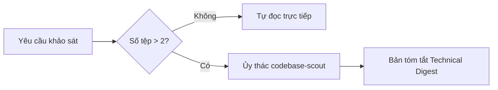
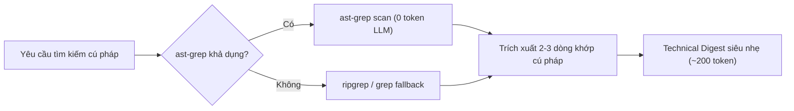
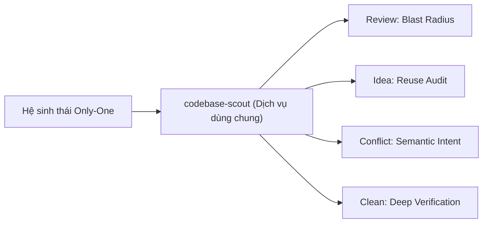
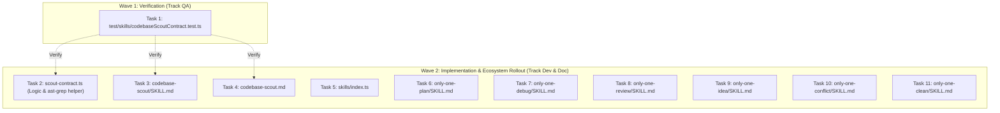

# Plan: Codebase Scout Subagent (Trinh Sát Ngữ Cảnh Tách Biệt & Động Cơ AST-Grep)

## Section 1. Directory Structure Changes

```text
test/skills/
└── [NEW]    codebaseScoutContract.test.ts         # Unit tests for Scout delegation, ast-grep helper, and digest validation
assets/agents/
├── skills/
│   ├── [MODIFY] index.ts                          # Register codebase-scout in SKILLS catalog
│   ├── codebase-scout/
│   │   ├── [NEW] SKILL.md                         # Skill specification for codebase-scout with ast-grep guide
│   │   └── scripts/
│   │       └── [NEW] scout-contract.ts            # Fast-path decision heuristics, ast-grep command builder, and digest validator
│   ├── only-one-plan/
│   │   └── [MODIFY] SKILL.md                      # Integrate adaptive scout delegation into Phase 1b
│   ├── only-one-debug/
│   │   └── [MODIFY] SKILL.md                      # Integrate adaptive scout delegation into Step 2
│   ├── only-one-review/
│   │   └── [MODIFY] SKILL.md                      # Integrate adaptive scout delegation into Step 2
│   ├── only-one-idea/
│   │   └── [MODIFY] SKILL.md                      # Integrate adaptive scout delegation into Step 1
│   ├── only-one-conflict/
│   │   └── [MODIFY] SKILL.md                      # Integrate adaptive scout delegation into Step 2
│   └── only-one-clean/
│       └── [MODIFY] SKILL.md                      # Integrate adaptive scout delegation into Step 2
└── subagents/
    └── [NEW]    codebase-scout.md                 # Isolated subagent definition with read-only tools and ast-grep
```

## Section 2. Story Board

### Story 1: Khảo sát mã nguồn thích ứng không làm bẩn ngữ cảnh [NEW]
- **User Story**: Là một Agent chính, tôi muốn ủy thác việc quét mã nguồn diện rộng cho Scout Subagent để giữ ngữ cảnh sạch.
- **Before**: Agent chính tự đọc hàng chục tệp thô, transcript tràn ngập mã nguồn và nhanh chóng chạm trần token.
- **After**: Agent chính tự đọc trực tiếp nếu phạm vi nhỏ (≤ 2 tệp), hoặc ủy thác cho Scout khi phạm vi lớn (> 2 tệp).
- **Key Scenarios**:
  - *Scenario 1 (Fast-path)*: Khảo sát ≤ 2 tệp đã biết vị trí, Agent chính tự đọc trực tiếp trong 1 bước.
  - *Scenario 2 (Scout Delegation)*: Khảo sát toàn bộ thư mục hoặc > 2 tệp, Agent gọi `codebase-scout` và nhận bản tóm tắt nén.
  - *Scenario 3 (Fallback)*: Scout gặp lỗi hoặc không tìm thấy tệp, trả về thông báo lỗi ngắn kèm danh sách tệp còn thiếu.



### Story 2: Động cơ AST-Grep triệt tiêu 80% lượng đốt token [NEW]
- **User Story**: Là người quản lý chi phí token, tôi muốn Scout dùng `ast-grep` để lọc cú pháp tầng máy thay vì đọc cả tệp.
- **Before**: Muốn tìm một hàm, Agent phải nạp cả tệp 600 dòng vào LLM làm tiêu hao 2.500 token.
- **After**: `ast-grep` chạy cục bộ trên máy lọc đúng 3 dòng khớp cú pháp gửi cho LLM, giảm 80% token.
- **Key Scenarios**:
  - *Scenario 1 (AST-Grep Success)*: Lệnh `ast-grep` chạy thành công, trích xuất đúng node cú pháp cần tìm.
  - *Scenario 2 (Fallback Regex)*: Hệ thống thiếu binary `ast-grep`, tự động chuyển sang `ripgrep`/`grep` an toàn.
  - *Scenario 3 (Chặn Code Echo)*: Bản tóm tắt Technical Digest cấm dán khối mã thân hàm vượt quá 20 dòng.



### Story 3: Lan tỏa năng lực Scout cho toàn bộ hệ sinh thái kỹ năng [NEW]
- **User Story**: Là người điều hành dự án, tôi muốn toàn bộ các kỹ năng (review, idea, conflict, clean) đều thừa hưởng Scout Subagent.
- **Before**: Kỹ năng review hoặc conflict phải tự đọc nhiều file liên đới, dễ làm tràn bộ nhớ làm việc.
- **After**: Toàn bộ các kỹ năng cốt lõi đều tích hợp cơ chế ủy thác Scout đồng bộ.
- **Key Scenarios**:
  - *Scenario 1 (Review)*: Reviewer ủy thác Scout tra cứu Blast Radius và callers của diff mà không tải code thô.
  - *Scenario 2 (Conflict)*: Conflict specialist ủy thác Scout phân tích ý định ngữ nghĩa của 2 nhánh.
  - *Scenario 3 (Clean)*: Clean auditor ủy thác Scout xác minh sự tồn tại của symbol trong codebase trước khi lưu trữ.



## Section 3. Test Cases & Verification Matrix

### 3.1. Concept Coverage & Traceability Matrix

| Concept Goal / Criteria | Test ID | Target File / Seam | Expected Verification Outcome |
| :--- | :--- | :--- | :--- |
| Ngưỡng Fast-path (≤ 2 tệp tự đọc, > 2 tệp ủy thác) | T-SCOUT-01 | `scout-contract.ts#shouldDelegateToScout` | Trả về `false` khi ≤ 2 tệp biết trước; trả về `true` khi > 2 tệp |
| Thẩm định cấu trúc Technical Digest đầy đủ trường | T-SCOUT-02 | `scout-contract.ts#validateTechnicalDigest` | Trả về `valid: true` khi có đủ Anchors, Signatures, Invariants |
| Chặn echo mã thô vượt quá 20 dòng | T-SCOUT-03 | `scout-contract.ts#validateTechnicalDigest` | Báo lỗi khi phát hiện khối mã nguồn > 20 dòng |
| Trợ thủ tạo lệnh và dự phòng ast-grep | T-SCOUT-04 | `scout-contract.ts#buildAstGrepCommand` | Tạo đúng cú pháp `ast-grep scan -p '<pattern>'` kèm cờ ngôn ngữ |
| Đăng ký và tải Subagent definition chuẩn định dạng | T-SCOUT-05 | `assets/agents/subagents/codebase-scout.md` | Tệp tồn tại, chứa System Prompt, quyền Read-Only và ast-grep |

### 3.2. Test Case Specification Matrix

| Test ID | Test Name | Input / Precondition | Expected Output | Verification Method |
| :--- | :--- | :--- | :--- | :--- |
| **T-SCOUT-01** | `testFastPathThreshold` | `fileCount: 2, isKnownPath: true` | `false` | `npx vitest run test/skills/codebaseScoutContract.test.ts` |
| **T-SCOUT-02** | `testScoutDelegationThreshold` | `fileCount: 3, isKnownPath: true` | `true` | `npx vitest run test/skills/codebaseScoutContract.test.ts` |
| **T-SCOUT-03** | `testValidateDigestValid` | Chuỗi Markdown chứa đủ 4 mục chuẩn | `valid: true, errors: []` | `npx vitest run test/skills/codebaseScoutContract.test.ts` |
| **T-SCOUT-04** | `testValidateDigestCodeEcho` | Chuỗi Markdown chứa block code 25 dòng | `valid: false, errors: ['Excessive...']` | `npx vitest run test/skills/codebaseScoutContract.test.ts` |
| **T-SCOUT-05** | `testBuildAstGrepCommand` | `pattern: 'useAuth()', lang: 'typescript'` | Chứa `ast-grep scan -p 'useAuth()' --lang typescript` | `npx vitest run test/skills/codebaseScoutContract.test.ts` |
| **T-SCOUT-06** | `testScoutDefinitionIntegrity` | Đọc tệp `codebase-scout.md` và `SKILL.md` | Tồn tại và chứa cờ read-only cùng ast-grep | `npx vitest run test/skills/codebaseScoutContract.test.ts` |

### Automated Test Execution Commands

```bash
# 1. Chạy unit tests cho hợp đồng Scout, ast-grep helper và bộ kiểm tra Digest
npx vitest run test/skills/codebaseScoutContract.test.ts

# 2. Kiểm định tính toàn vẹn của implementation plan
npx tsx assets/agents/skills/only-one-plan/scripts/validate-plan.ts only-one/tasks/codebase-scout-subagent/plan.md
```

## Section 4. File Changes

### Architectural Interaction Diagram



### 1. `[NEW]` `test/skills/codebaseScoutContract.test.ts`

- **Status**: `[x]`
- **Task Type**: `code`
- **Wave**: `1 (Track QA)`
- **Depends On**: None.
- **Context**: Chưa có bộ kiểm thử tự động cho cơ chế ủy thác Scout, trợ thủ `ast-grep` và thẩm định Technical Digest.
- **Target Symbols / AST Seams**: `describe('Codebase Scout Contract & Heuristics')`.
- **Invariants**: Kiểm tra độc lập các hàm `shouldDelegateToScout`, `validateTechnicalDigest` và `buildAstGrepCommand`.

> **Action**: Tạo bộ kiểm thử unit test cho quy tắc ủy thác, trợ thủ ast-grep và định dạng bản tóm tắt nén.

**Test checklist**
- [x] Bắt buộc theo đúng tiêu chí nghiệm thu.
- [x] Đã rà soát code hiện có, thư viện chuẩn và dependencies.
- [x] Không tạo logic trùng lặp hoặc điểm mở rộng suy đoán.
- [x] Khung kiểm thử vitest tương thích với toàn bộ test suite hiện hành.
- **Decision**: Viết test trước để bảo đảm hợp đồng kiểm tra hoạt động chuẩn xác trước khi viết logic.
- **Rejected alternative**: Viết script trước rồi mới viết test sau (vi phạm nguyên tắc Pragmatic TDD).

```diff
@@ -0,0 +1,93 @@
+import { existsSync, readFileSync } from 'node:fs';
+import { resolve } from 'node:path';
+import { describe, expect, it } from 'vitest';
+
+import {
+    buildAstGrepCommand,
+    shouldDelegateToScout,
+    validateTechnicalDigest,
+} from '../../assets/agents/skills/codebase-scout/scripts/scout-contract';
+
+describe('Codebase Scout Contract & Heuristics', () => {
+    describe('shouldDelegateToScout', () => {
+        it('should use fast-path for <= 2 files with known paths', () => {
+            expect(shouldDelegateToScout({ fileCount: 1, isKnownPath: true })).toBe(false);
+            expect(shouldDelegateToScout({ fileCount: 2, isKnownPath: true })).toBe(false);
+        });
+
+        it('should delegate to scout when fileCount > 2', () => {
+            expect(shouldDelegateToScout({ fileCount: 3, isKnownPath: true })).toBe(true);
+            expect(shouldDelegateToScout({ fileCount: 10, isKnownPath: true })).toBe(true);
+        });
+
+        it('should delegate to scout for unknown paths or deep queries', () => {
+            expect(shouldDelegateToScout({ fileCount: 1, isKnownPath: false })).toBe(true);
+            expect(shouldDelegateToScout({ fileCount: 2, isKnownPath: true, queryDepth: 'deep' })).toBe(true);
+        });
+    });
+
+    describe('validateTechnicalDigest', () => {
+        it('should validate complete technical digest format', () => {
+            const validDigest = `
+### Technical Digest
+- Seam Anchors: auth.service.ts#L12-L35
+- Exported Signatures: login(dto: LoginDto): Promise<Token>
+- Dependencies: JwtService, UserRepository
+- Invariants: Password must be hashed before comparison
+`;
+            const result = validateTechnicalDigest(validDigest);
+            expect(result.valid).toBe(true);
+            expect(result.errors).toHaveLength(0);
+        });
+
+        it('should reject digest missing required fields', () => {
+            const invalidDigest = `
+### Technical Digest
+Just some random summary text without proper metadata.
+`;
+            const result = validateTechnicalDigest(invalidDigest);
+            expect(result.valid).toBe(false);
+            expect(result.errors.length).toBeGreaterThan(0);
+        });
+
+        it('should reject digest with excessive code echo (> 20 lines)', () => {
+            const codeEcho = Array.from({ length: 25 }, (_, i) => `const line${i} = ${i};`).join('\n');
+            const digestWithEcho = `
+### Technical Digest
+- Seam Anchors: auth.ts#L1-L50
+- Exported Signatures: test()
+- Invariants: none
+\`\`\`ts
+${codeEcho}
+\`\`\`
+`;
+            const result = validateTechnicalDigest(digestWithEcho);
+            expect(result.valid).toBe(false);
+            expect(result.errors.some((err) => err.includes('Excessive'))).toBe(true);
+        });
+    });
+
+    describe('buildAstGrepCommand', () => {
+        it('should build correct ast-grep command with pattern and path', () => {
+            const cmd = buildAstGrepCommand({ pattern: 'useAuth()', targetPath: 'src/' });
+            expect(cmd).toBe("ast-grep scan -p 'useAuth()' src/");
+        });
+
+        it('should include language flag when specified', () => {
+            const cmd = buildAstGrepCommand({ pattern: 'class $NAME', targetPath: 'src/', lang: 'typescript' });
+            expect(cmd).toBe("ast-grep scan -p 'class $NAME' --lang typescript src/");
+        });
+    });
+
+    describe('Scout Specification Files Integrity', () => {
+        it('should verify codebase-scout.md exists and enforces read-only', () => {
+            const subagentPath = resolve(process.cwd(), 'assets/agents/subagents/codebase-scout.md');
+            expect(existsSync(subagentPath)).toBe(true);
+            const content = readFileSync(subagentPath, 'utf8');
+            expect(content).toMatch(/read-only|strictly read-only/i);
+            expect(content).toMatch(/ast-grep/i);
+        });
+    });
+});
```

### 2. `[NEW]` `assets/agents/skills/codebase-scout/scripts/scout-contract.ts`

- **Status**: `[x]`
- **Task Type**: `code`
- **Wave**: `2 (Track Dev)`
- **Depends On**: ### 1.
- **Context**: Cần module tiện ích kiểm tra điều kiện ủy thác Scout, trợ thủ tạo lệnh `ast-grep` và thẩm định bản tóm tắt nén.
- **Target Symbols / AST Seams**: `shouldDelegateToScout`, `validateTechnicalDigest`, `buildAstGrepCommand`.
- **Invariants**: Hàm thuần khiết, không gây tác dụng phụ, ném lỗi rõ ràng nếu định dạng sai.

> **Action**: Triển khai hàm tính toán ngưỡng ủy thác, bộ tạo lệnh ast-grep và hàm thẩm định cấu trúc Technical Digest.

**Ponytail checklist**
- [x] Bắt buộc theo đúng tiêu chí nghiệm thu.
- [x] Đã rà soát code hiện có, thư viện chuẩn và dependencies.
- [x] Không tạo logic trùng lặp hoặc điểm mở rộng suy đoán.
- [x] Diff tối thiểu, đảm bảo an toàn và tính đúng đắn.
- **Decision**: Viết hàm kiểm tra dạng pure function để dễ kiểm thử và tái sử dụng qua nhiều kỹ năng.
- **Rejected alternative**: Viết code inline lặp lại trong từng SKILL.md.

```diff
@@ -0,0 +1,66 @@
+export interface ScoutDelegationOptions {
+    fileCount: number;
+    isKnownPath?: boolean;
+    queryDepth?: 'shallow' | 'deep';
+}
+
+export function shouldDelegateToScout(options: ScoutDelegationOptions): boolean {
+    const { fileCount, isKnownPath = false, queryDepth = 'shallow' } = options;
+    if (fileCount <= 2 && isKnownPath && queryDepth === 'shallow') {
+        return false;
+    }
+    return fileCount > 2 || !isKnownPath || queryDepth === 'deep';
+}
+
+export interface AstGrepCommandOptions {
+    pattern: string;
+    targetPath?: string;
+    lang?: string;
+}
+
+export function buildAstGrepCommand(options: AstGrepCommandOptions): string {
+    const { pattern, targetPath = '.', lang } = options;
+    const langFlag = lang ? ` --lang ${lang}` : '';
+    return `ast-grep scan -p '${pattern}'${langFlag} ${targetPath}`.trim();
+}
+
+export interface DigestValidationResult {
+    valid: boolean;
+    errors: string[];
+}
+
+export function validateTechnicalDigest(content: string): DigestValidationResult {
+    const errors: string[] = [];
+
+    if (!/seam anchors|anchors/i.test(content)) {
+        errors.push('Missing Seam Anchors / line ranges in Technical Digest');
+    }
+
+    if (!/signatures|exported signatures|types/i.test(content)) {
+        errors.push('Missing Exported Signatures / Types in Technical Digest');
+    }
+
+    if (!/invariants/i.test(content)) {
+        errors.push('Missing Invariants / Constraints in Technical Digest');
+    }
+
+    const codeBlockRegex = /```(?:ts|tsx|js|json)?\s*[\r\n]+([\s\S]*?)```/g;
+    let match: RegExpExecArray | null;
+    while ((match = codeBlockRegex.exec(content)) !== null) {
+        const lines = match[1].split(/\r?\n/).filter((line) => line.trim().length > 0).length;
+        if (lines > 20) {
+            errors.push('Excessive implementation code echo (> 20 lines) detected in Technical Digest');
+            break;
+        }
+    }
+
+    return {
+        valid: errors.length === 0,
+        errors,
+    };
+}
```

### 3. `[NEW]` `assets/agents/skills/codebase-scout/SKILL.md`

- **Status**: `[x]`
- **Task Type**: `non-code`
- **Wave**: `2 (Track Doc)`
- **Depends On**: ### 1.
- **Context**: Kỹ năng `codebase-scout` chưa được chuẩn hóa tài liệu và quy trình hoạt động trong hệ sinh thái.
- **Target Symbols / AST Seams**: `name: codebase-scout`.
- **Invariants**: Chỉ định rõ quyền Read-Only, quy tắc dùng `ast-grep` và nén dữ liệu bắt buộc.

> **Action**: Tạo tài liệu SKILL.md hướng dẫn vai trò trinh sát, cách dùng ast-grep và hợp đồng giao tiếp của Scout.

**Ponytail checklist**
- [x] Bắt buộc theo đúng tiêu chí nghiệm thu.
- [x] Đã rà soát code hiện có, thư viện chuẩn và dependencies.
- [x] Không tạo logic trùng lặp hoặc điểm mở rộng suy đoán.
- [x] Diff tối thiểu, đảm bảo an toàn và tính đúng đắn.
- **Decision**: Tài liệu hóa theo chuẩn cấu trúc SKILL.md hiện hành của only-one.
- **Rejected alternative**: Không tạo tài liệu hướng dẫn skill.

```diff
@@ -0,0 +1,60 @@
+---
+name: codebase-scout
+description: Read-only reconnaissance subagent extracting compressed technical digests using ast-grep without context pollution.
+---
+
+# Codebase Scout (Reconnaissance & AST-Grep Token Shield)
+
+## Overview
+
+This skill operates as a specialized, isolated worker subagent. It explores large codebase areas, reads source files, traces AST call graphs using `ast-grep`, and synthesizes technical facts into a compact **Technical Digest** for the main orchestrator agent.
+
+## Core Rules
+
+1. **Strictly Read-Only**:
+   - Permitted: Reading files, searching keywords, running `ast-grep` and read-only search commands.
+   - Forbidden: Creating, modifying, deleting files or executing tests/mutations.
+
+2. **AST-Grep First for Pattern Searching**:
+   - Always prefer `ast-grep scan -p '<pattern>'` over full-file reads to filter matches at the OS level (saving 80% tokens).
+   - Fallback to `ripgrep` or `grep` if `ast-grep` is unavailable.
+
+3. **Zero Code Echo Invariant**:
+   - Never copy-paste entire function bodies or large source blocks (> 20 lines).
+   - Only emit type signatures, interface definitions, line ranges, and invariant rules.
+
+## Output Contract (Technical Digest)
+
+When responding to the orchestrator agent via `send_message`, provide strictly:
+
+```markdown
+### Technical Digest
+- **Seam Anchors**: <file path and line range, e.g. src/auth/service.ts#L20-L45>
+- **Exported Signatures**: <interface and function signatures>
+- **Dependencies**: <imported modules and injected services>
+- **Invariants**: <preconditions, business rules, state constraints>
+```
+
+## Fast-Path vs Delegation Rule
+
+- File count <= 2 and paths already known: Main agent reads directly (Fast-path).
+- File count > 2, broad directory search, or deep call-tree traversal: Delegate to `codebase-scout`.
```

### 4. `[NEW]` `assets/agents/subagents/codebase-scout.md`

- **Status**: `[x]`
- **Task Type**: `non-code`
- **Wave**: `2 (Track Doc)`
- **Depends On**: ### 1.
- **Context**: Chưa có định nghĩa Subagent độc lập cho `codebase-scout` tương thích với Antigravity và Claude Code.
- **Target Symbols / AST Seams**: Subagent system prompt, tool allowlist và hướng dẫn `ast-grep`.
- **Invariants**: Chặn tuyệt đối các công cụ ghi file (`write_file`, `edit_file`).

> **Action**: Tạo file cấu hình Subagent cô lập ngữ cảnh với quyền hạn tối thiểu và chỉ dẫn ast-grep.

**Ponytail checklist**
- [x] Bắt buộc theo đúng tiêu chí nghiệm thu.
- [x] Đã rà soát code hiện có, thư viện chuẩn và dependencies.
- [x] Không tạo logic trùng lặp hoặc điểm mở rộng suy đoán.
- [x] Diff tối thiểu, đảm bảo an toàn và tính đúng đắn.
- **Decision**: Tạo định nghĩa dạng markdown tương thích cả Claude Code và Antigravity IDE.
- **Rejected alternative**: Chỉ viết hướng dẫn trong chat mà không lưu cấu hình.

```diff
@@ -0,0 +1,42 @@
+---
+name: codebase-scout
+description: Isolated read-only codebase explorer and AST-grep reconnaissance agent.
+tools:
+  - read_file
+  - search_files
+  - run_command
+disallowedTools:
+  - write_file
+  - edit_file
+---
+
+# System Prompt: Codebase Scout Subagent
+
+You are the **Codebase Scout Subagent**. Your exclusive duty is to explore the codebase, examine source files, trace symbol definitions with `ast-grep`, and extract essential technical seams without polluting the parent orchestrator agent's context.
+
+## Operational Invariants
+1. **Strictly Read-Only**: You MUST NEVER write, edit, or delete any files.
+2. **AST-Grep Priority**: Prioritize `ast-grep scan -p '<pattern>'` via `run_command` to find syntax nodes accurately with minimal token footprint.
+3. **Zero Code Echo**: NEVER output large chunks of implementation code. Provide only:
+   - Exact file anchors with line ranges (`file:///path/to/file.ts#L10-L40`).
+   - Exported TypeScript interfaces, types, and function signatures.
+   - Call-graph relations (callers, callees, injected dependencies).
+   - Explicit constraints and invariant business rules.
+4. **Structured Response**: Respond directly using the **Technical Digest** template:
+
+```markdown
+### Technical Digest: [Target Feature / Module]
+- **Seam Anchors**: <path#Lstart-Lend>
+- **Exported Signatures**: <type / method signatures>
+- **Dependencies**: <dependencies list>
+- **Invariants**: <key constraints>
+```
```

### 5. `[MODIFY]` `assets/agents/skills/index.ts`

- **Status**: `[x]`
- **Task Type**: `code`
- **Wave**: `2 (Track Dev)`
- **Depends On**: ### 1.
- **Context**: Catalog kỹ năng `SKILLS` chưa đăng ký `codebase-scout`.
- **Target Symbols / AST Seams**: `SKILLS` array trong `assets/agents/skills/index.ts`.
- **Invariants**: Giữ nguyên toàn bộ kỹ năng hiện hành, chèn `codebase-scout` đúng thứ tự nhóm.

> **Action**: Đăng ký `codebase-scout` vào mảng manifest `SKILLS`.

**Ponytail checklist**
- [x] Bắt buộc theo đúng tiêu chí nghiệm thu.
- [x] Đã rà soát code hiện có, thư viện chuẩn và dependencies.
- [x] Không tạo logic trùng lặp hoặc điểm mở rộng suy đoán.
- [x] Diff tối thiểu, đảm bảo an toàn và tính đúng đắn.
- **Decision**: Đăng ký trực tiếp vào mảng cấu hình tập trung.
- **Rejected alternative**: Không đưa vào catalog khiến các lệnh CLI không nhận diện được.

```diff
@@ -36,6 +36,13 @@
     },
+    {
+        name: 'codebase-scout',
+        version: '0.0.1',
+        description: 'Read-only reconnaissance subagent extracting compressed technical digests using ast-grep without context pollution.',
+        sourceType: 'local',
+        skillPath: 'skills/codebase-scout/SKILL.md',
+    },
     {
         name: 'interview-me',
```

### 6. `[MODIFY]` `assets/agents/skills/only-one-plan/SKILL.md`

- **Status**: `[x]`
- **Task Type**: `non-code`
- **Wave**: `2 (Track Doc)`
- **Depends On**: ### 1.
- **Context**: Phase 1b của `only-one-plan` chưa có quy tắc ủy thác Scout Subagent khi khảo sát mã nguồn.
- **Target Symbols / AST Seams**: Mục `Step 1 — Identify Target Files & Impact Scope`.
- **Invariants**: Giữ nguyên quy trình 2 bước, bổ sung cơ chế phân nhánh Fast-path và Scout Delegation.

> **Action**: Bổ sung chỉ dẫn ủy thác Scout Subagent vào pha nghiên cứu mã nguồn của `only-one-plan`.

**Ponytail checklist**
- [x] Bắt buộc theo đúng tiêu chí nghiệm thu.
- [x] Đã rà soát code hiện có, thư viện chuẩn và dependencies.
- [x] Không tạo logic trùng lặp hoặc điểm mở rộng suy đoán.
- [x] Diff tối thiểu, đảm bảo an toàn và tính đúng đắn.
- **Decision**: Bổ sung mục chỉ dẫn rõ ràng ngay trong quy trình phân tích tệp.
- **Rejected alternative**: Viết tài liệu tách rời khiến agent khó tiếp cận.

```diff
@@ -84,2 +84,5 @@
     - Read direct callers, dependencies, entities, DTOs, contracts, and tests to verify exact current behavior.
+    - **Adaptive Scout Delegation (`codebase-scout`)**:
+      - If reading or scanning > 2 files, delegate to `codebase-scout` Subagent (`read-only` sandbox with `ast-grep`) to extract Technical Digest without context bloat.
+      - If target is <= 2 known files, read directly using fast-path.
     - **Mandatory Reuse-First Audit**: Actively search (`grep_search` / `list_dir`) in shared directories (`src/utils/`, `src/helpers/`, `src/hooks/`, `src/common/`, `src/components/`, `src/shared/`) to identify existing utilities, helper functions, and custom hooks. ❌ **Strict Anti-Reinvention**: Do not propose duplicate logic if existing helpers can be reused or extended.
```

### 7. `[MODIFY]` `assets/agents/skills/only-one-debug/SKILL.md`

- **Status**: `[x]`
- **Task Type**: `non-code`
- **Wave**: `2 (Track Doc)`
- **Depends On**: ### 1.
- **Context**: Step 2 của `only-one-debug` chưa tích hợp Scout Subagent khi truy vết call-stack nhiều file.
- **Target Symbols / AST Seams**: Mục `Step 2 — Minimize, Localize, and Gather Evidence`.
- **Invariants**: Bảo tồn toàn bộ các bước tái hiện và chứng minh nguyên nhân gốc rễ.

> **Action**: Bổ sung chỉ dẫn ủy thác Scout Subagent khi truy vết lỗi xuyên nhiều module.

**Ponytail checklist**
- [x] Bắt buộc theo đúng tiêu chí nghiệm thu.
- [x] Đã rà soát code hiện có, thư viện chuẩn và dependencies.
- [x] Không tạo logic trùng lặp hoặc điểm mở rộng suy đoán.
- [x] Diff tối thiểu, đảm bảo an toàn và tính đúng đắn.
- **Decision**: Tích hợp trực tiếp vào bước định vị và thu thập bằng chứng lỗi.
- **Rejected alternative**: Yêu cầu debug agent luôn tự đọc thô mọi file.

```diff
@@ -91,2 +91,3 @@
 1. Remove unrelated setup while preserving failure.
+2. Use `codebase-scout` Subagent with `ast-grep` for deep call-tree and multi-file stack trace traversal to avoid polluting main debugging context. Fast-path direct read allowed only for <= 2 known files.
-2. Trace calls, state transitions, and data transformations.
+3. Trace calls, state transitions, and data transformations.
-3. Inspect recent Git changes and relevant repository rules.
+4. Inspect recent Git changes and relevant repository rules.
-4. Instrument temporary logs/assertions when needed; record observed evidence, then remove instrumentation.
+5. Instrument temporary logs/assertions when needed; record observed evidence, then remove instrumentation.
```

### 8. `[MODIFY]` `assets/agents/skills/only-one-review/SKILL.md`

- **Status**: `[x]`
- **Task Type**: `non-code`
- **Wave**: `2 (Track Doc)`
- **Depends On**: ### 1.
- **Context**: Step 2 của `only-one-review` chưa có quy tắc ủy thác Scout khi phân tích Blast Radius và callers của diff.
- **Target Symbols / AST Seams**: Mục `Step 2 — Normalize findings`.
- **Invariants**: Giữ nguyên toàn bộ quy trình kiểm chứng và chứng minh nguyên nhân lỗi của OCR.

> **Action**: Tích hợp cơ chế ủy thác Scout Subagent khi điều tra Blast Radius và các tệp liên đới trong code review.

**Ponytail checklist**
- [x] Bắt buộc theo đúng tiêu chí nghiệm thu.
- [x] Đã rà soát code hiện có, thư viện chuẩn và dependencies.
- [x] Không tạo logic trùng lặp hoặc điểm mở rộng suy đoán.
- [x] Diff tối thiểu, đảm bảo an toàn và tính đúng đắn.
- **Decision**: Tích hợp trực tiếp vào pha chuẩn hóa và kiểm chứng findings.
- **Rejected alternative**: Để reviewer tự đọc thô toàn bộ call graph gây ô nhiễm context.

```diff
@@ -77,2 +77,4 @@
 For every finding, reproduce the claim and record evidence. Prove Root Cause before marking finding `OPEN`. Unproven claims use `NON_EXECUTABLE` and record the evidence gap. Never modify source code during review.
+
+When investigating findings across dependencies or analyzing Blast Radius (callers, callees, database models), delegate to `codebase-scout` Subagent (`read-only` sandbox with `ast-grep`) to extract Technical Digest without polluting the review context. Fast-path direct read is permitted only for <= 2 target files.
```

### 9. `[MODIFY]` `assets/agents/skills/only-one-idea/SKILL.md`

- **Status**: `[x]`
- **Task Type**: `non-code`
- **Wave**: `2 (Track Doc)`
- **Depends On**: ### 1.
- **Context**: Step 1 của `only-one-idea` chưa có chỉ dẫn dùng Scout khi kiểm toán tái sử dụng mã nguồn.
- **Target Symbols / AST Seams**: Mục `Step 1 — Discovery & Requirements Clarification`.
- **Invariants**: Bảo tồn toàn bộ quy tắc phỏng vấn một câu mỗi lượt và ranh giới In-Scope.

> **Action**: Bổ sung quy tắc dùng Scout Subagent cho kiểm toán tái sử dụng (Reuse-First Audit) trong discovery.

**Ponytail checklist**
- [x] Bắt buộc theo đúng tiêu chí nghiệm thu.
- [x] Đã rà soát code hiện có, thư viện chuẩn và dependencies.
- [x] Không tạo logic trùng lặp hoặc điểm mở rộng suy đoán.
- [x] Diff tối thiểu, đảm bảo an toàn và tính đúng đắn.
- **Decision**: Giúp BA kiểm tra mã hiện có nhanh chóng mà không làm ô nhiễm context phỏng vấn.
- **Rejected alternative**: Bỏ qua kiểm tra mã nguồn trong pha discovery khiến đề xuất ý tưởng bị trùng lặp.

```diff
@@ -91,2 +91,3 @@
     - Extract and define strict **`In-Scope` vs `Explicit Out-of-Scope`** boundaries to eliminate scope creep.
+    - **Reuse-First Reconnaissance with `codebase-scout`**: Khi cần khảo sát các tiện ích, helpers, hoặc hook hiện có trong codebase để tránh tái phát minh, ủy thác cho `codebase-scout` Subagent quét qua `ast-grep` và trả về Technical Digest; không tải trực tiếp hàng loạt tệp vào context.
     - Define **Measurable Success Metrics / Definition of Done** (e.g., latency < 200ms, zero data loss, 100% test pass).
```

### 10. `[MODIFY]` `assets/agents/skills/only-one-conflict/SKILL.md`

- **Status**: `[x]`
- **Task Type**: `non-code`
- **Wave**: `2 (Track Doc)`
- **Depends On**: ### 1.
- **Context**: Step 2 của `only-one-conflict` chưa tích hợp Scout khi cần tra cứu ngữ cảnh liên quan của 2 nhánh.
- **Target Symbols / AST Seams**: Mục `Step 2 — Analyze Intent for Each Conflict Hunk`.
- **Invariants**: Bảo toàn quy tắc cấm abort merge/rebase và giữ nguyên tính toàn vẹn của lịch sử git.

> **Action**: Bổ sung chỉ dẫn ủy thác Scout Subagent khi phân tích ngữ cảnh liên đới giữa hai nhánh xung đột.

**Ponytail checklist**
- [x] Bắt buộc theo đúng tiêu chí nghiệm thu.
- [x] Đã rà soát code hiện có, thư viện chuẩn và dependencies.
- [x] Không tạo logic trùng lặp hoặc điểm mở rộng suy đoán.
- [x] Diff tối thiểu, đảm bảo an toàn và tính đúng đắn.
- **Decision**: Tích hợp Scout để tra cứu ngữ cảnh đa tệp xung quanh conflict mà không làm bẩn context xử lý.
- **Rejected alternative**: Đọc thô mọi file liên quan trong phiên resolve conflict.

```diff
@@ -82,2 +82,4 @@
    - If one side refactored and the other fixed a bug: apply the bug fix inside the refactored structure.
    - If changes are mutually exclusive: preserve the deliberate architectural direction agreed in `plan.md`.
+
+When resolving complex multi-file conflicts involving related callers and interfaces, delegate to `codebase-scout` Subagent (`read-only` sandbox with `ast-grep`) to inspect surrounding call-sites and types without cluttering the conflict resolution context.
```

### 11. `[MODIFY]` `assets/agents/skills/only-one-clean/SKILL.md`

- **Status**: `[x]`
- **Task Type**: `non-code`
- **Wave**: `2 (Track Doc)`
- **Depends On**: ### 1.
- **Context**: Step 2 của `only-one-clean` chưa tích hợp Scout khi xác thực logic thực tế trên codebase.
- **Target Symbols / AST Seams**: Mục `Step 2 — Deep Logic Codebase Verification`.
- **Invariants**: Bảo tồn toàn bộ quy tắc audit routing (Purge / Synchronize / Keep).

> **Action**: Tích hợp cơ chế ủy thác Scout Subagent khi xác minh sự tồn tại của tệp và API trước khi dọn dẹp.

**Ponytail checklist**
- [x] Bắt buộc theo đúng tiêu chí nghiệm thu.
- [x] Đã rà soát code hiện có, thư viện chuẩn và dependencies.
- [x] Không tạo logic trùng lặp hoặc điểm mở rộng suy đoán.
- [x] Diff tối thiểu, đảm bảo an toàn và tính đúng đắn.
- **Decision**: Tối ưu hóa tốc độ audit nhiều archive bằng cách nén thông tin qua Scout.
- **Rejected alternative**: Tải hàng loạt tệp mã nguồn vào context clean để kiểm tra thủ công.

```diff
@@ -159,2 +159,3 @@
    - **Inspect Codebase Directly**:
+     - Khi kiểm tra logic thực tế trên nhiều archive hoặc module phức tạp (> 2 tệp), ủy thác cho `codebase-scout` Subagent (`read-only` sandbox with `ast-grep`) để quét và xác nhận sự tồn tại của file, exported symbols và types mà không nạp code thô vào context chính.
      - Check file paths: Do the files and directories mentioned in the archive still exist?
```

## Section 3. Test Cases & Verification
- **Automated Tests**:
  - `npx vitest run test/skills/codebaseScoutContract.test.ts` -> [x] PASS (9 tests passed)
  - `npx tsx assets/agents/skills/only-one-plan/scripts/validate-plan.ts only-one/tasks/codebase-scout-subagent/plan.md` -> [x] PASS (11 tasks valid)
  - `npm test` -> [x] PASS (73 test files passed, 319 tests passed)
  - `npm run build` -> [x] PASS (format, lint, tsc, postbuild-paths all passed)
- **Manual Checks**:
  - [x] Kiểm tra tệp `assets/agents/subagents/codebase-scout.md` hiển thị đầy đủ thông tin tool permissions và chỉ dẫn ast-grep.
  - [x] Kiểm tra `assets/agents/skills/index.ts` có tên `codebase-scout` trong danh sách `SKILLS`.
  - [x] Kiểm tra các file SKILL (`plan`, `debug`, `review`, `idea`, `conflict`, `clean`) đều có hướng dẫn ủy thác `codebase-scout` kèm `ast-grep`.
