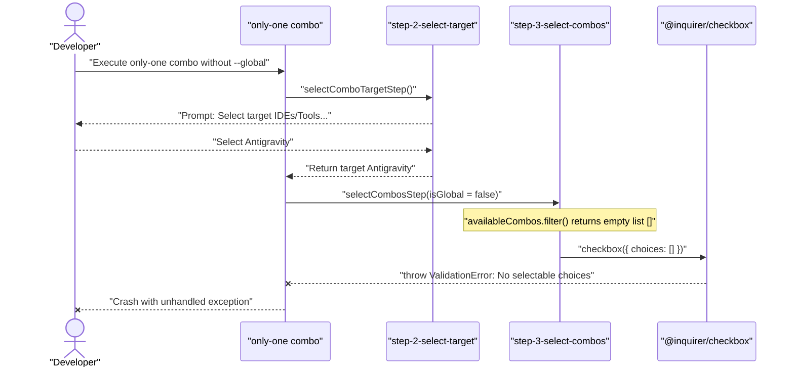

# Debug: Checkbox Prompt Crash When No Compatible Combos Exist

## Section 1. Diagnosis & Directory Structure Changes

### Symptom
- **Actual**: Running `only-one combo` without `--global` crashes with `ValidationError: [checkbox prompt] No selectable choices. All choices are disabled.` after selecting target tool.
- **Expected**: Notify user that no compatible combos exist in local mode, provide `--global` hint, and exit cleanly without crashing.
- **Blast Radius**: Affects interactive execution of `only-one combo` in local project mode across all IDE targets.

### Reproduction
- **Trigger**: Run `only-one combo` in interactive mode in project directory without `-g` / `--global`.
- **Red Test**: `test/commands/combo/combo.test.ts` -> `it('handles interactive combo selection gracefully when no compatible combos exist for the scope')`.
- **Command**: `npx vitest run test/commands/combo/combo.test.ts -t "handles interactive combo selection gracefully when no compatible combos exist"`.

### Evidence
- **Observed Facts**:
  1. Built-in combos in `assets/agents/combos/index.ts` specify `scope: 'global'`.
  2. `isComboScopeMatch(combo, false)` filters out all global combos in local project mode.
  3. `compatibleCombos` evaluates to empty list `[]`.
  4. `step-3-select-combos.ts` passes `choices: []` into `@inquirer/checkbox`.
  5. `@inquirer/checkbox` throws `ValidationError` when choice array is empty.
- **Fault Location**: `src/commands/combo/actions/step-3-select-combos.ts:31-67`.

### Root Cause
- **Mechanical Cause**: `selectCombosStep` does not verify `compatibleCombos.length` before calling `@inquirer/checkbox`. Empty choice arrays trigger immediate validation failure.
- **Trigger Mechanism**: Running `only-one combo` in local project mode filters out all global combos, generating empty prompt choices.
- **Violated Invariant**: Never invoke `@inquirer/checkbox` or any prompt with an empty choices array.

### Hypotheses Rejected
- *Hypothesis 1: Antigravity tool support was missing from combo manifests.*
  - **Disproven**: `assets/agents/combos/index.ts` contains `'antigravity'` in `supportedAgents` for all combos.
- *Hypothesis 2: An existing item had `disabled: true` set.*
  - **Disproven**: No manifest or code sets `disabled: true`. The error is caused by choice array having zero length.

### Fix Constraints
- Retain existing `--global` combo installation logic unchanged.
- Preserve positional combo arguments check in `createComboCommand`.
- Provide user-friendly advice suggesting `-g` / `--global` flag when local combos are absent.
- Ensure CLI exits cleanly with status code 0.

### Defect Call Trace / State Divergence Flow


### Directory Structure Changes
```text
src/commands/combo/actions/
└── [MODIFY] step-3-select-combos.ts       # Guard empty compatibleCombos and empty choices
test/commands/combo/
└── [MODIFY] combo.test.ts                 # Add Red regression reproduction test
```

## Section 2. Defect User Story & Reproduction Scenarios

### Story 1: Checkbox Prompt Crash When No Compatible Combos Exist [BUGFIX]
- **User Story**: Là lập trình viên chạy lệnh `only-one combo` không truyền cờ `--global`, tôi muốn nhận thông báo rõ ràng về phạm vi tương thích thay vì gặp lỗi sập process `ValidationError`.
- **Actual Defect Scenario**:
  - Khi chạy `only-one combo` chọn target Antigravity, bộ lọc loại bỏ toàn bộ combo do `scope: 'global'`.
  - Mảng lựa chọn rỗng truyền trực tiếp vào `@inquirer/checkbox` gây crash.
  - *Serving Files*:
    - `[TEST]` `test/commands/combo/combo.test.ts`
    - `[MODIFY]` `src/commands/combo/actions/step-3-select-combos.ts`
- **Expected Acceptance Scenario**:
  - Khi không có combo phù hợp trong local project mode, CLI in thông báo thân thiện và gợi ý cờ `-g / --global`.
  - CLI thoát an toàn với exit code 0 mà không crash.
  - *Serving Files*:
    - `[MODIFY]` `src/commands/combo/actions/step-3-select-combos.ts`

## Section 3. Test Cases & Verification Matrix

### 3.1. Defect & Invariant Traceability Matrix
| Tiêu chí Lỗi / Invariant | Mô tả Tái hiện / Ràng buộc | Test Cases / Tasks Đáp ứng | Trạng thái |
| :--- | :--- | :--- | :---: |
| **`DEF-1`** | `@inquirer/checkbox` crash với choices rỗng khi chạy local | `TC-01`, Task 1, Task 2 | 🟢 100% Phủ |
| **`INV-1`** | Không gọi prompt checkbox khi danh sách lựa chọn rỗng | `TC-01`, Task 2 | 🟢 100% Phủ |
| **`INV-2`** | Giữ nguyên xử lý positional argument và `--global` mode | `TC-02`, Task 2 | 🟢 100% Phủ |

### 3.2. Test Case Specification Matrix
| Test ID | Defect Ref | Story / Module | Tên Test Case (`it / test`) | Điều kiện / Dữ liệu đầu vào | Kết quả kỳ vọng (Assertions) | Loại test | Status |
| :--- | :--- | :--- | :--- | :--- | :--- | :--- | :---: |
| `TC-01` | `DEF-1` | Story 1 | `it('handles interactive combo selection gracefully when no compatible combos exist for the scope')` | `only-one combo --tool antigravity` (isGlobal = false) | Không crash; stdout chứa cảnh báo không có combo tương thích và gợi ý `-g / --global` | Integration | `[x]` |
| `TC-02` | `INV-2` | Story 1 | `it('applies a predefined combo setup successfully')` | `only-one combo backend-flow --global --tool cursor` | Thành công sao chép skill và in báo cáo | Regression | `[x]` |

### Automated Test Execution Commands
- Targeted reproduction test: `npx vitest run test/commands/combo/combo.test.ts -t "handles interactive combo selection gracefully when no compatible combos exist"` -> `PASS (1 passed, 5 skipped)`
- Full combo test suite: `npx vitest run test/commands/combo/combo.test.ts` -> `PASS (6 passed)`
- Repository test suite: `npm test` -> `PASS (75 test files passed, 335 tests passed)`
- Linter verification: `npm run lint` -> `PASS (0 errors, 178 warnings)`
- Code formatting: `npm run format:check` -> `PASS (Clean)`

## Section 4. File Changes

### 1. `[MODIFY]` `test/commands/combo/combo.test.ts`

- **Status**: `[x]`
- **Task Type**: `code`
- **Wave**: `1 (Track QA)`
- **Depends On**: None.
- **Context**: Add deterministic Red reproduction test verifying empty choice guard in interactive combo mode.
- **Target Symbols / AST Seams**: `describe('combo command')`.
- **Invariants**: Must assert stdout notification and clean exit without unhandled error.

> **Action**: Add regression test case for interactive execution with empty compatible combos.

**Test checklist**
- [x] Existing fixtures/helpers reused.
- [x] No duplicate setup.
- [x] Test covers changed behavior only.
- [x] Existing test toolchain used.
- **Decision**: Extend existing `combo.test.ts` with minimal mock prompt throwing on empty choices.
- **Rejected alternative**: Creating new separate test file adding unnecessary test file sprawl.

```diff
@@ -169,4 +169,37 @@ describe('combo command', () => {
             await rm(cwd, { recursive: true, force: true });
         }
     });
+
+    it('handles interactive combo selection gracefully when no compatible combos exist for the scope', async () => {
+        const cwd = await mkdtemp(join(tmpdir(), 'combo-empty-choices-'));
+        const writes: string[] = [];
+
+        try {
+            const program = createProgram({
+                cwd,
+                env: {},
+                fetcher: vi.fn(async () => ({ ok: true, json: async () => ({}) })),
+                stdout: (line) => writes.push(line),
+                prompts: {
+                    select: vi.fn().mockResolvedValue('antigravity'),
+                    checkbox: vi.fn(async (options) => {
+                        if (!options.choices || options.choices.length === 0) {
+                            throw new Error('[checkbox prompt] No selectable choices. All choices are disabled.');
+                        }
+
+                        return [];
+                    }),
+                },
+            });
+
+            await program.parseAsync(['combo', '--tool', 'antigravity'], { from: 'user' });
+
+            const output = writes.join('\n');
+            expect(output).toContain('No compatible combos found for Antigravity in local project mode');
+            expect(output).toContain('Tip: Predefined combos are scoped for global installation. Try running with -g / --global.');
+            expect(output).toContain('No combos selected. Exiting.');
+        } finally {
+            await rm(cwd, { recursive: true, force: true });
+        }
+    });
 });
```

### 2. `[MODIFY]` `src/commands/combo/actions/step-3-select-combos.ts`

- **Status**: `[x]`
- **Task Type**: `code`
- **Wave**: `2 (Track Dev)`
- **Depends On**: ### 1.
- **Context**: Guard against calling `@inquirer/checkbox` when candidate combos list is empty.
- **Target Symbols / AST Seams**: `selectCombosStep`.
- **Invariants**: Must preserve positional combo name parsing and retain `--global` behavior.

> **Action**: Check `selectedComboNames` early and guard `compatibleCombos.length` before creating choices.

**Ponytail checklist**
- [x] Required by proven root cause.
- [x] Existing implementation and dependencies searched.
- [x] No duplicate logic or speculative extension point.
- [x] Minimum diff preserves correctness and safety.
- **Decision**: Guard empty candidate combos list before calculating choices and prompt invocation.
- **Rejected alternative**: Catching ValidationError inside prompt wrapper, which masks underlying programming errors.

```diff
@@ -30,6 +30,20 @@ export const selectCombosStep = async (
     targetTools: AgentToolOption[],
     isGlobal = false,
 ): Promise<string[]> => {
+    const selectedComboNames = parseCsv(namesArg);
+
+    if (selectedComboNames?.length) {
+        return selectedComboNames;
+    }
+
+    const compatibleCombos = availableCombos.filter((combo) => isComboScopeMatch(combo, isGlobal) && isComboAgentMatch(combo, targetTools));
+
+    if (!compatibleCombos.length) {
+        deps.stdout(`No compatible combos found for ${targetTool.name} in ${isGlobal ? 'global' : 'local project'} mode.`);
+        if (!isGlobal) {
+            deps.stdout('Tip: Predefined combos are scoped for global installation. Try running with -g / --global.');
+        }
+
+        return [];
+    }
+
     const comboChecks = await Promise.all(
@@ -47,7 +61,5 @@ export const selectCombosStep = async (
         }),
     );
 
-    let selectedComboNames = parseCsv(namesArg);
-
-    if (!selectedComboNames?.length) {
+    let chosenNames: string[] = [];
         if (!deps.prompts?.checkbox) {
             throw new Error('Combo selection is required in non-interactive mode. Pass combo names positionally.');
         } else {
@@ -62,9 +74,9 @@ export const selectCombosStep = async (
             choices.sort((a, b) => Number(a.installationStatus === 'installed') - Number(b.installationStatus === 'installed'));
 
-            selectedComboNames = await deps.prompts.checkbox({
+            chosenNames = await deps.prompts.checkbox({
                 message: `Select combos to install for ${targetTool.name}:`,
                 choices: choices.map(({ installationStatus: _installationStatus, ...choice }) => choice),
             });
         }
-    }
 
-    return selectedComboNames;
+    return chosenNames;
 };
```

