# Concept: Combo Smart Overwrite & Force Sync Engine (Cơ chế Ghi đè Thông minh & Cờ Đồng bộ Cưỡng chế cho Combos)

## 1. Problem & Goal (Vấn đề & Mục tiêu)

### Problem (Điểm nghẽn & Thiếu sót hiện tại)
- **Context & Trigger**: Khi người dùng chạy lệnh `only-one combo -g` hoặc `only-one combo` để cài đặt hoặc cập nhật các combo tài sản (rules, skills, packages, subagents) cho các IDE.
- **Symptom & Defect**: Người dùng cập nhật phiên bản mới của rules hoặc skills trong mã nguồn/manifest, sau đó chạy `only-one combo -g`, nhưng tệp trên đĩa ở thư mục Global (`~/.gemini/config/rules/`, `~/.claude/rules/`) hoặc Workspace **không hề được cập nhật**. Tệp cũ vẫn giữ nguyên nội dung cũ (ví dụ `alwaysApply: true` cũ).
- **Root Cause**:
  1. *Checkbox Default False*: Trong `src/commands/combo/actions/step-4-confirm-overwrite.ts`, tất cả các thành phần đã tồn tại trên đĩa (`alreadyExisting`) đều được đặt mặc định `checked: false`. Khi người dùng bấm phím `Enter` (theo phản xạ thông thường), mảng `overwriteList` nhận giá trị rỗng `[]`. Do đó, engine cài đặt đánh dấu toàn bộ thành phần là `status: 'skipped'`.
  2. *Thiếu phát hiện phiên bản cũ (Outdated Detection)*: Hệ thống không so sánh phiên bản hiện tại trên đĩa / trong lockfile `installed.json` với phiên bản mới trong manifest để tự động đánh dấu `checked: true` (pre-select) cho các thành phần cần cập nhật.
  3. *Thiếu cờ `--force` (`-f`)*: Lệnh `only-one combo` không hỗ trợ cờ `-f, --force` để cho phép ghi đè tự động toàn bộ mà không cần hiển thị interactive prompt.
  4. *Combo `only-one-flow` thiếu khai báo rules*: Combo toàn diện phổ biến nhất lại không chứa trường `rules: [...]`, khiến người dùng chọn combo này không được phân phối/đồng bộ rules.
- **Impact / Blast Radius**: Lập trình viên tưởng rằng hệ sinh thái IDE đã được nâng cấp đầy đủ, nhưng thực tế IDE vẫn chạy bộ rules và skills cũ, gây phình Context Window và phát sinh lỗi sai lệch hành vi.

### Goal (Kết quả kỹ thuật mục tiêu)
- **Core Goal**: Xây dựng cơ chế Smart Overwrite và cờ `--force` (`-f`) cho `only-one combo`, đảm bảo các thành phần có bản cập nhật mới được tự động phát hiện và ghi đè an toàn.
- **Acceptance Criteria**:
  - Bổ sung cờ `-f, --force` vào lệnh `only-one combo` (`src/commands/combo/command.ts` và `types.ts`). Khi có cờ này, tự động chọn ghi đè 100% các thành phần đã tồn tại, bỏ qua hộp thoại checkbox tương tác.
  - Nâng cấp `checkExistingComboComponents` trong `src/core/combo/index.ts`: So sánh phiên bản hiện tại với phiên bản mới trong manifest, bổ sung cờ `isOutdated: boolean` và chuỗi nhãn phiên bản `versionDiff` (ví dụ `[UPDATE: v0.0.1 -> v0.0.2]`).
  - Cập nhật `step-4-confirm-overwrite.ts`: Đặt mặc định `checked: true` cho bất kỳ thành phần nào có `isOutdated: true`, giúp người dùng chỉ cần bấm `Enter` là tự động nâng cấp các mục đã lỗi thời.
  - Bổ sung các core rules vào combo `only-one-flow` trong `assets/agents/combos/index.ts`.
  - Viết bộ kiểm thử tự động toàn diện kiểm chứng cờ `--force`, cơ chế pre-select outdated, và hành vi ghi đè của combo.

## 2. Scope Boundaries (Ranh giới phạm vi)
- **In-Scope**:
  - Sửa `src/commands/combo/command.ts` và `src/commands/combo/types.ts` để bổ sung cờ `-f, --force`.
  - Sửa `src/commands/combo/actions/step-4-confirm-overwrite.ts` để xử lý cờ `--force` và pre-select `checked: true` cho outdated components.
  - Sửa `src/core/combo/index.ts` để phát hiện và gán cờ `isOutdated`.
  - Cập nhật trường `rules:` trong combo `only-one-flow` tại `assets/agents/combos/index.ts`.
  - Thêm test suite `test/combo/smartOverwriteSync.test.ts`.
- **Explicit Out-of-Scope**:
  - Không thay đổi cơ chế copy tệp của `installRules`, `installSkills`, `installPackages`.
  - Không thay đổi cấu trúc schema của `installed.json`.

## 3. Proposed Solution & Core Mechanism (Giải pháp đề xuất & Cơ chế cốt lõi)

### 1. Luồng Hoạt động với Cờ `--force`
Khi người dùng chạy `only-one combo -g -f`:
- CLI phát hiện `options.force === true`.
- Tự động lấy toàn bộ danh sách `alreadyExisting.map(c => c.id)` đưa vào `overwriteList`.
- Bỏ qua bước gọi `deps.prompts.checkbox`, tiến thẳng tới bước thi công ghi đè.

### 2. Luồng Hoạt động Thông minh Interactive (Smart Overwrite)
Khi người dùng chạy `only-one combo -g` không kèm cờ `--force`:
- Engine `checkExistingComboComponents` đối chiếu:
  $$\text{Nếu } \texttt{installedVersion} < \texttt{manifestVersion} \implies \texttt{isOutdated = true}$$
- Danh sách checkbox hiển thị:
  - Các mục có cập nhật: `[X] Rule: 02-next-architecture-stack [UPDATE: v0.0.1 -> v0.0.2]` (Mặc định được tích chọn sẵn `checked: true`).
  - Các mục giữ nguyên phiên bản: `[ ] Rule: 01-context-and-tools (Already Up-to-Date)` (Mặc định `checked: false`).
- Người dùng chỉ cần bấm **`Enter`**: Toàn bộ các mục có bản cập nhật mới sẽ được ghi đè tức thì!

### Sơ đồ Luồng Quyết định (Decision Flow)

```mermaid
flowchart TD
    RunCombo["only-one combo -g"] --> CheckForce{"Có cờ --force (-f)?"}
    CheckForce -->|"Có (-f)"| AutoSelectAll["Tự động chọn 100% components ghi đè"]
    AutoSelectAll --> ExecuteSync["Ghi đè tệp mới sang Global / Workspace"]
    
    CheckForce -->|"Không"| DetectVersions["So sánh phiên bản Manifest vs Đĩa / Lockfile"]
    DetectVersions --> PreSelectOutdated["Đặt checked: true cho các mục isOutdated"]
    PreSelectOutdated --> ShowCheckbox["Hiển thị danh sách Checkbox tương tác"]
    ShowCheckbox -->|"Người dùng bấm Enter"| ExecuteSync
    ExecuteSync --> Finish["Hoàn tất cập nhật đồng bộ"]
```

## 4. Critical Risks & Edge Cases (Phân tích Rủi ro & Cơ chế Phòng vệ)
- **Rủi ro 1: Tệp trên đĩa bị người dùng sửa tay (Local Customizations bị ghi đè ngoài ý muốn)**
  - *Mặt tiêu cực / Nguy cơ*: Người dùng từng sửa thủ công một quy tắc tại `.agents/rules/` và khi chạy `--force` thì các chỉnh sửa thủ công đó bị ghi đè mất.
  - *Cơ chế phòng vệ*: Ở chế độ interactive thông thường (không có cờ `-f`), nhãn hiển thị ghi rõ `[UPDATE: v0.0.1 -> v0.0.2]` để người dùng nhận diện. Cờ `-f` chỉ áp dụng khi người dùng chủ động truyền tham số cưỡng chế.
- **Rủi ro 2: Lockfile `installed.json` bị thiếu hoặc bị xóa**
  - *Mặt tiêu cực / Nguy cơ*: Không có cơ sở dữ liệu để so sánh phiên bản cũ.
  - *Cơ chế phòng vệ*: Cơ chế dự phòng (Fallback): Nếu không tìm thấy phiên bản trong `installed.json`, hệ thống đọc trực tiếp trường `version` trong frontmatter của tệp markdown trên đĩa, hoặc coi là `isOutdated: true` nếu hash nội dung khác nhau.
