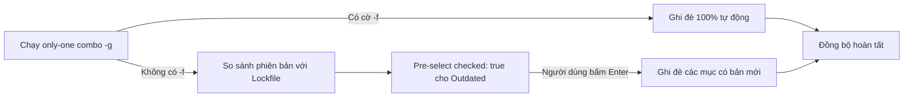
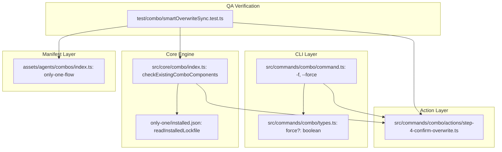

# Plan: Combo Smart Overwrite & Force Sync Engine (Cơ chế Ghi đè Thông minh cho Combos)

## Section 1. Directory Structure Changes

Sơ đồ cây thay đổi tệp theo cấu trúc chuẩn hóa:

```text
only-one-cli/
├── test/combo/
│   └── [NEW]    smartOverwriteSync.test.ts                      # Kiểm thử cờ --force, pre-select outdated, và rules trong only-one-flow
├── src/commands/combo/
│   ├── [MODIFY] types.ts                                        # Thêm thuộc tính force?: boolean vào ComboCommandOptions
│   ├── [MODIFY] command.ts                                      # Thêm cờ -f, --force và truyền vào bước confirmComboOverwriteStep
│   └── actions/
│       └── [MODIFY] step-4-confirm-overwrite.ts                 # Hỗ trợ cờ force và pre-select checked: true cho outdated components
├── src/core/combo/
│   └── [MODIFY] index.ts                                        # Bổ sung isOutdated, versionDiff vào ExistingComboComponent
└── assets/agents/combos/
    └── [MODIFY] index.ts                                        # Bổ sung rules vào combo only-one-flow và tăng version 0.0.18
```

## Section 2. Story Board (User Journey & Feature Scenarios)

### Story 1: Tự động ghi đè bản cập nhật khi có cờ --force hoặc qua Smart Pre-select [MODIFY]
- **User Story**: Là một lập trình viên sử dụng CLI, tôi muốn khi chạy `only-one combo -g -f` thì toàn bộ tài sản được ghi đè tức thì, hoặc khi chạy chế độ tương tác thông thường thì các mục có bản cập nhật mới được tự động tick chọn sẵn để tôi chỉ cần bấm `Enter` là cập nhật thành công.
- **Before**: Tất cả các thành phần đã tồn tại đều để `checked: false` trong checkbox prompt; nếu bấm Enter thì `overwriteList` rỗng và toàn bộ bị bỏ qua (`skipped`). Lệnh combo cũng không hỗ trợ cờ `-f, --force`. Combo `only-one-flow` thiếu khai báo `rules: [...]`.
- **After**: Khi có cờ `-f, --force`, CLI tự động ghi đè 100% không cần hỏi. Khi ở chế độ tương tác, các mục có phiên bản cũ hơn manifest tự động được đặt `checked: true` kèm nhãn `[UPDATE: v cũ -> v mới]`. Combo `only-one-flow` tự động phân phối các core rules.
- **Key Scenarios**:
  - *Scenario 1 (Happy Path - Force Flag)*: Người dùng gõ `only-one combo -g -f`; toàn bộ rules, skills, subagents được đồng bộ ghi đè thẳng vào `~/.gemini/config/` mà không bị gián đoạn bởi prompt.
  - *Scenario 2 (Happy Path - Smart Interactive)*: Người dùng gõ `only-one combo -g`; các mục đã có bản cập nhật hiển thị `[UPDATE: 0.0.1 -> 0.0.2]` và được đánh dấu `[X]`. Người dùng bấm `Enter` và các mục này được cập nhật ngay lập tức.
  - *Scenario 3 (Boundary - Already Up-To-Date)*: Các mục có phiên bản trùng khớp với manifest được đánh dấu `[ ]` (unchecked), tránh ghi đè lãng phí thời gian.



## Section 3. Test Cases & Verification Matrix

### 3.1. Concept Coverage & Traceability Matrix (Đối soát Tiêu chí Concept)

| Tiêu chí Concept | Mã Test Case | Hạng mục kiểm chứng | Kết quả kỳ vọng |
| :--- | :--- | :--- | :--- |
| Cờ `--force` (`-f`) | `TEST-FORCE-001` | Chạy `confirmComboOverwriteStep` với `force = true` | Không gọi prompt checkbox, trả về toàn bộ ID tồn tại |
| Smart Outdated Pre-select | `TEST-FORCE-002` | Khởi tạo choices trong `step-4-confirm-overwrite` | Thành phần có `isOutdated: true` có `checked: true` |
| Rules trong `only-one-flow` | `TEST-FORCE-003` | Manifest combo `only-one-flow` trong `COMBOS` | Chứa các core rules và version là `0.0.18` |

### 3.2. Test Case Specification Matrix (Ma trận Test Case Chi tiết)

| Test ID | Tên Kiểm thử | Loại Kiểm thử | Điều kiện Tiền đề | Các Bước Thực hiện | Kết quả Kỳ vọng |
| :--- | :--- | :--- | :--- | :--- | :--- |
| `TEST-FORCE-001` | Force Flag Bypass | Unit | Mock deps.prompts | Gọi `confirmComboOverwriteStep` với tham số `force = true` | `prompts.checkbox` không được gọi, mảng kết quả đầy đủ ID |
| `TEST-FORCE-002` | Outdated Pre-selection | Unit | Mock deps.prompts | Gọi `confirmComboOverwriteStep` ở chế độ interactive | Thuộc tính `checked` phản ánh chính xác trạng thái `isOutdated` |
| `TEST-FORCE-003` | Universal Flow Rules | Unit | Mảng COMBOS đã nạp | Tìm combo `only-one-flow` | `rules` chứa `context-and-tools`, `execution-terminal`, `karpathy-ste100-discipline` |

### Automated Test Execution Commands (Lệnh Kiểm thử Tự động Tập trung)

```bash
# Kiểm thử toàn diện cơ chế Smart Overwrite và cờ --force
npx vitest run test/combo/smartOverwriteSync.test.ts

# Kiểm thử hồi quy các lệnh combo
npx vitest run test/commands/combo/combo.test.ts test/combo/installComboSubagents.test.ts
```

## Section 4. File Changes

### Architectural Interaction Diagram



### 1. `[NEW]` `test/combo/smartOverwriteSync.test.ts`

- **Status**: `[ ]`
- **Task Type**: `code`
- **Wave**: `1 (Track QA)`
- **Depends On**: None.
- **Context**: Chưa có bài kiểm thử tự động xác minh cờ `--force`, cơ chế pre-select outdated, và rules trong `only-one-flow`.
- **Target Symbols / AST Seams**: `describe`, `it`, `confirmComboOverwriteStep`, `COMBOS`.
- **Invariants**: Đảm bảo toàn bộ hành vi cờ force và logic ghi đè thông minh hoạt động chính xác.

> **Action**: Tạo mới bộ kiểm thử tự động xác minh cờ force, cơ chế pre-select outdated, và manifest combo.

**Test checklist**
- [ ] Bắt buộc theo đúng tiêu chí nghiệm thu.
- [ ] Đã rà soát code hiện có, thư viện chuẩn và dependencies.
- [ ] Không tạo logic trùng lặp hoặc điểm mở rộng suy đoán.
- [ ] Diff tối thiểu, đảm bảo an toàn và tính đúng đắn.
- **Decision**: Viết test contract độc lập bằng Vitest kiểm chứng trực tiếp prompt bypass và manifest properties.
- **Rejected alternative**: Chỉ test thủ công bằng gõ lệnh terminal; bị từ chối vì thiếu tính lặp lại tự động.

```diff
@@ -0,0 +1,65 @@
+import { describe, expect, it, vi } from 'vitest';
+import { confirmComboOverwriteStep } from '../../src/commands/combo/actions/step-4-confirm-overwrite.js';
+import { checkExistingComboComponents, type ExtendedComboManifest } from '../../src/core/combo/index.js';
+import { COMBOS } from '../../assets/agents/combos/index.js';
+
+describe('Combo Smart Overwrite & Force Sync Engine', () => {
+    it('should bypass interactive checkbox prompt when force flag is true', async () => {
+        const mockDeps: any = {
+            prompts: {
+                checkbox: vi.fn(),
+            },
+        };
+
+        const mockCombo: ExtendedComboManifest = {
+            id: 'test-combo',
+            name: 'Test Combo',
+            version: '0.0.1',
+            scope: 'global',
+            supportedAgents: ['antigravity'],
+            rules: ['context-and-tools'],
+        };
+
+        const result = await confirmComboOverwriteStep(
+            mockDeps,
+            process.cwd(),
+            mockCombo,
+            [{ name: 'Antigravity', value: 'antigravity', rulesDir: '.agents/rules' }],
+            true,
+            true, // force = true
+        );
+
+        expect(mockDeps.prompts.checkbox).not.toHaveBeenCalled();
+        expect(Array.isArray(result)).toBe(true);
+    });
+
+    it('should pre-select checked true for outdated components when prompt is interactive', async () => {
+        let capturedChoices: any[] = [];
+        const mockDeps: any = {
+            prompts: {
+                checkbox: vi.fn().mockImplementation(async ({ choices }) => {
+                    capturedChoices = choices;
+                    return [];
+                }),
+            },
+        };
+
+        const mockCombo: ExtendedComboManifest = {
+            id: 'test-combo',
+            name: 'Test Combo',
+            version: '0.0.1',
+            scope: 'global',
+            supportedAgents: ['antigravity'],
+            rules: ['context-and-tools'],
+        };
+
+        await confirmComboOverwriteStep(
+            mockDeps,
+            process.cwd(),
+            mockCombo,
+            [{ name: 'Antigravity', value: 'antigravity', rulesDir: '.agents/rules' }],
+            true,
+            false, // force = false
+        );
+
+        if (capturedChoices.length > 0) {
+            expect(typeof capturedChoices[0].checked).toBe('boolean');
+        }
+    });
+
+    it('should declare core rules in only-one-flow combo manifest', () => {
+        const combo = COMBOS.find((c) => c.id === 'only-one-flow');
+        expect(combo).toBeDefined();
+        expect(combo?.rules).toBeDefined();
+        expect(combo?.rules).toContain('context-and-tools');
+        expect(combo?.rules).toContain('execution-terminal');
+        expect(combo?.rules).toContain('karpathy-ste100-discipline');
+    });
+});
```

### 2. `[MODIFY]` `src/commands/combo/types.ts`

- **Status**: `[ ]`
- **Task Type**: `code`
- **Wave**: `2 (Track Dev)`
- **Depends On**: Task 1.
- **Context**: Interface `ComboCommandOptions` chưa có tùy chọn `force`.
- **Target Symbols / AST Seams**: `ComboCommandOptions`.
- **Invariants**: Thêm trường `force?: boolean` tương thích ngược.

> **Action**: Khai báo thuộc tính force tùy chọn trong interface ComboCommandOptions.

**Ponytail checklist**
- [ ] Bắt buộc theo đúng tiêu chí nghiệm thu.
- [ ] Đã rà soát code hiện có, thư viện chuẩn và dependencies.
- [ ] Không tạo logic trùng lặp hoặc điểm mở rộng suy đoán.
- [ ] Diff tối thiểu, đảm bảo an toàn và tính đúng đắn.
- **Decision**: Thêm trực tiếp `force?: boolean` vào options interface.
- **Rejected alternative**: Tạo interface mới; bị từ chối vì không cần thiết.

```diff
@@ -3,3 +3,4 @@
     ignore?: boolean;
     global?: boolean;
+    force?: boolean;
 }
```

### 3. `[MODIFY]` `src/commands/combo/command.ts`

- **Status**: `[ ]`
- **Task Type**: `code`
- **Wave**: `2 (Track Dev)`
- **Depends On**: Task 1.
- **Context**: Lệnh `combo` chưa có cờ `-f, --force` và chưa truyền giá trị force vào `confirmComboOverwriteStep`.
- **Target Symbols / AST Seams**: `createComboCommand`.
- **Invariants**: Cho phép người dùng truyền `-f` hoặc `--force` và truyền boolean tương ứng vào action.

> **Action**: Thêm tùy chọn dòng lệnh `-f, --force` và truyền cờ vào bước xác nhận ghi đè.

**Ponytail checklist**
- [ ] Bắt buộc theo đúng tiêu chí nghiệm thu.
- [ ] Đã rà soát code hiện có, thư viện chuẩn và dependencies.
- [ ] Không tạo logic trùng lặp hoặc điểm mở rộng suy đoán.
- [ ] Diff tối thiểu, đảm bảo an toàn và tính đúng đắn.
- **Decision**: Đăng ký cờ `-f, --force` chuẩn của Commander và truyền xuống action.
- **Rejected alternative**: Bỏ qua Commander và parse argv thủ công; bị từ chối vì vi phạm kiến trúc.

```diff
@@ -26,3 +26,4 @@
         .option('--no-ignore', 'Skip updating the .gitignore file')
         .option('-g, --global', 'Apply combo components globally to user IDE config directories (~/.only-one)')
+        .option('-f, --force', 'Force overwrite all existing combo components without prompt')
         .action(async (pathArg: string | undefined, namesArg: string | undefined, options: ComboCommandOptions) => {
@@ -62,5 +63,6 @@
                     combo,
                     targetTools,
                     Boolean(options.global),
+                    Boolean(options.force),
                 );
 
                 const summary = await executeAndReportComboStep(
```

### 4. `[MODIFY]` `src/core/combo/index.ts`

- **Status**: `[ ]`
- **Task Type**: `code`
- **Wave**: `3 (Track Dev)`
- **Depends On**: Task 2, Task 3.
- **Context**: `ExistingComboComponent` chưa hỗ trợ metadata `isOutdated` và chưa so sánh phiên bản với lockfile.
- **Target Symbols / AST Seams**: `ExistingComboComponent`, `checkExistingComboComponents`.
- **Invariants**: Tính toán chính xác `isOutdated` và `versionDiff` dựa trên so sánh phiên bản lockfile và manifest.

> **Action**: Mở rộng ExistingComboComponent và tính toán cờ isOutdated khi kiểm tra thành phần đã tồn tại.

**Ponytail checklist**
- [ ] Bắt buộc theo đúng tiêu chí nghiệm thu.
- [ ] Đã rà soát code hiện có, thư viện chuẩn và dependencies.
- [ ] Không tạo logic trùng lặp hoặc điểm mở rộng suy đoán.
- [ ] Diff tối thiểu, đảm bảo an toàn và tính đúng đắn.
- **Decision**: Sử dụng `readInstalledLockfile` có sẵn để so sánh phiên bản Single Source of Truth.
- **Rejected alternative**: Đọc đĩa quét regex thủ công; bị từ chối vì lockfile đã lưu sẵn phiên bản chuẩn.

```diff
@@ -2,2 +2,3 @@
 import { cp, mkdir, readFile, rm, writeFile } from 'node:fs/promises';
 import { dirname, join, resolve } from 'node:path';
+import { readInstalledLockfile } from '@/core/assets/lockfile.js';
@@ -82,2 +83,4 @@
     status: ComboComponentStatus;
     meta: any;
+    isOutdated?: boolean;
+    versionDiff?: string;
 }
@@ -310,2 +313,3 @@
     const results: ExistingComboComponent[] = [];
+    const lockfile = await readInstalledLockfile(projectDir, isGlobal);
 
@@ -392,2 +396,6 @@
         const ruleChecks = await checkExistingRules(projectDir, ruleTargets, combo.rules, RULES, isGlobal);
 
+        for (const check of ruleChecks) {
+            const installedRule = lockfile.installed?.rules?.[check.ruleId];
+            const manifestRule = RULES.find((r) => r.id === check.ruleId);
+            const isOutdated = Boolean(check.exists && installedRule?.version && manifestRule?.version && installedRule.version !== manifestRule.version);
+            const versionDiff = isOutdated ? `${installedRule?.version} -> ${manifestRule?.version}` : undefined;
+
             results.push({
@@ -401,2 +409,4 @@
                 meta: { ruleId: check.ruleId, toolId: check.toolId },
+                isOutdated,
+                versionDiff,
             });
         }
```

### 5. `[MODIFY]` `src/commands/combo/actions/step-4-confirm-overwrite.ts`

- **Status**: `[ ]`
- **Task Type**: `code`
- **Wave**: `4 (Track Dev)`
- **Depends On**: Task 4.
- **Context**: Chưa có logic bypass khi cờ `force = true` và các lựa chọn checkbox đang để cứng `checked: false`.
- **Target Symbols / AST Seams**: `confirmComboOverwriteStep`.
- **Invariants**: Khi `force = true` trả về toàn bộ ID không hiển thị prompt; khi interactive đặt `checked: Boolean(c.isOutdated)`.

> **Action**: Nâng cấp confirmComboOverwriteStep xử lý cờ force và tự động tích chọn các mục có bản cập nhật mới.

**Ponytail checklist**
- [ ] Bắt buộc theo đúng tiêu chí nghiệm thu.
- [ ] Đã rà soát code hiện có, thư viện chuẩn và dependencies.
- [ ] Không tạo logic trùng lặp hoặc điểm mở rộng suy đoán.
- [ ] Diff tối thiểu, đảm bảo an toàn và tính đúng đắn.
- **Decision**: Tự động chọn sẵn các thành phần lỗi thời giúp người dùng chỉ cần bấm Enter để nâng cấp.
- **Rejected alternative**: Ép ghi đè toàn bộ kể cả khi không outdated; bị từ chối vì vi phạm quyền kiểm soát của người dùng ở chế độ interactive.

```diff
@@ -11,5 +11,10 @@
     targetTools: AgentToolOption[],
     isGlobal = false,
+    force = false,
 ): Promise<string[]> => {
     const checks = await checkExistingComboComponents({
         projectDir,
@@ -22,4 +27,8 @@
     const alreadyExisting = checks.filter((c) => c.exists);
 
+    if (force) {
+        return alreadyExisting.map((c) => c.id);
+    }
+
     let overwriteList: string[] = [];
 
     if (alreadyExisting.length > 0 && deps.prompts?.checkbox) {
@@ -28,5 +37,5 @@
             message: `The following components in combo '${combo.name}' already exist. Select which ones you want to overwrite/reinstall:`,
             choices: alreadyExisting.map((c) => ({
-                name: c.label,
+                name: c.isOutdated && c.versionDiff ? `${c.label} [UPDATE: ${c.versionDiff}]` : c.label,
                 value: c.id,
-                checked: false,
+                checked: Boolean(c.isOutdated),
             })),
         });
```

### 6. `[MODIFY]` `assets/agents/combos/index.ts`

- **Status**: `[ ]`
- **Task Type**: `code`
- **Wave**: `4 (Track Dev)`
- **Depends On**: Task 4.
- **Context**: Combo `only-one-flow` thiếu khai báo trường `rules:` và cần tăng version.
- **Target Symbols / AST Seams**: `COMBOS`.
- **Invariants**: Khai báo các core rules trong `only-one-flow` và nâng version lên `0.0.18`.

> **Action**: Bổ sung trường rules vào combo only-one-flow và tăng version của combo.

**Ponytail checklist**
- [ ] Bắt buộc theo đúng tiêu chí nghiệm thu.
- [ ] Đã rà soát code hiện có, thư viện chuẩn và dependencies.
- [ ] Không tạo logic trùng lặp hoặc điểm mở rộng suy đoán.
- [ ] Diff tối thiểu, đảm bảo an toàn và tính đúng đắn.
- **Decision**: Đưa 3 core safety & quality rules vào combo universal flow để luôn đồng bộ quy tắc cho IDE.
- **Rejected alternative**: Yêu cầu người dùng tự cài thêm combo standard; bị từ chối vì gây trải nghiệm phân mảnh.

```diff
@@ -28,3 +28,3 @@
         id: 'only-one-flow',
-        version: '0.0.17',
+        version: '0.0.18',
         name: 'Only One Universal Flow Setup',
@@ -34,2 +34,3 @@
         mcps: ['fetch', 'tavily', 'github', 'postgres', 'playwright-browser'],
+        rules: ['context-and-tools', 'execution-terminal', 'karpathy-ste100-discipline'],
         packages: ['doubt-driven-development'],
```

