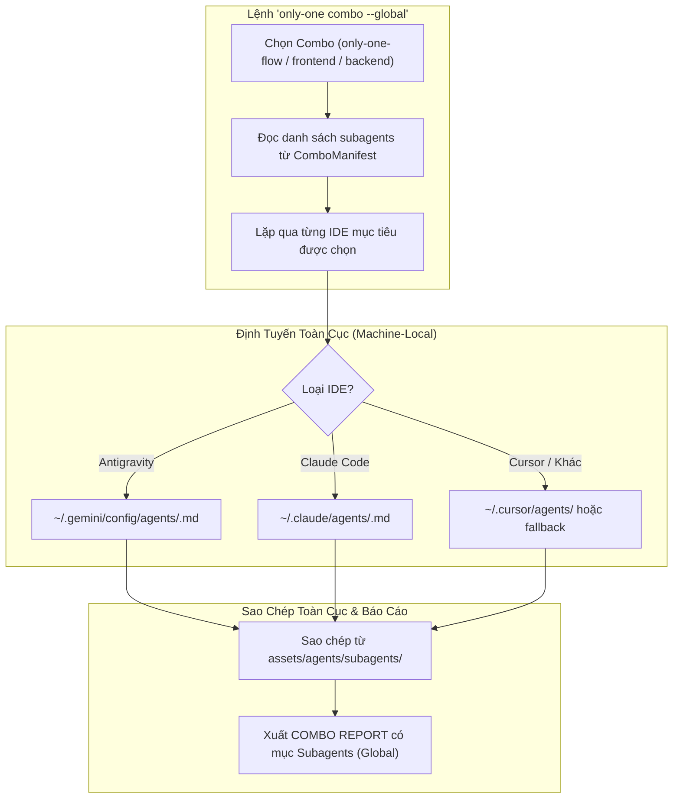

# Concept: Phân Phối Subagents Toàn Cục Qua Combos (Global First-Class Subagent Asset)

## 1. Problem & Goal

### Problem (Current Bottlenecks & Deficiencies)
- **Context & Trigger**: Khi người dùng chạy lệnh `only-one combo` với cờ `--global` (mặc định của các combo `only-one-flow`, `frontend-flow`, `backend-flow`).
- **Symptom & Defect**: Các Subagents mới thiết kế (`codebase-scout`, `terminal-runner`, `browser-tester`, `api-tester`) không được cài đặt đồng bộ vào thư mục cấu hình toàn cục (Global Customizations) của các công cụ AI.
- **Root Cause**: `ComboManifest` trong `assets/types.ts` thiếu trường `subagents?: string[]`, và engine cài đặt `src/core/combo/index.ts` chưa có nhánh xử lý sao chép subagents ở phạm vi Global (`isGlobal = true`).
- **Impact / Blast Radius**: Người dùng phải tự sao chép thủ công file subagent vào từng máy, làm mất khả năng tái sử dụng xuyên suốt mọi dự án trên máy trạm.

### Goal (Target Technical Outcomes)
- **Core Goal**: Nâng cấp `ComboManifest` và engine cài đặt combo để đưa Subagent thành First-Class Asset, tự động cài đặt **TOÀN CỤC (GLOBAL)** vào thư mục cấu hình của từng công cụ AI.
- **Acceptance Criteria**:
  - `ComboManifest` chính thức hỗ trợ trường `subagents?: string[]`.
  - Phân bổ 4 Subagents vào đúng các Combo mục tiêu (`only-one-flow`, `frontend-flow`, `backend-flow`) với phạm vi `scope: 'global'`.
  - Hàm giải quyết đường dẫn (`resolveToolDestinationPaths`) hỗ trợ loại asset `subagents` ở chế độ Global:
    - **Antigravity (Global)**: **`~/.gemini/config/agents/<name>.md`** (Đồng bộ tuyệt đối với `~/.gemini/config/skills/` và `~/.gemini/config/rules/`).
    - **Claude Code (Global)**: **`~/.claude/agents/<name>.md`** (Chuẩn chính thức của Claude Code).
    - **Cursor (Global)**: `~/.cursor/agents/<name>.md` (hoặc fallback `~/.gemini/config/agents/`).
  - Báo cáo kết quả cài đặt `COMBO REPORT` hiển thị đầy đủ danh sách Subagents được cài đặt toàn cục kèm trạng thái (`success`, `skipped`, `failed`).

## 2. Scope Boundaries
- **In-Scope**:
  - Cập nhật kiểu dữ liệu `ComboManifest` trong `assets/types.ts`.
  - Cấu hình mảng `subagents` trong các combo tại `assets/agents/combos/index.ts`.
  - Mở rộng hàm `resolveToolDestinationPaths` trong `src/core/agent/tools.ts` để hỗ trợ `'subagents'` ở cả chế độ Workspace và Global.
  - Mở rộng hàm cài đặt `installCombo` trong `src/core/combo/index.ts` và hàm hiển thị báo cáo trong `step-5-execute-and-report.ts`.
- **Explicit Out-of-Scope**:
  - Không thay đổi nội dung logic bên trong các tệp subagent markdown.
  - Không can thiệp vào các công cụ AI không nằm trong danh mục `AI_TOOLS`.

## 3. Proposed Solution & Core Mechanism
- **Core Mechanism**: 
  - Khi `installCombo` chạy với `isGlobal = true`, engine đọc danh sách `subagents` từ manifest của combo được chọn.
  - Với mỗi IDE mục tiêu, engine gọi `resolveToolDestinationPaths(tool, 'subagents', homeDir, true)` để xác định thư mục đích toàn cục (`~/.gemini/config/agents/` cho Antigravity, `~/.claude/agents/` cho Claude Code).
  - Engine tự động tạo thư mục cha (`mkdir -p`) và sao chép tệp từ `assets/agents/subagents/<name>.md` tới thư mục đích toàn cục, xử lý ghi đè an toàn và hiển thị trong `COMBO REPORT`.

- **Conceptual Flow / Domain Model**:


- **CLI / Protocol Wireframe**:
```text
+---------------------------------------------------------------------------------+
| COMBO INSTALLATION REPORT (GLOBAL SUBAGENTS INTEGRATION)                        |
+---------------------------------------------------------------------------------+
| ==================================================                              |
|          COMBO 'ONLY-ONE-FLOW' REPORT (GLOBAL)                                  |
| ==================================================                              |
| Packages:                                                                       |
|   - ui-ux-pro-max-cli: success                                                  |
| Rules (Global):                                                                 |
|   - 01-context-and-tools in Antigravity (~/.gemini/config/rules/): success      |
| Skills (Global):                                                                |
|   - only-one-plan in Antigravity (~/.gemini/config/skills/): success            |
| Subagents (Global):                                                             |
|   - codebase-scout in Antigravity (~/.gemini/config/agents/): success           |
|   - terminal-runner in Antigravity (~/.gemini/config/agents/): success           |
|   - browser-tester in Antigravity (~/.gemini/config/agents/): success            |
|   - api-tester in Antigravity (~/.gemini/config/agents/): success                |
|   - codebase-scout in Claude Code (~/.claude/agents/): success                  |
|   - terminal-runner in Claude Code (~/.claude/agents/): success                  |
|   - browser-tester in Claude Code (~/.claude/agents/): success                   |
|   - api-tester in Claude Code (~/.claude/agents/): success                       |
+---------------------------------------------------------------------------------+
```

## 4. Critical Risks & Edge Cases (Phân tích Rủi ro & Cơ chế Phòng vệ)

- **Rủi ro 1: Thư mục cha toàn cục `~/.gemini/config/agents/` chưa tồn tại**
  * *Mặt tiêu cực / Nguy cơ*: Lỗi `ENOENT` khi sao chép tệp vào thư mục chưa được khởi tạo trên máy người dùng mới.
  * *Cơ chế phòng vệ*: Sử dụng `mkdir(destDir, { recursive: true })` trước khi thực hiện copy.

- **Rủi ro 2: Ghi đè tệp cấu hình tùy chỉnh toàn cục của người dùng**
  * *Mặt tiêu cực / Nguy cơ*: Người dùng đã tự tùy biến subagent trong `~/.gemini/config/agents/` hoặc `~/.claude/agents/`, lệnh combo vô tình ghi đè mất cấu hình riêng.
  * *Cơ chế phòng vệ*: Tích hợp danh sách kiểm tra `overwriteList` và hỏi xác nhận người dùng trước khi ghi đè, giống như quy trình xử lý `skills` và `rules`.
