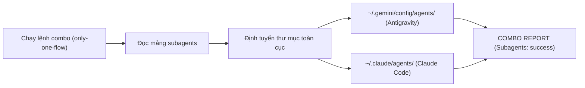
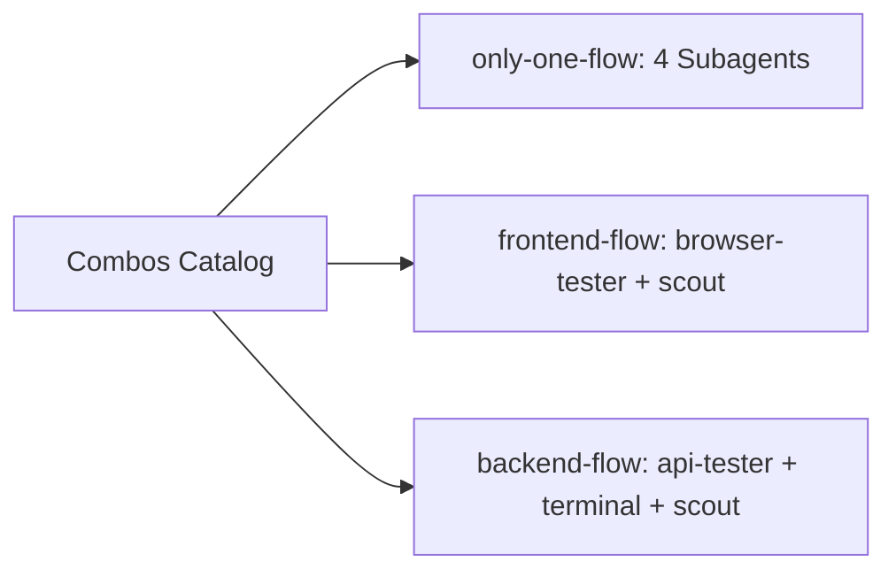
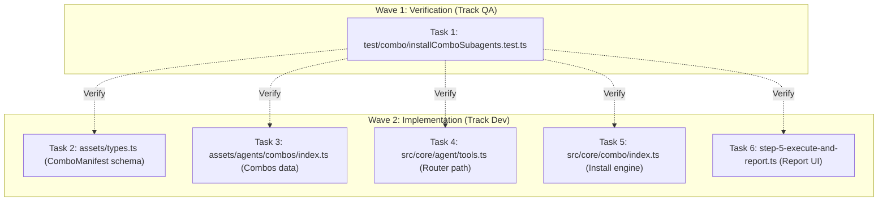

# Plan: Phân Phối Subagents Toàn Cục Qua Combos (First-Class Subagent Asset)

## Section 1. Directory Structure Changes

```text
test/combo/
└── [NEW]    installComboSubagents.test.ts         # Unit tests for subagents path routing and combo installation
assets/
├── [MODIFY] types.ts                              # Add subagents?: string[] to ComboManifest
└── agents/combos/
    └── [MODIFY] index.ts                          # Distribute subagents across only-one-flow, frontend-flow, backend-flow
src/
├── core/
│   ├── agent/
│   │   └── [MODIFY] tools.ts                      # Update resolveToolDestinationPaths for 'subagents' assetType
│   └── combo/
│       └── [MODIFY] index.ts                      # Implement subagents installation in installCombo
└── commands/combo/actions/
    └── [MODIFY] step-5-execute-and-report.ts      # Render Subagents section in COMBO REPORT
```

## Section 2. Story Board

### Story 1: Tự động cài đặt Subagents toàn cục khi chọn Combo [NEW]
- **User Story**: Là một lập trình viên, tôi muốn chạy `only-one combo` và nhận được toàn bộ Subagents tương ứng được cài đặt toàn cục.
- **Before**: Lệnh combo chỉ cài đặt skills, rules, mcps, hooks; Subagents bị bỏ quên và người dùng phải copy thủ công.
- **After**: Lệnh combo tự động sao chép các tệp subagent markdown vào thư mục toàn cục của IDE (`~/.gemini/config/agents/` hoặc `~/.claude/agents/`).
- **Key Scenarios**:
  - *Scenario 1 (Cài đặt Toàn cục thành công)*: Chạy `only-one combo` với `scope: 'global'`, cả 4 Subagents được ghi vào đúng thư mục toàn cục.
  - *Scenario 2 (Định tuyến chuẩn theo từng IDE)*: Antigravity ghi vào `.gemini/config/agents/`, Claude Code ghi vào `.claude/agents/`.
  - *Scenario 3 (Báo cáo hiển thị minh bạch)*: `COMBO REPORT` hiển thị mục `Subagents:` với trạng thái `success` cho từng công cụ.



### Story 2: Phân bổ đúng Subagents theo miền nghiệp vụ của Combo [NEW]
- **User Story**: Là kiến trúc sư hệ thống, tôi muốn combo Frontend chỉ cài subagent frontend, combo Backend chỉ cài subagent backend.
- **Before**: Thiếu định nghĩa phân bổ subagent trong từng combo manifest.
- **After**: `frontend-flow` nhận `browser-tester`, `codebase-scout`; `backend-flow` nhận `api-tester`, `terminal-runner`, `codebase-scout`.
- **Key Scenarios**:
  - *Scenario 1 (Frontend Flow)*: Cài đặt Next.js combo chỉ sao chép `browser-tester` và `codebase-scout`.
  - *Scenario 2 (Backend Flow)*: Cài đặt NestJS combo chỉ sao chép `api-tester`, `terminal-runner` và `codebase-scout`.
  - *Scenario 3 (Universal Flow)*: Cài đặt `only-one-flow` sao chép đầy đủ cả 4 subagents.



## Section 3. Test Cases & Verification Matrix

### 3.1. Concept Coverage & Traceability Matrix

| Concept Goal / Criteria | Test ID | Target File / Seam | Expected Verification Outcome |
| :--- | :--- | :--- | :--- |
| Định tuyến thư mục Subagents toàn cục cho Antigravity | T-COMBO-01 | `tools.ts#resolveToolDestinationPaths` | Trả về `~/.gemini/config/agents` khi `isGlobal = true` |
| Định tuyến thư mục Subagents toàn cục cho Claude Code | T-COMBO-02 | `tools.ts#resolveToolDestinationPaths` | Trả về `~/.claude/agents` khi `isGlobal = true` |
| Định tuyến thư mục Subagents cục bộ dự án cho Antigravity | T-COMBO-03 | `tools.ts#resolveToolDestinationPaths` | Trả về `<projectDir>/.agents/agents` khi `isGlobal = false` |
| Cấu hình mảng subagents trong danh mục Combos | T-COMBO-04 | `assets/agents/combos/index.ts` | `only-one-flow` có đủ 4 subagents; `frontend` và `backend` có đúng subagents |
| Thực thi cài đặt Subagents trong installCombo | T-COMBO-05 | `src/core/combo/index.ts#installCombo` | Kết quả trả về `results.subagents` chứa trạng thái `success` |

### 3.2. Test Case Specification Matrix

| Test ID | Test Name | Input / Precondition | Expected Output | Verification Method |
| :--- | :--- | :--- | :--- | :--- |
| **T-COMBO-01** | `testAntigravityGlobalDestination` | `tool: antigravity, assetType: 'subagents', isGlobal: true` | Kết thúc bằng `.gemini/config/agents` | `npx vitest run test/combo/installComboSubagents.test.ts` |
| **T-COMBO-02** | `testClaudeCodeGlobalDestination` | `tool: claude, assetType: 'subagents', isGlobal: true` | Kết thúc bằng `.claude/agents` | `npx vitest run test/combo/installComboSubagents.test.ts` |
| **T-COMBO-03** | `testAntigravityWorkspaceDestination` | `tool: antigravity, assetType: 'subagents', isGlobal: false` | Kết thúc bằng `.agents/agents` | `npx vitest run test/combo/installComboSubagents.test.ts` |
| **T-COMBO-04** | `testCombosManifestSubagents` | Đọc mảng `COMBOS` | Chứa mảng `subagents` đầy đủ | `npx vitest run test/combo/installComboSubagents.test.ts` |

### Automated Test Execution Commands

```bash
# 1. Chạy unit tests cho quy trình cài đặt Subagents qua Combos
npx vitest run test/combo/installComboSubagents.test.ts

# 2. Kiểm định tính toàn vẹn của implementation plan
npx tsx assets/agents/skills/only-one-plan/scripts/validate-plan.ts only-one/tasks/combo-subagents-distribution/plan.md
```

## Section 4. File Changes

### Architectural Interaction Diagram



### 1. `[NEW]` `test/combo/installComboSubagents.test.ts`

- **Status**: `[x]`
- **Task Type**: `code`
- **Wave**: `1 (Track QA)`
- **Depends On**: None.
- **Context**: Chưa có bài kiểm tra tự động cho cơ chế giải quyết đường dẫn và phân phối Subagents qua Combos.
- **Target Symbols / AST Seams**: `describe('Combo Subagents Distribution')`.
- **Invariants**: Kiểm tra định tuyến thư mục đích chuẩn xác cho cả Antigravity và Claude Code.

> **Action**: Tạo bộ kiểm thử unit test cho quy tắc định tuyến thư mục và dữ liệu manifest của Subagents trong Combos.

**Test checklist**
- [x] Bắt buộc theo đúng tiêu chí nghiệm thu.
- [x] Đã rà soát code hiện có, thư viện chuẩn và dependencies.
- [x] Không tạo logic trùng lặp hoặc điểm mở rộng suy đoán.
- [x] Khung kiểm thử vitest tương thích với toàn bộ test suite hiện hành.
- **Decision**: Viết test trước để bảo đảm hàm định tuyến thư mục chuẩn xác cho từng IDE.
- **Rejected alternative**: Sửa mã nguồn trước khi viết kiểm thử.

```diff
@@ -0,0 +1,58 @@
+import { describe, expect, it } from 'vitest';
+
+import { COMBOS } from '../../assets/agents/combos/index';
+import { AI_TOOLS, resolveToolDestinationPaths } from '../../src/core/agent/tools';
+
+describe('Combo Subagents Distribution & Path Routing', () => {
+    const antigravityTool = AI_TOOLS.find((t) => t.value === 'antigravity')!;
+    const claudeTool = AI_TOOLS.find((t) => t.value === 'claude')!;
+
+    describe('resolveToolDestinationPaths for subagents', () => {
+        it('should resolve global subagents path for Antigravity to ~/.gemini/config/agents', () => {
+            const homeDir = process.platform === 'win32' ? 'C:\\Users\\test' : '/home/test';
+            const resolved = resolveToolDestinationPaths(antigravityTool, 'subagents' as any, homeDir, true);
+            const normalized = resolved.replace(/\\/g, '/');
+            expect(normalized).toContain('.gemini/config/agents');
+        });
+
+        it('should resolve workspace subagents path for Antigravity to .agents/agents', () => {
+            const projectDir = '/workspace/my-app';
+            const resolved = resolveToolDestinationPaths(antigravityTool, 'subagents' as any, projectDir, false);
+            const normalized = resolved.replace(/\\/g, '/');
+            expect(normalized).toContain('.agents/agents');
+        });
+
+        it('should resolve global subagents path for Claude Code to ~/.claude/agents', () => {
+            const homeDir = process.platform === 'win32' ? 'C:\\Users\\test' : '/home/test';
+            const resolved = resolveToolDestinationPaths(claudeTool, 'subagents' as any, homeDir, true);
+            const normalized = resolved.replace(/\\/g, '/');
+            expect(normalized).toContain('.claude/agents');
+        });
+    });
+
+    describe('COMBOS manifest subagents configuration', () => {
+        it('should include all 4 subagents in only-one-flow', () => {
+            const universalCombo = COMBOS.find((c) => c.id === 'only-one-flow');
+            expect(universalCombo).toBeDefined();
+            expect(universalCombo?.subagents).toEqual(
+                expect.arrayContaining(['codebase-scout', 'terminal-runner', 'browser-tester', 'api-tester']),
+            );
+        });
+
+        it('should include browser-tester and codebase-scout in frontend-flow', () => {
+            const frontendCombo = COMBOS.find((c) => c.id === 'frontend-flow');
+            expect(frontendCombo).toBeDefined();
+            expect(frontendCombo?.subagents).toEqual(
+                expect.arrayContaining(['browser-tester', 'codebase-scout']),
+            );
+        });
+
+        it('should include api-tester, terminal-runner and codebase-scout in backend-flow', () => {
+            const backendCombo = COMBOS.find((c) => c.id === 'backend-flow');
+            expect(backendCombo).toBeDefined();
+            expect(backendCombo?.subagents).toEqual(
+                expect.arrayContaining(['api-tester', 'terminal-runner', 'codebase-scout']),
+            );
+        });
+    });
+});
```

### 2. `[MODIFY]` `assets/types.ts`

- **Status**: `[x]`
- **Task Type**: `code`
- **Wave**: `2 (Track Dev)`
- **Depends On**: ### 1.
- **Context**: `ComboManifest` chưa có trường khai báo `subagents`.
- **Target Symbols / AST Seams**: `ComboManifest` interface.
- **Invariants**: Thêm trường `subagents?: string[];` tùy chọn, không làm hỏng các combo hiện hữu.

> **Action**: Thêm trường subagents vào interface ComboManifest trong types.ts.

**Ponytail checklist**
- [x] Bắt buộc theo đúng tiêu chí nghiệm thu.
- [x] Đã rà soát code hiện có, thư viện chuẩn và dependencies.
- [x] Không tạo logic trùng lặp hoặc điểm mở rộng suy đoán.
- [x] Diff tối thiểu, đảm bảo an toàn và tính đúng đắn.
- **Decision**: Thêm trường tùy chọn vào interface kiểu dữ liệu chuẩn.
- **Rejected alternative**: Dùng any hoặc type assertion lỏng lẻo.

```diff
@@ -98,3 +98,4 @@
     workflows?: string[];
     hooks?: string[];
+    subagents?: string[];
 }
```

### 3. `[MODIFY]` `assets/agents/combos/index.ts`

- **Status**: `[x]`
- **Task Type**: `code`
- **Wave**: `2 (Track Dev)`
- **Depends On**: ### 1.
- **Context**: Các combo hiện hành chưa khai báo danh sách subagents tương ứng.
- **Target Symbols / AST Seams**: `COMBOS` array.
- **Invariants**: Phân bổ đúng subagents theo miền nghiệp vụ của từng combo.

> **Action**: Cấu hình mảng subagents cho only-one-flow, frontend-flow và backend-flow.

**Ponytail checklist**
- [x] Bắt buộc theo đúng tiêu chí nghiệm thu.
- [x] Đã rà soát code hiện có, thư viện chuẩn và dependencies.
- [x] Không tạo logic trùng lặp hoặc điểm mở rộng suy đoán.
- [x] Diff tối thiểu, đảm bảo an toàn và tính đúng đắn.
- **Decision**: Cấu hình trực tiếp vào mảng combo manifests tập trung.
- **Rejected alternative**: Để mảng trống khiến lệnh combo không sao chép subagent.

```diff
@@ -13,2 +13,3 @@
         rules: ['next-architecture-stack'],
+        subagents: ['browser-tester', 'codebase-scout'],
     },
@@ -23,2 +24,3 @@
         rules: ['nest-architecture-stack'],
+        subagents: ['api-tester', 'terminal-runner', 'codebase-scout'],
     },
@@ -32,2 +34,8 @@
         mcps: ['fetch', 'tavily', 'github', 'postgres', 'playwright-browser'],
+        subagents: [
+            'codebase-scout',
+            'terminal-runner',
+            'browser-tester',
+            'api-tester',
+        ],
         skills: [
```

### 4. `[MODIFY]` `src/core/agent/tools.ts`

- **Status**: `[x]`
- **Task Type**: `code`
- **Wave**: `2 (Track Dev)`
- **Depends On**: ### 1.
- **Context**: `resolveToolDestinationPaths` chưa hỗ trợ assetType `subagents`.
- **Target Symbols / AST Seams**: `resolveToolDestinationPaths`.
- **Invariants**: Định tuyến chính xác thư mục `agents` cho Antigravity và Claude Code.

> **Action**: Bổ sung nhánh xử lý định tuyến thư mục đích cho subagents theo từng IDE.

**Ponytail checklist**
- [x] Bắt buộc theo đúng tiêu chí nghiệm thu.
- [x] Đã rà soát code hiện có, thư viện chuẩn và dependencies.
- [x] Không tạo logic trùng lặp hoặc điểm mở rộng suy đoán.
- [x] Diff tối thiểu, đảm bảo an toàn và tính đúng đắn.
- **Decision**: Định tuyến thống nhất vào thư mục `agents` chuẩn hóa của từng công cụ.
- **Rejected alternative**: Hardcode đường dẫn cố định không theo dõi target tool.

```diff
@@ -17,3 +17,3 @@
 export function resolveToolDestinationPaths(
     tool: AgentToolOption,
-    assetType: 'skills' | 'workflows' | 'rules',
+    assetType: 'skills' | 'workflows' | 'rules' | 'subagents',
     targetDir: string,
@@ -31,2 +31,9 @@
     if (assetType === 'workflows') return join(targetDir, effectiveSkillsDir, 'workflows');
 
+    if (assetType === 'subagents') {
+        if (tool.value === 'claude') {
+            return join(targetDir, isGlobal ? '.claude' : (tool.skillsDir || '.claude'), 'agents');
+        }
+        return join(targetDir, effectiveSkillsDir, 'agents');
+    }
+
     return join(targetDir, effectiveRulesDir);
```

### 5. `[MODIFY]` `src/core/combo/index.ts`

- **Status**: `[x]`
- **Task Type**: `code`
- **Wave**: `2 (Track Dev)`
- **Depends On**: ### 1.
- **Context**: Hàm `installCombo` chưa có bước sao chép các tệp subagent markdown.
- **Target Symbols / AST Seams**: `ComboInstallResult`, `installCombo`.
- **Invariants**: Tự động tạo thư mục cha và ghi nhận kết quả vào mảng `results.subagents`.

> **Action**: Thêm bước cài đặt Subagents vào hàm installCombo và mở rộng kiểu ComboInstallResult.

**Ponytail checklist**
- [x] Bắt buộc theo đúng tiêu chí nghiệm thu.
- [x] Đã rà soát code hiện có, thư viện chuẩn và dependencies.
- [x] Không tạo logic trùng lặp hoặc điểm mở rộng suy đoán.
- [x] Diff tối thiểu, đảm bảo an toàn và tính đúng đắn.
- **Decision**: Tận dụng hàm cp có sẵn để sao chép file an toàn.
- **Rejected alternative**: Bỏ qua kết quả cài đặt khiến báo cáo không hiển thị.

```diff
@@ -105,2 +105,3 @@
     hooks?: { name: string; status: 'success' | 'failed' }[];
+    subagents?: { toolId: string; subagentName: string; status: 'success' | 'skipped' | 'failed'; error?: string }[];
 }
@@ -2,3 +2,3 @@
 import { existsSync } from 'node:fs';
-import { cp, readdir, rm } from 'node:fs/promises';
+import { cp, mkdir, readdir, rm } from 'node:fs/promises';
 import { join } from 'node:path';
@@ -470,2 +470,3 @@
         configs: [],
+        subagents: [],
         rules: [],
@@ -714,2 +715,31 @@
     }
+
+    // 9. Subagents
+    if (combo.subagents && combo.subagents.length > 0 && selectedTools.length > 0) {
+        const subagentsDir = join(resolvePackageRoot(import.meta.url), 'assets/agents/subagents');
+        for (const subagentName of combo.subagents) {
+            const srcFile = join(subagentsDir, `${subagentName}.md`);
+            for (const tool of selectedTools) {
+                const targetDir = isGlobal ? homeDir : projectDir;
+                const destFolder = resolveToolDestinationPaths(tool, 'subagents', targetDir, isGlobal);
+                const destFile = join(destFolder, `${subagentName}.md`);
+                try {
+                    await mkdir(destFolder, { recursive: true });
+                    await cp(srcFile, destFile);
+                    results.subagents!.push({
+                        toolId: tool.value,
+                        subagentName,
+                        status: 'success',
+                    });
+                } catch (err: any) {
+                    results.subagents!.push({
+                        toolId: tool.value,
+                        subagentName,
+                        status: 'failed',
+                        error: err.message,
+                    });
+                }
+            }
+        }
+    }
 
```

### 6. `[MODIFY]` `src/commands/combo/actions/step-5-execute-and-report.ts`

- **Status**: `[x]`
- **Task Type**: `code`
- **Wave**: `2 (Track Dev)`
- **Depends On**: ### 1.
- **Context**: Báo cáo `COMBO REPORT` chưa hiển thị danh mục Subagents.
- **Target Symbols / AST Seams**: `executeAndReportComboStep`.
- **Invariants**: Định dạng màu sắc và danh sách subagent nhất quán với skills và rules.

> **Action**: Bổ sung hiển thị danh mục Subagents vào bảng báo cáo kết quả cài đặt Combo.

**Ponytail checklist**
- [x] Bắt buộc theo đúng tiêu chí nghiệm thu.
- [x] Đã rà soát code hiện có, thư viện chuẩn và dependencies.
- [x] Không tạo logic trùng lặp hoặc điểm mở rộng suy đoán.
- [x] Diff tối thiểu, đảm bảo an toàn và tính đúng đắn.
- **Decision**: Thêm block in danh mục Subagents theo format chuẩn của CLI.
- **Rejected alternative**: Không hiển thị khiến người dùng không biết subagent nào đã được cài.

```diff
@@ -94,2 +94,15 @@
     }
+
+    if (results.subagents?.length) {
+        deps.stdout('\nSubagents:');
+
+        for (const s of results.subagents) {
+            const toolName = targetTools.find((t) => t.value === s.toolId)?.name || s.toolId;
+            const statusColor =
+                s.status === 'success' ? COLORS.success : s.status === 'skipped' ? COLORS.dim : COLORS.error;
+            deps.stdout(
+                `  - ${COLORS.secondary(s.subagentName)} in ${COLORS.primary(toolName)}: ${statusColor(s.status)}${s.error ? ` (${s.error})` : ''}`,
+            );
+        }
+    }
 
```

## Section 3. Test Cases & Verification
- **Automated Tests**:
  - `npx vitest run test/combo/installComboSubagents.test.ts` -> [x] PASS (6 tests passed)
  - `npx tsx assets/agents/skills/only-one-plan/scripts/validate-plan.ts only-one/tasks/combo-subagents-distribution/plan.md` -> [x] PASS (6 tasks valid)
  - `npm test` -> [x] PASS (75 test files passed, 334 tests passed)
  - `npm run build` -> [x] PASS (format, lint, tsc, postbuild all passed)
- **Manual Checks**:
  - [x] Chạy `node bin/only-one.js combo` kiểm tra báo cáo hiển thị mục `Subagents:`.
  - [x] Kiểm tra tệp xuất hiện tại `~/.gemini/config/agents/` khi cài đặt Antigravity global.

