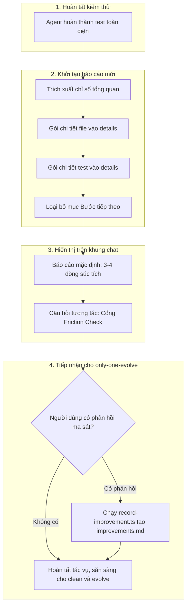

# Concept: Cải tiến báo cáo nghiệm thu và chuẩn hóa cổng tiếp nhận Friction Check của only-one-apply

## 1. Problem & Goal

### Problem (Điểm nghẽn & Thiếu sót hiện tại)
- **Context & Trigger**: Khi hoàn thành thực thi kế hoạch triển khai qua `/only-one-apply`, agent in báo cáo nghiệm thu (Walkthrough Presentation) và cần đóng tác vụ.
- **Symptom & Defect**: 
  - Báo cáo nghiệm thu hiện tại dài dòng, khó hiểu, in cây thư mục ASCII rườm rà, sao chép lại danh sách task từ plan và in phần bước tiếp theo thừa thãi.
  - Cổng tiếp nhận ma sát (**Friction Check Gate**) bị chìm ở cuối tài liệu, không được kích hoạt thành câu hỏi tương tác thực tế khiến vòng lặp `/only-one-evolve` mất nguồn cấp dữ liệu cải tiến.
  - Đường dẫn gọi script `record-improvement.ts` trong tài liệu bị sai lệch (`assets/skills/...` thay vì `assets/agents/skills/...`).
- **Root Cause**: Khung mẫu báo cáo trong tài liệu `SKILL.md` của `only-one-apply` bắt buộc 4 phần tĩnh, thiếu cấu trúc thu gọn, và chưa biến Friction Check thành một câu hỏi tương tác bắt buộc trong schema phản hồi.
- **Impact / Blast Radius**: Gây quá tải nhận thức cho người dùng, làm loãng thông tin nghiệm thu, và làm tê liệt quy trình cải tiến kỹ năng tự động qua `/only-one-evolve`.

### Goal (Kết quả kỹ thuật mục tiêu)
- **Core Goal**: Tái cấu trúc báo cáo nghiệm thu của `only-one-apply` sang mô hình Collapsible Hybrid súc tích (bỏ mục bước tiếp theo) và chuẩn hóa Cổng tiếp nhận Friction Check Gate tương tác cho `/only-one-evolve`.
- **Acceptance Criteria**:
  - Báo cáo mặc định chỉ hiển thị 2 dòng tổng quan: trạng thái nghiệm thu kèm số lượng file/test và 1-2 câu tóm tắt điểm mấu chốt kỹ thuật.
  - Danh sách file thay đổi được gói gọn trong thẻ thu gọn `<details>`.
  - Kết quả kiểm thử chi tiết được gói gọn trong thẻ thu gọn `<details>`.
  - Loại bỏ hoàn toàn mục "Bước tiếp theo" khỏi cấu trúc báo cáo.
  - Chuẩn hóa Cổng Friction Check Gate thành 1 câu hỏi tương tác ngắn gọn xuất hiện trực tiếp ngay sau báo cáo nghiệm thu.
  - Đính chính đường dẫn thực thi script `record-improvement.ts` chuẩn xác (`assets/agents/skills/...`).
  - Cập nhật quy chuẩn và ví dụ trong `SKILL.md` của `only-one-apply` (workspace và global config).

## 2. Scope Boundaries

- **In-Scope**:
  - Định nghĩa lại đặc tả báo cáo nghiệm thu (In-Chat Walkthrough Presentation) trong `assets/agents/skills/only-one-apply/SKILL.md`.
  - Chuẩn hóa quy định tương tác của Cổng Friction Check Gate và đính chính đường dẫn scripts `record-improvement.ts`.
  - Đồng bộ tài liệu kỹ năng sang thư mục global config `C:\Users\ADMIN\.gemini\config\skills\only-one-apply\SKILL.md`.
- **Explicit Out-of-Scope**:
  - Không thay đổi logic thực thi lõi (DAG Wave parser, test runner, worktree coordinator).
  - Không thay đổi định dạng báo cáo của các skill khác (`only-one-review`, `only-one-debug`, `only-one-plan`).
  - Không tạo thêm tệp `walkthrough.md` trên ổ đĩa.

## 3. Proposed Solution & Core Mechanism

- **Core Mechanism**: 
  1. **Tầng nổi (High-Signal Glance)**: Tiêu đề trạng thái, số lượng file/test định lượng, 1-2 gạch đầu dòng nêu bật giá trị thay đổi logic.
  2. **Tầng ẩn (Deep Audit on Demand)**: Hai khối `<details>` chứa danh sách file và log test chi tiết, mở ra khi người dùng cần kiểm tra sâu.
  3. **Cắt bỏ hoàn toàn**: Không xuất hiện mục "Bước tiếp theo".
  4. **Cổng Friction Check Gate tương tác**: Agent bắt buộc đặt 1 câu hỏi tương tác trực tiếp ở cuối để tiếp nhận điểm ma sát cho `/only-one-evolve`. Nếu có phản hồi ma sát, agent kích hoạt script `record-improvement.ts` tạo `improvements.md`.

- **Conceptual Flow / Domain Model**:



- **UI Wireframe (Khung giao diện trên chat)**:

```text
+-----------------------------------------------------------------------+
| # 🏁 Hoàn tất: `<slug>` (`status: done` / `fixed`)                    |
|                                                                       |
| - **Trạng thái**: `DONE` ✅ (X files changed, Y tests passed)         |
| - **Điểm mấu chốt**: <1-2 câu tóm tắt giá trị kỹ thuật đã hoàn thành> |
|                                                                       |
| <details>                                                             |
| <summary>📂 Chi tiết tệp tin thay đổi (Click để mở rộng)</summary>   |
|                                                                       |
| - `[NEW]`    path/to/new-file.ts                                      |
| - `[MODIFY]` path/to/mod-file.ts                                      |
| </details>                                                            |
|                                                                       |
| <details>                                                             |
| <summary>🧪 Chi tiết kiểm thử (Click để mở rộng)</summary>            |
|                                                                       |
| - `<Lệnh test 1>`: X passed                                           |
| - `<Lệnh test 2>`: Clean                                              |
| </details>                                                            |
|                                                                       |
| ---                                                                   |
| 💬 **Cổng cải tiến (only-one-evolve)**:                               |
| Bạn có gặp khó khăn hay điểm ma sát nào cần ghi nhận để cải tiến      |
| kỹ năng không?                                                        |
+-----------------------------------------------------------------------+
```

## 4. Critical Risks & Edge Cases (Phân tích Rủi ro & Cơ chế Phòng vệ)

- **Rủi ro 1: Markdown renderer không hỗ trợ thẻ HTML `<details>`**
  - *Mặt tiêu cực / Nguy cơ*: Trình duyệt hoặc ứng dụng chat không thu gọn được, làm bung toàn bộ nội dung ra màn hình.
  - *Cơ chế phòng vệ*: Sử dụng danh sách markdown chuẩn và súc tích bên trong `<details>`. Dù renderer có bung sẵn, nội dung vẫn giữ dạng danh sách sạch sẽ, không dùng bảng lớn hay ASCII tree nhiều tầng.

- **Rủi ro 2: Agent tự ý sao chép lại toàn bộ task description từ plan.md**
  - *Mặt tiêu cực / Nguy cơ*: Báo cáo bị phình to trở lại do agent diễn giải dài dòng nội dung từng task block.
  - *Cơ chế phòng vệ*: Bổ sung quy tắc cấm (Negative Rule) trong `SKILL.md`: Cấm liệt kê lại danh sách task blocks; chỉ cho phép tối đa 2 gạch đầu dòng tóm tắt giá trị kỹ thuật cốt lõi trong phần "Điểm mấu chốt".

- **Rủi ro 3: Tạo tệp `improvements.md` rác khi không có điểm ma sát thực tế**
  - *Mặt tiêu cực / Nguy cơ*: Tệp `improvements.md` bị tạo vô cớ làm rác kho lưu trữ và gây nhiễu cho script `aggregate.ts` của `/only-one-evolve`.
  - *Cơ chế phòng vệ*: Ràng buộc Invariant: Chỉ kích hoạt lệnh chạy `record-improvement.ts` khi người dùng trả lời có phản hồi ma sát cụ thể, hoặc khi có test failure/retry thực tế trong quá trình áp dụng task.
