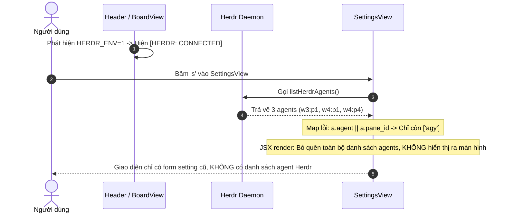

# Debug: Danh sách Agent từ Herdr không hiển thị trong Settings TUI

## Section 1. Diagnosis

### Symptom
- **Actual**: Mặc dù tiêu đề TUI hiển thị `[HERDR: CONNECTED]`, khi bấm `s` vào `SettingsView`, giao diện hoàn toàn không có danh sách hiển thị các Agent đang chạy từ Herdr. Tại các dòng chọn Agent theo từng phase (`concept`, `plan`, `apply`, `debug`, `review`, `clean`), hệ thống chỉ hiển thị duy nhất giá trị đang chọn `[ antigravity ]` hoặc `[ claudecode ]` mà không hiển thị danh sách các agent/pane thực tế đang chạy trong Herdr.
- **Expected**: `SettingsView` phải hiển thị một panel/danh sách trực quan các Herdr Agent đang chạy (bao gồm `pane_id`, `agent`, trạng thái `idle`/`working`, và thư mục `cwd`). Đồng thời, danh sách tùy chọn cho các phase phải bao gồm các pane/agent cụ thể từ Herdr (ví dụ `w4:p1 (agy)`, `w4:p4 (agy)`).
- **Blast Radius**: Người dùng không thể thấy và không thể gán task tới các agent/pane cụ thể đang chạy trong Herdr.

### Reproduction
- **Trigger**: Khởi chạy `only-one tui` trong môi trường Herdr (`HERDR_ENV=1`), bấm `s` vào Settings.
- **Evidence Command**: Chạy `herdr agent list` trong terminal:
  ```json
  {"agents":[{"agent":"agy","agent_status":"idle","pane_id":"w3:p1","cwd":"D:\\Sources\\PERSONAL\\only-one-cv"},{"agent":"agy","agent_status":"idle","pane_id":"w4:p1","cwd":"D:\\Sources\\PERSONAL\\only-one-cli"},{"agent":"agy","agent_status":"idle","pane_id":"w4:p4","cwd":"D:\\Sources\\PERSONAL\\only-one-cli"}]}
  ```
  Có 3 agents thực tế đang chạy trên các pane `w3:p1`, `w4:p1`, `w4:p4`.
- **Red Test**: `test/tui/herdrSettings.test.ts` kiểm tra nạp và hiển thị thông tin chi tiết Herdr Agents.

### Evidence
- **Observed Facts**:
  1. Trong `SettingsView.tsx`: Code chỉ render danh sách các dòng setting `settingItems.map(...)`. Hoàn toàn KHÔNG có JSX element nào để hiển thị danh sách các agent nhận được từ `listHerdrAgents()`.
  2. Tại dòng 22 của `SettingsView.tsx`:
     ```ts
     const dynamicNames = agents.map((a) => a.agent || a.pane_id).filter(Boolean);
     ```
     Vì `a.agent` là `"agy"`, biểu thức `a.agent || a.pane_id` luôn trả về `"agy"`, nuốt mất toàn bộ thông tin `pane_id` (`w4:p1`, `w4:p4`, `w3:p1`). Kết quả là 3 agent thực tế bị gộp thành 1 chuỗi trùng lặp `"agy"`.
  3. Giá trị hiển thị tại dòng 121 chỉ là `[ config.agentRouting[phase] ]`, người dùng không có danh sách trực quan để biết có những agent nào đang sẵn sàng.
- **Fault Location**: `src/tui/components/SettingsView.tsx`.

### Root Cause
- **Mechanical Cause**:
  1. Thiếu Component hiển thị (View Pane): Không có phần UI hiển thị danh sách Herdr Agents trong JSX của `SettingsView`.
  2. Lỗi ánh xạ định danh (Identifier Flattening Bug): Sử dụng `a.agent || a.pane_id` khiến định danh pane của Herdr bị mất hoàn toàn khi `agent` có giá trị.
- **Trigger Mechanism**: Người dùng kết nối Herdr và mở Settings kỳ vọng thấy danh sách agent của Herdr nhưng chỉ thấy form cấu hình phẳng cũ.
- **Violated Invariant**: TUI khi kết nối Herdr phải hiển thị rõ ràng trạng thái và danh sách các agent đang trực thuộc session Herdr.

### Defect Call Trace / State Divergence Flow



### Fix Constraints
- Giữ nguyên giao diện gọn gàng, co giãn tốt trên terminal.
- Hiển thị danh sách Herdr Active Agents với icon trạng thái (🟢 idle / 🟡 working), pane_id và cwd.
- Đưa cả format `${agent.pane_id} (${agent.agent})` và các agent mặc định vào danh sách chọn cho các phase.

---

## Section 2. File Changes

### Directory Structure Changes

```text
test/tui/
└── [MODIFY] herdrSettings.test.ts          # Test case xác thực format định danh và nạp Herdr agents

src/tui/
└── [MODIFY] components/SettingsView.tsx    # Bổ sung UI danh sách Herdr Active Agents và sửa lỗi định danh
```

---

### 1. `[MODIFY]` `test/tui/herdrSettings.test.ts`

- **Status**: `[x]`
- **Context**: Cần test case xác thực việc giữ lại `pane_id` khi format danh sách agent từ Herdr.
- **Target Symbols / AST Seams**: `describe('Herdr Settings & Routing')`.
- **Invariants**: Phải đảm bảo không làm mất `pane_id` khi `agent` có giá trị.
- **Depends On**: None.
- **Fast Test Command**: `npm test test/tui/herdrSettings.test.ts`.

> **Action**: Bổ sung kiểm thử định danh agent kết hợp pane_id cho Herdr.

**Test checklist**
- [x] Tái sử dụng fixture và helper hiện có.
- [x] Không trùng lặp setup state.
- [x] Chỉ kiểm tra hành vi đã thay đổi.
- [x] Tương thích toolchain hiện có.
- **Decision**: Kiểm tra tính duy nhất và đầy đủ của các định danh agent từ Herdr.
- **Rejected alternative**: Không mock toàn bộ child_process trong test cơ bản.

```diff
@@ -2,4 +2,5 @@
 import { DEFAULT_GLOBAL_CONFIG } from '../../src/tui/types/config.js';
 import { buildHerdrDispatchPlan } from '../../src/tui/services/herdrService.js';
+import type { HerdrAgent } from '../../src/tui/types/task.js';
 import type { TaskModel } from '../../src/tui/types/task.js';
 
@@ -27,4 +28,21 @@
         expect(plan.agentStartCommand).toContain('--kind custom-herdr-agent');
     });
+
+    it('phải tạo định danh duy nhất kèm pane_id cho từng Herdr agent', () => {
+        const mockAgents: HerdrAgent[] = [
+            { pane_id: 'w4:p1', agent: 'agy', agent_status: 'idle' },
+            { pane_id: 'w4:p4', agent: 'agy', agent_status: 'idle' },
+        ];
+
+        const dynamicOptions = mockAgents.map((a) =>
+            a.pane_id ? `${a.pane_id} (${a.agent})` : a.agent,
+        );
+
+        expect(dynamicOptions).toHaveLength(2);
+        expect(dynamicOptions[0]).toBe('w4:p1 (agy)');
+        expect(dynamicOptions[1]).toBe('w4:p4 (agy)');
+        expect(dynamicOptions[0]).not.toBe(dynamicOptions[1]);
+    });
 });
```

---

### 2. `[MODIFY]` `src/tui/components/SettingsView.tsx`

- **Status**: `[x]`
- **Context**: `SettingsView` không hiển thị danh sách Herdr Agent trong JSX và làm mất `pane_id`.
- **Target Symbols / AST Seams**: `SettingsView`.
- **Invariants**: Giữ nguyên cơ chế phím tắt `Esc / s` để lưu và thoát.
- **Depends On**: `test/tui/herdrSettings.test.ts`.
- **Fast Test Command**: `npm test test/tui/herdrSettings.test.ts`.

> **Action**: Hiển thị bảng Herdr Active Agents và sửa logic định danh tùy chọn agent.

**Ponytail checklist**
- [x] Bắt buộc theo đúng tiêu chí nghiệm thu.
- [x] Đã rà soát code hiện có, thư viện chuẩn và dependencies.
- [x] Không tạo logic trùng lặp hoặc điểm mở rộng suy đoán.
- [x] Diff tối thiểu, đảm bảo an toàn và tính đúng đắn.
- **Decision**: Render danh sách Herdr Active Agents bên trên hoặc bên dưới form cấu hình, hiển thị rõ pane_id, trạng thái và thư mục làm việc.
- **Rejected alternative**: Không ẩn danh sách Herdr agents phía sau phím bấm phụ.

```diff
@@ -2,4 +2,5 @@
 import React, { FC, useEffect, useState } from 'react';
-import { listHerdrAgents } from '../services/herdrService.js';
+import { isHerdrSessionActive, listHerdrAgents } from '../services/herdrService.js';
 import type { OnlyOneGlobalConfig } from '../types/config.js';
+import type { HerdrAgent } from '../types/task.js';
 
@@ -16,4 +17,5 @@
     const [config, setConfig] = useState<OnlyOneGlobalConfig>(initialConfig);
     const [availableAgents, setAvailableAgents] = useState<string[]>(DEFAULT_AGENT_OPTIONS);
+    const [herdrAgents, setHerdrAgents] = useState<HerdrAgent[]>([]);
     const [focusIndex, setFocusIndex] = useState(0);
 
@@ -21,5 +23,8 @@
         listHerdrAgents().then((agents) => {
             if (agents.length > 0) {
-                const dynamicNames = agents.map((a) => a.agent || a.pane_id).filter(Boolean);
+                setHerdrAgents(agents);
+                const dynamicNames = agents
+                    .map((a) => (a.pane_id ? `${a.pane_id} (${a.agent})` : a.agent))
+                    .filter(Boolean);
                 setAvailableAgents(Array.from(new Set([...dynamicNames, ...DEFAULT_AGENT_OPTIONS])));
             }
@@ -107,4 +112,28 @@
                 </Text>
                 <Text dimColor>[Esc / s] Lưu & Quay lại</Text>
             </Box>
+
+            {/* Panel danh sách Herdr Active Agents */}
+            <Box flexDirection="column" borderStyle="single" borderColor="green" paddingX={1} marginBottom={1}>
+                <Box justifyContent="space-between">
+                    <Text bold color="green">
+                        🟢 HERDR ACTIVE AGENTS ({herdrAgents.length} agents đang chạy)
+                    </Text>
+                    <Text dimColor>{isHerdrSessionActive() ? 'SESSION: CONNECTED' : 'SESSION: OFF'}</Text>
+                </Box>
+                {herdrAgents.length === 0 ? (
+                    <Text dimColor italic>
+                        {isHerdrSessionActive()
+                            ? 'Chưa có agent nào đang chạy trong Herdr session.'
+                            : 'Herdr session không hoạt động (HERDR_ENV != 1).'}
+                    </Text>
+                ) : (
+                    herdrAgents.map((a) => (
+                        <Box key={a.pane_id || a.agent} gap={1}>
+                            <Text color="cyan">{a.pane_id}</Text>
+                            <Text color="white">({a.agent})</Text>
+                            <Text color={a.agent_status === 'idle' ? 'green' : 'yellow'}>
+                                [{a.agent_status === 'idle' ? '🟢 idle' : '🟡 working'}]
+                            </Text>
+                            {a.cwd && <Text dimColor>cwd: {a.cwd}</Text>}
+                        </Box>
+                    ))
+                )}
+            </Box>
 
             <Box flexDirection="column" gap={1}>
```

---

## Section 3. Verification

### Red Feedback Loop
- [x] Chạy `npm test test/tui/herdrSettings.test.ts` xác thực format định danh.
- [x] Kiểm tra hiển thị danh sách agents trên màn hình Settings.

### Regression
- [x] Chạy toàn bộ test suites của module TUI: `npm test test/tui/`.
- [x] Kiểm tra định dạng mã nguồn: `npm run format:check`.

### Evidence
- `npm test test/tui/herdrSettings.test.ts` — `PASS` (2 tests passed).
- `npm test test/tui/` — `PASS` (7 test files, 20 tests passed).
- `npm run format:check` — `PASS` (Prettier code style verified).
- `npm run build` — `PASS` (Clean TypeScript build).
