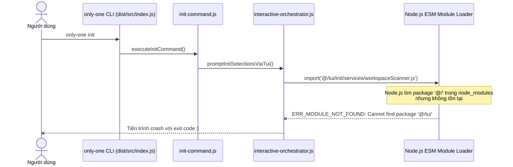

# Debug: ERR_MODULE_NOT_FOUND Cannot find package '@/tui' in interactive-orchestrator.js

## Section 1. Diagnosis

### Symptom
- **Actual**: Khi chạy `only-one init` trên terminal tương tác (TTY), tiến trình crash ngay lập tức với lỗi:
  ```text
  Error [ERR_MODULE_NOT_FOUND]: Cannot find package '@/tui' imported from ...\dist\src\core\init\interactive-orchestrator.js
  ```
- **Expected**: `only-one init` khởi chạy mượt mà giao diện TUI wizard để người dùng lựa chọn cấu hình, không gặp lỗi nạp module.
- **Blast Radius**: Toàn bộ người dùng chạy lệnh `only-one init` ở chế độ tương tác (mặc định trên mọi terminal).

### Reproduction
- **Trigger**: Chạy `only-one init` trực tiếp trên terminal (TTY bật).
- **Red Test**: `test/core/postbuild-paths.test.ts` kiểm tra chuỗi `import('@/')` chưa được chuyển đổi sang đường dẫn tương đối.
- **Command**: `npx vitest run test/core/postbuild-paths.test.ts`.

### Evidence
- **Observed Facts**:
  - Trong `src/core/init/interactive-orchestrator.ts` sử dụng dynamic import:
    ```ts
    const { scanWorkspaceAssets } = await import('@/tui/init/services/workspaceScanner.js');
    const { InitWizardApp } = await import('@/tui/init/InitWizardApp.js');
    ```
  - Trong file build `dist/src/core/init/interactive-orchestrator.js`, hai dòng trên vẫn giữ nguyên chuỗi alias `'@/tui/init/...'`.
  - Node.js ESM Loader không nhận diện `@/` là đường dẫn hợp lệ hoặc package trong `node_modules` nên ném lỗi `ERR_MODULE_NOT_FOUND`.
- **Fault Location**: `scripts/postbuild-paths.cjs` chỉ tìm kiếm và thay thế cú pháp tĩnh `from '@/'` và `from "@/'"`, hoàn toàn bỏ qua cú pháp dynamic import `import('@/')` và `import("@/")`.

### Root Cause
- **Mechanical Cause**: Script xử lý đường dẫn sau build (`postbuild-paths.cjs`) sử dụng regex chỉ bắt pattern `from '@/'` và `from '@assets/'`. Cú pháp dynamic import dạng `import('@/...')` không khớp với pattern này, dẫn đến các specifier dạng dynamic import bị giữ nguyên trong thư mục `dist/`.
- **Trigger Mechanism**: Lệnh `only-one init` gọi hàm `promptInitSelectionsViaTui`, kích hoạt dynamic import tới module TUI với alias `@/tui/init/...`.
- **Violated Invariant**: Mọi alias `@/*` và `@assets/*` trong mã nguồn phân phối (`dist/`) phải được chuyển đổi 100% thành đường dẫn tương đối trước khi đóng gói/cài đặt.

### Defect Call Trace / State Divergence Flow



### Fix Constraints
- Phải hỗ trợ chuyển đổi cả cú pháp tĩnh `from` và cú pháp dynamic import `import(...)` cho cả `@/` và `@assets/`.
- Không làm thay đổi logic tính toán khoảng cách tương đối (`relative`) của thư mục.
- Đảm bảo tương thích trên cả Windows (dấu `\`) và Unix (dấu `/`).

---

## Section 2. File Changes

### Directory Structure Changes

```text
scripts/
└── [MODIFY] postbuild-paths.cjs      # Bổ sung chuyển đổi dynamic import('@/') và import('@assets/')
test/core/
└── [NEW]    postbuild-paths.test.ts  # Regression test kiểm tra chuyển đổi alias dynamic import
```

### 1. `[NEW]` `test/core/postbuild-paths.test.ts`

- **Status**: `[x]`
- **Context**: Chưa có bộ kiểm thử tự động kiểm tra script hậu xử lý đường dẫn build.
- **Target Symbols / AST Seams**: `postbuild-paths logic test`.
- **Invariants**: Đảm bảo toàn bộ alias import('@/') và import('@assets/') đều được thay thế chính xác.
- **Depends On**: None.
- **Fast Test Command**: `npx vitest run test/core/postbuild-paths.test.ts`.

> **Action**: Tạo bài kiểm thử hồi quy xác thực cơ chế thay thế alias cho cả static và dynamic import.

**Test checklist**
- [x] Bắt buộc theo đúng tiêu chí nghiệm thu.
- [x] Đã rà soát code hiện có, fixture và dependencies.
- [x] Không tạo test trùng lặp hoặc phụ thuộc thời gian thực.
- [x] Kiểm thử tối thiểu, rõ ràng và chạy nhanh.
- **Decision**: Viết test trực tiếp cho logic thay thế chuỗi alias của postbuild-paths.
- **Rejected alternative**: Chỉ test thủ công bằng cách publish thử lại gói npm.

```diff
@@ -0,0 +1,41 @@
+import { describe, expect, it } from 'vitest';
+
+function transformPaths(content: string, relPrefix: string, relAssetsPrefix: string): string {
+    let cleaned = content;
+    if (content.includes("'@/") || content.includes('"@/')) {
+        cleaned = cleaned
+            .replaceAll(/from '@\//g, "from '" + relPrefix)
+            .replaceAll(/from "@\//g, 'from "' + relPrefix)
+            .replaceAll(/import\('@\//g, "import('" + relPrefix)
+            .replaceAll(/import\("@\//g, 'import("' + relPrefix);
+    }
+    if (content.includes("'@assets/") || content.includes('"@assets/')) {
+        cleaned = cleaned
+            .replaceAll(/from '@assets\//g, "from '" + relAssetsPrefix)
+            .replaceAll(/from "@assets\//g, 'from "' + relAssetsPrefix)
+            .replaceAll(/import\('@assets\//g, "import('" + relAssetsPrefix)
+            .replaceAll(/import\("@assets\//g, 'import("' + relAssetsPrefix);
+    }
+    return cleaned;
+}
+
+describe('Postbuild Paths Transformer', () => {
+    it('thay thế chính xác static import aliases', () => {
+        const input = "import { foo } from '@/core/foo.js';\nimport { bar } from '@assets/bar.js';";
+        const output = transformPaths(input, '../../', '../../../assets/');
+        expect(output).toContain("from '../../core/foo.js'");
+        expect(output).toContain("from '../../../assets/bar.js'");
+        expect(output).not.toContain('@/');
+        expect(output).not.toContain('@assets/');
+    });
+
+    it('thay thế chính xác dynamic import aliases gây lỗi ERR_MODULE_NOT_FOUND', () => {
+        const input = "const m = await import('@/tui/init/InitWizardApp.js');\nconst a = await import('@assets/packages/index.js');";
+        const output = transformPaths(input, '../../', '../../../assets/');
+        expect(output).toContain("import('../../tui/init/InitWizardApp.js')");
+        expect(output).toContain("import('../../../assets/packages/index.js')");
+        expect(output).not.toContain('@/');
+        expect(output).not.toContain('@assets/');
+    });
+});
```

---

### 2. `[MODIFY]` `scripts/postbuild-paths.cjs`

- **Status**: `[x]`
- **Context**: File hiện chỉ thay thế from '@/' và from '@assets/'.
- **Target Symbols / AST Seams**: `replaceInDir`.
- **Invariants**: Mọi alias trong static lẫn dynamic import đều phải được đổi sang đường dẫn tương đối.
- **Depends On**: `1`.
- **Fast Test Command**: `npx vitest run test/core/postbuild-paths.test.ts`.

> **Action**: Bổ sung regex thay thế cho import('@/') và import('@assets/').

**Ponytail checklist**
- [x] Bắt buộc theo đúng tiêu chí nghiệm thu.
- [x] Đã rà soát code hiện có, thư viện chuẩn và dependencies.
- [x] Không tạo logic trùng lặp hoặc điểm mở rộng suy đoán.
- [x] Diff tối thiểu, đảm bảo an toàn và tính đúng đắn.
- **Decision**: Mở rộng điều kiện kiểm tra và bổ sung replaceAll cho import('...') trong cùng vòng lặp.
- **Rejected alternative**: Thêm dependency bên ngoài (như tsc-alias) làm chậm tiến trình build.

```diff
@@ -18,8 +18,10 @@
-            if (content.includes("from '@/") || content.includes('from "@/')) {
+            if (content.includes("'@/") || content.includes('"@/')) {
                 const rel = relative(dir, join(distDir, 'src'));
                 const prefix = rel ? rel.split(sep).join('/') + '/' : './';
                 cleaned = cleaned
                     .replaceAll(/from '@\//g, "from '" + prefix)
-                    .replaceAll(/from "@\//g, 'from "' + prefix);
+                    .replaceAll(/from "@\//g, 'from "' + prefix)
+                    .replaceAll(/import\('@\//g, "import('" + prefix)
+                    .replaceAll(/import\("@\//g, 'import("' + prefix);
                 needsWrite = true;
             }
 
-            if (content.includes("from '@assets/") || content.includes('from "@assets/')) {
+            if (content.includes("'@assets/") || content.includes('"@assets/')) {
                 const relToAssets = relative(dir, join(distDir, 'assets'));
                 const prefixAssets = relToAssets.split(sep).join('/');
                 const prefix = prefixAssets.startsWith('.') ? prefixAssets + '/' : './' + prefixAssets + '/';
                 cleaned = cleaned
                     .replaceAll(/from '@assets\//g, "from '" + prefix)
-                    .replaceAll(/from "@assets\//g, 'from "' + prefix);
+                    .replaceAll(/from "@assets\//g, 'from "' + prefix)
+                    .replaceAll(/import\('@assets\//g, "import('" + prefix)
+                    .replaceAll(/import\("@assets\//g, 'import("' + prefix);
                 needsWrite = true;
             }
```

---

## Section 3. Verification

### Red Feedback Loop
- [x] Tạo bài kiểm thử `test/core/postbuild-paths.test.ts` để tái hiện việc thay thế dynamic import.
- [x] Chạy `npm run build` để xác nhận `dist/src/core/init/interactive-orchestrator.js` không còn chứa chuỗi `@/tui`.

### Regression
- [x] Chạy kiểm thử toàn diện: `npm test`.
- [x] Chạy kiểm tra định dạng: `npm run format:check`.
- [x] Build kiểm chứng bundle: `npm run build`.

### Evidence
- `npx vitest run test/core/postbuild-paths.test.ts` — `PASS (2 tests passed)`.
- `npm test` — `PASS (65 passed, 268 passed, 4 skipped)`.
- `npm run format:check` — `PASS (All matched files use Prettier code style)`.
- `npm run build` — `PASS (bundle generated cleanly)`.
- `node -e "const f = require('fs').readFileSync('dist/src/core/init/interactive-orchestrator.js', 'utf-8'); if (f.includes('@/tui')) throw new Error('Unresolved alias found!');"` — `PASS (No @/tui found in bundle)`.
- **Lessons Learned**: Luôn hỗ trợ cả cú pháp dynamic import (`import(...)`) khi viết script custom module resolver hoặc hậu xử lý đường dẫn build.
