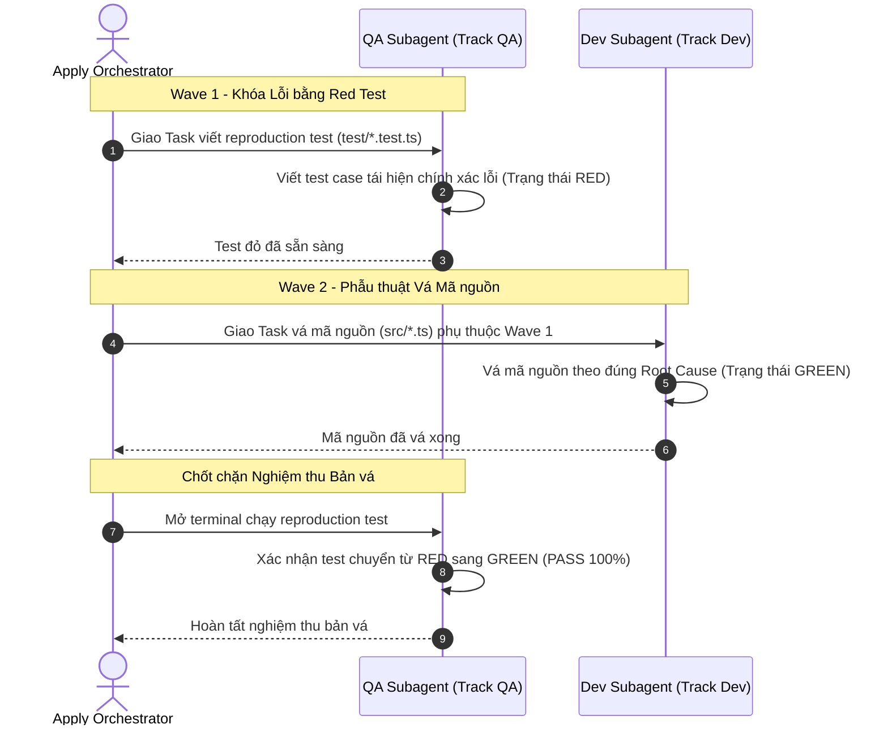

# Concept: Tái thiết kế Only-One Debug theo Kiến trúc Plan và Phân Tách Builder/Tester

## 1. Problem & Goal (Vấn đề & Mục tiêu)

### Problem (Điểm nghẽn & Thiếu sót hiện tại)
- **Context & Trigger**: Khi chạy `/only-one-debug` để điều tra lỗi, chẩn đoán nguyên nhân gốc rễ (RCA) và lập bản vá `debug.md`.
- **Symptom & Defect**: `debug.md` bị lệch pha kiến trúc so với `plan.md`: trùng lặp hai đề mục `Section 3`, thiếu metadata `Wave` và `Track QA / Dev`, task block thiếu trường `Task Type`.
- **Root Cause**: `only-one-debug` chưa được đồng bộ hóa với chuẩn kiến trúc mới của `only-one-plan`; parser `validate-debug.ts` còn dùng regex cũ và lỏng lẻo.
- **Impact / Blast Radius**: Khi chuyển `debug.md` sang `/only-one-apply`, hệ thống không thể kích hoạt chế độ đa Subagents (Orchestrator Mode); người sửa lỗi tự viết test cho bản vá của mình dẫn đến nguy cơ bỏ sót regression.

### Goal (Kết quả kỹ thuật mục tiêu)
- **Core Goal**: Tái thiết kế toàn diện `/only-one-debug` theo chuẩn 4 phần của `only-one-plan`, đồng thời áp dụng mô hình **Builder / Tester Separation** vào quy trình sửa lỗi.
- **Acceptance Criteria**:
  - `debug.md` sở hữu cấu trúc 4 Sections chuẩn mực, triệt tiêu hoàn toàn lỗi trùng lặp `Section 3`:
    - **Section 1**: Diagnosis & RCA (Symptom, Reproduction, Evidence, Root Cause, Mermaid Trace Flow, Directory Structure).
    - **Section 2**: Defect Story Board (User Journey, Kịch bản lỗi Hiện tại vs Kỳ vọng, Mermaid Flow).
    - **Section 3**: Test Cases & Verification Matrix (Ma trận Đối soát và Đặc tả Test Cases `| Test ID |`).
    - **Section 4**: File Changes (Tổ chức theo Execution Waves và Builder/Tester Separation).
  - **Phân tách Builder / Tester trong sửa lỗi**:
    - `Wave 1 (Track QA)`: Tester Subagent viết tệp reproduction test ở trạng thái RED (`*.test.ts`).
    - `Wave 2 (Track Dev)`: Coder Subagent viết mã nguồn vá lỗi ở trạng thái GREEN (`src/...`) phụ thuộc vào test của QA.
    - Chốt chặn Wave Gatekeeper: Tester Subagent mở terminal chạy test nghiệm thu; hỗ trợ Red Feedback Loop và Circuit Breaker (tối đa 3 lần retries).
  - Mọi task block trong Section 4 đồng nhất 100% metadata với `plan.md`: `Status`, `Task Type`, `Wave`, `Depends On`, `Context`, `Target Symbols / AST Seams`, `Invariants`.
  - Cập nhật công cụ `validate-debug.ts` để kiểm tra toàn vẹn cấu trúc và tính hợp lệ của đồ thị DAG Wave.

## 2. Scope Boundaries (Ranh giới phạm vi)

- **In-Scope**:
  - Chuẩn hóa tài liệu kỹ năng `only-one-debug/SKILL.md` theo cấu trúc 4 Sections tương thích hoàn toàn với `only-one-plan`.
  - Tích hợp mô hình Builder/Tester: tách riêng `Track QA` (viết red test) và `Track Dev` (vá mã nguồn).
  - Tích hợp chốt chặn Wave Gatekeeper, Red Feedback Loop và Circuit Breaker vào `debug.md`.
  - Nâng cấp script `validate-debug.ts` đồng bộ đầy đủ các luật kiểm tra từ `validate-plan.ts`.
  - Viết test suites kiểm tra tính hợp lệ của `debug.md` chuẩn mới.
- **Explicit Out-of-Scope**:
  - Không thay đổi các nguyên lý điều tra RCA cốt lõi (Symptom $\rightarrow$ Reproduction $\rightarrow$ Evidence $\rightarrow$ Root Cause).
  - Không can thiệp vào mã nguồn nghiệp vụ của dự án.

## 3. Proposed Solution & Core Mechanism (Giải pháp đề xuất & Cơ chế cốt lõi)

- **Core Mechanism**:
  - `/only-one-debug` vận hành theo quy trình chẩn đoán khoa học:
    1. **Khảo sát & Tái hiện (Role: SRE / RCA Investigator)**: Tìm nguyên nhân gốc rễ và lập sơ đồ phân kỳ trạng thái lỗi (Defect State Divergence).
    2. **Đặc tả Bản vá (Role: Technical Architect)**: Soạn thảo `debug.md` có cấu trúc tương đương `plan.md` để bàn giao trơn tru cho `/only-one-apply`.
    3. **Phân vai Thi công (Role: QA vs Dev Subagents)**:
       - QA Subagent viết reproduction test khóa chặt hành vi lỗi (Red Test).
       - Dev Subagent thực hiện bản vá phẫu thuật tối thiểu (Surgical Patch).

- **Sơ đồ Chu trình Sửa lỗi Builder / Tester (Debugging Flow)**:


- **Mô hình Khung Cấu trúc Chuẩn của `debug.md` (ASCII Wireframe)**:
```text
debug.md
├── Frontmatter (status, slug, reproduction_test, created_at)
├── # Debug: <Tên sự cố>
├── ## Section 1. Diagnosis & Directory Structure Changes
│   ├── Symptom (Actual, Expected, Blast Radius)
│   ├── Reproduction (Trigger, Red Test, Command)
│   ├── Evidence & Root Cause (Mechanical Cause, Violated Invariant)
│   ├── Defect State Divergence Flow (Mermaid Sequence)
│   └── Directory Structure Changes (ASCII Tree)
├── ## Section 2. Defect User Story & Reproduction Scenarios (Mermaid Storyboard)
├── ## Section 3. Test Cases & Verification Matrix (| Test ID |)
└── ## Section 4. File Changes (Execution Waves, Track QA/Dev, Diff blocks)
```

## 4. Critical Risks & Edge Cases (Phân tích Rủi ro & Cơ chế Phòng vệ)

- **Rủi ro 1: Phình phạm vi sửa đổi mã nguồn ngoài vùng lỗi (Scope Creep)**
  - *Mặt tiêu cực / Nguy cơ*: Dev Subagent tiện tay tái cấu trúc hoặc sửa các tệp không liên quan trực tiếp đến lỗi.
  - *Cơ chế phòng vệ*: Ponytail Invariant: Mọi diff trong Section 4 bắt buộc phải gắn liền trực tiếp với bằng chứng `Root Cause` ở Section 1; cấm tái cấu trúc lan man.
- **Rủi ro 2: Bài test tái hiện không ổn định (Flaky Reproduction)**
  - *Mặt tiêu cực / Nguy cơ*: Test lúc đỏ lúc xanh do race condition hoặc phụ thuộc môi trường.
  - *Cơ chế phòng vệ*: Nguyên tắc chẩn đoán bắt buộc: Kịch bản tái hiện ở Section 1 phải mang tính tất định (deterministic) trước khi cho phép lập Section 4.
- **Rủi ro 3: Coder tự ý nới lỏng assertion trong tệp test để ép pass**
  - *Mặt tiêu cực / Nguy cơ*: Coder sửa bài test thay vì sửa lỗi logic trong mã nguồn.
  - *Cơ chế phòng vệ*: Ràng buộc phân quyền tuyệt đối: `Track Dev` chỉ được phép sửa mã nguồn (`src/...`), cấm chạm vào tệp test trong `test/`.
- **Rủi ro 4: Phá vỡ tính tương thích với các tài liệu `debug.md` cũ**
  - *Mặt tiêu cực / Nguy cơ*: Validator báo lỗi toàn bộ các tài liệu debug đã tạo trước đây.
  - *Cơ chế phòng vệ*: Nâng cấp `validate-debug.ts` theo hướng cảnh báo mềm (Warning) với các trường mới nếu gặp tài liệu debug cũ, chỉ chặn lỗi cứng (Error) với các tài liệu tạo mới.
