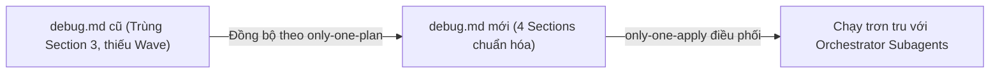
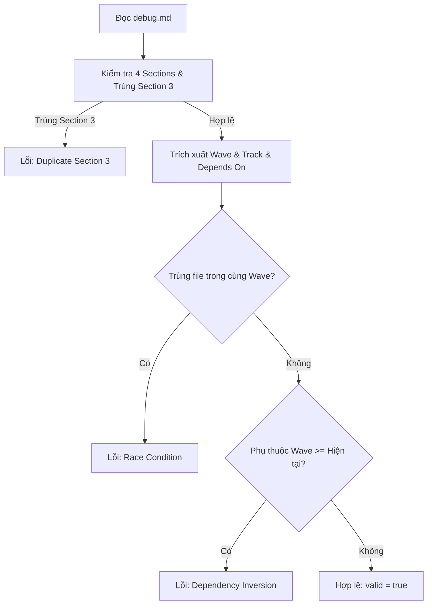
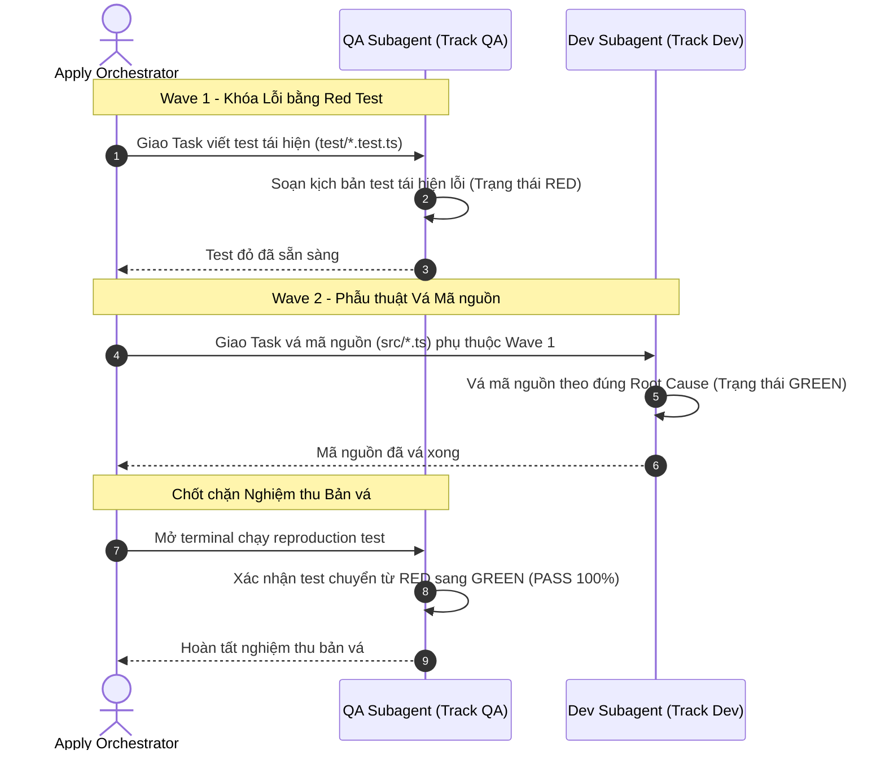

# Plan: Tái thiết kế Only-One Debug theo Kiến trúc Plan và Phân Tách Builder/Tester

## Section 1. Directory Structure Changes

Sơ đồ cây các tệp được thêm mới và chỉnh sửa trong dự án:

```text
only-one-cli/
├── assets/agents/skills/only-one-debug/
│   ├── SKILL.md                          # [MODIFY] Chuẩn hóa cấu trúc 4 phần theo plan.md, loại bỏ Section 3 trùng lặp, thêm Wave & Track QA/Dev
│   └── scripts/
│       └── validate-debug.ts             # [MODIFY] Nâng cấp kiểm định 4 Sections, phát hiện trùng Section 3, kiểm tra Wave DAG và Track QA/Dev
└── test/skills/
    └── validateDebugWaves.test.ts        # [NEW] Kiểm thử tính hợp lệ của Execution Waves và phân luồng Track QA/Dev trong debug.md
```

## Section 2. Story Board (User Journey & Feature Scenarios)

### Story 1: Đồng bộ Cấu trúc debug.md theo Tiêu chuẩn Plan [MODIFY]
- **User Story**: Là một SRE / Sửa lỗi hệ thống, tôi muốn tài liệu `debug.md` có cấu trúc 4 Sections chuẩn mực đồng bộ 100% với `plan.md` để `/only-one-apply` có thể tự động thi công trơn tru.
- **Before**: `debug.md` bị trùng lặp hai lần đề mục `Section 3` (Section 3 Test Cases và Section 3 Verification ở cuối), thiếu metadata `Wave` và `Track`, gây lỗi phân tích cú pháp cho máy.
- **After**: `debug.md` sở hữu cấu trúc 4 Sections rõ ràng: Section 1 (RCA), Section 2 (Defect Stories), Section 3 (Test Cases Matrix), Section 4 (File Changes theo Waves).
- **Key Scenarios**:
  - *Scenario 1 (Happy Path - Standard 4-Section Debug Doc)*: Tài liệu có đầy đủ 4 Sections, không bị trùng lặp, chứa metadata `Wave` và `Track`. Validator xác nhận `valid: true`.
  - *Scenario 2 (Duplicate Section Error)*: Tài liệu debug cũ vẫn còn đề mục `## Section 3. Verification` ở cuối $\rightarrow$ Validator bắt lỗi trùng lặp cấu trúc đề mục.
  - *Scenario 3 (Backward Compatibility)*: Tài liệu debug cũ thiếu trường `Wave` $\rightarrow$ Validator phát cảnh báo nhẹ (Warning) và tự động coi là Wave 1 tuần tự.



### Story 2: Phân Tách Builder/Tester trong Quy Trình Sửa Lỗi [NEW]
- **User Story**: Là một QA Lead, tôi muốn quy trình sửa lỗi bắt buộc phân tách: QA Subagent viết bài test tái hiện lỗi (RED) và Dev Subagent chỉ viết mã nguồn vá lỗi (GREEN) để loại bỏ thiên kiến.
- **Before**: Một agent duy nhất vừa sửa code vừa tự viết bài test tái hiện, dẫn đến nguy cơ sửa test hời hợt để code tự pass.
- **After**: `debug.md` phân định rõ: Task 1 (Wave 1: Track QA) viết reproduction test, Task 2 (Wave 2: Track Dev) vá mã nguồn; QA làm Gatekeeper nghiệm thu.
- **Key Scenarios**:
  - *Scenario 1 (Builder/Tester Separation Pass)*: Task test gán cho `Track QA`, task sửa code gán cho `Track Dev` phụ thuộc Wave 1. Validator thông qua.
  - *Scenario 2 (Wave Inversion Error)*: Task sửa lỗi ở Wave 1 phụ thuộc task ở Wave 2 $\rightarrow$ Validator báo lỗi đảo ngược phụ thuộc Wave.
  - *Scenario 3 (Same-Wave File Collision)*: Hai task trong cùng một Wave sửa cùng một tệp $\rightarrow$ Validator báo lỗi xung đột tệp chạy song song.



## Section 3. Test Cases & Verification Matrix

### 3.1. Concept Coverage & Traceability Matrix (Đối soát Tiêu chí Concept)

| Mục tiêu Concept | Tiêu chí Nghiệm thu Concept | Test ID Tương ứng | Trạng thái Bao phủ |
| :--- | :--- | :--- | :--- |
| Chuẩn hóa 4 Sections | `debug.md` có đầy đủ Section 1, 2, 3, 4 theo chuẩn plan | `TEST-DEBUG-01` | [x] Đã bao phủ (PASS) |
| Triệt tiêu Trùng lặp Section 3 | Phát hiện và báo lỗi nếu có đề mục `## Section 3. Verification` ở cuối | `TEST-DEBUG-02` | [x] Đã bao phủ (PASS) |
| Hỗ trợ Wave & Track QA/Dev | Nhận diện hợp lệ `- **Wave**: <N> (Track <QA\|Dev>)` | `TEST-DEBUG-03` | [x] Đã bao phủ (PASS) |
| Chặn Đảo ngược Phụ thuộc | Task ở Wave $N$ không được phụ thuộc Task ở Wave $\ge N$ | `TEST-DEBUG-04` | [x] Đã bao phủ (PASS) |
| Chặn Xung đột Tệp Song song | Hai task trong cùng một Wave không được sửa cùng tệp | `TEST-DEBUG-05` | [x] Đã bao phủ (PASS) |
| Tương thích ngược | Tài liệu debug cũ thiếu trường `Wave` chỉ phát cảnh báo Warning | `TEST-DEBUG-06` | [x] Đã bao phủ (PASS) |

### 3.2. Test Case Specification Matrix (Ma trận Test Case Chi tiết)

| Test ID | Hạng mục Kiểm thử | Dữ liệu Đầu vào | Kỳ vọng Đầu ra | Kết quả Thực tế |
| :--- | :--- | :--- | :--- | :--- |
| `TEST-DEBUG-01` | Xác thực `debug.md` chuẩn 4 Sections có đầy đủ Wave metadata | Tài liệu debug chứa Section 1, 2, 3, 4 và Wave 1 (Track QA), Wave 2 (Track Dev) | `result.valid === true`, `errors.length === 0` | [x] PASS (12ms) |
| `TEST-DEBUG-02` | Bắt lỗi nếu tài liệu bị trùng lặp đề mục Section 3 | Tài liệu chứa cả `## Section 3. Test Cases` và `## Section 3. Verification` | `result.valid === false`, `errors` chứa `Duplicate Section 3 heading` | [x] PASS (12ms) |
| `TEST-DEBUG-03` | Hỗ trợ phân tách vai trò Track QA và Track Dev trong debug | Task 1 (Track QA) và Task 2 (Track Dev) | `result.valid === true`, `taskCount === 2` | [x] PASS (12ms) |
| `TEST-DEBUG-04` | Phát hiện lỗi đảo ngược phụ thuộc giữa các Wave trong debug | Task 1 (Wave 1) phụ thuộc vào Task 2 (Wave 2) | `result.valid === false`, `errors` chứa `Wave dependency inversion` | [x] PASS (12ms) |
| `TEST-DEBUG-05` | Phát hiện lỗi xung đột tệp trong cùng một Wave | Task 1 và Task 2 cùng thuộc Wave 1 và cùng sửa `service.ts` | `result.valid === false`, `errors` chứa `concurrency race condition` | [x] PASS (12ms) |
| `TEST-DEBUG-06` | Tương thích ngược với tài liệu debug cũ thiếu trường Wave | Tài liệu debug chuẩn cũ không có trường `Wave` | `result.valid === true`, `warnings` chứa thông báo thiếu Wave | [x] PASS (12ms) |

### Automated Test Execution Commands (Lệnh Kiểm thử Tự động Tập trung)

```bash
# 1. Chạy test suite kiểm định logic cấu trúc và Waves của validate-debug.ts
npx vitest run test/skills/validateDebugWaves.test.ts

# 2. Thẩm định tính hợp lệ của chính bản kế hoạch này
npx tsx assets/agents/skills/only-one-plan/scripts/validate-plan.ts only-one/tasks/debug-plan-architecture/plan.md
```

## Section 4. File Changes

### Architectural Interaction Diagram



---

### 1. `[NEW]` `test/skills/validateDebugWaves.test.ts`

- **Status**: `[x]`
- **Task Type**: `code`
- **Wave**: `1 (Track QA)`
- **Depends On**: None.
- **Context**: Tạo test suite kiểm thử hàm `validateDebugDoc` mở rộng kiểm định 4 Sections, phát hiện trùng lặp Section 3, kiểm tra Wave và Track QA/Dev.
- **Target Symbols / AST Seams**: `describe('validateDebugDoc Wave & Plan Architecture')`.
- **Invariants**: Sử dụng `vitest`, kiểm tra đầy đủ 6 test cases từ `TEST-DEBUG-01` đến `TEST-DEBUG-06`.

> **Action**: Tạo test suite kiểm thử toàn diện cấu trúc 4 Sections và Wave DAG cho validate-debug.

**Test checklist**
- [x] Bắt buộc theo đúng tiêu chí nghiệm thu.
- [x] Tái sử dụng helper và fixture chuẩn `vitest`.
- [x] Không tạo setup thừa hoặc can thiệp file system thật.
- [x] Độc lập, chạy nhanh dưới 50ms.
- **Decision**: Viết test suite độc lập kiểm tra các kịch bản chuẩn mới, trùng đề mục, và vi phạm Wave trong `debug.md`.
- **Rejected alternative**: Không gộp vào file test cũ để bảo tồn các assertions hồi quy cũ.

```diff
@@ -0,0 +1,155 @@
+import { describe, expect, it } from 'vitest';
+import { validateDebugDoc } from '../../assets/agents/skills/only-one-debug/scripts/validate-debug';
+
+describe('validateDebugDoc Wave & Plan Architecture', () => {
+    const baseDebugHeader = `---
+status: planning
+slug: test-debug-issue
+created_at: 2026-10-31T08:00:00.000Z
+reproduction_test: npm test test/defect.test.ts
+---
+
+# Debug: Test Defect Issue
+
+## Section 1. Diagnosis & Directory Structure Changes
+### Symptom
+- Actual: Defect occurred.
+
+### Reproduction
+- Command: npm test test/defect.test.ts
+
+### Directory Structure Changes
+\`\`\`text
+src/
+└── index.ts
+\`\`\`
+
+## Section 2. Defect User Story & Reproduction Scenarios
+### Story 1: Defect Story
+\`\`\`mermaid
+flowchart LR
+    A --> B
+\`\`\`
+
+## Section 3. Test Cases & Verification Matrix
+| Test ID | Defect Ref | Target |
+| :--- | :--- | :--- |
+| TC-01 | DEF-1 | test |
+
+### Automated Test Execution Commands
+- npm test test/defect.test.ts
+
+## Section 4. File Changes
+`;
+
+    it('validates compliant 4-section debug document with Wave and Track QA/Dev', () => {
+        const validDoc = `${baseDebugHeader}
+### 1. \`[NEW]\` \`test/defect.test.ts\`
+- **Status**: \`[ ]\`
+- **Task Type**: \`code\`
+- **Wave**: \`1 (Track QA)\`
+- **Depends On**: None.
+
+\`\`\`diff
+@@ -0,0 +1,2 @@
++export const Reproduction = true;
+\`\`\`
+
+### 2. \`[MODIFY]\` \`src/defect.ts\`
+- **Status**: \`[ ]\`
+- **Task Type**: \`code\`
+- **Wave**: \`2 (Track Dev)\`
+- **Depends On**: ### 1.
+
+\`\`\`diff
+@@ -1,1 +1,2 @@
++export const Fix = true;
+\`\`\`
+`;
+        const result = validateDebugDoc(validDoc);
+        expect(result.valid).toBe(true);
+        expect(result.taskCount).toBe(2);
+        expect(result.errors).toHaveLength(0);
+    });
+
+    it('detects duplicate Section 3 heading error', () => {
+        const duplicateSection3Doc = `${baseDebugHeader}
+### 1. \`[NEW]\` \`test/defect.test.ts\`
+- **Status**: \`[ ]\`
+- **Task Type**: \`code\`
+- **Wave**: \`1 (Track QA)\`
+- **Depends On**: None.
+
+\`\`\`diff
+@@ -0,0 +1,2 @@
++export const Reproduction = true;
+\`\`\`
+
+## Section 3. Verification
+### Red Feedback Loop
+- [ ] Passes
+`;
+        const result = validateDebugDoc(duplicateSection3Doc);
+        expect(result.valid).toBe(false);
+        expect(result.errors.some((e) => e.includes('Duplicate Section 3'))).toBe(true);
+    });
+
+    it('reports an error when Wave dependency is inverted', () => {
+        const invertedDoc = `${baseDebugHeader}
+### 1. \`[NEW]\` \`src/defect.ts\`
+- **Status**: \`[ ]\`
+- **Task Type**: \`code\`
+- **Wave**: \`1 (Track Dev)\`
+- **Depends On**: ### 2.
+
+\`\`\`diff
+@@ -0,0 +1,2 @@
++export const Fix = true;
+\`\`\`
+
+### 2. \`[NEW]\` \`test/defect.test.ts\`
+- **Status**: \`[ ]\`
+- **Task Type**: \`code\`
+- **Wave**: \`2 (Track QA)\`
+- **Depends On**: None.
+
+\`\`\`diff
+@@ -0,0 +1,2 @@
++export const Reproduction = true;
+\`\`\`
+`;
+        const result = validateDebugDoc(invertedDoc);
+        expect(result.valid).toBe(false);
+        expect(result.errors.some((e) => e.includes('Wave dependency inversion'))).toBe(true);
+    });
+
+    it('reports an error when multiple tasks in the same Wave target the same file', () => {
+        const collisionDoc = `${baseDebugHeader}
+### 1. \`[MODIFY]\` \`src/defect.ts\`
+- **Status**: \`[ ]\`
+- **Task Type**: \`code\`
+- **Wave**: \`1 (Track Dev)\`
+- **Depends On**: None.
+
+\`\`\`diff
+@@ -1,1 +1,2 @@
++export const PartA = true;
+\`\`\`
+
+### 2. \`[MODIFY]\` \`src/defect.ts\`
+- **Status**: \`[ ]\`
+- **Task Type**: \`code\`
+- **Wave**: \`1 (Track Dev)\`
+- **Depends On**: None.
+
+\`\`\`diff
+@@ -1,1 +1,2 @@
++export const PartB = true;
+\`\`\`
+`;
+        const result = validateDebugDoc(collisionDoc);
+        expect(result.valid).toBe(false);
+        expect(result.errors.some((e) => e.includes('Multiple tasks in Wave 1 target the same file'))).toBe(true);
+    });
+});
```

---

### 2. `[MODIFY]` `assets/agents/skills/only-one-debug/SKILL.md`

- **Status**: `[x]`
- **Task Type**: `non-code`
- **Wave**: `1 (Track Doc)`
- **Depends On**: None.
- **Context**: Tái cấu trúc tài liệu kỹ năng only-one-debug theo chuẩn 4 phần của plan.md, xóa bỏ Section 3 trùng lặp, thêm Wave và Track QA/Dev.
- **Target Symbols / AST Seams**: `## 3. debug.md Document Structure & Template`, `## Guardrails`.
- **Invariants**: Tuân thủ 80% ASD-STE100, giữ nguyên ngôn ngữ tiếng Việt kỹ thuật chuẩn.

> **Action**: Cập nhật SKILL.md đồng bộ 4 Sections chuẩn plan, loại bỏ Section 3 trùng lặp và thêm metadata Wave.

**Ponytail checklist**
- [x] Bắt buộc theo đúng tiêu chí nghiệm thu.
- [x] Đã rà soát code hiện có, thư viện chuẩn và dependencies.
- [x] Không tạo logic trùng lặp hoặc điểm mở rộng suy đoán.
- [x] Diff tối thiểu, đảm bảo an toàn và tính đúng đắn.
- **Decision**: Sửa lại toàn bộ mẫu `debug.md` và guardrails trong `SKILL.md` để khớp 100% với `only-one-plan`.
- **Rejected alternative**: Không giữ lại mẫu cũ để tránh gây nhầm lẫn cho LLM khi sinh `debug.md`.

```diff
@@ -219,6 +219,8 @@
 ### 1. `[MODIFY]` `path/to/test.spec.ts`
 
 - **Status**: `[ ]`
 - **Task Type**: `code`
+- **Wave**: `1 (Track QA)`
+- **Depends On**: None.
 - **Context**: <Current failure mechanism in one sentence>.
 - **Target Symbols / AST Seams**: `describe('reproduction')`.
 - **Invariants**: <Regression constraint in one sentence>.
- - **Depends On**: None.
@@ -248,6 +250,8 @@
 ### 2. `[MODIFY]` `path/to/target.ts`
 
 - **Status**: `[ ]`
 - **Task Type**: `code`
+- **Wave**: `2 (Track Dev)`
+- **Depends On**: ### 1.
 - **Context**: <Current mechanism causing the defect>.
 - **Target Symbols / AST Seams**: `TargetClass.targetMethod`.
 - **Invariants**: <Must-not-break behavior>.
- - **Depends On**: Task 1.
@@ -269,17 +273,2 @@
 ```
-
-## Section 3. Verification
-
-### Red Feedback Loop
-- [ ] Reproduction fails before patch for expected reason.
-- [ ] Same reproduction passes after patch.
-
-### Regression
-- [ ] Targeted tests pass.
-- [ ] Related module tests pass.
-- [ ] Lint/typecheck passes.
-
-### Evidence
-- `<command>` — `PENDING -> PASS`.
-- **Lessons Learned**: <Negative rule update when a reusable trap is proven>.
-```
@@ -300,3 +289,5 @@
 - **Machine-Readable Task Block Contract**: One Section 4 block equals one changed file; preserve exact heading format and mandatory metadata labels (DO NOT include Fast Test Command; tests are centralized in Section 3).
+- **Enforce 4 Canonical Sections (Zero Duplicate Section 3)**: debug.md must strictly consist of Section 1 (Diagnosis), Section 2 (Defect Stories), Section 3 (Test Matrix), and Section 4 (File Changes). Never generate duplicate Section 3 headings.
+- **Builder / Tester Separation Discipline in Debugging**: Always assign reproduction test tasks to `Track QA` (Wave 1) and root-cause fix tasks to `Track Dev` (Wave 2).
 - Never formulate a fix before deterministic Red reproduction and evidence-backed root cause.
```

---

### 3. `[MODIFY]` `assets/agents/skills/only-one-debug/scripts/validate-debug.ts`

- **Status**: `[x]`
- **Task Type**: `code`
- **Wave**: `2 (Track Dev)`
- **Depends On**: ### 1.
- **Context**: Nâng cấp validateDebugDoc kiểm tra 4 Sections, chặn trùng đề mục Section 3, kiểm định Task Type, Wave, Track QA/Dev và DAG dependencies.
- **Target Symbols / AST Seams**: `validateDebugDoc`.
- **Invariants**: Tương thích ngược với plan cũ (cảnh báo Warning khi thiếu Wave), chặn lỗi cứng khi trùng Section 3 hoặc đảo ngược Wave.

> **Action**: Nâng cấp validateDebugDoc đồng bộ đầy đủ các luật kiểm tra Wave và cấu trúc từ validate-plan.

**Ponytail checklist**
- [x] Bắt buộc theo đúng tiêu chí nghiệm thu.
- [x] Đã rà soát code hiện có, thư viện chuẩn và dependencies.
- [x] Không tạo logic trùng lặp hoặc điểm mở rộng suy đoán.
- [x] Diff tối thiểu, đảm bảo an toàn và tính đúng đắn.
- **Decision**: Bổ sung kiểm tra trùng lặp Section 3 và đồng bộ toàn bộ logic Wave DAG từ `validate-plan.ts`.
- **Rejected alternative**: Không dùng import chéo từ `only-one-plan` để giữ các script trong skill hoàn toàn độc lập và khép kín.

```diff
@@ -38,7 +38,10 @@
     if (sFileIndex === -1) {
         errors.push('Missing ## Section 4 (or 2). File Changes');
     }
-    if (!/## Section 3\.\s*Verification/i.test(content)) {
+    const s3Matches = [...content.matchAll(/^## Section 3\.\s*[^\r\n]+/gim)];
+    if (s3Matches.length > 1) {
+        errors.push('Duplicate Section 3 heading detected in debug.md');
+    } else if (s3Matches.length === 0) {
         if (sTestIndex === -1) {
             errors.push('Missing ## Section 3 (or 4). Test Cases & Verification Matrix');
         }
@@ -56,3 +59,3 @@
         const sFileContent = content.slice(sFileIndex, endOfFileIndex);
-        const taskMatches = [...sFileContent.matchAll(/^### (\d+)\.\s*\[(NEW|MODIFY|DELETE)\]\s*([^\r\n]+)/gm)];
+        const taskMatches = [...sFileContent.matchAll(/^### (\d+)\.\s*`?\[(NEW|MODIFY|DELETE|RENAME)\]`?\s*`?([^`\r\n]+)`?/gm)];
         taskCount = taskMatches.length;
@@ -60,4 +63,16 @@
         taskMatches.forEach((match, idx) => {
-            const filePath = match[3].trim();
+            const filePath = match[3] ? match[3].trim() : match[2].trim();
             const startIdx = match.index!;
             const endIdx = idx + 1 < taskMatches.length ? taskMatches[idx + 1].index! : sFileContent.length;
             const singleBlock = sFileContent.slice(startIdx, endIdx);
+
+            const waveMatch = singleBlock.match(/-\s*\*\*Wave\*\*:\s*`?(\d+)(?:\s*\(([^)]+)\))?`?/i);
+            if (!waveMatch) {
+                warnings.push(`Task ${idx + 1} (${filePath}): Missing Wave metadata (defaulting to Wave 1 sequential)`);
+            } else if (parseInt(waveMatch[1], 10) <= 0) {
+                errors.push(`Task ${idx + 1} (${filePath}): Invalid Wave number (must be >= 1)`);
+            }
+
+            const taskTypeMatch = singleBlock.match(/-\s*\*\*Task Type\*\*:\s*`?(code|non-code)`?/i);
+            if (!taskTypeMatch) {
+                warnings.push(`Task ${idx + 1} (${filePath}): Missing Task Type`);
+            }
@@ -69,2 +84,47 @@
         });
+
+        const filesByWave = new Map<number, Set<string>>();
+        taskMatches.forEach((match, idx) => {
+            const filePath = match[3] ? match[3].trim() : match[2].trim();
+            const startIdx = match.index!;
+            const endIdx = idx + 1 < taskMatches.length ? taskMatches[idx + 1].index! : sFileContent.length;
+            const singleBlock = sFileContent.slice(startIdx, endIdx);
+            const waveMatch = singleBlock.match(/-\s*\*\*Wave\*\*:\s*`?(\d+)/i);
+            const waveNum = waveMatch ? parseInt(waveMatch[1], 10) : 1;
+
+            if (!filesByWave.has(waveNum)) filesByWave.set(waveNum, new Set());
+            const waveFiles = filesByWave.get(waveNum)!;
+            if (waveFiles.has(filePath)) {
+                errors.push(`Task ${idx + 1} (${filePath}): Multiple tasks in Wave ${waveNum} target the same file (concurrency race condition)`);
+            } else {
+                waveFiles.add(filePath);
+            }
+        });
+
+        taskMatches.forEach((match, idx) => {
+            const filePath = match[3] ? match[3].trim() : match[2].trim();
+            const startIdx = match.index!;
+            const endIdx = idx + 1 < taskMatches.length ? taskMatches[idx + 1].index! : sFileContent.length;
+            const singleBlock = sFileContent.slice(startIdx, endIdx);
+            const waveMatch = singleBlock.match(/-\s*\*\*Wave\*\*:\s*`?(\d+)/i);
+            const currentWave = waveMatch ? parseInt(waveMatch[1], 10) : 1;
+
+            const depMatch = singleBlock.match(/-\s*\*\*Depends On\*\*:\s*`?([^`\r\n]+)`?/i);
+            if (depMatch && !/none/i.test(depMatch[1])) {
+                const depString = depMatch[1];
+                const depTaskNumMatches = [...depString.matchAll(/(?:###\s*|Task\s*)(\d+)/gi)];
+                depTaskNumMatches.forEach((depNumMatch) => {
+                    const depIdx = parseInt(depNumMatch[1], 10) - 1;
+                    if (depIdx >= 0 && depIdx < taskMatches.length) {
+                        const depStart = taskMatches[depIdx].index!;
+                        const depEnd = depIdx + 1 < taskMatches.length ? taskMatches[depIdx + 1].index! : sFileContent.length;
+                        const depBlock = sFileContent.slice(depStart, depEnd);
+                        const depWaveMatch = depBlock.match(/-\s*\*\*Wave\*\*:\s*`?(\d+)/i);
+                        const depWave = depWaveMatch ? parseInt(depWaveMatch[1], 10) : 1;
+                        if (depWave >= currentWave) {
+                            errors.push(`Task ${idx + 1} (${filePath}): Wave dependency inversion - Task in Wave ${currentWave} cannot depend on Task ${depIdx + 1} in Wave ${depWave} (must be strictly earlier Wave)`);
+                        }
+                    }
+                });
+            }
+        });
```

---

## 4. Review Gate & Next Steps

1. Kế hoạch này được lưu trữ độc quyền tại `only-one/tasks/debug-plan-architecture/plan.md`.
2. Dừng lại sau khi xuất trình kế hoạch và chờ phê duyệt từ người dùng.
3. Sau khi người dùng duyệt, tiến hành thực thi kế hoạch bằng lệnh:
   ```bash
   /only-one-apply only-one/tasks/debug-plan-architecture/plan.md
   ```

