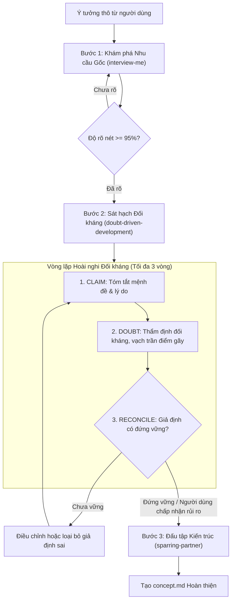

# Concept: Doubt-Driven Development External Skill Integration (Tích hợp Kỹ năng Hoài nghi Từ xa qua Skills.sh)

## 1. Problem & Goal (Vấn đề & Mục tiêu)

### Problem (Điểm nghẽn & Thiếu sót hiện tại)
- **Context & Trigger**: Khi người dùng thảo luận ý tưởng, thiết kế hoặc đưa ra yêu cầu kỹ thuật với Agent trong workflow `/only-one-idea` (hoặc `/only-one-plan`).
- **Symptom & Defect**: Agent thường mắc hội chứng LLM Sycophancy (nịnh bợ, dễ dãi thuận theo), tự động chấp thuận các giải pháp bề nổi của người dùng (bẫy XY Problem) và tán dương ý tưởng mà không kiểm chứng tính xác thực của các giả định nền tảng.
- **Root Cause**: Hệ thống `only-one-cli` hiện chỉ có `interview-me` (hỏi làm rõ phạm vi ở vai trò BA) và `sparring-partner` (so sánh các phương án kỹ thuật ở Step 2), nhưng thiếu hoàn toàn một động cơ **Hoài nghi Đối kháng (Adversarial Doubt Engine)** có cấu trúc để chủ động "bẻ gãy" và sát hạch các giả định ngầm (Unstated Assumptions) trước khi thiết kế giải pháp.
- **Impact / Blast Radius**: Người dùng dễ bị cuốn vào việc xây dựng những tính năng sai lệch với nhu cầu gốc, lãng phí thời gian và token để tạo ra kiến trúc cồng kềnh, hoặc triển khai các giải pháp tiềm ẩn nguy cơ race condition, lỗ hổng bảo mật và sự cố production.

### Goal (Kết quả kỹ thuật mục tiêu)
- **Core Goal**: Tích hợp kỹ năng đối kháng `doubt-driven-development` từ kho cộng đồng chuẩn mực (`addyosmani/agent-skills`) vào `only-one-cli` dưới dạng **External Skill Package** (thông qua `skills.sh` installer), đồng thời đưa quy trình hoài nghi (`CLAIM` $\rightarrow$ `EXTRACT` $\rightarrow$ `DOUBT` $\rightarrow$ `RECONCILE` $\rightarrow$ `STOP`) vào workflow `/only-one-idea`.
- **Acceptance Criteria**:
  - Đăng ký `doubt-driven-development` trong `assets/agents/packages/index.ts` với `kind: 'skills'`, `source: 'addyosmani/agent-skills'`, `skillName: 'doubt-driven-development'`.
  - Bổ sung package `doubt-driven-development` vào cấu hình combos thích hợp (`only-one-flow`) trong `assets/agents/combos/index.ts`.
  - Cập nhật quy trình thẩm định trong `assets/agents/skills/only-one-idea/SKILL.md`, biến `Doubt Cycle` thành một chốt chặn bắt buộc (Mandatory Phase Gate) giữa Step 1 (Khám phá) và Step 2 (Thiết kế Kiến trúc).
  - Tăng patch version cho packages manifest và combos manifest.
  - Viết bộ kiểm thử hợp đồng tự động xác thực việc đăng ký package và tính khả dụng của remote installer.

## 2. Scope Boundaries (Ranh giới phạm vi)
- **In-Scope**:
  - Đăng ký package `doubt-driven-development` trong `assets/agents/packages/index.ts`.
  - Liên kết package vào combo `only-one-flow` trong `assets/agents/combos/index.ts`.
  - Cập nhật tài liệu quy trình `/only-one-idea` (`assets/agents/skills/only-one-idea/SKILL.md`).
  - Viết unit tests kiểm tra hợp đồng package và combo tại `test/skills/doubtDrivenDevelopmentPackage.test.ts`.
- **Explicit Out-of-Scope**:
  - Không sao chép thủ công tệp `SKILL.md` vào `assets/agents/skills/` (phân phối động qua remote `skills.sh` installer).
  - Không thay đổi các subagent runtime verification (`terminal-runner`, `browser-tester`, `api-tester`).
  - Không áp dụng vòng lặp hoài nghi cho các thao tác đổi tên hoặc lệnh cơ học đơn giản.

## 3. Proposed Solution & Core Mechanism (Giải pháp đề xuất & Cơ chế cốt lõi)

### Cơ chế Đăng ký & Phân phối Remote Skill (Package Bridge)

```typescript
// assets/agents/packages/index.ts
{
    id: 'doubt-driven-development',
    version: '0.0.1',
    description: 'Adversarial reasoning and skepticism loop from addyosmani/agent-skills',
    installer: {
        kind: 'skills',
        source: 'addyosmani/agent-skills',
        skillName: 'doubt-driven-development',
        cliVersion: 'latest',
    },
    requirements: ['node', 'npx'],
}
```

Khi chạy cài đặt, engine `src/core/skill/remote/skills-sh-installer.ts` sẽ kích hoạt:
$$\text{Lệnh thực thi: } \texttt{npx -y skills add addyosmani/agent-skills --skill doubt-driven-development --agent <agents> --yes --copy}$$
Hỗ trợ tự động phân phối về cả môi trường Workspace (`.agents/skills/`) lẫn Global (`~/.gemini/config/skills/`).

### Sơ đồ Quy trình Vận hành trong `/only-one-idea`



## 4. Critical Risks & Edge Cases (Phân tích Rủi ro & Cơ chế Phòng vệ)
- **Rủi ro 1: Không có kết nối mạng hoặc GitHub API gặp sự cố (Network Failure)**
  - *Mặt tiêu cực / Nguy cơ*: Quá trình cài đặt combo hoặc package thất bại khi người dùng làm việc trong môi trường offline/proxy nghiêm ngặt.
  - *Cơ chế phòng vệ*: Module `skills-sh-installer.ts` của `only-one` có sẵn cơ chế bắt ngoại lệ an toàn và báo cáo chi tiết; nếu lỗi mạng xảy ra, hệ thống vẫn hoàn tất các asset nội bộ khác mà không gây sập CLI.
- **Rủi ro 2: Phản biện quá đà dẫn đến bế tắc phân tích (Analysis Paralysis)**
  - *Mặt tiêu cực / Nguy cơ*: Agent liên tục hoài nghi và từ chối mọi đề xuất khiến cuộc thảo luận kéo dài vô tận.
  - *Cơ chế phòng vệ*: Áp dụng quy tắc ngắt mạch cứng (Circuit Breaker: tối đa 3 vòng lặp). Nếu người dùng ý thức rõ rủi ro và xác nhận tiếp tục (`Collaborative Override`), Agent tôn trọng và ghi các rủi ro đã chấp nhận vào `concept.md`.
