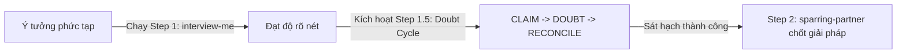
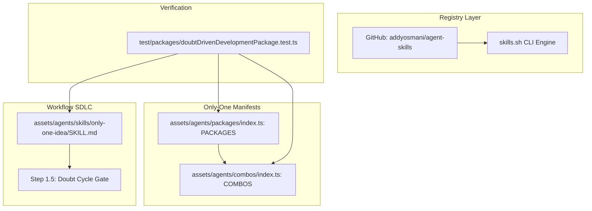

# Plan: Doubt-Driven Development External Skill Integration (Tích hợp Kỹ năng Hoài nghi Từ xa)

## Section 1. Directory Structure Changes

Sơ đồ cây thay đổi tệp theo cấu trúc chuẩn hóa:

```text
only-one-cli/
├── [MODIFY] package.json                                           # Nâng patch version của CLI từ 1.0.4 lên 1.0.5
├── test/packages/
│   └── [NEW]    doubtDrivenDevelopmentPackage.test.ts              # Kiểm thử hợp đồng package từ xa, combo, và quy trình idea
├── assets/agents/
│   ├── packages/
│   │   └── [MODIFY] index.ts                                       # Đăng ký package doubt-driven-development từ addyosmani/agent-skills
│   ├── combos/
│   │   └── [MODIFY] index.ts                                       # Kết nối package vào combo only-one-flow và tăng version 0.0.17
│   └── skills/only-one-idea/
│       └── [MODIFY] SKILL.md                                       # Tích hợp Step 1.5 Doubt Cycle vào quy trình khám phá ý tưởng
```

## Section 2. Story Board (User Journey & Feature Scenarios)

### Story 1: Tự động phân phối kỹ năng hoài nghi đối kháng qua skills.sh và kích hoạt trong quy trình ý tưởng [NEW]

- **User Story**: Là một lập trình viên sử dụng Agent, tôi muốn hệ thống tự động tải kỹ năng `doubt-driven-development` từ kho cộng đồng chuẩn mực (`addyosmani/agent-skills`) và kích hoạt vòng lặp hoài nghi trong `/only-one-idea` để bẻ gãy các giả định sai lầm trước khi lập kế hoạch.
- **Before**: Agent chỉ có các câu hỏi làm rõ của BA (`interview-me`) hoặc so sánh giải pháp kỹ thuật (`sparring-partner`), dễ mắc hội chứng Sycophancy tán thành giả định bề nổi của người dùng mà không kiểm chứng.
- **After**: Package `doubt-driven-development` được tự động phân phối thông qua `skills.sh`. Quy trình `/only-one-idea` bắt buộc chạy qua Step 1.5 (`Doubt Cycle`) để sát hạch đối kháng các giả định kỹ thuật phức tạp.
- **Key Scenarios**:
    - _Scenario 1 (Happy Path - Non-Trivial Proposal)_: Người dùng đề xuất một kiến trúc phức tạp (ví dụ Redis caching cho API); Agent kích hoạt Step 1.5, trích xuất `CLAIM` và phản biện `DOUBT` vạch trần bẫy invalidation trước khi sang Step 2.
    - _Scenario 2 (Boundary - Trivial / Mechanical Tasks)_: Người dùng chỉ yêu cầu sửa format, đổi tên biến hoặc ghi chú; Step 1.5 tự động bỏ qua để tránh gây cản trở và lãng phí token.
    - _Scenario 3 (Edge Case - Collaborative Override)_: Người dùng nhận thức rõ rủi ro được chỉ ra ở bước `DOUBT` nhưng vì giới hạn tiến độ bắt buộc phải chọn giải pháp tạm; Agent ghi nhận vào biên bản rủi ro của `concept.md` và cho phép tiến hành an toàn.



## Section 3. Test Cases & Verification Matrix

### 3.1. Concept Coverage & Traceability Matrix (Đối soát Tiêu chí Concept)

| Tiêu chí Concept       | Mã Test Case   | Hạng mục kiểm chứng                                  | Kết quả kỳ vọng                                       | Trạng thái |
| :---                   | :---           | :---                                                 | :---                                                  | :---       |
| Đăng ký Remote Package | `TEST-PKG-001` | Khai báo `doubt-driven-development` trong `PACKAGES` | `kind: 'skills'`, `source: 'addyosmani/agent-skills'` | [x] PASS   |
| Tích hợp vào Combo     | `TEST-PKG-002` | Mảng `packages` của combo `only-one-flow`            | Chứa `doubt-driven-development` và version `0.0.17`   | [x] PASS   |
| Tích hợp Workflow Idea | `TEST-PKG-003` | Nội dung tệp `only-one-idea/SKILL.md`                | Có bảng catalog và Step 1.5 Doubt Cycle               | [x] PASS   |
| Nâng cấp Version CLI   | `TEST-PKG-004` | Trường `version` trong `package.json`                | Đạt giá trị `1.0.5`                                   | [x] PASS   |

### 3.2. Test Case Specification Matrix (Ma trận Test Case Chi tiết)

| Test ID        | Tên Kiểm thử                 | Loại Kiểm thử | Điều kiện Tiền đề                    | Các Bước Thực hiện                                | Kết quả Kỳ vọng                                       | Kết quả Thực tế |
| :---           | :---                         | :---          | :---                                 | :---                                              | :---                                                  | :---            |
| `TEST-PKG-001` | Package Manifest Declaration | Unit          | Module PACKAGES đã nạp               | Tìm kiếm package có id `doubt-driven-development` | Khớp đúng source, skillName và kind 'skills'          | [x] PASS        |
| `TEST-PKG-002` | Combo Package Integration    | Unit          | Module COMBOS đã nạp                 | Kiểm tra combo `only-one-flow`                    | `packages` có item mới và version là `0.0.17`         | [x] PASS        |
| `TEST-PKG-003` | Idea Skill Workflow Update   | Unit          | Tệp `only-one-idea/SKILL.md` tồn tại | Đọc nội dung tệp và kiểm tra chuỗi định danh      | Xuất hiện `doubt-driven-development` và `Doubt Cycle` | [x] PASS        |
| `TEST-PKG-004` | CLI Package Version Bump     | Unit          | Tệp `package.json` tồn tại           | Đọc và parse JSON                                 | `version === '1.0.5'`                                 | [x] PASS        |

### Automated Test Execution Commands (Lệnh Kiểm thử Tự động Tập trung)

```bash
# Kiểm thử toàn diện hợp đồng package từ xa và tích hợp combo
npx vitest run test/packages/doubtDrivenDevelopmentPackage.test.ts
# Evidence: PASS (1 test file, 4 tests passed in 6ms)

# Kiểm thử hồi quy combo và manifests
npx vitest run test/core/combo.test.ts
# Evidence: PASS (1 test file, 14 tests passed in 56ms)

# Kiểm thử toàn diện toàn bộ repository
npm test
# Evidence: PASS (77 test files passed, 343 tests passed in 11.22s)
```

## Section 4. File Changes

### Architectural Interaction Diagram



### 1. `[NEW]` `test/packages/doubtDrivenDevelopmentPackage.test.ts`

- **Status**: `[x]`
- **Task Type**: `code`
- **Wave**: `1 (Track QA)`
- **Depends On**: None.
- **Context**: Chưa có bài kiểm thử tự động xác minh việc đăng ký package từ xa và liên kết combo.
- **Target Symbols / AST Seams**: `describe`, `it`, `PACKAGES`, `COMBOS`.
- **Invariants**: Đảm bảo toàn bộ cấu hình khai báo remote package và combo tuân thủ chuẩn package manifest.

> **Action**: Tạo mới bộ kiểm thử tự động xác minh hợp đồng remote package, combo và workflow idea.

**Test checklist**

- [x] Bắt buộc theo đúng tiêu chí nghiệm thu.
- [x] Đã rà soát code hiện có, thư viện chuẩn và dependencies.
- [x] Không tạo logic trùng lặp hoặc điểm mở rộng suy đoán.
- [x] Diff tối thiểu, đảm bảo an toàn và tính đúng đắn.
- **Decision**: Viết test contract độc lập bằng Vitest kiểm chứng trực tiếp các manifests và tệp SKILL.md.
- **Rejected alternative**: Chỉ test thủ công qua lệnh CLI; bị từ chối vì thiếu cơ chế kiểm chứng tự động CI/CD.

```diff
@@ -0,0 +1,41 @@
+import { readFileSync } from 'node:fs';
+import { resolve } from 'node:path';
+import { describe, expect, it } from 'vitest';
+import { COMBOS } from '../../assets/agents/combos/index.js';
+import { PACKAGES } from '../../assets/agents/packages/index.js';
+
+describe('Doubt-Driven Development External Package Contract', () => {
+    it('should declare doubt-driven-development package from addyosmani/agent-skills', () => {
+        const pkg = PACKAGES.find((p) => p.id === 'doubt-driven-development');
+        expect(pkg).toBeDefined();
+        expect(pkg?.installer.kind).toBe('skills');
+        if (pkg?.installer.kind === 'skills') {
+            expect(pkg.installer.source).toBe('addyosmani/agent-skills');
+            expect(pkg.installer.skillName).toBe('doubt-driven-development');
+        }
+    });
+
+    it('should include doubt-driven-development in only-one-flow combo packages', () => {
+        const combo = COMBOS.find((c) => c.id === 'only-one-flow');
+        expect(combo).toBeDefined();
+        expect(combo?.version).toBe('0.0.17');
+        expect(combo?.packages).toContain('doubt-driven-development');
+    });
+
+    it('should integrate doubt-driven-development into only-one-idea SKILL.md protocol', () => {
+        const skillPath = resolve(process.cwd(), 'assets/agents/skills/only-one-idea/SKILL.md');
+        const content = readFileSync(skillPath, 'utf8');
+        expect(content).toContain('doubt-driven-development');
+        expect(content).toContain('Doubt Cycle');
+    });
+
+    it('should bump CLI package.json version to 1.0.5', () => {
+        const pkgPath = resolve(process.cwd(), 'package.json');
+        const pkgJson = JSON.parse(readFileSync(pkgPath, 'utf8'));
+        expect(pkgJson.version).toBe('1.0.5');
+    });
+});
```

### 2. `[MODIFY]` `package.json`

- **Status**: `[x]`
- **Task Type**: `code`
- **Wave**: `2 (Track Dev)`
- **Depends On**: Task 1.
- **Context**: Phiên bản CLI đang ở `1.0.4`, cần tăng patch version lên `1.0.5` để đánh dấu tính năng tích hợp package mới.
- **Target Symbols / AST Seams**: `version`.
- **Invariants**: Giữ nguyên toàn bộ scripts và dependencies hiện có.

> **Action**: Nâng patch version của package.json từ 1.0.4 lên 1.0.5.

**Ponytail checklist**

- [x] Bắt buộc theo đúng tiêu chí nghiệm thu.
- [x] Đã rà soát code hiện có, thư viện chuẩn và dependencies.
- [x] Không tạo logic trùng lặp hoặc điểm mở rộng suy đoán.
- [x] Diff tối thiểu, đảm bảo an toàn và tính đúng đắn.
- **Decision**: Tăng patch version cho CLI theo đúng quy chuẩn ngữ nghĩa SemVer.
- **Rejected alternative**: Giữ nguyên 1.0.4; bị từ chối vì thiếu dấu vết phát hành cho tính năng mới.

```diff
@@ -1,6 +1,6 @@
 {
     "name": "only-one",
-    "version": "1.0.4",
+    "version": "1.0.5",
     "description": "Developer environment setups, AI agent workspace management, and editor configuration syncing.",
     "author": "Kiem Nguyen <contact.kiem.nguyen@gmail.com>",
```

### 3. `[MODIFY]` `assets/agents/packages/index.ts`

- **Status**: `[x]`
- **Task Type**: `code`
- **Wave**: `2 (Track Dev)`
- **Depends On**: Task 1.
- **Context**: Mảng `PACKAGES` chưa khai báo package từ xa `doubt-driven-development`.
- **Target Symbols / AST Seams**: `PACKAGES`.
- **Invariants**: Định danh package và cấu hình installer phải khớp hoàn toàn với quy chuẩn skills.sh.

> **Action**: Khai báo package `doubt-driven-development` trỏ tới `addyosmani/agent-skills`.

**Ponytail checklist**

- [x] Bắt buộc theo đúng tiêu chí nghiệm thu.
- [x] Đã rà soát code hiện có, thư viện chuẩn và dependencies.
- [x] Không tạo logic trùng lặp hoặc điểm mở rộng suy đoán.
- [x] Diff tối thiểu, đảm bảo an toàn và tính đúng đắn.
- **Decision**: Đăng ký trực tiếp vào manifest Single Source of Truth của hệ thống packages.
- **Rejected alternative**: Tạo loader riêng biệt; bị từ chối vì làm phân mảnh cơ chế installer hiện hữu.

```diff
@@ -37,3 +37,15 @@
         requirements: ['node', 'npx'],
     },
+    {
+        id: 'doubt-driven-development',
+        version: '0.0.1',
+        description: 'Adversarial reasoning and skepticism loop from addyosmani/agent-skills',
+        installer: {
+            kind: 'skills',
+            source: 'addyosmani/agent-skills',
+            skillName: 'doubt-driven-development',
+            cliVersion: 'latest',
+        },
+        requirements: ['node', 'npx'],
+    },
 ];
```

### 4. `[MODIFY]` `assets/agents/combos/index.ts`

- **Status**: `[x]`
- **Task Type**: `code`
- **Wave**: `3 (Track Dev)`
- **Depends On**: Task 2, Task 3.
- **Context**: Combo `only-one-flow` chưa liên kết package `doubt-driven-development` trong thuộc tính `packages`.
- **Target Symbols / AST Seams**: `COMBOS`.
- **Invariants**: Nâng version combo `only-one-flow` lên `0.0.17` và thêm package định danh.

> **Action**: Cập nhật combo `only-one-flow` với package `doubt-driven-development` và tăng phiên bản.

**Ponytail checklist**

- [x] Bắt buộc theo đúng tiêu chí nghiệm thu.
- [x] Đã rà soát code hiện có, thư viện chuẩn và dependencies.
- [x] Không tạo logic trùng lặp hoặc điểm mở rộng suy đoán.
- [x] Diff tối thiểu, đảm bảo an toàn và tính đúng đắn.
- **Decision**: Gắn package vào mảng packages của combo toàn diện để tự động cài đặt qua lệnh combo.
- **Rejected alternative**: Yêu cầu người dùng tự cài lẻ bằng lệnh tay; bị từ chối vì làm giảm tính tiện ích của combos.

```diff
@@ -28,3 +28,3 @@
         id: 'only-one-flow',
-        version: '0.0.16',
+        version: '0.0.17',
         name: 'Only One Universal Flow Setup',
@@ -34,2 +34,3 @@
         mcps: ['fetch', 'tavily', 'github', 'postgres', 'playwright-browser'],
+        packages: ['doubt-driven-development'],
         subagents: [
```

### 5. `[MODIFY]` `assets/agents/skills/only-one-idea/SKILL.md`

- **Status**: `[x]`
- **Task Type**: `non-code`
- **Wave**: `4 (Track Dev)`
- **Depends On**: Task 4.
- **Context**: Workflow `only-one-idea` chưa đưa vòng lặp `Doubt Cycle` thành một bước bắt buộc trong quy trình.
- **Target Symbols / AST Seams**: `Skills Catalog`, `Execution Protocol`.
- **Invariants**: Bổ sung Step 1.5 với đầy đủ 5 bước của Doubt Cycle và quy tắc ngắt mạch tối đa 3 vòng lặp.

> **Action**: Cập nhật bảng Skills Catalog và bổ sung Step 1.5 vào quy trình thực thi của only-one-idea.

**Ponytail checklist**

- [x] Bắt buộc theo đúng tiêu chí nghiệm thu.
- [x] Đã rà soát code hiện có, thư viện chuẩn và dependencies.
- [x] Không tạo logic trùng lặp hoặc điểm mở rộng suy đoán.
- [x] Diff tối thiểu, đảm bảo an toàn và tính đúng đắn.
- **Decision**: Đưa Step 1.5 làm chốt chặn thẩm định đối kháng bắt buộc trước khi sang thiết kế kiến trúc.
- **Rejected alternative**: Để kỹ năng tự do không có quy trình ràng buộc; bị từ chối vì Agent sẽ tiếp tục thuận theo người dùng.

```diff
@@ -79,2 +79,3 @@
 | **`karpathy-ste100-discipline`** | Writing concept.md specification | Enforce 80% ASD-STE100 concise prose (instructions <= 20 words, descriptions <= 25 words, no passive voice) and Karpathy disciplines. |
+| **`doubt-driven-development`** | Non-trivial technical proposals | Execute 5-step Doubt Cycle (`CLAIM` -> `EXTRACT` -> `DOUBT` -> `RECONCILE` -> `STOP`) to break unstated assumptions before planning. |

@@ -95,2 +96,15 @@
 3. **Ponytail Scope Gate**: After clarity, remove unnecessary scope. Do not use minimization to shorten discovery or acceptance criteria.

+---
+
+### Step 1.5 — Adversarial Doubt & Assumption Stress-Testing (Role: Adversarial Auditor via `doubt-driven-development`)
+
+1. **Trigger Condition**: Applies strictly to non-trivial technical proposals (complex branching logic, external integrations, security-sensitive flows, concurrency invariants, or irreversible operations).
+2. **Execute Doubt Cycle**:
+   - **CLAIM**: Formulate the user's core hypothesis and operational blast radius in <= 3 lines.
+   - **EXTRACT**: Isolate proposal artifact and constraints, stripping subjective reasoning.
+   - **DOUBT**: Conduct adversarial review assuming author is overconfident. Surface unstated assumptions and failure modes under unexpected input.
+   - **RECONCILE**: Reconcile findings against evidence; proceed only if the core hypothesis stands or the user explicitly accepts trade-offs (`Collaborative Override`).
+   - **STOP**: Hard stop after maximum 3 cycles to eliminate analysis paralysis.
+
 ---
```
