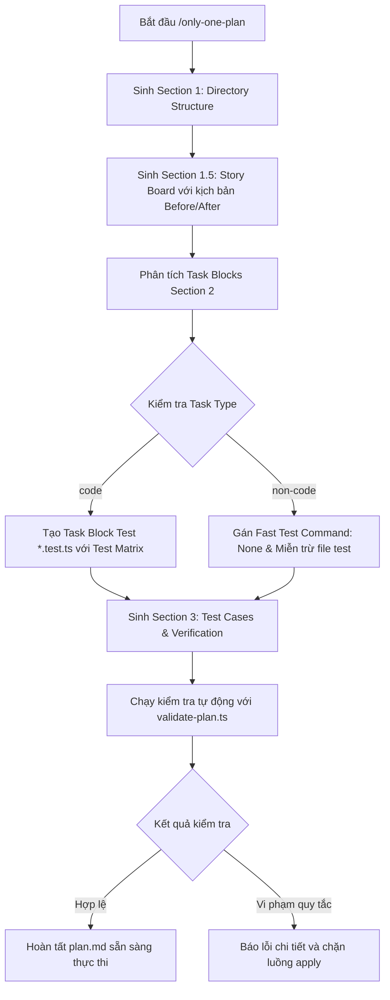

# Concept: Chuẩn hóa Kiểm thử và Bổ sung Story Board cho Only-One Plan

## 1. Problem & Goal (Vấn đề & Mục tiêu)

### Problem (Điểm nghẽn & Thiếu sót hiện tại)
- **Context & Trigger**: Khi `/only-one-plan` tạo kế hoạch `plan.md` từ ý tưởng hoặc yêu cầu thay đổi.
- **Symptom & Defect**: Kế hoạch thiếu test case cho code logic, sinh test dư thừa cho non-code, và thiếu Story Board.
- **Root Cause**: Đặc tả `only-one-plan` thiếu metadata phân loại task và chưa tích hợp linter kiểm tra ràng buộc.
- **Impact / Blast Radius**: Giảm độ tin cậy kiểm thử, lãng phí thời gian tạo test rác, và khó hình dung trải nghiệm người dùng.

### Goal (Kết quả kỹ thuật mục tiêu)
- **Core Goal**: Thiết lập chuẩn mực kiểm thử phân cấp và tích hợp Story Board trực quan vào `plan.md`.
- **Acceptance Criteria**:
  - Bổ sung `Section 1.5. Story Board` mô tả kịch bản Before/After cho các tính năng `[NEW]`, `[MODIFY]`, `[DELETE]`.
  - Bổ sung metadata `Task Type: code | non-code` vào từng task block của Section 2.
  - Bắt buộc task block `code` phải có file test đi kèm và khai báo Test Matrix (Happy Path, Edge Cases, Error Handling).
  - Khóa task block `non-code` với `Fast Test Command: None (Non-code task)` và cấm tạo file test đi kèm.
  - Cập nhật script `validate-plan.ts` để chặn kế hoạch vi phạm các quy tắc trên.

## 2. Scope Boundaries (Ranh giới phạm vi)
- **In-Scope**:
  - Cập nhật đặc tả `SKILL.md` của `only-one-plan` trong codebase và cấu hình toàn cục.
  - Cập nhật script kiểm tra tĩnh `validate-plan.ts` để kiểm tra tự động Section 1.5, `Task Type`, và tính đối xứng test.
  - Cập nhật template mẫu `plan-template.md` tương ứng.
- **Explicit Out-of-Scope**:
  - Không sửa đổi logic thực thi của `/only-one-apply` hoặc `/only-one-debug`.
  - Không tạo mã nguồn kiểm thử thực tế cho các dự án ứng dụng ngoài.

## 3. Proposed Solution & Core Mechanism (Giải pháp đề xuất & Cơ chế cốt lõi)
- **Core Mechanism**: Cơ chế hợp đồng hai lớp kết hợp linter xác định. Template quy định cấu trúc và linter tự động cưỡng chế tính tuân thủ.
- **Conceptual Flow / Domain Model**:

## 4. Critical Risks & Edge Cases (Rủi ro & Xử lý ngoại lệ)
- **Nguy cơ nhận diện sai Task Type**: Các file cấu hình có chứa code logic (như `vite.config.ts`, `tailwind.config.ts`) cần được phân loại chính xác qua hướng dẫn chi tiết.
- **Phình to kích thước plan.md**: Hạn chế văn bản Story Board theo chuẩn STE-100 để tránh làm tràn context window khi thực thi `/only-one-apply`.
- **Tương thích ngược**: Các plan cũ chưa có Section 1.5 cần có cờ cảnh báo linh hoạt nếu được tái sử dụng.
