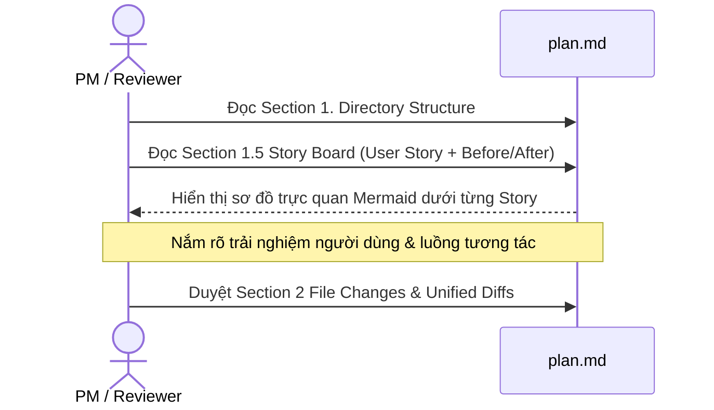
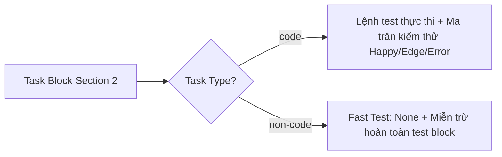
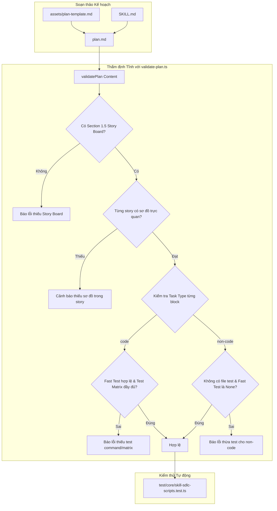

# Plan: Chuẩn hóa Kiểm thử và Bổ sung Story Board cho Only-One Plan

## Section 1. Directory Structure Changes

```text
assets/agents/skills/only-one-plan/
├── [MODIFY] SKILL.md                          # Cập nhật đặc tả Section 1.5, Task Type và chính sách test
├── assets/
│   └── [MODIFY] plan-template.md              # Bổ sung mẫu Section 1.5 kèm sơ đồ và metadata Task Type
└── scripts/
    └── [MODIFY] validate-plan.ts              # Bổ sung kiểm tra Section 1.5, sơ đồ story và Task Type

test/core/
└── [MODIFY] skill-sdlc-scripts.test.ts        # Bổ sung test cases xác thực các quy tắc plan mới

C:/Users/ADMIN/.gemini/config/skills/only-one-plan/
├── [MODIFY] SKILL.md                          # Đồng bộ đặc tả mới cho cấu hình toàn cục
├── assets/
│   └── [MODIFY] plan-template.md              # Đồng bộ mẫu template mới cho cấu hình toàn cục
└── scripts/
    └── [MODIFY] validate-plan.ts              # Đồng bộ script kiểm tra tĩnh cho cấu hình toàn cục
```

## Section 1.5. Story Board (User Journey & Feature Scenarios)

### Story 1: Bổ sung Section 1.5 Story Board kèm sơ đồ trực quan vào cấu trúc plan [NEW]
- **User Story**: Là một Product Manager và Tech Lead, tôi muốn xem kịch bản Before/After và sơ đồ luồng trực quan dưới mỗi story để nắm bắt trọn vẹn tác động nghiệp vụ trước phần mã nguồn.
- **Before**: Kế hoạch chuyển trực tiếp từ sơ đồ cây thư mục sang danh sách task block mã nguồn, thiếu góc nhìn trải nghiệm người dùng và sơ đồ luồng chi tiết cho từng tính năng.
- **After**: Kế hoạch có phần Story Board phân định rõ kịch bản Before/After và bắt buộc có một sơ đồ Mermaid/ASCII dưới mỗi story biểu diễn luồng tương tác.
- **Key Scenarios**:
  - *Scenario 1 (Tính năng mới)*: Người dùng đọc kịch bản trải nghiệm mong muốn và quan sát sơ đồ chuyển đổi trạng thái.
  - *Scenario 2 (Chỉnh sửa/Xóa)*: Người dùng so sánh hành vi cũ so với hành vi mới để đánh giá tác động phụ (blast radius) qua sơ đồ tương tác.



### Story 2: Ràng buộc Phân loại Task Type và Chính sách Kiểm thử [MODIFY]
- **User Story**: Là một Kỹ sư Kiểm thử và Developer, tôi muốn các task block code bắt buộc có test matrix, trong khi các task phi-code được miễn trừ test để tránh lãng phí.
- **Before**: Task block code không có tiêu chuẩn bắt buộc về ma trận test; task block phi-code (tài liệu, config) có thể bị yêu cầu tạo test vô lý.
- **After**: Mỗi task block có metadata `Task Type: code | non-code`. Task `code` bắt buộc có task test và ma trận Happy Path/Edge Cases/Error Handling. Task `non-code` bắt buộc đặt Fast Test Command là None và không tạo file test.
- **Key Scenarios**:
  - *Scenario 1 (Code Task)*: Khai báo `Task Type: code` $\rightarrow$ Linter yêu cầu lệnh test thực thi và ma trận kiểm thử toàn diện.
  - *Scenario 2 (Non-code Task)*: Khai báo `Task Type: non-code` $\rightarrow$ Linter cấm trỏ đến file test và cấm lệnh test runtime.



---

## Section 2. File Changes

### Architectural Interaction Diagram



---

### 1. `[MODIFY]` `assets/agents/skills/only-one-plan/scripts/validate-plan.ts`

- **Status**: `[x]`
- **Task Type**: `code`
- **Context**: Script hiện tại chỉ kiểm tra Section 1, 2, 3 và diff cơ bản, chưa kiểm tra Section 1.5, sơ đồ story và Task Type.
- **Target Symbols / AST Seams**: `validatePlan`.
- **Invariants**: Giữ nguyên chữ ký hàm `validatePlan(content: string): PlanValidationResult`.
- **Depends On**: None.
- **Fast Test Command**: `npx vitest run test/core/skill-sdlc-scripts.test.ts`.

> **Action**: Bổ sung kiểm tra Section 1.5, cảnh báo thiếu sơ đồ story, và thẩm định quy tắc Task Type cho code/non-code.

**Ponytail checklist**
- [ ] Bắt buộc theo đúng tiêu chí nghiệm thu.
- [ ] Đã rà soát code hiện có, thư viện chuẩn và dependencies.
- [ ] Không tạo logic trùng lặp hoặc điểm mở rộng suy đoán.
- [ ] Diff tối thiểu, đảm bảo an toàn và tính đúng đắn.
- **Decision**: Mở rộng hàm `validatePlan` kiểm tra Section 1.5, sơ đồ story và regex scoped cho Section 2.
- **Rejected alternative**: Viết parser AST markdown hoàn toàn mới gây tốn kém thời gian và dễ lỗi.

```diff
@@ line 31 @@
     if (!/## Section 1\.\s*Directory Structure Changes/i.test(content)) {
         errors.push('Missing ## Section 1. Directory Structure Changes');
     }
+    const s15Match = content.match(/## Section 1\.5\.\s*Story Board([\s\S]*?)(?=## Section 2\.|$)/i);
+    if (!s15Match) {
+        errors.push('Missing ## Section 1.5. Story Board');
+    } else {
+        const s15Content = s15Match[1];
+        const storyMatches = [...s15Content.matchAll(/^### Story \d+:?[^\r\n]+/gm)];
+        if (storyMatches.length === 0) {
+            warnings.push('Section 1.5 Story Board contains zero story scenarios');
+        } else {
+            storyMatches.forEach((sMatch, sIdx) => {
+                const sHeader = sMatch[0];
+                const sContent = s15Content.slice(sMatch.index);
+                const nextStory = sContent.slice(sHeader.length).search(/^### Story \d+:/m);
+                const singleStory = nextStory !== -1 ? sContent.slice(0, sHeader.length + nextStory) : sContent;
+                if (!/```(mermaid|text)/i.test(singleStory)) {
+                    warnings.push(`Story ${sIdx + 1}: Missing flow/state diagram in storyboard`);
+                }
+            });
+        }
+    }
     if (!/## Section 2\.\s*File Changes/i.test(content)) {
         errors.push('Missing ## Section 2. File Changes');
     }
@@ line 39 @@
-    const taskBlockRegex = /### \d+\.\s*`?\[(NEW|MODIFY|DELETE|RENAME)\]`?\s*`?([^`\r\n]+)`?/g;
-    const taskMatches = [...content.matchAll(taskBlockRegex)];
+    const s2Match = content.match(/## Section 2\.\s*File Changes([\s\S]*?)(?=## Section 3\.|$)/i);
+    const s2Content = s2Match ? s2Match[1] : '';
+    const taskBlockRegex = /^### \d+\.\s*`?\[(NEW|MODIFY|DELETE|RENAME)\]`?\s*`?([^`\r\n]+)`?/gm;
+    const taskMatches = [...s2Content.matchAll(taskBlockRegex)];
     const taskCount = taskMatches.length;

     if (taskCount === 0) {
         errors.push('Section 2 contains zero machine-readable file task blocks');
     }

+    const testFileRegex = /(\.test\.|\.spec\.|_test\.)/;

     taskMatches.forEach((match, idx) => {
         const blockHeader = match[0];
+        const filePath = match[2].trim();
-        const blockContent = content.slice(match.index);
+        const blockContent = s2Content.slice(match.index);
-        const nextBlock = blockContent.slice(blockHeader.length).search(/### \d+\.\s*`?\[(NEW|MODIFY|DELETE|RENAME)\]`?/);
+        const nextBlock = blockContent.slice(blockHeader.length).search(/^### \d+\.\s*`?\[(NEW|MODIFY|DELETE|RENAME)\]`?/m);
         const singleBlock = nextBlock !== -1 ? blockContent.slice(0, blockHeader.length + nextBlock) : blockContent;

-        if (!/-\s*\*\*Status\*\*:/i.test(singleBlock)) warnings.push(`Task ${idx + 1} (${match[2]}): Missing Status`);
-        if (!/-\s*\*\*Depends On\*\*:/i.test(singleBlock)) warnings.push(`Task ${idx + 1} (${match[2]}): Missing Depends On`);
-        if (!/-\s*\*\*Fast Test Command\*\*:/i.test(singleBlock)) warnings.push(`Task ${idx + 1} (${match[2]}): Missing Fast Test Command`);
-        if (!/```diff[\s\S]*?```/i.test(singleBlock)) errors.push(`Task ${idx + 1} (${match[2]}): Missing Git Unified Diff block`);
+        if (!/-\s*\*\*Status\*\*:/i.test(singleBlock)) warnings.push(`Task ${idx + 1} (${filePath}): Missing Status`);
+        if (!/-\s*\*\*Depends On\*\*:/i.test(singleBlock)) warnings.push(`Task ${idx + 1} (${filePath}): Missing Depends On`);

+        const taskTypeMatch = singleBlock.match(/-\s*\*\*Task Type\*\*:\s*`?(code|non-code)`?/i);
+        if (!taskTypeMatch) {
+            errors.push(`Task ${idx + 1} (${filePath}): Missing or invalid Task Type (must be 'code' or 'non-code')`);
+        } else {
+            const taskType = taskTypeMatch[1].toLowerCase();
+            const fastTestMatch = singleBlock.match(/-\s*\*\*Fast Test Command\*\*:\s*`?([^`\r\n]+)`?/i);
+            const fastTestCmd = fastTestMatch ? fastTestMatch[1].trim() : '';

+            if (taskType === 'code') {
+                if (!fastTestCmd || /^none/i.test(fastTestCmd)) {
+                    errors.push(`Task ${idx + 1} (${filePath}): Code tasks must specify an executable Fast Test Command`);
+                }
+                if (testFileRegex.test(filePath)) {
+                    const hasHappyPath = /Happy Path/i.test(singleBlock);
+                    const hasEdgeCases = /(Boundary|Edge Cases)/i.test(singleBlock);
+                    const hasErrorHandling = /(Failure|Error Handling)/i.test(singleBlock);
+                    if (!hasHappyPath || !hasEdgeCases || !hasErrorHandling) {
+                        warnings.push(`Task ${idx + 1} (${filePath}): Test file should declare full Test Matrix (Happy Path, Boundary/Edge Cases, Failure/Error Handling)`);
+                    }
+                }
+            } else if (taskType === 'non-code') {
+                if (testFileRegex.test(filePath)) {
+                    errors.push(`Task ${idx + 1} (${filePath}): Non-code tasks must not target test files`);
+                }
+                if (fastTestCmd && !/^none/i.test(fastTestCmd)) {
+                    errors.push(`Task ${idx + 1} (${filePath}): Non-code tasks must set Fast Test Command to 'None (Non-code task)'`);
+                }
+            }
+        }

+        if (!/-\s*\*\*Fast Test Command\*\*:/i.test(singleBlock)) warnings.push(`Task ${idx + 1} (${filePath}): Missing Fast Test Command`);
+        if (!/```diff[\s\S]*?```/i.test(singleBlock)) errors.push(`Task ${idx + 1} (${filePath}): Missing Git Unified Diff block`);
     });
```

---

### 2. `[MODIFY]` `test/core/skill-sdlc-scripts.test.ts`

- **Status**: `[x]`
- **Task Type**: `code`
- **Context**: File test hiện tại chứa test case `validPlan` cũ chưa có Section 1.5, sơ đồ story và Task Type.
- **Target Symbols / AST Seams**: `describe('Deterministic SDLC Skills Scripts')`.
- **Invariants**: Tất cả các test cases của vitest đều phải pass.
- **Depends On**: `assets/agents/skills/only-one-plan/scripts/validate-plan.ts`.
- **Fast Test Command**: `npx vitest run test/core/skill-sdlc-scripts.test.ts`.

> **Action**: Cập nhật test case cũ và bổ sung bộ test toàn diện cho các quy tắc kiểm tra mới của `validatePlan`.

**Test checklist**
- [ ] Bắt buộc theo đúng tiêu chí nghiệm thu.
- [ ] Tái sử dụng cú pháp describe/it của vitest sẵn có.
- [ ] Không duplicate fixture không cần thiết.
- [ ] Bao phủ toàn diện Happy Path, Boundary/Edge Cases, Failure/Error Handling.
- **Decision**: Thêm các test case kiểm tra thiếu Section 1.5, thiếu Task Type, vi phạm quy tắc code/non-code.
- **Rejected alternative**: Tách ra file test riêng gây phân mảnh test suite.

```diff
@@ line 43 @@
     it('validates plan structure and diff presence', () => {
         const validPlan = `---
 slug: test
 status: planned
 ---
 # Plan
 ## Section 1. Directory Structure Changes
+## Section 1.5. Story Board
+### Story 1: Feature [MODIFY]
+- **Before**: Old behavior.
+- **After**: New behavior.
+\`\`\`mermaid
+flowchart LR
+    A --> B
+\`\`\`
 ## Section 2. File Changes
 ### 1. [MODIFY] file.ts
 - **Status**: [ ]
+- **Task Type**: code
 - **Depends On**: None
 - **Fast Test Command**: npm test file.test.ts
 \`\`\`diff
 + line
 \`\`\`
+### 2. [NEW] file.test.ts
+- **Status**: [ ]
+- **Task Type**: code
+- **Depends On**: file.ts
+- **Fast Test Command**: npm test file.test.ts
+**Test Matrix**:
+- [ ] Happy Path
+- [ ] Boundary / Edge Cases
+- [ ] Failure / Error Handling
+\`\`\`diff
++ line
+\`\`\`
+### 3. [MODIFY] README.md
+- **Status**: [ ]
+- **Task Type**: non-code
+- **Depends On**: None
+- **Fast Test Command**: None (Non-code task)
+\`\`\`diff
++ doc
+\`\`\`
 ## Section 3. Test Cases & Verification
 `;
         expect(validatePlan(validPlan).valid).toBe(true);
     });
+
+    it('flags error when plan is missing Section 1.5 Story Board', () => {
+        const invalidPlan = `---
+slug: test
+status: planned
+---
+# Plan
+## Section 1. Directory Structure Changes
+## Section 2. File Changes
+### 1. [MODIFY] file.ts
+- **Status**: [ ]
+- **Task Type**: code
+- **Fast Test Command**: npm test
+\`\`\`diff
++ line
+\`\`\`
+## Section 3. Test Cases & Verification
+`;
+        const res = validatePlan(invalidPlan);
+        expect(res.valid).toBe(false);
+        expect(res.errors).toContain('Missing ## Section 1.5. Story Board');
+    });
+
+    it('flags warning when story in Section 1.5 is missing diagram', () => {
+        const planWithoutDiagram = `---
+slug: test
+status: planned
+---
+# Plan
+## Section 1. Directory Structure Changes
+## Section 1.5. Story Board
+### Story 1: Feature [MODIFY]
+- **Before**: Old.
+- **After**: New.
+## Section 2. File Changes
+### 1. [MODIFY] file.ts
+- **Status**: [ ]
+- **Task Type**: code
+- **Fast Test Command**: npm test
+\`\`\`diff
++ line
+\`\`\`
+## Section 3. Test Cases & Verification
+`;
+        const res = validatePlan(planWithoutDiagram);
+        expect(res.warnings.some(w => w.includes('Missing flow/state diagram in storyboard'))).toBe(true);
+    });
+
+    it('flags error when task block is missing Task Type', () => {
+        const invalidPlan = `---
+slug: test
+status: planned
+---
+# Plan
+## Section 1. Directory Structure Changes
+## Section 1.5. Story Board
+## Section 2. File Changes
+### 1. [MODIFY] file.ts
+- **Status**: [ ]
+- **Fast Test Command**: npm test
+\`\`\`diff
++ line
+\`\`\`
+## Section 3. Test Cases & Verification
+`;
+        const res = validatePlan(invalidPlan);
+        expect(res.valid).toBe(false);
+        expect(res.errors.some(e => e.includes('Missing or invalid Task Type'))).toBe(true);
+    });
+
+    it('flags error when non-code task has test file or test command', () => {
+        const invalidPlan = `---
+slug: test
+status: planned
+---
+# Plan
+## Section 1. Directory Structure Changes
+## Section 1.5. Story Board
+## Section 2. File Changes
+### 1. [MODIFY] file.test.ts
+- **Status**: [ ]
+- **Task Type**: non-code
+- **Fast Test Command**: None
+\`\`\`diff
++ line
+\`\`\`
+## Section 3. Test Cases & Verification
+`;
+        const res = validatePlan(invalidPlan);
+        expect(res.valid).toBe(false);
+        expect(res.errors.some(e => e.includes('Non-code tasks must not target test files'))).toBe(true);
+    });
```

---

### 3. `[MODIFY]` `assets/agents/skills/only-one-plan/assets/plan-template.md`

- **Status**: `[x]`
- **Task Type**: `non-code`
- **Context**: File template hiện tại chưa có Section 1.5, sơ đồ story và trường metadata Task Type.
- **Target Symbols / AST Seams**: Markdown template headings and placeholders.
- **Invariants**: Giữ nguyên frontmatter placeholders `{{slug}}`, `{{created_at}}`, `{{title}}`.
- **Depends On**: None.
- **Fast Test Command**: `None (Non-code task)`.

> **Action**: Bổ sung cấu trúc mẫu của Section 1.5 kèm mẫu sơ đồ và metadata Task Type cho code/non-code task blocks.

**Ponytail checklist**
- [ ] Bắt buộc theo đúng tiêu chí nghiệm thu.
- [ ] Đã rà soát code hiện có, thư viện chuẩn và dependencies.
- [ ] Không tạo logic trùng lặp hoặc điểm mở rộng suy đoán.
- [ ] Diff tối thiểu, đảm bảo an toàn và tính đúng đắn.
- **Decision**: Cập nhật mẫu chuẩn để AI agent kế thừa trực tiếp khi scaffold plan.
- **Rejected alternative**: Giữ nguyên template cũ khiến agent phải tự ghi nhớ thêm các section mới.

```diff
@@ line 17 @@
 ```
 
+## Section 1.5. Story Board (User Journey & Feature Scenarios)
+
+### Story 1: Feature / Component Name [NEW|MODIFY|DELETE]
+- **User Story**: As a <role>, I want <goal> so that <benefit>.
+- **Before**: <Behavior or state before change in one sentence>.
+- **After**: <Behavior or state after change in one sentence>.
+- **Key Scenarios**:
+  - *Scenario 1 (Happy Path)*: ...
+  - *Scenario 2 (Edge Case / Failure)*: ...
+
+```mermaid
+flowchart LR
+    A[Before State] -->|User Action| B[After State]
+```
+
 ## Section 2. File Changes
 
 ### 1. `[MODIFY]` `path/to/file.ts`
 
 - **Status**: `[ ]`
+- **Task Type**: `code`
 - **Context**: <Current mechanism in one sentence>.
 - **Target Symbols / AST Seams**: `Class.methodName`.
 - **Invariants**: <Constraint that must not be broken in one sentence>.
 - **Depends On**: None.
 - **Fast Test Command**: `npm test path/to/file.test.ts`.
 
 > **Action**: <Brief one-sentence description of modification purpose>.
 
 ```diff
 <unified diff>
 ```
 
+### 2. `[NEW]` `path/to/file.test.ts`
+
+- **Status**: `[ ]`
+- **Task Type**: `code`
+- **Context**: <Test suite purpose>.
+- **Target Symbols / AST Seams**: `describe('...')`.
+- **Invariants**: <Invariants>.
+- **Depends On**: `path/to/file.ts`.
+- **Fast Test Command**: `npm test path/to/file.test.ts`.
+
+> **Action**: <Add test cases for file.ts>.
+
+**Test Matrix**
+- [ ] Happy Path: <Scenario>.
+- [ ] Boundary / Edge Cases: <Scenario>.
+- [ ] Failure / Error Handling: <Scenario>.
+
+```diff
+<unified diff>
+```
+
+### 3. `[MODIFY]` `path/to/doc.md`
+
+- **Status**: `[ ]`
+- **Task Type**: `non-code`
+- **Context**: <Documentation update>.
+- **Target Symbols / AST Seams**: <Section header>.
+- **Invariants**: <Invariants>.
+- **Depends On**: None.
+- **Fast Test Command**: `None (Non-code task)`.
+
+> **Action**: <Update documentation content>.
+
+```diff
+<unified diff>
+```
+
 ## Section 3. Test Cases & Verification
```

---

### 4. `[MODIFY]` `assets/agents/skills/only-one-plan/SKILL.md`

- **Status**: `[x]`
- **Task Type**: `non-code`
- **Context**: Tài liệu đặc tả kỹ năng `only-one-plan` hiện tại chưa quy định Section 1.5, sơ đồ story và chính sách Task Type.
- **Target Symbols / AST Seams**: Section Plan Output Structure & Guardrails.
- **Invariants**: Duy trì ngôn ngữ tiếng Việt cho giải thích nghiệp vụ, thuật ngữ tiếng Anh cho symbols/commands.
- **Depends On**: None.
- **Fast Test Command**: `None (Non-code task)`.

> **Action**: Cập nhật toàn diện đặc tả hướng dẫn, mẫu plan kèm sơ đồ dưới mỗi story và guardrails của kỹ năng `only-one-plan`.

**Ponytail checklist**
- [ ] Bắt buộc theo đúng tiêu chí nghiệm thu.
- [ ] Đã rà soát code hiện có, thư viện chuẩn và dependencies.
- [ ] Không tạo logic trùng lặp hoặc điểm mở rộng suy đoán.
- [ ] Diff tối thiểu, đảm bảo an toàn và tính đúng đắn.
- **Decision**: Bắt buộc sơ đồ Mermaid/ASCII cho từng story và quy định rõ ràng trách nhiệm kiểm thử phân cấp theo Task Type.
- **Rejected alternative**: Chỉ mô tả bằng văn bản khiến người đọc khó hình dung trực quan luồng tương tác.

```diff
@@ line 53 @@
   - **Machine Layer (Standardized English & Unified Diffs)**:
     - Section 2 must use ordered machine-readable file task blocks with headings `### <order>. [<ACTION>] <path>`.
-    - Every task block must contain fixed metadata keys: `Status`, `Context`, `Target Symbols / AST Seams`, `Invariants`, `Depends On`, and `Fast Test Command` before its checklist and diff.
+    - Every task block must contain fixed metadata keys: `Status`, `Task Type`, `Context`, `Target Symbols / AST Seams`, `Invariants`, `Depends On`, and `Fast Test Command` before its checklist and diff.
     - Section 2 must provide Git-standard **Unified Diff (` ```diff `)** blocks inside each task block.
@@ line 155 @@
-### Plan Output Structure (The 3 Core Sections - File-Centric & Diff-Centric)
+### Plan Output Structure (The Core Sections - File-Centric & Diff-Centric)
 
 ```markdown
 # Plan: <Implementation Plan Name>
 
 ## Section 1. Directory Structure Changes
 Visual ASCII tree diagram showing all files to be added, modified, or deleted with standardized action tags:
 
 ```text
 ...
 ```
 
+## Section 1.5. Story Board (User Journey & Feature Scenarios)
+Mô tả kịch bản hành vi kèm sơ đồ trực quan dưới mỗi story cho từng tính năng:
+
+### Story 1: Feature / Component Name [NEW|MODIFY|DELETE]
+- **User Story**: As a <role>, I want <goal> so that <benefit>.
+- **Before**: <Trạng thái hoặc hành vi trước khi có thay đổi>.
+- **After**: <Trạng thái hoặc hành vi sau khi có thay đổi>.
+- **Key Scenarios**:
+  - *Scenario 1 (Happy Path)*: ...
+  - *Scenario 2 (Boundary / Edge Cases)*: ...
+  - *Scenario 3 (Failure / Error Handling)*: ...
+
+```mermaid
+flowchart LR
+    A[Trạng thái Trước] -->|Hành động Người dùng| B[Trạng thái Sau]
+```
+
 ## Section 2. File Changes
@@ line 180 @@
 ### 1. `[MODIFY]` `path/to/file.ts`
 
 - **Status**: `[ ]`
+- **Task Type**: `code`
 - **Context**: <Bối cảnh hiện tại bằng tiếng Việt, tối đa 25 từ>.
 - **Target Symbols / AST Seams**: `Class.methodName`.
 - **Invariants**: <Ràng buộc bất biến bằng tiếng Việt, tối đa 25 từ>.
 - **Depends On**: None.
 - **Fast Test Command**: `npm test path/to/file.test.ts`.
@@ line 245 @@
-- Always include `Status`, `Context`, `Target Symbols / AST Seams`, `Invariants`, `Depends On`, and `Fast Test Command` in every file task block.
+- Always include `Status`, `Task Type`, `Context`, `Target Symbols / AST Seams`, `Invariants`, `Depends On`, and `Fast Test Command` in every file task block.
+- **Mandatory Storyboard Diagrams**: Every story in Section 1.5 must include a dedicated Mermaid/ASCII flow or sequence diagram illustrating the user interaction or state transition.
+- **Strict Test Policy by Task Type**:
+  - `Task Type: code`: Mandatory accompanying test task block (e.g. `*.test.ts`) and full Test Matrix (`Happy Path`, `Boundary / Edge Cases`, `Failure / Error Handling`).
+  - `Task Type: non-code`: Must specify `Fast Test Command: None (Non-code task)` and strictly forbidden from creating accompanying test file blocks.
```

---

### 5. `[MODIFY]` `C:/Users/ADMIN/.gemini/config/skills/only-one-plan/scripts/validate-plan.ts`

- **Status**: `[x]`
- **Task Type**: `code`
- **Context**: File validator toàn cục cần được đồng bộ đồng nhất với codebase `only-one-cli`.
- **Target Symbols / AST Seams**: `validatePlan`.
- **Invariants**: Giữ nguyên hành vi đồng nhất với file trong assets.
- **Depends On**: `assets/agents/skills/only-one-plan/scripts/validate-plan.ts`.
- **Fast Test Command**: `npx vitest run test/core/skill-sdlc-scripts.test.ts`.

> **Action**: Đồng bộ logic kiểm tra Section 1.5, sơ đồ story và Task Type sang cấu hình skill toàn cục.

**Ponytail checklist**
- [ ] Bắt buộc theo đúng tiêu chí nghiệm thu.
- [ ] Đã rà soát code hiện có, thư viện chuẩn và dependencies.
- [ ] Không tạo logic trùng lặp hoặc điểm mở rộng suy đoán.
- [ ] Diff tối thiểu, đảm bảo an toàn và tính đúng đắn.
- **Decision**: Đồng bộ trực tiếp nội dung từ assets sang global config.
- **Rejected alternative**: Để global config lỗi thời gây sai lệch khi IDE kích hoạt skill.

```diff
@@ line 31 @@
     if (!/## Section 1\.\s*Directory Structure Changes/i.test(content)) {
         errors.push('Missing ## Section 1. Directory Structure Changes');
     }
+    const s15Match = content.match(/## Section 1\.5\.\s*Story Board([\s\S]*?)(?=## Section 2\.|$)/i);
+    if (!s15Match) {
+        errors.push('Missing ## Section 1.5. Story Board');
+    } else {
+        const s15Content = s15Match[1];
+        const storyMatches = [...s15Content.matchAll(/^### Story \d+:?[^\r\n]+/gm)];
+        if (storyMatches.length === 0) {
+            warnings.push('Section 1.5 Story Board contains zero story scenarios');
+        } else {
+            storyMatches.forEach((sMatch, sIdx) => {
+                const sHeader = sMatch[0];
+                const sContent = s15Content.slice(sMatch.index);
+                const nextStory = sContent.slice(sHeader.length).search(/^### Story \d+:/m);
+                const singleStory = nextStory !== -1 ? sContent.slice(0, sHeader.length + nextStory) : sContent;
+                if (!/```(mermaid|text)/i.test(singleStory)) {
+                    warnings.push(`Story ${sIdx + 1}: Missing flow/state diagram in storyboard`);
+                }
+            });
+        }
+    }
     if (!/## Section 2\.\s*File Changes/i.test(content)) {
         errors.push('Missing ## Section 2. File Changes');
     }
@@ line 39 @@
-    const taskBlockRegex = /### \d+\.\s*`?\[(NEW|MODIFY|DELETE|RENAME)\]`?\s*`?([^`\r\n]+)`?/g;
-    const taskMatches = [...content.matchAll(taskBlockRegex)];
+    const s2Match = content.match(/## Section 2\.\s*File Changes([\s\S]*?)(?=## Section 3\.|$)/i);
+    const s2Content = s2Match ? s2Match[1] : '';
+    const taskBlockRegex = /^### \d+\.\s*`?\[(NEW|MODIFY|DELETE|RENAME)\]`?\s*`?([^`\r\n]+)`?/gm;
+    const taskMatches = [...s2Content.matchAll(taskBlockRegex)];
     const taskCount = taskMatches.length;

     if (taskCount === 0) {
         errors.push('Section 2 contains zero machine-readable file task blocks');
     }

+    const testFileRegex = /(\.test\.|\.spec\.|_test\.)/;

     taskMatches.forEach((match, idx) => {
         const blockHeader = match[0];
+        const filePath = match[2].trim();
-        const blockContent = content.slice(match.index);
+        const blockContent = s2Content.slice(match.index);
-        const nextBlock = blockContent.slice(blockHeader.length).search(/### \d+\.\s*`?\[(NEW|MODIFY|DELETE|RENAME)\]`?/);
+        const nextBlock = blockContent.slice(blockHeader.length).search(/^### \d+\.\s*`?\[(NEW|MODIFY|DELETE|RENAME)\]`?/m);
         const singleBlock = nextBlock !== -1 ? blockContent.slice(0, blockHeader.length + nextBlock) : blockContent;

-        if (!/-\s*\*\*Status\*\*:/i.test(singleBlock)) warnings.push(`Task ${idx + 1} (${match[2]}): Missing Status`);
-        if (!/-\s*\*\*Depends On\*\*:/i.test(singleBlock)) warnings.push(`Task ${idx + 1} (${match[2]}): Missing Depends On`);
-        if (!/-\s*\*\*Fast Test Command\*\*:/i.test(singleBlock)) warnings.push(`Task ${idx + 1} (${match[2]}): Missing Fast Test Command`);
-        if (!/```diff[\s\S]*?```/i.test(singleBlock)) errors.push(`Task ${idx + 1} (${match[2]}): Missing Git Unified Diff block`);
+        if (!/-\s*\*\*Status\*\*:/i.test(singleBlock)) warnings.push(`Task ${idx + 1} (${filePath}): Missing Status`);
+        if (!/-\s*\*\*Depends On\*\*:/i.test(singleBlock)) warnings.push(`Task ${idx + 1} (${filePath}): Missing Depends On`);

+        const taskTypeMatch = singleBlock.match(/-\s*\*\*Task Type\*\*:\s*`?(code|non-code)`?/i);
+        if (!taskTypeMatch) {
+            errors.push(`Task ${idx + 1} (${filePath}): Missing or invalid Task Type (must be 'code' or 'non-code')`);
+        } else {
+            const taskType = taskTypeMatch[1].toLowerCase();
+            const fastTestMatch = singleBlock.match(/-\s*\*\*Fast Test Command\*\*:\s*`?([^`\r\n]+)`?/i);
+            const fastTestCmd = fastTestMatch ? fastTestMatch[1].trim() : '';

+            if (taskType === 'code') {
+                if (!fastTestCmd || /^none/i.test(fastTestCmd)) {
+                    errors.push(`Task ${idx + 1} (${filePath}): Code tasks must specify an executable Fast Test Command`);
+                }
+                if (testFileRegex.test(filePath)) {
+                    const hasHappyPath = /Happy Path/i.test(singleBlock);
+                    const hasEdgeCases = /(Boundary|Edge Cases)/i.test(singleBlock);
+                    const hasErrorHandling = /(Failure|Error Handling)/i.test(singleBlock);
+                    if (!hasHappyPath || !hasEdgeCases || !hasErrorHandling) {
+                        warnings.push(`Task ${idx + 1} (${filePath}): Test file should declare full Test Matrix (Happy Path, Boundary/Edge Cases, Failure/Error Handling)`);
+                    }
+                }
+            } else if (taskType === 'non-code') {
+                if (testFileRegex.test(filePath)) {
+                    errors.push(`Task ${idx + 1} (${filePath}): Non-code tasks must not target test files`);
+                }
+                if (fastTestCmd && !/^none/i.test(fastTestCmd)) {
+                    errors.push(`Task ${idx + 1} (${filePath}): Non-code tasks must set Fast Test Command to 'None (Non-code task)'`);
+                }
+            }
+        }

+        if (!/-\s*\*\*Fast Test Command\*\*:/i.test(singleBlock)) warnings.push(`Task ${idx + 1} (${filePath}): Missing Fast Test Command`);
+        if (!/```diff[\s\S]*?```/i.test(singleBlock)) errors.push(`Task ${idx + 1} (${filePath}): Missing Git Unified Diff block`);
     });
```

---

### 6. `[MODIFY]` `C:/Users/ADMIN/.gemini/config/skills/only-one-plan/assets/plan-template.md`

- **Status**: `[x]`
- **Task Type**: `non-code`
- **Context**: File template toàn cục cần được đồng bộ đồng nhất với codebase `only-one-cli`.
- **Target Symbols / AST Seams**: Markdown template headings and placeholders.
- **Invariants**: Giữ nguyên các placeholder chuẩn.
- **Depends On**: `assets/agents/skills/only-one-plan/assets/plan-template.md`.
- **Fast Test Command**: `None (Non-code task)`.

> **Action**: Đồng bộ mẫu template mới kèm sơ đồ story sang cấu hình skill toàn cục.

**Ponytail checklist**
- [ ] Bắt buộc theo đúng tiêu chí nghiệm thu.
- [ ] Đã rà soát code hiện có, thư viện chuẩn và dependencies.
- [ ] Không tạo logic trùng lặp hoặc điểm mở rộng suy đoán.
- [ ] Diff tối thiểu, đảm bảo an toàn và tính đúng đắn.
- **Decision**: Đồng bộ trực tiếp từ assets sang global config.
- **Rejected alternative**: Giữ nguyên phiên bản cũ ở global config.

```diff
@@ line 17 @@
 ```
 
+## Section 1.5. Story Board (User Journey & Feature Scenarios)
+
+### Story 1: Feature / Component Name [NEW|MODIFY|DELETE]
+- **User Story**: As a <role>, I want <goal> so that <benefit>.
+- **Before**: <Behavior or state before change in one sentence>.
+- **After**: <Behavior or state after change in one sentence>.
+- **Key Scenarios**:
+  - *Scenario 1 (Happy Path)*: ...
+  - *Scenario 2 (Edge Case / Failure)*: ...
+
+```mermaid
+flowchart LR
+    A[Before State] -->|User Action| B[After State]
+```
+
 ## Section 2. File Changes
 
 ### 1. `[MODIFY]` `path/to/file.ts`
 
 - **Status**: `[ ]`
+- **Task Type**: `code`
 - **Context**: <Current mechanism in one sentence>.
 - **Target Symbols / AST Seams**: `Class.methodName`.
 - **Invariants**: <Constraint that must not be broken in one sentence>.
 - **Depends On**: None.
 - **Fast Test Command**: `npm test path/to/file.test.ts`.
 
 > **Action**: <Brief one-sentence description of modification purpose>.
 
 ```diff
 <unified diff>
 ```
 
+### 2. `[NEW]` `path/to/file.test.ts`
+
+- **Status**: `[ ]`
+- **Task Type**: `code`
+- **Context**: <Test suite purpose>.
+- **Target Symbols / AST Seams**: `describe('...')`.
+- **Invariants**: <Invariants>.
+- **Depends On**: `path/to/file.ts`.
+- **Fast Test Command**: `npm test path/to/file.test.ts`.
+
+> **Action**: <Add test cases for file.ts>.
+
+**Test Matrix**
+- [ ] Happy Path: <Scenario>.
+- [ ] Boundary / Edge Cases: <Scenario>.
+- [ ] Failure / Error Handling: <Scenario>.
+
 ```diff
 <unified diff>
 ```
 
+### 3. `[MODIFY]` `path/to/doc.md`
+
+- **Status**: `[ ]`
+- **Task Type**: `non-code`
+- **Context**: <Documentation update>.
+- **Target Symbols / AST Seams**: <Section header>.
+- **Invariants**: <Invariants>.
+- **Depends On**: None.
+- **Fast Test Command**: `None (Non-code task)`.
+
+> **Action**: <Update documentation content>.
+
+```diff
+<unified diff>
+```
+
 ## Section 3. Test Cases & Verification
```

---

### 7. `[MODIFY]` `C:/Users/ADMIN/.gemini/config/skills/only-one-plan/SKILL.md`

- **Status**: `[x]`
- **Task Type**: `non-code`
- **Context**: File hướng dẫn kỹ năng toàn cục cần được đồng bộ đồng nhất với codebase `only-one-cli`.
- **Target Symbols / AST Seams**: Section Plan Output Structure & Guardrails.
- **Invariants**: Giữ nguyên format chuẩn của Antigravity Skill.
- **Depends On**: `assets/agents/skills/only-one-plan/SKILL.md`.
- **Fast Test Command**: `None (Non-code task)`.

> **Action**: Đồng bộ hướng dẫn kỹ năng toàn cục kèm quy định sơ đồ dưới mỗi story theo chuẩn mới.

**Ponytail checklist**
- [ ] Bắt buộc theo đúng tiêu chí nghiệm thu.
- [ ] Đã rà soát code hiện có, thư viện chuẩn và dependencies.
- [ ] Không tạo logic trùng lặp hoặc điểm mở rộng suy đoán.
- [ ] Diff tối thiểu, đảm bảo an toàn và tính đúng đắn.
- **Decision**: Đồng bộ trực tiếp nội dung từ assets sang global config.
- **Rejected alternative**: Bỏ qua global config khiến IDE không nhận diện được quy tắc mới.

```diff
@@ line 53 @@
   - **Machine Layer (Standardized English & Unified Diffs)**:
     - Section 2 must use ordered machine-readable file task blocks with headings `### <order>. [<ACTION>] <path>`.
-    - Every task block must contain fixed metadata keys: `Status`, `Context`, `Target Symbols / AST Seams`, `Invariants`, `Depends On`, and `Fast Test Command` before its checklist and diff.
+    - Every task block must contain fixed metadata keys: `Status`, `Task Type`, `Context`, `Target Symbols / AST Seams`, `Invariants`, `Depends On`, and `Fast Test Command` before its checklist and diff.
     - Section 2 must provide Git-standard **Unified Diff (` ```diff `)** blocks inside each task block.
@@ line 155 @@
-### Plan Output Structure (The 3 Core Sections - File-Centric & Diff-Centric)
+### Plan Output Structure (The Core Sections - File-Centric & Diff-Centric)
 
 ```markdown
 # Plan: <Implementation Plan Name>
 
 ## Section 1. Directory Structure Changes
 Visual ASCII tree diagram showing all files to be added, modified, or deleted with standardized action tags:
 
 ```text
 ...
 ```
 
+## Section 1.5. Story Board (User Journey & Feature Scenarios)
+Mô tả kịch bản hành vi kèm sơ đồ trực quan dưới mỗi story cho từng tính năng:
+
+### Story 1: Feature / Component Name [NEW|MODIFY|DELETE]
+- **User Story**: As a <role>, I want <goal> so that <benefit>.
+- **Before**: <Trạng thái hoặc hành vi trước khi có thay đổi>.
+- **After**: <Trạng thái hoặc hành vi sau khi có thay đổi>.
+- **Key Scenarios**:
+  - *Scenario 1 (Happy Path)*: ...
+  - *Scenario 2 (Boundary / Edge Cases)*: ...
+  - *Scenario 3 (Failure / Error Handling)*: ...
+
+```mermaid
+flowchart LR
+    A[Trạng thái Trước] -->|Hành động Người dùng| B[Trạng thái Sau]
+```
+
 ## Section 2. File Changes
 @@ line 180 @@
 ### 1. `[MODIFY]` `path/to/file.ts`
 
 - **Status**: `[ ]`
+- **Task Type**: `code`
 - **Context**: <Bối cảnh hiện tại bằng tiếng Việt, tối đa 25 từ>.
 - **Target Symbols / AST Seams**: `Class.methodName`.
 - **Invariants**: <Ràng buộc bất biến bằng tiếng Việt, tối đa 25 từ>.
 - **Depends On**: None.
 - **Fast Test Command**: `npm test path/to/file.test.ts`.
 @@ line 245 @@
-- Always include `Status`, `Context`, `Target Symbols / AST Seams`, `Invariants`, `Depends On`, and `Fast Test Command` in every file task block.
+- Always include `Status`, `Task Type`, `Context`, `Target Symbols / AST Seams`, `Invariants`, `Depends On`, and `Fast Test Command` in every file task block.
+- **Mandatory Storyboard Diagrams**: Every story in Section 1.5 must include a dedicated Mermaid/ASCII flow or sequence diagram illustrating the user interaction or state transition.
+- **Strict Test Policy by Task Type**:
+  - `Task Type: code`: Mandatory accompanying test task block (e.g. `*.test.ts`) and full Test Matrix (`Happy Path`, `Boundary / Edge Cases`, `Failure / Error Handling`).
+  - `Task Type: non-code`: Must specify `Fast Test Command: None (Non-code task)` and strictly forbidden from creating accompanying test file blocks.
```

---

## Section 3. Test Cases & Verification

- **Automated Tests**:
  - [x] `npx vitest run test/core/skill-sdlc-scripts.test.ts`: PASS (11 tests passed in 362ms).
  - [x] `npx tsx assets/agents/skills/only-one-plan/scripts/validate-plan.ts only-one/tasks/enhance-plan-testing-and-storyboard/plan.md`: PASS (valid: true, 7 tasks, 0 errors, 0 warnings).
  - [x] `npm run build`: PASS (TypeScript build and prettier check passed).

- **Manual Checks**:
  - [x] Kiểm tra nội dung `plan-template.md` có đầy đủ Section 1.5, sơ đồ mẫu dưới story và ví dụ mẫu cho cả `Task Type: code` và `Task Type: non-code`.
  - [x] Kiểm tra `SKILL.md` hiển thị rõ ràng quy định bắt buộc sơ đồ Mermaid/ASCII cho từng story trong Guardrails.
  - [x] Đã đồng bộ hoàn chỉnh sang cấu hình toàn cục `C:/Users/ADMIN/.gemini/config/skills/only-one-plan/`.
