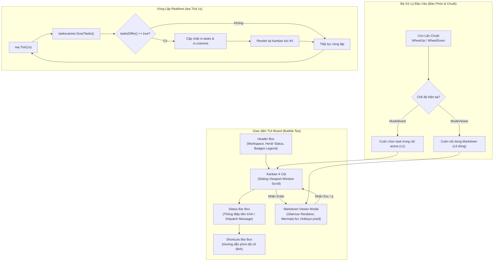

# Concept: Tối ưu UI Board, Footer Tách Biệt, Cuộn Cột, Markdown Glamour + Mermaid ASCII & Cuộn Chuột

## 1. Problem & Goal (Vấn đề & Mục tiêu)

### Problem (Điểm nghẽn & Thiếu sót hiện tại)
- **Context & Trigger**: Người dùng điều hướng trên TUI Board, thực hiện phím tắt điều phối Agent (`p`, `a`, `d`, `c`), mở tài liệu Markdown (`Enter`), và tương tác qua bàn phím cùng chuột máy tính.
- **Symptom & Defect**:
  1. Các ký hiệu viết tắt tài liệu `[C]`, `[P]`, `[D]`, `[R]` trên card chưa có phần chú thích giải nghĩa màu sắc và mục đích.
  2. Phần chân trang nhồi nhét cả danh sách phím tắt và thông báo trạng thái dài vào một khung duy nhất, gây tràn chữ và rối mắt.
  3. Thông báo dispatch lệnh (ví dụ: `Đã dispatch plan tới pane [w4:p7]...`) vẫn hiển thị ID kỹ thuật thô thay vì tên đại diện thân thiện của Pane (`pm`, `dev`, `bug`...).
  4. Cột Kanban render toàn bộ danh sách task; khi số lượng card vượt quá chiều cao cột (`colHeight`), các card bị tràn ra ngoài màn hình hoặc bị che khuất khiến con trỏ active task biến mất khỏi tầm nhìn.
  5. Chế độ xem Markdown Viewer (`Enter`) chỉ hiển thị văn bản thô không ngắt dòng (soft wrap), thiếu cú pháp highlight (Headers, Bold, Code block), cuộn từng dòng đơn điệu (thiếu PageUp/PageDown, Vim half-page `d`/`u`), không có số nhảy tab nhanh và không cho phép dispatch lệnh trực tiếp khi đang đọc tài liệu.
  6. TUI Board không tự động phản ánh trạng thái mới khi các agent chạy ngầm tạo task, di chuyển cột hoặc sinh tài liệu mới (`plan.md`, `debug.md`); người dùng buộc phải nhấn phím `r` thủ công để thấy thay đổi.
  7. Khối Code (` ```ts `, ` ```go `) và sơ đồ Mermaid (` ```mermaid `) trong file Markdown chỉ hiển thị dưới dạng văn bản thô không màu mè, không có viền hộp code và không hiển thị được hình vẽ cấu trúc.
  8. Giao diện TUI chưa hỗ trợ con lăn chuột (Mouse Wheel Up/Down); người dùng buộc phải bấm phím điều hướng để cuộn trang hoặc di chuyển task.
- **Root Cause**:
  1. Khung Header Box chưa định nghĩa thanh legend giải nghĩa cho các mã màu và ký tự viết tắt.
  2. Layout chân trang dùng chung một container `footer` cho cả hai nhóm dữ liệu có vòng đời và mật độ khác nhau.
  3. Mã nguồn dispatch chuỗi thông báo lấy trực tiếp trường `route.Pane` thay vì tra cứu qua từ điển ánh xạ `m.paneNames`.
  4. Vòng lặp render cột duyệt qua toàn bộ mảng `col.Tasks` mà không áp dụng thuật toán cửa sổ trượt (sliding window viewport) tương ứng với chiều cao khả dụng.
  5. Viewer tách biệt hoàn toàn với bộ điều phối phím dispatch, chỉ cắt chuỗi thô theo dòng mà không tích hợp bộ định dạng Markdown và xử lý phím điều hướng mở rộng.
  6. Hàm khởi tạo `Init()` của Bubble Tea trả về `nil`, không kích hoạt vòng lặp `tea.Tick` định kỳ để kiểm tra biến động của hệ thống tệp.
  7. Chưa tích hợp bộ phân tích cú pháp Markdown nâng cao (`glamour`) và bộ chuyển đổi sơ đồ ASCII trực quan cho terminal.
  8. Xử lý sự kiện `tea.MouseMsg` mới chỉ bắt hành động click chuột trái (`MouseButtonLeft`), chưa xử lý sự kiện lăn con trỏ `MouseButtonWheelUp` và `MouseButtonWheelDown`.
- **Impact / Blast Radius**: Trải nghiệm quan sát trên TUI Board bị giảm sút, người dùng khó nhận biết ý nghĩa ký hiệu, nhầm lẫn pane nhận lệnh, không thể xem các task ở cuối danh sách dài, tốn thao tác đóng mở Viewer để dispatch, tệp markdown chứa code và sơ đồ rất khó đọc, và thiếu sự tự nhiên khi thao tác bằng chuột.

### Goal (Kết quả kỹ thuật mục tiêu)
- **Core Goal**: Bổ sung thanh chú thích Badges trên Header, phân tách rõ ràng Status Bar và Shortcuts Bar, chuẩn hóa hiển thị tên Pane khi dispatch lệnh, tích hợp cơ chế cuộn mượt mà cho từng cột Kanban, nâng cấp toàn diện Markdown Viewer với Glamour & Mermaid ASCII, tự động đồng bộ Realtime, và hỗ trợ cuộn bằng con lăn chuột.
- **Acceptance Criteria**:
  - Khung Header Box hiển thị đầy đủ chú thích màu sắc: `[C] Concept`, `[P] Plan`, `[D] Debug`, `[R] Review`.
  - Chân trang được chia thành 2 hộp độc lập: Status Bar (thông báo tiến trình đang chạy) nằm ngay trên Shortcuts Bar (hướng dẫn phím bấm).
  - Khi kích hoạt các phím dispatch (`p`, `a`, `d`, `c`), chuỗi thông báo trạng thái hiển thị chính xác tên nhãn Pane thân thiện (`pm`, `dev`, `bug`, `lead`, `tester`), chỉ fallback về ID khi nhãn rỗng.
  - Cột Kanban áp dụng cơ chế cuộn thông minh (sliding window viewport), tự động dịch chuyển vùng nhìn thấy để bám sát con trỏ task active, đồng thời hiển thị chỉ báo cuộn (`▲` khi còn task phía trên, `▼` khi còn task phía dưới).
  - Markdown Viewer hiển thị chất lượng cao:
    - Định dạng bằng **`glamour`**: Tự động tô màu cú pháp (Syntax Highlighting qua Chroma) cho các khối Code Block theo từng ngôn ngữ, kẻ bảng Markdown Unicode chuẩn, soft wrap theo chiều rộng khung.
    - Sơ đồ Mermaid: Tự động chuyển đổi hoặc đóng khung tô màu cú pháp trực quan (ASCII box/arrow art) ngay trong terminal mà không cần mở Web.
    - Cuộn nhanh: `PageUp`/`PageDown`, `Home`/`End`, `J`/`K`, hiển thị tiến độ đọc `Dòng X/Y (Z%)`.
    - Chuyển tab trực tiếp bằng phím số `1`, `2`, `3` tương ứng tài liệu hiện hữu bên cạnh `Tab`/`Shift+Tab`.
    - Phím tắt tác vụ nhanh: Nhấn `p` (Plan), `a` (Apply), `d` (Debug) trực tiếp trong Viewer để dispatch ngay tài liệu đang xem.
  - Cơ chế Realtime hoạt động tự động thông qua chu kỳ 1 giây (`tea.Tick 1s`), phát hiện thay đổi qua hàm so sánh `tasksDiffer` và cập nhật tức thì danh sách task, badges tài liệu và cột Kanban mà không làm mất vị trí con trỏ của người dùng.
  - Hỗ trợ cuộn bằng chuột (Mouse Wheel Up/Down): Lăn con lăn chuột để cuộn mượt mà nội dung văn bản trong Viewer và cuộn danh sách task trong cột Kanban.

## 2. Scope Boundaries (Ranh giới phạm vi)
- **In-Scope**:
  - Bổ sung thành phần hiển thị Badges Legend vào Header Box của TUI Board.
  - Tách đôi container footer thành Status Bar Box và Shortcuts Bar Box độc lập.
  - Xây dựng hàm helper tra cứu tên Pane thân thiện và áp dụng vào các nhánh xử lý phím dispatch `p`, `a`, `d`, `c`.
  - Tích hợp logic cửa sổ trượt (sliding viewport) và chỉ báo cuộn theo chiều dọc cho từng cột Kanban.
  - Tích hợp thư viện `glamour` và bộ xử lý sơ đồ ASCII terminal trong Markdown Viewer.
  - Bổ sung bắt sự kiện `tea.MouseButtonWheelUp` và `tea.MouseButtonWheelDown` để cuộn bằng chuột.
  - Tích hợp vòng lặp `tea.Tick` 1s trong `Init()` và `Update()` để cập nhật dữ liệu Realtime.
- **Explicit Out-of-Scope**:
  - Không thay đổi cấu trúc bảng Kanban hoặc số lượng 4 cột chuẩn.
  - Không bắt buộc mở trình duyệt ngoài để xem file (100% xử lý bên trong Terminal).
  - Không thay đổi giao thức giao tiếp ngầm với Herdr CLI.
  - Không sửa đổi cấu trúc lưu trữ của tệp cấu hình JSON.

## 3. Proposed Solution & Core Mechanism (Giải pháp đề xuất & Cơ chế cốt lõi)

### Core Mechanism
- **Badges Legend**: Tích hợp một hàng văn bản có màu định dạng tương thích trực tiếp vào Header Box: `Badges: [C] Concept  [P] Plan  [D] Debug  [R] Review`.
- **Two-Tier Footer Layout**:
  - **Tier 1 (Status Bar)**: Chiếm toàn bộ chiều ngang, viền mảnh với tiền tố biểu tượng nổi bật (`ℹ Sẵn sàng.` hoặc `⚡ Đã dispatch ...`), đảm bảo thông báo dài hiển thị trọn vẹn mà không che khuất phím tắt.
  - **Tier 2 (Shortcuts Bar)**: Nằm cố định ở dòng dưới cùng, hiển thị các phím tắt cốt lõi một cách ngắn gọn, súc tích.
- **Pane Display Name Resolver**: Xây dựng phương thức tra cứu an toàn nhận vào `paneID` và trả về `DisplayName` từ bản đồ ánh xạ `paneNames` đã nạp từ Herdr Session.
- **Column Viewport Scrolling (Cơ chế Cuộn Cột)**:
  - Xác định số card hiển thị tối đa `maxCards = (colHeight - 4) / 5`.
  - Tính toán dải chỉ số bắt đầu `startIdx` dựa trên `curIdx = m.taskIndices[colIdx]` sao cho `startIdx <= curIdx < startIdx + maxCards`.
  - Chỉ render các card trong dải `[startIdx, startIdx + maxCards]`.
  - Chèn dòng chỉ báo `▲ (+N task)` nếu `startIdx > 0` và `▼ (+M task)` nếu `endIdx < len(tasks)`.
- **Glamour & Mermaid Terminal Art in Viewer**:
  - Khởi tạo renderer `glamour.NewTermRenderer` với cấu hình chiều rộng `boxWidth - 4` và theme tối (`dark`).
  - Toàn bộ nội dung Markdown (tiêu đề, khối code `ts`, `go`, `json`, bảng biểu) được render chuẩn mực với Chroma syntax highlighting.
  - Với các khối Mermaid (`sequenceDiagram`, `flowchart`), hệ thống chuyển đổi các kết nối cơ bản thành cấu trúc hình hộp Unicode (`┌───┐ ──► ┌───┐`) hoặc đóng khung mã nguồn DSL màu sắc giúp người đọc nắm bắt luồng dữ liệu ngay trong terminal.
- **Mouse Wheel Scrolling**:
  - Bắt sự kiện `tea.MouseMsg` tại hàm `Update()`.
  - Khi `msg.Button == tea.MouseButtonWheelUp`: Giảm `viewerScroll` đi 3 dòng (trong Viewer) hoặc giảm `taskIndices[colIdx]` (trong Board).
  - Khi `msg.Button == tea.MouseButtonWheelDown`: Tăng `viewerScroll` đi 3 dòng (trong Viewer) hoặc tăng `taskIndices[colIdx]` (trong Board).
- **Realtime Background Polling**:
  - Kích hoạt `tea.Tick(1*time.Second)` tại `Init()`.
  - Khi nhận `tickMsg`, quét danh sách task ngầm và chạy hàm `tasksDiffer(oldTasks, newTasks)`.
  - Nếu có sự khác biệt (số lượng, slug, status, hoặc số badges tài liệu), cập nhật `m.tasks` và `m.columns`.

### Conceptual Flow / Domain Model



### UI Wireframe

#### 1. Markdown Viewer Wireframe (Với Glamour & Syntax Highlight Code)
```text
┌─ 📖 MARKDOWN VIEWER | [1: concept.md]  [2: plan.md]  [3: debug.md] ─────────────────┐
│                                                                                      │
│   # Concept: Tối ưu UI Board và Markdown Viewer                                      │
│                                                                                      │
│   > [!NOTE] Bối cảnh: Người dùng cần giao diện đọc trực quan thuần Terminal.         │
│                                                                                      │
│   ┌── Code: typescript ────────────────────────────────────────────────────────┐     │
│   │  const server = createServer({ port: 4200 });                              │     │
│   │  await server.listen(); // Khởi động background service                    │     │
│   └────────────────────────────────────────────────────────────────────────────┘     │
│                                                                                      │
│   ┌── Diagram: Sequence Flow ──────────────────────────────────────────────────┐     │
│   │  User          Board         Herdr                                         │     │
│   │   │              │             │                                           │     │
│   │   │─── enter ───►│             │                                           │     │
│   │   │              │─── prompt ─►│                                           │     │
│   └────────────────────────────────────────────────────────────────────────────┘     │
│                                                                                      │
└──────────────────────────────────────────────────────────────────────────────────────┘
┌─ [Tab/1-3] Đổi file  [↑/↓/Lăn chuột] Cuộn  [p] Plan  [a] Apply  [q] Đóng | 24/95 (25%) ─┐
```

## 4. Critical Risks & Edge Cases (Rủi ro & Xử lý ngoại lệ)
- **Tương thích terminal với ANSI escape sequences**: Glamour tạo ra các mã màu ANSI chuẩn (Chroma/Termenv). Khi chạy trên Windows Terminal / PowerShell 7, các mã màu này được hỗ trợ hoàn hảo; với các terminal đời cũ không có truecolor, Glamour tự động fallback an toàn về bảng màu 256/16 màu.
- **Sự kiện cuộn chuột quá nhanh**: Người dùng cuộn con lăn liên tục có thể sinh ra nhiều `MouseMsg` dồn dập. Xử lý cộng dồn `viewerScroll` với giới hạn biên `[0, totalLines - boxHeight]` bảo đảm không bao giờ văng chỉ số.
- **Bộ nhớ khi render Glamour liên tục**: Cache lại kết quả Glamour Markdown đã render của document hiện tại; chỉ render lại khi tài liệu được chuyển đổi hoặc kích thước cửa sổ (`WindowSizeMsg`) thay đổi.
