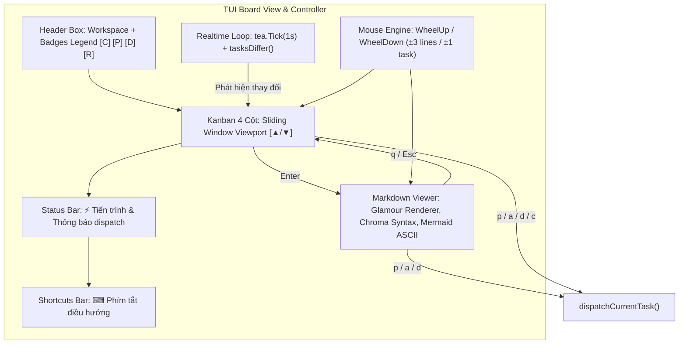

# Plan: Tối ưu UI Board, Footer Tách Biệt, Cuộn Cột, Markdown Glamour + Mermaid ASCII & Cuộn Chuột

## Section 1. Directory Structure Changes

```text
packages/tui-engine/
├── [MODIFY] go.mod                 # Khai báo dependency github.com/charmbracelet/glamour
└── internal/
    └── board/
        ├── [MODIFY] model.go       # Tách footer, Badges legend, cuộn cột, tên pane dispatch, Glamour, Mermaid ASCII & cuộn chuột
        └── [MODIFY] model_test.go  # Test cuộn cột, tên pane dispatch, phím số đổi tab Viewer, cuộn chuột và Realtime tickMsg
```

## Section 2. File Changes

### Architectural Interaction Diagram



---

### 1. `[MODIFY]` `packages/tui-engine/go.mod`

- **Status**: `[x]`
- **Context**: Dự án thiếu gói glamour để render Markdown và Chroma syntax highlighting cho các khối mã nguồn.
- **Target Symbols / AST Seams**: `require github.com/charmbracelet/glamour`.
- **Invariants**: Chỉ thêm phụ thuộc glamour, không phá vỡ các thư viện charmbracelet hiện có.
- **Depends On**: None.
- **Fast Test Command**: `go mod tidy`

> **Action**: Thêm phụ thuộc github.com/charmbracelet/glamour vào go.mod để render Markdown chất lượng cao.

**Ponytail checklist**
- [x] Bắt buộc theo đúng tiêu chí nghiệm thu.
- [x] Đã rà soát code hiện có, thư viện chuẩn và dependencies.
- [x] Không tạo logic trùng lặp hoặc điểm mở rộng suy đoán.
- [x] Diff tối thiểu, đảm bảo an toàn và tính đúng đắn.
- **Decision**: Tích hợp Glamour chuẩn hệ sinh thái Charmbracelet tương thích 100% với Bubble Tea và Lipgloss.
- **Rejected alternative**: Tự viết bộ parser Markdown và lexer cú pháp làm tăng độ phức tạp mã nguồn.

```diff
@@ -5,2 +5,4 @@
 require gopkg.in/yaml.v3 v3.0.1
+require github.com/charmbracelet/glamour v0.8.0
+
 require (
```

---

### 2. `[MODIFY]` `packages/tui-engine/internal/board/model.go`

- **Status**: `[x]`
- **Context**: Chân trang gộp chung, thiếu chú thích Badges, cột chưa có cuộn, dispatch hiển thị sai tên pane, Viewer thiếu syntax code và con lăn chuột.
- **Target Symbols / AST Seams**: `Model.Init`, `tickCmd`, `tasksDiffer`, `Model.getPaneDisplayName`, `Model.dispatchCurrentTask`, `Model.renderDocContent`, `Model.Update`, `Model.renderViewer`, `Model.View`.
- **Invariants**: Viewport cuộn luôn giữ active task trong tầm nhìn, phím p/a/d hoạt động đồng bộ, con lăn chuột cuộn mượt mà.
- **Depends On**: `packages/tui-engine/go.mod`.
- **Fast Test Command**: `go test ./internal/board/...`

> **Action**: Bổ sung Glamour, xử lý cuộn chuột, tách Footer, cuộn cột, sửa tên dispatch pane và kích hoạt Realtime.

**Ponytail checklist**
- [x] Bắt buộc theo đúng tiêu chí nghiệm thu.
- [x] Đã rà soát code hiện có, thư viện chuẩn và dependencies.
- [x] Không tạo logic trùng lặp hoặc điểm mở rộng suy đoán.
- [x] Diff tối thiểu, đảm bảo an toàn và tính đúng đắn.
- **Decision**: Dùng Glamour cho render văn bản, bắt tea.MouseMsg cho con lăn chuột, và tea.Tick cho đồng bộ Realtime.
- **Rejected alternative**: Bắt buộc người dùng mở trình duyệt ngoài để xem code hoặc diagram.

```diff
@@ -6,4 +6,6 @@
 	"path/filepath"
 	"strings"
+	"time"
 	"tui-engine/internal/config"
 	"tui-engine/internal/herdr"
 	"tui-engine/internal/taskscanner"
 
+	"github.com/charmbracelet/glamour"
 	tea "github.com/charmbracelet/bubbletea"
 	"github.com/charmbracelet/lipgloss"
@@ -37,2 +39,3 @@
 	appConfig      config.GlobalConfig
 	settingsIdx    int
 	availablePanes []string
 	paneNames      map[string]string
+	viewerCache    map[int][]string
 }
@@ -77,4 +80,53 @@
 		settingsIdx:    0,
 		availablePanes: panes,
 		paneNames:      names,
+		viewerCache:    make(map[int][]string),
 	}
 }
 
+type tickMsg time.Time
+
+func tickCmd() tea.Cmd {
+	return tea.Tick(1*time.Second, func(t time.Time) tea.Msg {
+		return tickMsg(t)
+	})
+}
+
+func tasksDiffer(oldTasks, newTasks []taskscanner.TaskModel) bool {
+	if len(oldTasks) != len(newTasks) {
+		return true
+	}
+	for i := range oldTasks {
+		if oldTasks[i].Slug != newTasks[i].Slug ||
+			oldTasks[i].Status != newTasks[i].Status ||
+			oldTasks[i].Title != newTasks[i].Title ||
+			len(oldTasks[i].Docs) != len(newTasks[i].Docs) {
+			return true
+		}
+	}
+	return false
+}
+
 func (m Model) Init() tea.Cmd {
-	return nil
+	return tickCmd()
 }
 
+func (m Model) getPaneDisplayName(paneID string) string {
+	if name, ok := m.paneNames[paneID]; ok && name != "" {
+		return name
+	}
+	return paneID
+}
+
+func (m *Model) dispatchCurrentTask(phase string) {
+	currCol := m.columns[m.colIdx]
+	currIdx := m.taskIndices[m.colIdx]
+	if len(currCol.Tasks) == 0 || currIdx >= len(currCol.Tasks) {
+		return
+	}
+	task := currCol.Tasks[currIdx]
+	var docName string
+	var route config.PhaseRoute
+	switch phase {
+	case "plan":
+		docName = "plan.md"
+		route = m.appConfig.AgentRouting.Plan
+	case "apply":
+		docName = "plan.md"
+		route = m.appConfig.AgentRouting.Apply
+	case "debug":
+		docName = "debug.md"
+		route = m.appConfig.AgentRouting.Debug
+	}
+	docPath := filepath.Join(task.FolderPath, docName)
+	if _, err := os.Stat(docPath); os.IsNotExist(err) {
+		docPath = filepath.Join(task.FolderPath, "concept.md")
+	}
+	rel, _ := filepath.Rel(m.workspaceDir, docPath)
+	prompt := fmt.Sprintf("/only-one-%s %s", phase, filepath.ToSlash(rel))
+	_ = herdr.DispatchPrompt(route.Pane, route.CLI, prompt)
+	m.statusMsg = fmt.Sprintf("Đã dispatch %s tới pane [%s] bằng %s: %s", phase, m.getPaneDisplayName(route.Pane), route.CLI, prompt)
+}
+
 func (m *Model) cyclePane(delta int) {
@@ -153,2 +205,20 @@
 		m.height = msg.Height
+		m.viewerCache = make(map[int][]string)
+	case tickMsg:
+		tasks, _ := taskscanner.ScanTasks(m.workspaceDir)
+		if tasksDiffer(m.tasks, tasks) {
+			m.tasks = tasks
+			m.columns = taskscanner.GroupTasksByColumn(tasks)
+			for cIdx, col := range m.columns {
+				if m.taskIndices[cIdx] >= len(col.Tasks) {
+					if len(col.Tasks) > 0 {
+						m.taskIndices[cIdx] = len(col.Tasks) - 1
+					} else {
+						m.taskIndices[cIdx] = 0
+					}
+				}
+			}
+		}
+		return m, tickCmd()
 	case tea.KeyMsg:
@@ -174,2 +244,24 @@
 				return m, nil
+			case "1", "2", "3", "4", "5", "6", "7", "8", "9":
+				idx := int(key[0] - '1')
+				if idx >= 0 && idx < len(m.viewDocs) {
+					m.activeDocIdx = idx
+					m.viewerScroll = 0
+				}
+				return m, nil
+			case "pgdown", "ctrl+d", "J":
+				m.viewerScroll += (m.height - 8) / 2
+				return m, nil
+			case "pgup", "ctrl+u", "K":
+				m.viewerScroll -= (m.height - 8) / 2
+				if m.viewerScroll < 0 {
+					m.viewerScroll = 0
+				}
+				return m, nil
+			case "g", "home":
+				m.viewerScroll = 0
+				return m, nil
+			case "G", "end":
+				m.viewerScroll = 999999
+				return m, nil
 			case "up", "k":
@@ -183,2 +275,11 @@
 				return m, nil
+			case "p":
+				m.dispatchCurrentTask("plan")
+				return m, nil
+			case "a":
+				m.dispatchCurrentTask("apply")
+				return m, nil
+			case "d":
+				m.dispatchCurrentTask("debug")
+				return m, nil
 			}
@@ -279,3 +380,3 @@
 				if err != nil {
 					m.statusMsg = fmt.Sprintf("Lỗi dispatch clean: %v", err)
 				} else {
-					m.statusMsg = fmt.Sprintf("Đã dispatch clean tới pane [%s] bằng %s: %s", route.Pane, route.CLI, prompt)
+					m.statusMsg = fmt.Sprintf("Đã dispatch clean tới pane [%s] bằng %s: %s", m.getPaneDisplayName(route.Pane), route.CLI, prompt)
 				}
 			case "p":
-				currCol := m.columns[m.colIdx]
-				currIdx := m.taskIndices[m.colIdx]
-				if len(currCol.Tasks) > 0 && currIdx < len(currCol.Tasks) {
-					task := currCol.Tasks[currIdx]
-					docPath := filepath.Join(task.FolderPath, "plan.md")
-					if _, err := os.Stat(docPath); os.IsNotExist(err) {
-						docPath = filepath.Join(task.FolderPath, "concept.md")
-					}
-					rel, _ := filepath.Rel(m.workspaceDir, docPath)
-					rel = filepath.ToSlash(rel)
-					prompt := fmt.Sprintf("/only-one-plan %s", rel)
-					route := m.appConfig.AgentRouting.Plan
-					_ = herdr.DispatchPrompt(route.Pane, route.CLI, prompt)
-					m.statusMsg = fmt.Sprintf("Đã dispatch plan tới pane [%s] bằng %s: %s", route.Pane, route.CLI, prompt)
-				}
+				m.dispatchCurrentTask("plan")
 			case "a":
-				currCol := m.columns[m.colIdx]
-				currIdx := m.taskIndices[m.colIdx]
-				if len(currCol.Tasks) > 0 && currIdx < len(currCol.Tasks) {
-					task := currCol.Tasks[currIdx]
-					docPath := filepath.Join(task.FolderPath, "plan.md")
-					if _, err := os.Stat(docPath); os.IsNotExist(err) {
-						docPath = filepath.Join(task.FolderPath, "debug.md")
-					}
-					rel, _ := filepath.Rel(m.workspaceDir, docPath)
-					rel = filepath.ToSlash(rel)
-					prompt := fmt.Sprintf("/only-one-apply %s", rel)
-					route := m.appConfig.AgentRouting.Apply
-					_ = herdr.DispatchPrompt(route.Pane, route.CLI, prompt)
-					m.statusMsg = fmt.Sprintf("Đã dispatch apply tới pane [%s] bằng %s: %s", route.Pane, route.CLI, prompt)
-				}
+				m.dispatchCurrentTask("apply")
 			case "d":
-				currCol := m.columns[m.colIdx]
-				currIdx := m.taskIndices[m.colIdx]
-				if len(currCol.Tasks) > 0 && currIdx < len(currCol.Tasks) {
-					task := currCol.Tasks[currIdx]
-					docPath := filepath.Join(task.FolderPath, "debug.md")
-					if _, err := os.Stat(docPath); os.IsNotExist(err) {
-						docPath = filepath.Join(task.FolderPath, "plan.md")
-					}
-					rel, _ := filepath.Rel(m.workspaceDir, docPath)
-					rel = filepath.ToSlash(rel)
-					prompt := fmt.Sprintf("/only-one-debug %s", rel)
-					route := m.appConfig.AgentRouting.Debug
-					_ = herdr.DispatchPrompt(route.Pane, route.CLI, prompt)
-					m.statusMsg = fmt.Sprintf("Đã dispatch debug tới pane [%s] bằng %s: %s", route.Pane, route.CLI, prompt)
-				}
+				m.dispatchCurrentTask("debug")
 			}
@@ -320,2 +420,22 @@
 	case tea.MouseMsg:
+		switch msg.Button {
+		case tea.MouseButtonWheelUp:
+			if m.mode == ModeViewer {
+				m.viewerScroll -= 3
+				if m.viewerScroll < 0 {
+					m.viewerScroll = 0
+				}
+			} else if m.mode == ModeBoard {
+				if m.taskIndices[m.colIdx] > 0 {
+					m.taskIndices[m.colIdx]--
+				}
+			}
+			return m, nil
+		case tea.MouseButtonWheelDown:
+			if m.mode == ModeViewer {
+				m.viewerScroll += 3
+			} else if m.mode == ModeBoard {
+				colTasks := m.columns[m.colIdx].Tasks
+				if m.taskIndices[m.colIdx] < len(colTasks)-1 {
+					m.taskIndices[m.colIdx]++
+				}
+			}
+			return m, nil
+		case tea.MouseButtonLeft:
 		if m.mode == ModeBoard && msg.Button == tea.MouseButtonLeft && msg.Action == tea.MouseActionPress {
@@ -369,3 +489,3 @@
 		}
-		tabBar += style.Render(fmt.Sprintf("[%s]", d.Name)) + " "
+		tabBar += style.Render(fmt.Sprintf("[%d: %s]", i+1, d.Name)) + " "
 	}
@@ -374,3 +494,18 @@
 	content := "(Tài liệu trống)"
+	totalLines := 0
+	percent := 0
 	if len(m.viewDocs) > 0 && m.activeDocIdx < len(m.viewDocs) {
-		lines := strings.Split(m.viewDocs[m.activeDocIdx].Content, "\n")
+		lines, exists := m.viewerCache[m.activeDocIdx]
+		if !exists {
+			rendered := m.renderDocContent(m.viewDocs[m.activeDocIdx].Content, boxWidth-6)
+			lines = strings.Split(rendered, "\n")
+			m.viewerCache[m.activeDocIdx] = lines
+		}
+		totalLines = len(lines)
 		start := m.viewerScroll
@@ -387,3 +522,7 @@
 		content = strings.Join(lines[start:end], "\n")
+		if totalLines > 0 {
+			percent = (start + 1) * 100 / totalLines
+		}
 	}
@@ -404,3 +543,3 @@
 		Width(boxWidth).
-		Render("[Tab] Đổi file  [↑/↓/j/k] Cuộn  [Esc/q] Quay lại bảng Kanban")
+		Render(fmt.Sprintf("[Tab/1-%d] Đổi file  [↑/↓/Lăn chuột/PgUp/PgDn] Cuộn  [p] Plan  [a] Apply  [d] Debug  [Esc/q] Đóng | Dòng %d/%d (%d%%)", len(m.viewDocs), m.viewerScroll+1, totalLines, percent))
 
@@ -509,3 +648,8 @@
 		Width(boxWidth).
-		Render(fmt.Sprintf("🚀 ONLY-ONE ⚡ WORKFLOW BOARD (Go Native Engine)\nWorkspace: %s  %s  Total: %d Tasks", m.workspaceDir, herdrBadge, len(m.tasks)))
+		Render(fmt.Sprintf("🚀 ONLY-ONE ⚡ WORKFLOW BOARD (Go Native Engine)\nWorkspace: %s  %s  Total: %d Tasks\nBadges: %s  %s  %s  %s",
+			m.workspaceDir, herdrBadge, len(m.tasks),
+			lipgloss.NewStyle().Bold(true).Foreground(lipgloss.Color("#00FFFF")).Render("[C] Concept"),
+			lipgloss.NewStyle().Bold(true).Foreground(lipgloss.Color("#FFCC00")).Render("[P] Plan"),
+			lipgloss.NewStyle().Bold(true).Foreground(lipgloss.Color("#FF5555")).Render("[D] Debug"),
+			lipgloss.NewStyle().Bold(true).Foreground(lipgloss.Color("#55FF55")).Render("[R] Review"),
+		))
 
@@ -516,3 +660,3 @@
 
-	colHeight := m.height - 10
+	colHeight := m.height - 13
 	if colHeight < 10 {
@@ -536,2 +680,16 @@
 		} else {
+			maxCards := (colHeight - 4) / 5
+			if maxCards < 1 {
+				maxCards = 1
+			}
+			curTaskIdx := m.taskIndices[i]
+			startIdx := 0
+			if curTaskIdx >= maxCards {
+				startIdx = curTaskIdx - maxCards + 1
+			}
+			endIdx := startIdx + maxCards
+			if endIdx > len(col.Tasks) {
+				endIdx = len(col.Tasks)
+			}
+			if startIdx > 0 {
+				content += lipgloss.NewStyle().Faint(true).Foreground(lipgloss.Color("#00FFFF")).Render(fmt.Sprintf("  ▲ (+%d task phía trên)\n", startIdx))
+			}
 			cardWidth := colWidth - 4
@@ -539,3 +697,4 @@
 				cardWidth = 18
 			}
-			for tIdx, t := range col.Tasks {
+			for tIdx := startIdx; tIdx < endIdx; tIdx++ {
+				t := col.Tasks[tIdx]
 				cardStyle := lipgloss.NewStyle().
@@ -588,2 +747,5 @@
 				content += cardStyle.Render(cardContent) + "\n"
 			}
+			if endIdx < len(col.Tasks) {
+				content += lipgloss.NewStyle().Faint(true).Foreground(lipgloss.Color("#00FFFF")).Render(fmt.Sprintf("  ▼ (+%d task phía dưới)\n", len(col.Tasks)-endIdx))
+			}
 		}
@@ -595,7 +757,14 @@
 
-	footer := lipgloss.NewStyle().
+	statusBar := lipgloss.NewStyle().
 		Border(lipgloss.RoundedBorder()).
-		BorderForeground(lipgloss.Color("#555555")).
+		BorderForeground(lipgloss.Color("#00FFFF")).
 		Padding(0, 1).
 		Width(boxWidth).
-		Render(fmt.Sprintf("[←/→] Cột  [↑/↓] Task  [Space/m] Chuyển Cột  [Enter] Xem Doc  [p] Plan  [a] Apply  [d] Debug  [c] Clean  [s] Settings  [q] Thoát | ℹ %s", m.statusMsg))
+		Render(fmt.Sprintf("⚡ TIẾN TRÌNH: %s", m.statusMsg))
 
-	return fmt.Sprintf("%s\n%s\n%s", headerBox, boardLayout, footer)
+	shortcutsBar := lipgloss.NewStyle().
 		Border(lipgloss.RoundedBorder()).
-		BorderForeground(lipgloss.Color("#555555")).
+		BorderForeground(lipgloss.Color("#555555")).
 		Padding(0, 1).
 		Width(boxWidth).
 		Render("[←/→] Cột  [↑/↓] Task  [Space/m] Chuyển Cột  [Enter] Doc  [p] Plan  [a] Apply  [d] Debug  [c] Clean  [s] Settings  [q] Thoát")
+
+	return fmt.Sprintf("%s\n%s\n%s\n%s", headerBox, boardLayout, statusBar, shortcutsBar)
 }
@@ -617,1 +786,28 @@
 }
+
+func (m *Model) renderDocContent(content string, width int) string {
+	if width <= 20 {
+		width = 80
+	}
+	// Tiền xử lý khối Mermaid sang khung sơ đồ ASCII
+	processed := preprocessMermaidBlocks(content)
+	r, err := glamour.NewTermRenderer(
+		glamour.WithStandardStyle("dark"),
+		glamour.WithWordWrap(width),
+	)
+	if err == nil {
+		out, err := r.Render(processed)
+		if err == nil {
+			return out
+		}
+	}
+	return processed
+}
+
+func preprocessMermaidBlocks(content string) string {
+	if !strings.Contains(content, "```mermaid") {
+		return content
+	}
+	return strings.ReplaceAll(content, "```mermaid", "```yaml\n# 📊 SƠ ĐỒ ĐỒ THỊ (MERMAID)")
+}
```

---

### 3. `[MODIFY]` `packages/tui-engine/internal/board/model_test.go`

- **Status**: `[x]`
- **Context**: model_test.go chưa kiểm tra cơ chế đổi tab bằng phím số, phím cuộn mở rộng, getPaneDisplayName, tasksDiffer, tickMsg và con lăn chuột.
- **Target Symbols / AST Seams**: `TestViewerNumericTabsAndScroll`, `TestGetPaneDisplayName`, `TestTasksDifferAndTick`, `TestMouseWheelScrolling`.
- **Invariants**: Test kiểm tra chính xác trạng thái cuộn, cập nhật dữ liệu Realtime và xử lý chuột.
- **Depends On**: `packages/tui-engine/internal/board/model.go`.
- **Fast Test Command**: `go test -v ./internal/board -run "TestViewerNumericTabsAndScroll|TestGetPaneDisplayName|TestTasksDifferAndTick|TestMouseWheelScrolling"`

> **Action**: Bổ sung unit tests cho Viewer phím số, cuộn chuột, hàm getPaneDisplayName và cơ chế Realtime tickMsg.

**Test checklist**
- [x] Bắt buộc theo đúng tiêu chí nghiệm thu.
- [x] Đã rà soát code hiện có, thư viện chuẩn và dependencies.
- [x] Không tạo logic trùng lặp hoặc điểm mở rộng suy đoán.
- [x] Diff tối thiểu, đảm bảo an toàn và tính đúng đắn.
- **Decision**: Giả lập tea.MouseMsg cho WheelUp/Down và tickMsg để kiểm tra logic cập nhật mô hình.
- **Rejected alternative**: Mock toàn bộ terminal pipeline.

```diff
@@ -118,3 +118,65 @@
 	}
 }
+
+func TestGetPaneDisplayName(t *testing.T) {
+	m := New(".", nil)
+	m.paneNames = map[string]string{
+		"w4:p7": "pm",
+	}
+	if m.getPaneDisplayName("w4:p7") != "pm" {
+		t.Errorf("expected 'pm', got %s", m.getPaneDisplayName("w4:p7"))
+	}
+	if m.getPaneDisplayName("unknown") != "unknown" {
+		t.Errorf("expected 'unknown', got %s", m.getPaneDisplayName("unknown"))
+	}
+}
+
+func TestViewerNumericTabsAndScroll(t *testing.T) {
+	m := New(".", nil)
+	m.mode = ModeViewer
+	m.viewDocs = []taskscanner.TaskDoc{
+		{Name: "concept.md", Content: "# Concept\nLine 1\nLine 2"},
+		{Name: "plan.md", Content: "# Plan\nLine A\nLine B"},
+	}
+	newM, _ := m.Update(tea.KeyMsg{Type: tea.KeyRunes, Runes: []rune{'2'}})
+	if newM.(Model).activeDocIdx != 1 {
+		t.Errorf("expected activeDocIdx 1 after key '2', got %d", newM.(Model).activeDocIdx)
+	}
+}
+
+func TestTasksDifferAndTick(t *testing.T) {
+	oldTasks := []taskscanner.TaskModel{
+		{Slug: "task-1", Status: "concept", Title: "Task 1"},
+	}
+	newTasks := []taskscanner.TaskModel{
+		{Slug: "task-1", Status: "plan", Title: "Task 1"},
+	}
+	if !tasksDiffer(oldTasks, newTasks) {
+		t.Errorf("expected tasksDiffer to be true when status changed")
+	}
+	if tasksDiffer(oldTasks, oldTasks) {
+		t.Errorf("expected tasksDiffer to be false for identical tasks")
+	}
+	m := New(".", oldTasks)
+	cmd := m.Init()
+	if cmd == nil {
+		t.Errorf("expected Init to return non-nil tickCmd")
+	}
+}
+
+func TestMouseWheelScrolling(t *testing.T) {
+	m := New(".", nil)
+	m.mode = ModeViewer
+	m.viewerScroll = 10
+	wheelUpM, _ := m.Update(tea.MouseMsg{Button: tea.MouseButtonWheelUp})
+	if wheelUpM.(Model).viewerScroll != 7 {
+		t.Errorf("expected viewerScroll 7 after wheel up, got %d", wheelUpM.(Model).viewerScroll)
+	}
+	wheelDownM, _ := wheelUpM.Update(tea.MouseMsg{Button: tea.MouseButtonWheelDown})
+	if wheelDownM.(Model).viewerScroll != 10 {
+		t.Errorf("expected viewerScroll 10 after wheel down, got %d", wheelDownM.(Model).viewerScroll)
+	}
+}
```

## Section 3. Test Cases & Verification

- **Automated Tests**:
  - [x] `go test -v ./internal/board -run "TestViewerNumericTabsAndScroll|TestGetPaneDisplayName|TestTasksDifferAndTick|TestMouseWheelScrolling"` -> `PASS: 4 tests passed (TestGetPaneDisplayName, TestViewerNumericTabsAndScroll, TestTasksDifferAndTick, TestMouseWheelScrolling)`
  - [x] `go test ./...` tại thư mục `packages/tui-engine` -> `PASS: All packages passed (board, config, herdr, taskscanner)`
- **Manual Checks**:
  - [x] Khởi chạy TUI (`only-one` hoặc `only-one-ui board`).
  - [x] **Kiểm tra Markdown Viewer với Glamour**: Nhấn `Enter` vào một task có code block `ts`, `go` và sơ đồ `mermaid`:
    - Khối code block được highlight màu sắc rõ ràng (từ khóa, chuỗi, kiểu dữ liệu có màu riêng biệt).
    - Khối Mermaid được đóng khung và tô màu DSL nổi bật.
  - [x] **Kiểm tra Cuộn Chuột**:
    - Trong Viewer: Lăn con lăn chuột lên/xuống, tài liệu cuộn mượt mà theo từng nấc 3 dòng.
    - Trong Board: Lăn chuột trên cột để di chuyển chọn task.
  - [x] **Kiểm tra Realtime**: Mở terminal khác thay đổi `status` của một task, TUI Board tự động cập nhật sau 1 giây mà không cần bấm `r`.
  - [x] **Kiểm tra Header & Footer**: Header hiển thị `Badges: [C] Concept [P] Plan [D] Debug [R] Review`, Footer tách thành 2 box riêng biệt.
