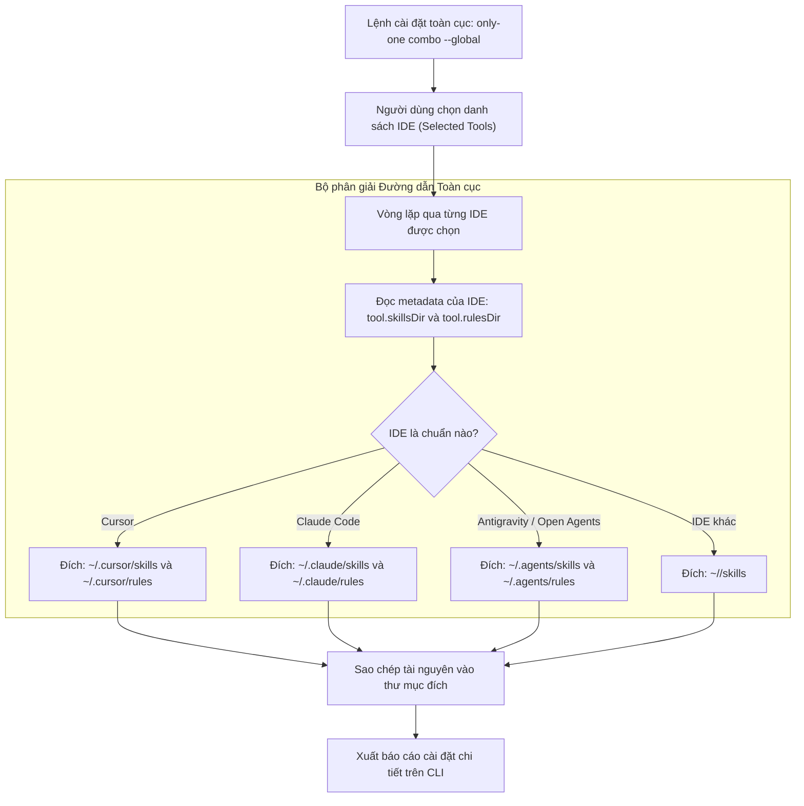

# Concept: Triển khai Tài sản Toàn cục theo Thư mục IDE Riêng biệt

## 1. Problem & Goal

### Problem (Điểm nghẽn & Thiếu sót hiện tại)
- **Context & Trigger**: Khi người dùng cài đặt tài nguyên toàn cục qua lệnh `only-one combo <name> --global` hoặc `only-one skill:add <name> --global`, hệ thống gọi hàm `resolveToolDestinationPaths` với tham số `isGlobal = true`.
- **Symptom & Defect**: Tất cả tài nguyên (skills, rules, workflows) đều bị ghi cứng vào thư mục dùng chung `~/.agents/skills` hoặc `~/.agents/rules`, bất kể người dùng chọn IDE nào (Cursor, Claude Code, Windsurf, Trae, RooCode...).
- **Root Cause**: Trong `src/core/agent/tools.ts`, nhánh `isGlobal = true` trả về cố định `join(targetDir, '.agents', assetType)`, bỏ qua hoàn toàn metadata cấu hình `skillsDir` và `rulesDir` của từng IDE được chọn trong `AI_TOOLS`.
- **Impact / Blast Radius**: Các IDE chuyên biệt (như Cursor đọc `~/.cursor/`, Claude Code đọc `~/.claude/`) không tự động nhận diện được tài nguyên cài đặt toàn cục. Người dùng phải tự sao chép thủ công hoặc cấu hình thêm.

### Goal (Kết quả kỹ thuật mục tiêu)
- **Core Goal**: Định tuyến chính xác tài sản toàn cục vào thư mục cấu hình chuẩn của từng IDE được người dùng chỉ định.
- **Acceptance Criteria**:
  - **`AC-1` (Phân giải Đường dẫn Chuẩn IDE)**: Khi `isGlobal = true`, `resolveToolDestinationPaths` sử dụng `tool.skillsDir` và `tool.rulesDir` trên thư mục gốc `targetDir` (`homedir()`), thay vì ghi cứng `.agents`.
  - **`AC-2` (Hỗ trợ Multi-target Độc lập)**: Khi người dùng chọn nhiều IDE cùng lúc (ví dụ Cursor + Claude Code), hệ thống sao chép độc lập tài nguyên vào từng thư mục tương ứng (`~/.cursor/...` và `~/.claude/...`).
  - **`AC-3` (Tương thích Ngược Open Agents)**: Các công cụ sử dụng chuẩn Open Agents (như Antigravity với `skillsDir: '.agents'`) vẫn tiếp tục triển khai tại `~/.agents/` như thiết kế gốc.
  - **`AC-4` (Minh bạch Báo cáo CLI)**: Báo cáo kết quả cài đặt hiển thị tường minh đường dẫn vật lý thực tế của từng IDE đã được cài đặt thành công.

---

## 2. Scope Boundaries

- **In-Scope**:
  - Nâng cấp hàm `resolveToolDestinationPaths` trong `src/core/agent/tools.ts` để đồng bộ cơ chế phân giải cho cả Local (`projectDir`) và Global (`homedir()`).
  - Đảm bảo các mô-đun cài đặt (`src/core/skill/index.ts`, `src/core/rule/index.ts`, `src/core/combo/index.ts`) hỗ trợ triển khai chuẩn xác tới nhiều IDE mục tiêu khi chạy global.
  - Cập nhật các bộ kiểm thử tự động (unit/integration tests) bao phủ việc phân giải đường dẫn toàn cục cho nhiều IDE.
- **Explicit Out-of-Scope**:
  - Không tự động di chuyển hoặc xoá thư mục `~/.agents/` cũ (người dùng chủ động tự dọn dẹp theo quyết định cá nhân).
  - Không thay đổi hành vi cài đặt cục bộ tại cấp độ dự án (Local Project - `<project>/.<ide>/`).

---

## 3. Proposed Solution & Core Mechanism

### Đánh giá Các Phương án Kỹ thuật (Architectural Options)

| Tiêu chí So sánh | Phương án 1: Thống nhất logic phân giải qua `AI_TOOLS` (Khuyến nghị) | Phương án 2: Bổ sung cấu hình `globalSkillsDir` riêng biệt |
| :--- | :--- | :--- |
| **Cơ chế** | Tái sử dụng `tool.skillsDir` và `tool.rulesDir` sẵn có trong `AI_TOOLS` cho cả Global và Local. | Bổ sung thêm trường `globalSkillsDir`, `globalRulesDir` vào từng đối tượng trong `AI_TOOLS`. |
| **Ưu điểm** | Đơn giản, tự nhiên, tuân thủ triết lý DRY, không làm phình schema cấu hình. | Cho phép thư mục global khác biệt hoàn toàn với local nếu có IDE đặc thù. |
| **Nhược điểm / Đánh đổi** | Giả định cấu trúc tên thư mục của IDE là tương đương giữa local và global (`~/.cursor` vs `<repo>/.cursor`). | Tăng độ phức tạp cấu hình và kiểm thử không cần thiết vì hiện tại các IDE đều giữ nguyên quy ước tên thư mục. |
| **Độ phức tạp** | Thấp (Low) | Trung bình (Medium) |
| **Quyết định** | **Chọn Phương án 1**: Triệt tiêu mã trùng lặp, logic phân giải nhất quán 100%. | Loại bỏ (Rejected). |

### Core Mechanism (Cơ chế Hoạt động Cốt lõi)

Hàm `resolveToolDestinationPaths` sẽ loại bỏ nhánh rẽ cứng nhắc `join(targetDir, '.agents', assetType)`. Thay vào đó, nó áp dụng chung một công thức phân giải cho cả Local và Global:
- **Skills**: `join(targetDir, tool.skillsDir || '.agents', 'skills')`
- **Rules**: `join(targetDir, tool.rulesDir || (tool.skillsDir ? join(tool.skillsDir, 'rules') : '.agents/rules'))`
- **Workflows**: `join(targetDir, tool.skillsDir || '.agents', 'workflows')`

Điểm khác biệt duy nhất giữa Local và Global là `targetDir`:
- Local: `targetDir = projectDir` (ví dụ: `D:/Sources/my-app/.cursor/skills`)
- Global: `targetDir = homeDir` (ví dụ: `C:/Users/ADMIN/.cursor/skills`)

### Conceptual Flow (Sơ đồ Luồng Điều phối Cài đặt Toàn cục)



### CLI Output Wireframe (Khung Giao diện Báo cáo CLI)

```text
+-----------------------------------------------------------------------+
|                   COMBO 'ONLY-ONE-FLOW' GLOBAL REPORT                 |
+-----------------------------------------------------------------------+
| Scope: GLOBAL (User Home Directory: C:\Users\ADMIN)                   |
| Target IDEs: Cursor, Claude Code, Antigravity                         |
+-----------------------------------------------------------------------+
| Skills Deployed:                                                      |
|   ✓ only-one-idea   -> ~/.cursor/skills/only-one-idea                 |
|   ✓ only-one-idea   -> ~/.claude/skills/only-one-idea                 |
|   ✓ only-one-idea   -> ~/.agents/skills/only-one-idea                 |
|   ✓ only-one-plan   -> ~/.cursor/skills/only-one-plan                 |
|   ✓ only-one-plan   -> ~/.claude/skills/only-one-plan                 |
|   ✓ only-one-plan   -> ~/.agents/skills/only-one-plan                 |
+-----------------------------------------------------------------------+
| Rules Deployed:                                                       |
|   ✓ karpathy-rules  -> ~/.cursor/rules/karpathy-rules.mdc             |
|   ✓ karpathy-rules  -> ~/.claude/rules/karpathy-rules.md              |
|   ✓ karpathy-rules  -> ~/.agents/rules/karpathy-rules.md              |
+-----------------------------------------------------------------------+
| Status: All assets successfully deployed to respective IDE folders!   |
+-----------------------------------------------------------------------+
```

---

## 4. Critical Risks & Edge Cases (Phân tích Rủi ro & Cơ chế Phòng vệ)

- **`Risk-1` (Trùng lặp & Nhân bản Dữ liệu Khi Chọn Nhiều IDE)**
  - *Mặt tiêu cực / Nguy cơ*: Khi chọn 3-4 IDE cùng lúc, mỗi IDE sẽ có một bản sao riêng của skill/rule, làm tăng dung lượng đĩa và khả năng phân mảnh nếu cập nhật lẻ tẻ.
  - *Cơ chế phòng vệ*: Đây là hành vi mong muốn để mỗi IDE hoàn toàn độc lập và không phụ thuộc chéo. Cơ chế lockfile sẽ lưu trữ trạng thái rõ ràng theo cặp `toolId:assetName` để khi chạy `update` hoặc `clean` sẽ xử lý chính xác theo từng IDE.

- **`Risk-2` (IDE Không Khai Báo `rulesDir`)**
  - *Mặt tiêu cực / Nguy cơ*: Một số IDE chỉ có `skillsDir` (như `.windsurf`, `.roo`) nhưng không hỗ trợ cấu hình rules toàn cục hoặc không có `rulesDir`. Nếu ép ghi rules có thể gây lỗi hoặc tạo thư mục thừa.
  - *Cơ chế phòng vệ*: Kiểm tra điều kiện `target.capabilities.includes(AllowedToolCapability.Rules)` trước khi triển khai rules. Nếu IDE không hỗ trợ rules, bỏ qua cài đặt rules cho IDE đó một cách an toàn và ghi chú `skipped (not supported)` trên báo cáo.

- **`Risk-3` (Tương thích với Antigravity & Open-Spec)**
  - *Mặt tiêu cực / Nguy cơ*: Sửa đổi đường dẫn có thể làm gãy các công cụ dựa vào chuẩn `~/.agents`.
  - *Cơ chế phòng vệ*: Trong cấu hình `AI_TOOLS`, Antigravity có sẵn `skillsDir: '.agents'` và `rulesDir: '.agents/rules'`. Khi áp dụng công thức mới, Antigravity vẫn sẽ trỏ chính xác về `~/.agents/`, bảo toàn 100% tính tương thích.

- **`Risk-4` (Thư mục Đích Chưa Tồn Tại Trên Máy Người Dùng)**
  - *Mặt tiêu cực / Nguy cơ*: Nếu người dùng chưa từng mở IDE đó (ví dụ thư mục `~/.cursor` chưa được tạo), việc ghi tệp trực tiếp sẽ gây lỗi `ENOENT`.
  - *Cơ chế phòng vệ*: Luôn gọi hàm tiện ích tạo thư mục đệ quy (`mkdir({ recursive: true })`) trước khi ghi hoặc sao chép tệp.
