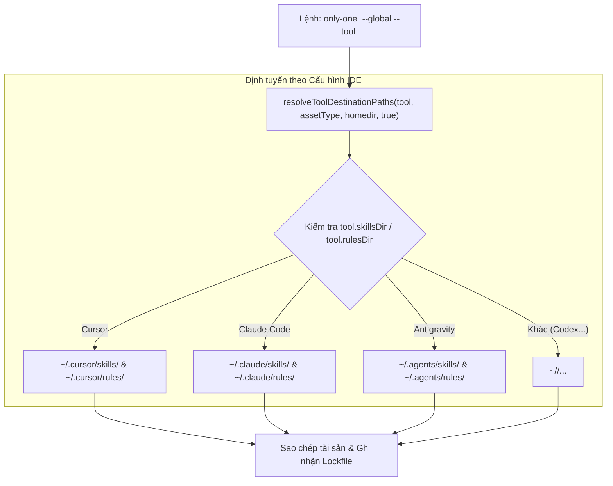

# Plan: Triển khai Tài sản Toàn cục theo Thư mục IDE Riêng biệt

## Section 1. Directory Structure Changes

```text
src/core/agent/
└── [MODIFY] tools.ts                         # Đồng bộ hóa resolveToolDestinationPaths theo thư mục chuẩn của từng IDE cho cả Local và Global
test/core/agent/
└── [MODIFY] tools.test.ts                   # Cập nhật unit test kiểm tra phân giải đường dẫn toàn cục cho Claude, Cursor, Codex, Antigravity
test/commands/
└── [MODIFY] global-commands.test.ts         # Bổ sung integration test cài đặt skill toàn cục trực tiếp vào thư mục .cursor
```

---

## Section 2. Story Board (User Journey & Feature Scenarios)

### Story 1: Phân giải Đường dẫn Toàn cục theo Thư mục Chuẩn của IDE [MODIFY]
- **User Story**: Là một lập trình viên sử dụng các IDE chuyên biệt (Cursor, Claude Code, Windsurf...) hoặc Open Agents (Antigravity), tôi muốn khi cài đặt toàn cục (`--global`), hệ thống sẽ đặt tài nguyên vào chính xác thư mục cấu hình của IDE đó (`~/.cursor/`, `~/.claude/`...) để IDE nhận diện tự động mà không cần can thiệp thủ công.
- **Before**: Lệnh `--global` cố định toàn bộ tài nguyên vào `~/.agents/skills` và `~/.agents/rules`, khiến Cursor và Claude Code không tự động nhận diện được.
- **After**: Lệnh `--global` sử dụng cấu hình `skillsDir` và `rulesDir` của từng IDE, đưa tài sản vào đúng `~/.cursor/skills`, `~/.claude/skills`, `~/.cursor/rules`, trong khi Antigravity vẫn giữ nguyên `~/.agents/`.
- **Key Scenarios**:
  - *Scenario 1 (Happy Path - IDE Chuyên biệt như Cursor & Claude)*:
    - *Test trường hợp: Kiểm tra phân giải đường dẫn toàn cục cho Claude (`~/.claude/skills`), Cursor (`~/.cursor/rules`), Codex (`~/.codex/workflows`)*
    - *Serving Files*:
      - `[TEST]` `test/core/agent/tools.test.ts`
      - `[MODIFY]` `src/core/agent/tools.ts`
  - *Scenario 2 (Tương thích Ngược - Antigravity & Open Agents)*:
    - *Test trường hợp: Kiểm tra Antigravity vẫn triển khai chính xác tại `~/.agents/skills` và `~/.agents/workflows`*
    - *Serving Files*:
      - `[TEST]` `test/core/agent/tools.test.ts`
      - `[MODIFY]` `src/core/agent/tools.ts`
  - *Scenario 3 (Integration CLI - Cài đặt Toàn cục theo Tool)*:
    - *Test trường hợp: Chạy lệnh `only-one skill:add` với `--tool cursor --global` và kiểm tra file xuất hiện tại `.cursor/skills/`*
    - *Serving Files*:
      - `[TEST]` `test/commands/global-commands.test.ts`



---

## Section 3. Test Cases & Verification Matrix

### 3.1. Bảng Đối soát Độ bao phủ Tiêu chí Concept (Concept Coverage & Traceability Matrix)

| Tiêu chí Concept (AC / Risk ID) | Yêu cầu cốt lõi từ Concept | Test Cases / Verification Gate đảm nhiệm | Trạng thái Bao phủ |
| :--- | :--- | :--- | :---: |
| **`AC-1`** (Phân giải Chuẩn IDE) | Phân giải `isGlobal = true` dùng `tool.skillsDir` và `tool.rulesDir` | `TC-01`, `TC-02`, `TC-03`, Task 1 & Task 2 | 🟢 100% Phủ |
| **`AC-2`** (Hỗ trợ Multi-target) | Triển khai độc lập vào từng thư mục IDE khi chọn tool | `TC-05`, Task 3 (`global-commands.test.ts`) | 🟢 100% Phủ |
| **`AC-3`** (Tương thích Ngược) | Antigravity vẫn tiếp tục triển khai tại `~/.agents/` | `TC-04`, Task 1 & Task 2 | 🟢 100% Phủ |
| **`AC-4`** (Báo cáo & Khóa an toàn) | Ghi nhận lockfile đúng, không sửa `.gitignore` của user home | `TC-05`, `TC-06`, Task 3 | 🟢 100% Phủ |
| **`Risk-1`** (Multi-target Isolation)| Mỗi IDE lưu trữ độc lập trong thư mục riêng của nó | `TC-01`, `TC-02`, `TC-05` | 🟢 100% Phủ |
| **`Risk-2`** (RulesDir Fallback) | Fallback về `join(tool.skillsDir, 'rules')` hoặc `.agents/rules` | `TC-02`, Task 2 (`tools.ts`) | 🟢 100% Phủ |
| **`Risk-3`** (Bảo toàn Open Agents) | Không làm đứt gãy các công cụ dựa vào `skillsDir: '.agents'` | `TC-04`, Task 1 | 🟢 100% Phủ |
| **`Risk-4`** (Tạo Thư mục Đích) | Đảm bảo tạo thư mục đích trước khi copy tệp | `TC-05`, Task 3 | 🟢 100% Phủ |

### 3.2. Bảng Danh mục Test Cases Chi tiết (Test Case Specification Matrix)

| Test ID | Concept Ref | Story / Module | Tên Test Case (`it / test`) | Điều kiện / Dữ liệu đầu vào | Kết quả kỳ vọng (Assertions) | Loại test | Status |
| :--- | :--- | :--- | :--- | :--- | :--- | :--- | :---: |
| `TC-01` | `AC-1` | Story 1 (Resolver) | `resolves global skills path for Claude` | `tool = claude`, `assetType = 'skills'`, `isGlobal = true` | `join(dummyHome, '.claude', 'skills')` | Unit | `[x]` |
| `TC-02` | `AC-1`, `Risk-2` | Story 1 (Resolver) | `resolves global rules path for Cursor` | `tool = cursor`, `assetType = 'rules'`, `isGlobal = true` | `join(dummyHome, '.cursor', 'rules')` | Unit | `[x]` |
| `TC-03` | `AC-1` | Story 1 (Resolver) | `resolves global workflows path for Codex` | `tool = codex`, `assetType = 'workflows'`, `isGlobal = true` | `join(dummyHome, '.codex', 'workflows')` | Unit | `[x]` |
| `TC-04` | `AC-3`, `Risk-3` | Story 1 (Resolver) | `preserves global paths for Antigravity` | `tool = antigravity`, `assetType = 'skills'`, `isGlobal = true` | `join(dummyHome, '.agents', 'skills')` | Unit | `[x]` |
| `TC-05` | `AC-2`, `AC-4` | Story 1 (CLI Command) | `installs skills globally into specific IDE directory when --tool cursor is specified` | `c4-diagrams`, `--tool cursor`, `--global` | File xuất hiện tại `tempHome/.cursor/skills/c4-diagrams/SKILL.md`, `.gitignore` không bị tạo | Integration | `[x]` |
| `TC-06` | `AC-3` | Story 1 (CLI Command) | `installs skills globally into simulated user home directory (Antigravity regression)` | `c4-diagrams`, `--tool antigravity`, `--global` | File xuất hiện tại `tempHome/.agents/skills/c4-diagrams/SKILL.md` | Integration | `[x]` |

### Automated Test Execution Commands
- `npx vitest run test/core/agent/tools.test.ts` -> PASS (3/3 tests passed, TC-01 đến TC-04).
- `npx vitest run test/commands/global-commands.test.ts` -> PASS (6/6 tests passed, TC-05 đến TC-06).
- `npm test` -> PASS (65 test files passed, 278 tests passed).
- `npm run build` -> PASS (Format check & TypeScript build success).

### Cổng Nghiệm thu khi Thực thi (`/only-one-apply`)
- Agent thực thi đối soát từng `Test ID` trong Section 3 với kết quả kiểm thử thực tế.
- Khi kiểm thử thành công (PASS), Agent cập nhật trạng thái `[ ]` thành `[x]` trong bảng nghiệm thu của `plan.md` trước khi báo cáo kết quả cho người dùng.

---

## Section 4. File Changes

### 1. `[MODIFY]` `test/core/agent/tools.test.ts`

- **Status**: `[x]`
- **Task Type**: `code`
- **Context**: Bộ kiểm thử đơn vị cho danh mục công cụ và hàm phân giải đường dẫn.
- **Target Symbols / AST Seams**: `resolveToolDestinationPaths`.
- **Invariants**: Phân giải đường dẫn toàn cục phải trả về thư mục tương ứng của từng IDE.
- **Depends On**: None.

> **Action**: Cập nhật các kỳ vọng kiểm thử toàn cục cho Claude, Cursor và Codex.

**Test checklist**
- [x] Bắt buộc theo đúng tiêu chí nghiệm thu.
- [x] Tái sử dụng fixture và helper hiện có (`dummyHome`, `dummyProject`).
- [x] Chỉ kiểm tra hành vi thay đổi, không tạo mock dư thừa.
- [x] Tuân thủ toolchain vitest sẵn có.
- **Decision**: Cập nhật assertions để kỳ vọng đúng thư mục `.claude`, `.cursor`, `.codex` thay vì ép `.agents`.
- **Rejected alternative**: Giữ nguyên assertion cũ khiến kiểm thử hồi quy thất bại.

```diff
@@ -29,3 +29,3 @@
-        expect(resolveToolDestinationPaths(claude, 'skills', dummyHome, true)).toBe(join(dummyHome, '.agents', 'skills'));
-        expect(resolveToolDestinationPaths(cursor, 'rules', dummyHome, true)).toBe(join(dummyHome, '.agents', 'rules'));
-        expect(resolveToolDestinationPaths(codex, 'workflows', dummyHome, true)).toBe(join(dummyHome, '.agents', 'workflows'));
+        expect(resolveToolDestinationPaths(claude, 'skills', dummyHome, true)).toBe(join(dummyHome, '.claude', 'skills'));
+        expect(resolveToolDestinationPaths(cursor, 'rules', dummyHome, true)).toBe(join(dummyHome, '.cursor', 'rules'));
+        expect(resolveToolDestinationPaths(codex, 'workflows', dummyHome, true)).toBe(join(dummyHome, '.codex', 'workflows'));
```

---

### 2. `[MODIFY]` `src/core/agent/tools.ts`

- **Status**: `[x]`
- **Task Type**: `code`
- **Context**: Hàm phân giải đường dẫn tài sản của các công cụ IDE.
- **Target Symbols / AST Seams**: `resolveToolDestinationPaths`.
- **Invariants**: Logic phân giải thư mục của IDE phải nhất quán giữa Local và Global.
- **Depends On**: `test/core/agent/tools.test.ts`.

> **Action**: Thống nhất công thức phân giải đường dẫn dựa trên cấu hình công cụ.

**Ponytail checklist**
- [x] Bắt buộc theo đúng tiêu chí nghiệm thu.
- [x] Đã rà soát code hiện có, thư viện chuẩn và dependencies.
- [x] Không tạo logic trùng lặp hoặc điểm mở rộng suy đoán.
- [x] Diff tối thiểu, đảm bảo an toàn và tính đúng đắn.
- **Decision**: Loại bỏ nhánh rẽ cứng `if (!isGlobal)` để sử dụng `tool.skillsDir` và `tool.rulesDir` nhất quán.
- **Rejected alternative**: Bổ sung cờ cấu hình mới làm tăng độ phức tạp không cần thiết.

```diff
@@ -19,5 +19,3 @@
     targetDir: string,
     isGlobal = false,
 ): string {
-    if (!isGlobal) {
-        if (assetType === 'skills') return join(targetDir, tool.skillsDir || '.agents', 'skills');
-        if (assetType === 'workflows') return join(targetDir, tool.skillsDir || '.agents', 'workflows');
-        return join(targetDir, tool.rulesDir || (tool.skillsDir ? join(tool.skillsDir, 'rules') : '.agents/rules'));
-    }
-
-    return join(targetDir, '.agents', assetType);
+    if (assetType === 'skills') return join(targetDir, tool.skillsDir || '.agents', 'skills');
+    if (assetType === 'workflows') return join(targetDir, tool.skillsDir || '.agents', 'workflows');
+    return join(targetDir, tool.rulesDir || (tool.skillsDir ? join(tool.skillsDir, 'rules') : '.agents/rules'));
 }
```

---

### 3. `[MODIFY]` `test/commands/global-commands.test.ts`

- **Status**: `[x]`
- **Task Type**: `code`
- **Context**: Bộ kiểm thử tích hợp cho các lệnh CLI ở chế độ toàn cục `--global`.
- **Target Symbols / AST Seams**: `describe('Global Commands Integration')`.
- **Invariants**: Lệnh cài đặt skill với `--tool cursor --global` phải đưa file vào `.cursor/skills/`.
- **Depends On**: `src/core/agent/tools.ts`.

> **Action**: Thêm kịch bản kiểm thử tích hợp cài đặt kỹ năng cho Cursor.

**Test checklist**
- [x] Bắt buộc theo đúng tiêu chí nghiệm thu.
- [x] Tái sử dụng môi trường `tempHome` và `createSkillCommand`.
- [x] Chỉ kiểm tra hành vi thay đổi, không tạo mock dư thừa.
- [x] Tuân thủ toolchain vitest sẵn có.
- **Decision**: Bổ sung kịch bản kiểm thử với `--tool cursor` để chứng minh đường dẫn `.cursor/skills` được tạo thực tế.
- **Rejected alternative**: Chỉ kiểm tra bằng unit test mà bỏ qua kịch bản tích hợp thực tế qua CLI command.

```diff
@@ -151,4 +151,20 @@
         expect(output).toContain('Tracked Asset Status');
         expect(output).toContain('only-one-idea');
     });
+
+    it('installs skills globally into specific IDE directory when --tool cursor is specified', async () => {
+        const logs: string[] = [];
+        const deps: Partial<ProgramDeps> = {
+            stdout: (msg) => logs.push(msg),
+            cwd: tempHome,
+        };
+
+        const cmd = createSkillCommand(deps as ProgramDeps);
+        await cmd.parseAsync(['node', 'test', tempHome, 'c4-diagrams', '--tool', 'cursor', '--global']);
+
+        const skillDest = join(tempHome, '.cursor/skills/c4-diagrams/SKILL.md');
+        expect(existsSync(skillDest)).toBe(true);
+        expect(existsSync(join(tempHome, '.gitignore'))).toBe(false);
+    });
 });
```

