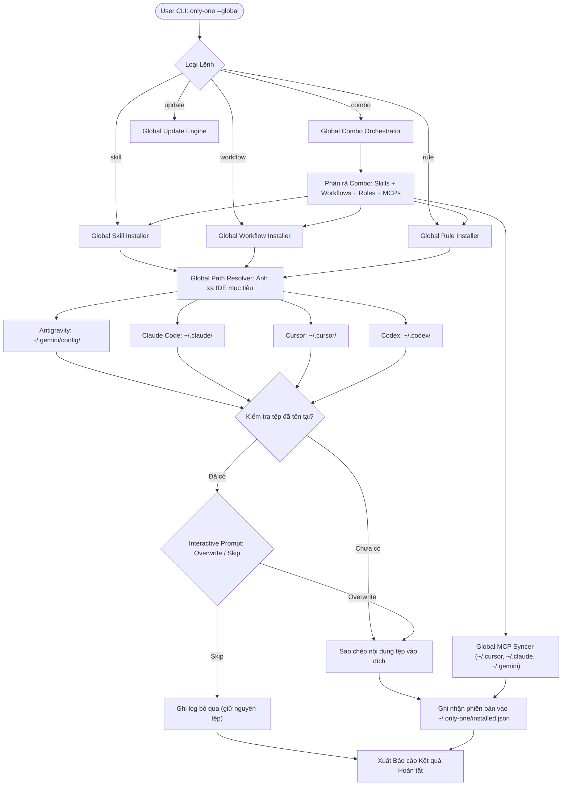

# Concept: Global Skills and Workflows Architecture (Kiến Trúc Kỹ Thuật Global Assets)

## 1. Problem & Goal (Vấn đề & Mục tiêu)

### Problem (Vấn đề & Điểm nghẽn Hiện tại)
- **Bối cảnh & Điểm kích hoạt**: Nhà phát triển làm việc trên nhiều repository độc lập cần sử dụng bộ kỹ năng (skills), quy trình (workflows), quy tắc (rules), và gói combo trọn gói (`combos`) chuẩn hóa của `only-one`.
- **Hiện tượng & Khiếm khuyết kỹ thuật**: Các lệnh `skill`, `workflow`, `rule`, `combo`, và `update` hiện chỉ hỗ trợ cài đặt ở phạm vi cục bộ (`local workspace scope`) tại thư mục hiện hành (`process.cwd()`), lưu metadata vào `only-one/installed.json` trong repository.
- **Nguyên nhân cốt lõi (Root Cause)**:
  - Thiếu cờ phạm vi toàn cục (`--global` / `-g`) trên CLI interface.
  - Thiếu module giải quyết đường dẫn toàn cục (`Global Path Resolver`) theo từng chuẩn cấu hình của IDE/Agent (`~/.gemini/config`, `~/.claude`, `~/.cursor`, `~/.codex`).
  - Chưa có thư mục lưu trữ metadata chuyên biệt ở cấp độ người dùng (`User Home Metadata Store`).
  - Lệnh `combo` hiện tại gắn chặt với `projectDir`, tự động cập nhật `.gitignore` và chỉ ghi lockfile vào local repository.
- **Tác động (Impact / Blast Radius)**:
  - Lặp lại thao tác cài đặt tốn thời gian cho mọi dự án mới.
  - Làm ô nhiễm Git history khi commit các file cá nhân (`.agents/`, `.cursor/`, `.claude/`) vào dự án chung của team.

### Goal (Mục tiêu Kỹ thuật Cần đạt)
- **Mục tiêu cốt lõi**: Hỗ trợ triển khai, đồng bộ và cập nhật toàn bộ assets (`skills`, `workflows`, `rules`, `combos`) ở cấp độ máy người dùng (`global scope`) với cờ `--global` / `-g`.
- **Tiêu chí nghiệm thu (Acceptance Criteria)**:
  - `only-one skill <names> --global [--tool <tools>]`: Cài đặt skills trực tiếp vào thư mục Global của các IDE được chỉ định.
  - `only-one workflow <names> --global [--tool <tools>]`: Cài đặt workflows trực tiếp vào thư mục Global của các IDE.
  - `only-one rule <names> --global [--tool <tools>]`: Cài đặt rules vào thư mục Global của các IDE.
  - `only-one combo <name> --global [--tool <tools>]`: Cài đặt trọn gói combo (skills, workflows, rules, MCPs) đồng bộ vào môi trường Global của các IDE.
  - `only-one update --global`: Tự động đối soát và làm mới các asset global đã cài đặt dựa trên lockfile toàn cục.
  - Tạo và duy trì thư mục riêng `~/.only-one/` để lưu giữ `installed.json` và `skills-lock.json` toàn cục, không phụ thuộc vào bất kỳ git repo nào.

---

## 2. Scope Boundaries (Ranh giới Phạm vi)

### In-Scope
- Bổ sung flag `--global` (viết tắt `-g`) cho 5 commands: `skill`, `workflow`, `rule`, `combo`, `update`.
- Module `Global Path Resolver` ánh xạ chính xác theo chuẩn của từng IDE:
  - **Antigravity**: `~/.gemini/config/` (Skills: `skills/<name>/SKILL.md`, Workflows: `workflows/<name>.md`, Rules: `rules/<name>.md`).
  - **Claude Code**: `~/.claude/` (Skills: `skills/<name>/SKILL.md`, Workflows: `workflows/<name>.md`, Rules: `rules/<name>.md`).
  - **Cursor**: `~/.cursor/` (Skills: `skills/<name>/SKILL.md`, Workflows: `workflows/<name>.md`, Rules: `rules/<name>.mdc` hoặc `.md`).
  - **Codex**: `~/.codex/` (Skills: `skills/<name>/SKILL.md`, Workflows: `workflows/<name>.md`).
- **Global Combo Orchestration**:
  - Khi chạy `only-one combo <name> --global`, tự động phân rã combo và cài đặt trọn vẹn:
    - *Skills, Workflows, Rules*: Chuyển tiếp tới `Global Path Resolver` của từng IDE được chọn.
    - *MCPs*: Đồng bộ vào các file cấu hình MCP toàn cục tương ứng (`~/.cursor/mcp.json`, `~/.claude/mcp.json`, `~/.gemini/antigravity-ide/mcp/mcp_config.json`, `~/.codex/mcp.toml`).
    - *Skip Local Side-effects*: Bỏ qua việc tạo `.gitignore` templates trong local repository.
- Xây dựng User Home Store tại `~/.only-one/`:
  - `~/.only-one/installed.json` (ghi nhận danh sách, phiên bản, IDE đã cài đặt cho cả `combos`, `skills`, `workflows`, `rules`).
  - `~/.only-one/skills-lock.json` (quản lý remote skills ở phạm vi global).
- Tích hợp kiểm tra xung đột và xác nhận ghi đè (`skip / overwrite`) an toàn trong cả môi trường TTY tương tác và non-TTY.
- Bổ sung tùy chọn phạm vi (Scope: Local vs Global) trong giao diện tương tác `only-one init` và TUI.

### Explicit Out-of-Scope
- Không sử dụng cơ chế Symbolic Link (symlink) giữa `~/.only-one/` và thư mục IDE nhằm đảm bảo tính tương thích và bảo mật trên môi trường Windows (tránh lỗi cấp quyền Developer Mode/SeCreateSymbolicLinkPrivilege).
- Không can thiệp hoặc khởi động lại tiến trình/daemon của các IDE đang chạy.
- Không xóa hay ghi đè tự động các asset local khi người dùng chạy lệnh global (hai phạm vi vận hành song song và độc lập).

---

## 3. Proposed Solution & Core Mechanism (Giải pháp Đề xuất & Cơ chế)

### Architectural Options Analysis

| Tiêu chí so sánh | Option 1: Direct Global Deployment with `~/.only-one` Metadata (Được chọn) | Option 2: Centralized Store with Symlink Junctions | Option 3: Virtual CLI Daemon & IPC Provider |
| :--- | :--- | :--- | :--- |
| **Cơ chế hoạt động** | Sao chép tệp trực tiếp vào thư mục Global của từng IDE; quản lý lockfile tại `~/.only-one/installed.json`. Hỗ trợ Combo phân rã cài đặt trọn gói. | Lưu bản gốc tại `~/.only-one/store/`, tạo symlink/junction trỏ từ thư mục IDE sang. | Chạy tiến trình nền cung cấp skills qua giao thức MCP/IPC ảo. |
| **Độ phức tạp (Complexity)** | **Thấp - Trung bình**: Tận dụng triệt để file copy pipelines sẵn có. | **Cao**: Xử lý logic junction/symlink phân nhánh theo OS. | **Rất cao**: Cần daemon quản lý vòng đời và IPC socket. |
| **Độ tin cậy đa nền tảng** | **100%**: Hoạt động mượt mà trên Windows, macOS, Linux không cần quyền Admin. | **Thấp trên Windows**: Dễ phát sinh lỗi `EPERM` nếu thiếu Developer Mode. | **Trung bình**: Dễ xảy ra timeout kết nối IPC. |
| **Khả năng nhận diện của IDE** | **Tức thời**: Mọi IDE đều đọc trực tiếp từ thư mục config chuẩn của nó. | **Tùy thuộc IDE**: Một số IDE bỏ qua tệp symlink vì lý do bảo mật. | **Kém**: Yêu cầu plugin hoặc cấu hình daemon riêng. |
| **Quyết định** | ✅ **Lựa chọn tối ưu** | ❌ Bị loại (Rủi ro quyền hạn trên Windows) | ❌ Bị loại (Over-engineering quá mức) |

---

### Core Mechanism: Global Path Resolver & Metadata Store

1. **Phân giải Root & Metadata (`ScopeContext`)**:
   - Khi không có `--global`: `ScopeContext = { type: 'local', rootDir: cwd, metadataDir: join(cwd, 'only-one') }`.
   - Khi có `--global`: `ScopeContext = { type: 'global', rootDir: os.homedir(), metadataDir: join(os.homedir(), '.only-one') }`.

2. **Ánh xạ thư mục đích Global (`Global Tool Mapping`)**:
   - Module `resolveGlobalToolDestinations(toolId, assetType, assetName)`:
     - Antigravity $\rightarrow$ `join(homeDir, '.gemini/config', assetType, assetFileName)`
     - Claude $\rightarrow$ `join(homeDir, '.claude', assetType, assetFileName)`
     - Cursor $\rightarrow$ `join(homeDir, '.cursor', assetType, assetFileName)`
     - Codex $\rightarrow$ `join(homeDir, '.codex', assetType, assetFileName)`

3. **Cơ chế Điều phối Combo Toàn cục (`Global Combo Orchestration`)**:
   - Khi thực thi `only-one combo <id> --global`:
     - Phân giải `ScopeContext.global`.
     - Nạp định nghĩa combo từ `COMBOS` (ví dụ `frontend-flow`, `backend-flow`, `full-sdlc-flow`, `git-flow`, `mcp-flow`).
     - Tự động ủy quyền cài đặt từng thành phần theo Global Scope:
       1. **Skills**: Chuyển giao danh sách skills qua `installSkills` với `ScopeContext.global`.
       2. **Workflows**: Chuyển giao danh sách workflows qua `installWorkflows` với `ScopeContext.global`.
       3. **Rules**: Chuyển giao danh sách rules qua `installRules` với `ScopeContext.global`.
       4. **MCPs**: Đồng bộ cấu hình MCPs toàn cục qua `syncMcpGlobalConfig`.
       5. **Lockfile**: Cập nhật mục `combos` và từng asset riêng lẻ vào `~/.only-one/installed.json`.

4. **Cập nhật và theo dõi phiên bản (`~/.only-one/installed.json`)**:
   - Cấu trúc file schema version 1 tương thích hoàn toàn với schema của `only-one/installed.json` local:
     ```json
     {
       "schemaVersion": 1,
       "updatedAt": "2026-10-19T15:35:00.000Z",
       "installed": {
         "combos": {
           "frontend-flow": {
             "version": "0.0.10",
             "installedAt": "2026-10-19T15:35:00.000Z",
             "tools": ["antigravity", "cursor"]
           }
         },
         "skills": { ... },
         "workflows": { ... },
         "rules": { ... }
       }
     }
     ```

---

### Conceptual Domain Flow (Sơ đồ Luồng Kỹ thuật)



---

## 4. Critical Risks & Edge Cases (Rủi ro & Kịch bản Biên)

1. **Quyền truy cập thư mục Home (`EACCES / EPERM`)**:
   - *Rủi ro*: Trên một số môi trường Linux/macOS khi chạy với tài khoản bị giới hạn quyền hoặc môi trường CI, `os.homedir()` có thể không ghi được.
   - *Biện pháp*: Kiểm tra quyền ghi (`fs.access(W_OK)`) trước khi tiến hành copy; nếu lỗi, dừng lại với mã lỗi rõ ràng và thông báo người dùng cấp quyền phù hợp.

2. **Xung đột tên giữa Local và Global (`Scope Precedence`)**:
   - *Rủi ro*: Dự án local có tệp skill/workflow trùng tên với asset đã cài đặt ở global.
   - *Nguyên tắc*: Theo chuẩn của các IDE (như Antigravity và Cursor), cấu hình Local trong project luôn có độ ưu tiên cao hơn và ghi đè (override) cấu hình Global. `only-one` giữ nguyên tắc này và không tự động can thiệp vào local khi đang thực thi lệnh global.

3. **Môi trường Non-TTY & CI/CD**:
   - *Rủi ro*: Chạy `only-one combo --global` trong script tự động không có TTY sẽ bị treo nếu đợi prompt xác nhận ghi đè.
   - *Biện pháp*: Tự động áp dụng chiến lược `Skip by Default` khi không có TTY trừ khi người dùng chỉ định rõ cờ `--overwrite` hoặc `--force`.

4. **Đồng bộ hóa thư mục con của Skill (`Directory vs Single File`)**:
   - *Đặc thù*: Skill là một thư mục (chứa `SKILL.md`, `references/`, `scripts/`), trong khi workflow là một tệp đơn (`.md`).
   - *Biện pháp*: Module copy phải sử dụng đệ quy (`cp(src, dest, { recursive: true })`) để đảm bảo toàn bộ tài liệu tham chiếu đi kèm của skill được sao chép trọn vẹn vào thư mục global của IDE.

5. **Xử lý MCP Servers trong Combo Global**:
   - *Đặc thù*: MCP servers vốn đã được lưu ở phạm vi toàn cục của IDE (`mcp.json` trong User Home).
   - *Biện pháp*: Khi chạy `only-one combo <name> --global`, đồng bộ MCP trực tiếp vào global config của các IDE được chọn, và không tạo file cấu hình mcp cục bộ nào trong repository.
