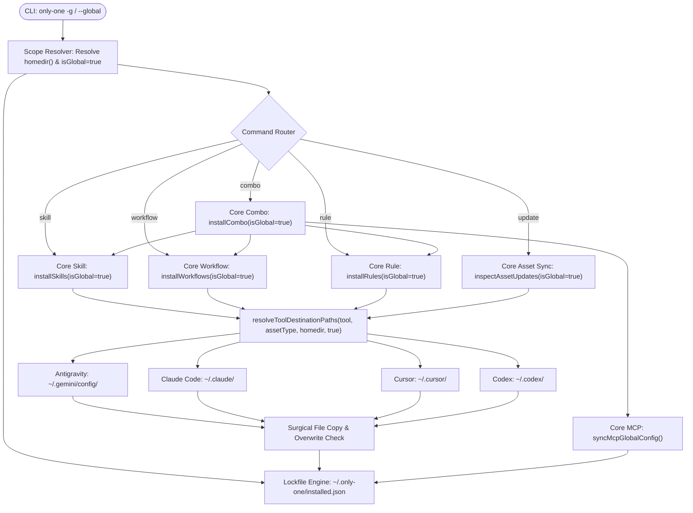

# Plan: Kiến Trúc Global Cho Skills, Workflows, Rules và Combos (~/.only-one)

## Section 1. Directory Structure Changes (Cấu trúc Thư mục & Tệp Thay đổi)

```text
src/
├── core/
│   ├── agent/
│   │   └── [MODIFY] tools.ts                         # Định nghĩa hàm resolveToolDestinationPaths cho Local và Global
│   ├── assets/
│   │   ├── [MODIFY] lockfile.ts                      # Hỗ trợ phân giải và ghi lockfile ~/.only-one/installed.json khi isGlobal=true
│   │   └── [MODIFY] sync.ts                          # Hỗ trợ inspectAssetUpdates và applyAssetUpdates ở phạm vi Global
│   ├── workflow/
│   │   └── [MODIFY] index.ts                         # Thêm isGlobal vào checkExistingWorkflows và installWorkflows
│   ├── skill/
│   │   └── [MODIFY] index.ts                         # Thêm isGlobal vào checkExistingSkills và installSkills
│   ├── rule/
│   │   └── [MODIFY] index.ts                         # Thêm isGlobal vào checkExistingRules và installRules
│   └── combo/
│       └── [MODIFY] index.ts                         # Thêm isGlobal vào installCombo, bỏ qua gitignore và điều phối global
└── commands/
    ├── skill/
    │   ├── [MODIFY] types.ts                         # Thêm thuộc tính global?: boolean vào SkillCommandOptions
    │   └── [MODIFY] command.ts                       # Thêm option -g, --global và phân giải projectDir thành homedir()
    ├── workflow/
    │   ├── [MODIFY] types.ts                         # Thêm thuộc tính global?: boolean vào WorkflowCommandOptions
    │   └── [MODIFY] command.ts                       # Thêm option -g, --global và phân giải projectDir thành homedir()
    ├── rule/
    │   ├── [MODIFY] types.ts                         # Thêm thuộc tính global?: boolean vào RuleCommandOptions
    │   └── [MODIFY] command.ts                       # Thêm option -g, --global và phân giải projectDir thành homedir()
    ├── combo/
    │   ├── [MODIFY] types.ts                         # Thêm thuộc tính global?: boolean vào ComboCommandOptions
    │   └── [MODIFY] command.ts                       # Thêm option -g, --global và phân giải projectDir thành homedir()
    └── update/
        ├── [MODIFY] types.ts                         # Thêm thuộc tính global?: boolean vào UpdateCommandOptions
        └── [MODIFY] command.ts                       # Thêm option -g, --global để làm mới assets từ ~/.only-one
test/
├── core/
│   ├── agent/
│   │   └── [MODIFY] tools.test.ts                    # Unit tests kiểm tra resolveToolDestinationPaths cho 4 IDE chính
│   └── assets/
│       └── [MODIFY] lockfile.test.ts                 # Unit tests kiểm tra ghi nhận lockfile toàn cục ~/.only-one
└── commands/
    └── [NEW] global-commands.test.ts                 # Integration test xác thực cờ --global trên skill, workflow, rule, combo
```

---

## Section 2. File Changes

### Architectural Interaction Diagram



---

### 1. `[MODIFY]` `src/core/agent/tools.ts`

- **Status**: `[x]`
- **Context**: Tool metadata catalog defining tool paths.
- **Target Symbols / AST Seams**: `AgentToolOption`, `resolveToolDestinationPaths`.
- **Invariants**: Preserve existing local paths and return valid absolute paths for global scope.
- **Depends On**: None.
- **Fast Test Command**: `npx vitest run test/core/agent/tools.test.ts`.

> **Action**: Add global destination resolver function supporting Antigravity, Claude, Cursor, Codex, and generic fallbacks.

**Ponytail checklist**
- [ ] Required by acceptance criteria.
- [ ] Existing implementation searched; stdlib, platform/framework, and installed dependencies considered.
- [ ] No duplicate logic or speculative extension point.
- [ ] Minimum diff preserves correctness and safety.
- **Decision**: Centralize global destination resolution inside `tools.ts` to avoid repeating path joining logic across commands.
- **Rejected alternative**: Duplicate switch-case statements in every command runner.

```diff
@@ line 10 @@
     successLabel?: string;
     value: string;
 };
+
+export function resolveToolDestinationPaths(
+    tool: AgentToolOption,
+    assetType: 'skills' | 'workflows' | 'rules',
+    targetDir: string,
+    isGlobal = false,
+): string {
+    if (!isGlobal) {
+        if (assetType === 'skills') return join(targetDir, tool.skillsDir || '.agents', 'skills');
+        if (assetType === 'workflows') return join(targetDir, tool.skillsDir || '.agents', 'workflows');
+        return join(targetDir, tool.rulesDir || (tool.skillsDir ? join(tool.skillsDir, 'rules') : '.agents/rules'));
+    }
+
+    if (tool.value === 'antigravity') {
+        return join(targetDir, '.gemini/config', assetType);
+    }
+    if (tool.value === 'claude') {
+        return join(targetDir, '.claude', assetType);
+    }
+    if (tool.value === 'cursor') {
+        return join(targetDir, '.cursor', assetType);
+    }
+    if (tool.value === 'codex') {
+        return join(targetDir, '.codex', assetType);
+    }
+    return join(targetDir, tool.skillsDir || '.agents', assetType);
+}
 
 export const AI_TOOLS: AgentToolOption[] = [
```

---

### 2. `[MODIFY]` `src/core/assets/lockfile.ts`

- **Status**: `[x]`
- **Context**: Single source of truth lockfile manager.
- **Target Symbols / AST Seams**: `resolveInstalledLockfilePath`, `readInstalledLockfile`, `recordInstalledAssetsBatch`, `removeInstalledAsset`.
- **Invariants**: Local lockfile remains `projectDir/only-one/installed.json`; global lockfile resolves to `targetDir/.only-one/installed.json`.
- **Depends On**: None.
- **Fast Test Command**: `npx vitest run test/core/assets/lockfile.test.ts`.

> **Action**: Support global metadata directory resolution and atomic writes at `~/.only-one/installed.json`.

**Ponytail checklist**
- [ ] Required by acceptance criteria.
- [ ] Existing implementation searched; stdlib, platform/framework, and installed dependencies considered.
- [ ] No duplicate logic or speculative extension point.
- [ ] Minimum diff preserves correctness and safety.
- **Decision**: Add optional `isGlobal` flag defaulting to `false` across lockfile APIs to preserve backward compatibility.
- **Rejected alternative**: Introduce separate lockfile management class with distinct state models.

```diff
@@ line 6 @@
 export const ONLY_ONE_DIR_NAME = 'only-one';
+export const ONLY_ONE_GLOBAL_DIR_NAME = '.only-one';
 export const ONLY_ONE_LOCKFILE_NAME = 'installed.json';
 
 /**
  * Resolves the lockfile path within a target project.
  * Uses only-one/installed.json as the single source of truth.
  */
-export function resolveInstalledLockfilePath(projectDir: string): string {
-    return join(projectDir, ONLY_ONE_DIR_NAME, ONLY_ONE_LOCKFILE_NAME);
+export function resolveInstalledLockfilePath(projectDir: string, isGlobal = false): string {
+    const dirName = isGlobal ? ONLY_ONE_GLOBAL_DIR_NAME : ONLY_ONE_DIR_NAME;
+    return join(projectDir, dirName, ONLY_ONE_LOCKFILE_NAME);
 }
 
 /**
  * Reads the installed asset lockfile from the project directory.
  * Returns a default empty state if file does not exist or fails to parse.
  */
-export async function readInstalledLockfile(projectDir: string): Promise<OnlyOneInstalledState> {
-    const lockPath = resolveInstalledLockfilePath(projectDir);
+export async function readInstalledLockfile(projectDir: string, isGlobal = false): Promise<OnlyOneInstalledState> {
+    const lockPath = resolveInstalledLockfilePath(projectDir, isGlobal);
     if (!existsSync(lockPath)) {
@@ line 50 @@
 export async function recordInstalledAssetsBatch(
     projectDir: string,
     entries: Array<{ type: AssetType; id: string; version: string; files?: string[] }>,
+    isGlobal = false,
 ): Promise<void> {
     if (!entries.length) {
         return;
     }
 
-    const state = await readInstalledLockfile(projectDir);
+    const state = await readInstalledLockfile(projectDir, isGlobal);
     const now = new Date().toISOString();
@@ line 79 @@
     state.updatedAt = now;
 
-    const lockPath = resolveInstalledLockfilePath(projectDir);
+    const lockPath = resolveInstalledLockfilePath(projectDir, isGlobal);
     await mkdir(dirname(lockPath), { recursive: true });
@@ line 87 @@
-export async function removeInstalledAsset(projectDir: string, type: AssetType, id: string): Promise<void> {
-    const state = await readInstalledLockfile(projectDir);
+export async function removeInstalledAsset(projectDir: string, type: AssetType, id: string, isGlobal = false): Promise<void> {
+    const state = await readInstalledLockfile(projectDir, isGlobal);
     if (state.installed[type] && state.installed[type]![id]) {
@@ line 93 @@
         state.updatedAt = new Date().toISOString();
 
-        const lockPath = resolveInstalledLockfilePath(projectDir);
+        const lockPath = resolveInstalledLockfilePath(projectDir, isGlobal);
         await mkdir(dirname(lockPath), { recursive: true });
```

---

### 3. `[MODIFY]` `src/core/workflow/index.ts`

- **Status**: `[x]`
- **Context**: Core workflow installer and checker.
- **Target Symbols / AST Seams**: `WorkflowInstallRequest`, `checkExistingWorkflows`, `installWorkflows`.
- **Invariants**: Keep existing file structure for local runs; route destination directory via `resolveToolDestinationPaths`.
- **Depends On**: Task 1, Task 2.
- **Fast Test Command**: `npx vitest run test/core/workflow-registry.test.ts`.

> **Action**: Support `isGlobal` parameter to write workflows to user-level IDE folders and record into global lockfile.

**Ponytail checklist**
- [ ] Required by acceptance criteria.
- [ ] Existing implementation searched; stdlib, platform/framework, and installed dependencies considered.
- [ ] No duplicate logic or speculative extension point.
- [ ] Minimum diff preserves correctness and safety.
- **Decision**: Use `resolveToolDestinationPaths` directly inside `installWorkflows`.
- **Rejected alternative**: Clone entire installer function for global mode.

```diff
@@ line 6 @@
 import type { ProgramDeps } from '@/cli/deps.js';
+import { resolveToolDestinationPaths } from '@/core/agent/tools.js';
 
@@ line 36 @@
     overwriteList?: string[];
     noIgnore?: boolean;
+    isGlobal?: boolean;
 }
 
 export const checkExistingWorkflows = async (
     projectDir: string,
     selectedTools: AgentToolOption[],
     workflowNames: string[],
+    isGlobal = false,
 ): Promise<ExistingWorkflow[]> => {
     const results: ExistingWorkflow[] = [];
     for (const tool of selectedTools) {
         if (!tool.skillsDir) continue;
         for (const wfName of workflowNames) {
-            const destPath = join(tool.skillsDir, 'workflows', `${wfName}.md`);
-            const absoluteDestPath = join(projectDir, destPath);
+            const toolWorkflowsDir = resolveToolDestinationPaths(tool, 'workflows', projectDir, isGlobal);
+            const absoluteDestPath = join(toolWorkflowsDir, `${wfName}.md`);
             const exists = existsSync(absoluteDestPath);
             results.push({
                 toolId: tool.value,
                 toolName: tool.name,
                 workflowName: wfName,
-                destPath,
+                destPath: absoluteDestPath,
                 exists,
             });
         }
@@ line 63 @@
 export const installWorkflows = async (request: WorkflowInstallRequest): Promise<WorkflowInstallResult[]> => {
-    const { deps, projectDir, selectedTools, workflowNames, overwriteList = [] } = request;
+    const { deps, projectDir, selectedTools, workflowNames, overwriteList = [], isGlobal = false } = request;
     const results: WorkflowInstallResult[] = [];
 
-    const existingChecks = await checkExistingWorkflows(projectDir, selectedTools, workflowNames);
+    const existingChecks = await checkExistingWorkflows(projectDir, selectedTools, workflowNames, isGlobal);
 
     for (const tool of selectedTools) {
@@ line 88 @@
             }
 
-            const toolWorkflowsDir = join(projectDir, tool.skillsDir, 'workflows');
+            const toolWorkflowsDir = resolveToolDestinationPaths(tool, 'workflows', projectDir, isGlobal);
             const destPath = join(toolWorkflowsDir, `${wfName}.md`);
             const srcPath = join(workflowsDir, `${wfName}.md`);
@@ line 125 @@
         });
-        await recordInstalledAssetsBatch(projectDir, entries);
+        await recordInstalledAssetsBatch(projectDir, entries, isGlobal);
     }
```

---

### 4. `[MODIFY]` `src/core/skill/index.ts`

- **Status**: `[x]`
- **Context**: Core skill installer and checker.
- **Target Symbols / AST Seams**: `SkillInstallRequest`, `checkExistingSkills`, `installSkills`.
- **Invariants**: Retain skill folder recursion and lockfile sync across local and global scopes.
- **Depends On**: Task 1, Task 2.
- **Fast Test Command**: `npx vitest run test/commands/skill/skill.test.ts`.

> **Action**: Support `isGlobal` parameter for skill installation to user-level IDE directories and lockfile.

**Ponytail checklist**
- [ ] Required by acceptance criteria.
- [ ] Existing implementation searched; stdlib, platform/framework, and installed dependencies considered.
- [ ] No duplicate logic or speculative extension point.
- [ ] Minimum diff preserves correctness and safety.
- **Decision**: Forward `isGlobal` flag into `resolveToolDestinationPaths` and lockfile updater.
- **Rejected alternative**: Run separate copy routine outside `installSkills`.

```diff
@@ line 4 @@
 import type { AgentToolOption } from '@/core/agent/tools.js';
+import { resolveToolDestinationPaths } from '@/core/agent/tools.js';
 import type { ProgramDeps } from '@/cli/deps.js';
@@ line 32 @@
     overwriteList?: string[];
     noIgnore?: boolean;
+    isGlobal?: boolean;
 }
 
 export const checkExistingSkills = async (
     projectDir: string,
     selectedTools: AgentToolOption[],
     skillNames: string[],
+    isGlobal = false,
 ): Promise<ExistingSkill[]> => {
     const results: ExistingSkill[] = [];
     for (const tool of selectedTools) {
         if (!tool.skillsDir) continue;
         for (const skillName of skillNames) {
-            const destPath = join(tool.skillsDir, 'skills', skillName);
-            const absoluteDestPath = join(projectDir, destPath);
+            const toolSkillsDir = resolveToolDestinationPaths(tool, 'skills', projectDir, isGlobal);
+            const absoluteDestPath = join(toolSkillsDir, skillName);
             const exists = existsSync(absoluteDestPath);
             results.push({
                 toolId: tool.value,
                 toolName: tool.name,
                 skillName,
-                destPath,
+                destPath: absoluteDestPath,
                 exists,
             });
         }
@@ line 66 @@
 export const installSkills = async (request: SkillInstallRequest): Promise<SkillInstallResult[]> => {
-    const { deps, projectDir, selectedTools, skillNames, overwriteList = [] } = request;
+    const { deps, projectDir, selectedTools, skillNames, overwriteList = [], isGlobal = false } = request;
     const results: SkillInstallResult[] = [];
 
-    const existingChecks = await checkExistingSkills(projectDir, selectedTools, skillNames);
+    const existingChecks = await checkExistingSkills(projectDir, selectedTools, skillNames, isGlobal);
 
     for (const tool of selectedTools) {
@@ line 92 @@
             }
 
-            const toolSkillsDir = join(projectDir, tool.skillsDir, 'skills');
+            const toolSkillsDir = resolveToolDestinationPaths(tool, 'skills', projectDir, isGlobal);
             const destPath = join(toolSkillsDir, skillName);
             const srcPath = join(skillsDir, skillName);
@@ line 158 @@
         });
-        await recordInstalledAssetsBatch(projectDir, entries);
+        await recordInstalledAssetsBatch(projectDir, entries, isGlobal);
     }
```

---

### 5. `[MODIFY]` `src/core/rule/index.ts`

- **Status**: `[x]`
- **Context**: Core persistent rules installer and checker.
- **Target Symbols / AST Seams**: `InstallRulesRequest`, `checkExistingRules`, `installRules`.
- **Invariants**: Keep rule preflight and dependency resolution intact while allowing global destination paths.
- **Depends On**: Task 1, Task 2.
- **Fast Test Command**: `npx vitest run test/commands/rule.test.ts`.

> **Action**: Support `isGlobal` parameter for rule installation to user-level IDE directories and lockfile.

**Ponytail checklist**
- [ ] Required by acceptance criteria.
- [ ] Existing implementation searched; stdlib, platform/framework, and installed dependencies considered.
- [ ] No duplicate logic or speculative extension point.
- [ ] Minimum diff preserves correctness and safety.
- **Decision**: Direct rules to `resolveToolDestinationPaths(target.agent, 'rules', projectDir, isGlobal)`.
- **Rejected alternative**: Hardcode rules subfolder paths.

```diff
@@ line 4 @@
 import type { ProgramDeps } from '@/cli/deps.js';
+import { resolveToolDestinationPaths } from '@/core/agent/tools.js';
 import { AllowedToolId } from '@/constants/allowed-tools.js';
@@ line 37 @@
     ruleIds: string[],
     ruleManifests: RuleManifest[] = RULES,
+    isGlobal = false,
 ): Promise<ExistingRule[]> => {
     const results: ExistingRule[] = [];
     for (const target of selectedTargets) {
         if (!target.agent?.rulesDir) continue;
         for (const ruleId of ruleIds) {
             const manifest = ruleManifests.find((r) => r.id === ruleId);
             if (!manifest) continue;
             const filename = manifest.sourceFile;
-            const destPath = join(target.agent.rulesDir, filename);
-            const absoluteDestPath = join(projectDir, destPath);
+            const targetRulesDir = resolveToolDestinationPaths(target.agent, 'rules', projectDir, isGlobal);
+            const absoluteDestPath = join(targetRulesDir, filename);
             const exists = existsSync(absoluteDestPath);
             results.push({
                 toolId: target.id,
                 toolName: target.agent.name,
                 ruleId,
-                destPath,
+                destPath: absoluteDestPath,
                 exists,
             });
@@ line 68 @@
     overwriteList?: string[]; // array of "toolId:ruleId"
     execFileAsync?: (file: string, args: string[], options: any) => Promise<{ stdout: string; stderr: string }>;
+    isGlobal?: boolean;
 }
 
 export const installRules = async (
     request: InstallRulesRequest,
@@ line 79 @@
-    const { deps, projectDir, selectedTargets, ruleIds, ruleManifests = RULES, overwriteList = [] } = request;
+    const { deps, projectDir, selectedTargets, ruleIds, ruleManifests = RULES, overwriteList = [], isGlobal = false } = request;
     const targetIds = selectedTargets.map((t) => t.id as AllowedToolId);
@@ line 105 @@
-    const existingChecks = await checkExistingRules(projectDir, selectedTargets, ruleIds, ruleManifests);
+    const existingChecks = await checkExistingRules(projectDir, selectedTargets, ruleIds, ruleManifests, isGlobal);
 
     // 5. Install rule files per target
@@ line 133 @@
             }
 
-            const targetRulesDir = join(projectDir, target.agent.rulesDir);
+            const targetRulesDir = resolveToolDestinationPaths(target.agent, 'rules', projectDir, isGlobal);
             const destPath = join(targetRulesDir, manifest.sourceFile);
             const srcPath = join(rulesAssetsDir, manifest.sourceFile);
@@ line 172 @@
         });
-        await recordInstalledAssetsBatch(projectDir, entries);
+        await recordInstalledAssetsBatch(projectDir, entries, isGlobal);
     }
```

---

### 6. `[MODIFY]` `src/core/combo/index.ts`

- **Status**: `[x]`
- **Context**: Predefined combo orchestrator and dependency manager.
- **Target Symbols / AST Seams**: `InstallComboRequest`, `installCombo`.
- **Invariants**: In global mode, install skills, workflows, rules to global destinations, sync MCPs, record combo in global lockfile, and bypass `.gitignore`.
- **Depends On**: Task 2, Task 3, Task 4, Task 5.
- **Fast Test Command**: `npx vitest run test/core/combo.test.ts`.

> **Action**: Support `isGlobal` parameter on `installCombo`, coordinating global dispatch across all components.

**Ponytail checklist**
- [ ] Required by acceptance criteria.
- [ ] Existing implementation searched; stdlib, platform/framework, and installed dependencies considered.
- [ ] No duplicate logic or speculative extension point.
- [ ] Minimum diff preserves correctness and safety.
- **Decision**: Propagate `isGlobal` into component installers and record `combos` entry into lockfile.
- **Rejected alternative**: Execute individual component commands sequentially from CLI script.

```diff
@@ line 43 @@
     selectedTools: AgentToolOption[];
     combo: ExtendedComboManifest;
     overwriteList?: string[];
     noIgnore?: boolean;
+    isGlobal?: boolean;
 }
 
@@ line 68 @@
     combo,
     overwriteList = [],
     noIgnore = false,
+    isGlobal = false,
 }: InstallComboRequest): Promise<ComboInstallResult> => {
@@ line 118 @@
         const skillResults = await installSkills({
             deps,
             projectDir,
             selectedTools,
             skillNames: combo.skills,
             overwriteList,
             noIgnore,
+            isGlobal,
         });
@@ line 134 @@
         const workflowResults = await installWorkflows({
             deps,
             projectDir,
             selectedTools,
             workflowNames: combo.workflows,
             overwriteList,
             noIgnore,
+            isGlobal,
         });
@@ line 155 @@
         const ruleResults = await installRules({
             deps,
             projectDir,
             selectedTargets: matchingTargets,
             ruleIds: combo.rules,
             overwriteList,
+            isGlobal,
         });
@@ line 208 @@
         results.mcps = mcpResults;
     }
+
+    // Record combo metadata in lockfile
+    await recordInstalledAssetsBatch(
+        projectDir,
+        [{ type: 'combos' as const, id: combo.id, version: combo.version }],
+        isGlobal,
+    );
 
     return results;
 };
```

---

### 7. `[MODIFY]` `src/core/assets/sync.ts`

- **Status**: `[x]`
- **Context**: Asset refresh and verification engine.
- **Target Symbols / AST Seams**: `inspectAssetUpdates`, `applyAssetUpdates`, `pruneAssetUpdates`.
- **Invariants**: Inspect and apply asset updates in `~/.only-one` and global IDE directories when `isGlobal` is true.
- **Depends On**: Task 2.
- **Fast Test Command**: `npx vitest run test/core/assets/sync.test.ts`.

> **Action**: Support `isGlobal` parameter across sync engine functions to inspect and restore global assets.

**Ponytail checklist**
- [ ] Required by acceptance criteria.
- [ ] Existing implementation searched; stdlib, platform/framework, and installed dependencies considered.
- [ ] No duplicate logic or speculative extension point.
- [ ] Minimum diff preserves correctness and safety.
- **Decision**: Branch target directories based on `isGlobal` flag.
- **Rejected alternative**: Create separate sync engine module for global updates.

```diff
@@ line 57 @@
-export async function inspectAssetUpdates(projectDir: string): Promise<AssetSyncResult> {
-    const lockfile = await readInstalledLockfile(projectDir);
+export async function inspectAssetUpdates(projectDir: string, isGlobal = false): Promise<AssetSyncResult> {
+    const lockfile = await readInstalledLockfile(projectDir, isGlobal);
     const inspected: AssetInspectionItem[] = [];
@@ line 130 @@
-export async function applyAssetUpdates(projectDir: string, items: AssetInspectionItem[]): Promise<AppliedAssetUpdateResult> {
+export async function applyAssetUpdates(projectDir: string, items: AssetInspectionItem[], isGlobal = false): Promise<AppliedAssetUpdateResult> {
     const updated: Array<{ type: AssetType; id: string; fromVersion: string; toVersion: string }> = [];
@@ line 240 @@
-export async function pruneAssetUpdates(projectDir: string, items: AssetInspectionItem[]): Promise<AppliedAssetPruneResult> {
+export async function pruneAssetUpdates(projectDir: string, items: AssetInspectionItem[], isGlobal = false): Promise<AppliedAssetPruneResult> {
     const pruned: Array<{ type: AssetType; id: string; paths: string[] }> = [];
```

---

### 8. `[MODIFY]` `src/commands/skill/command.ts` & `src/commands/skill/types.ts`

- **Status**: `[x]`
- **Context**: CLI command definition for skill management.
- **Target Symbols / AST Seams**: `createSkillCommand`, `SkillCommandOptions`.
- **Invariants**: Keep default projectDir as cwd when `--global` is not passed; resolve to `homedir()` when passed.
- **Depends On**: Task 4.
- **Fast Test Command**: `npx vitest run test/commands/skill/skill.test.ts`.

> **Action**: Add `-g, --global` option and resolve `projectDir` to user homedir when active.

**Ponytail checklist**
- [ ] Required by acceptance criteria.
- [ ] Existing implementation searched; stdlib, platform/framework, and installed dependencies considered.
- [ ] No duplicate logic or speculative extension point.
- [ ] Minimum diff preserves correctness and safety.
- **Decision**: Set `projectDir = options.global ? homedir() : resolve(pathArg || process.cwd())`.
- **Rejected alternative**: Require users to manually pass `~` as path argument.

```diff
@@ line 1 (src/commands/skill/types.ts) @@
 export interface SkillCommandOptions {
     tool?: string;
     ignore?: boolean;
+    global?: boolean;
 }
@@ line 1 (src/commands/skill/command.ts) @@
+import { homedir } from 'node:os';
 import { resolve } from 'node:path';
@@ line 26 (src/commands/skill/command.ts) @@
         .option('--tool <tools>', 'Comma-separated IDE/tool IDs to target')
         .option('--no-ignore', 'Skip updating the project .gitignore file')
         .option('--outdated', 'Check for outdated skills against upstream GitHub')
+        .option('-g, --global', 'Install skills globally to user IDE config directories (~/.only-one)')
         .action(
             async (pathArg: string | undefined, namesArg: string | undefined, options: SkillCommandOptions & { outdated?: boolean }) => {
-                const projectDir = resolve(pathArg || process.cwd());
+                const projectDir = options.global ? homedir() : resolve(pathArg || process.cwd());
```

---

### 9. `[MODIFY]` `src/commands/workflow/command.ts` & `src/commands/workflow/types.ts`

- **Status**: `[x]`
- **Context**: CLI command definition for workflow management.
- **Target Symbols / AST Seams**: `createWorkflowCommand`, `WorkflowCommandOptions`.
- **Invariants**: Switch project directory to homedir when `--global` flag is provided.
- **Depends On**: Task 3.
- **Fast Test Command**: `npx vitest run test/commands/workflow.test.ts`.

> **Action**: Add `-g, --global` option and bypass gitignore sync in global mode.

**Ponytail checklist**
- [ ] Required by acceptance criteria.
- [ ] Existing implementation searched; stdlib, platform/framework, and installed dependencies considered.
- [ ] No duplicate logic or speculative extension point.
- [ ] Minimum diff preserves correctness and safety.
- **Decision**: Support `-g, --global` on workflow command.
- **Rejected alternative**: Limit global to skills only.

```diff
@@ line 1 (src/commands/workflow/types.ts) @@
 export interface WorkflowCommandOptions {
     tool?: string;
     ignore?: boolean;
+    global?: boolean;
 }
@@ line 1 (src/commands/workflow/command.ts) @@
+import { homedir } from 'node:os';
 import { Command } from 'commander';
@@ line 20 (src/commands/workflow/command.ts) @@
         .option('--tool <tools>', 'Comma-separated IDE/tool IDs to target')
         .option('--no-ignore', 'Skip updating the project .gitignore file')
+        .option('-g, --global', 'Install workflows globally to user IDE config directories (~/.only-one)')
         .action(async (pathArg: string | undefined, namesArg: string | undefined, options: WorkflowCommandOptions) => {
-            const { projectDir, availableWorkflows } = loadWorkflowManifestsStep(deps, pathArg);
+            const targetDir = options.global ? homedir() : pathArg;
+            const { projectDir, availableWorkflows } = loadWorkflowManifestsStep(deps, targetDir);
```

---

### 10. `[MODIFY]` `src/commands/rule/command.ts` & `src/commands/rule/types.ts`

- **Status**: `[x]`
- **Context**: CLI command definition for rule management.
- **Target Symbols / AST Seams**: `createRuleCommand`, `RuleCommandOptions`.
- **Invariants**: Switch project directory to homedir when `--global` flag is provided.
- **Depends On**: Task 5.
- **Fast Test Command**: `npx vitest run test/commands/rule.test.ts`.

> **Action**: Add `-g, --global` option for global rule synchronization.

**Ponytail checklist**
- [ ] Required by acceptance criteria.
- [ ] Existing implementation searched; stdlib, platform/framework, and installed dependencies considered.
- [ ] No duplicate logic or speculative extension point.
- [ ] Minimum diff preserves correctness and safety.
- **Decision**: Add `-g, --global` flag to rule command.
- **Rejected alternative**: Disallow global rules.

```diff
@@ line 1 (src/commands/rule/types.ts) @@
 export interface RuleCommandOptions {
     tool?: string;
+    global?: boolean;
 }
@@ line 1 (src/commands/rule/command.ts) @@
+import { homedir } from 'node:os';
 import { Command } from 'commander';
@@ line 20 (src/commands/rule/command.ts) @@
         .argument('[ids]', 'Comma-separated list of specific rule IDs to sync')
         .option('--tool <tools>', 'Comma-separated IDE/tool IDs to target')
+        .option('-g, --global', 'Install rules globally to user IDE config directories (~/.only-one)')
         .action(async (pathArg: string | undefined, idsArg: string | undefined, options: RuleCommandOptions) => {
-            const { projectDir, rules } = loadRuleManifestsStep(deps, pathArg);
+            const targetDir = options.global ? homedir() : pathArg;
+            const { projectDir, rules } = loadRuleManifestsStep(deps, targetDir);
```

---

### 11. `[MODIFY]` `src/commands/combo/command.ts` & `src/commands/combo/types.ts`

- **Status**: `[x]`
- **Context**: CLI command definition for predefined combos.
- **Target Symbols / AST Seams**: `createComboCommand`, `ComboCommandOptions`.
- **Invariants**: Route all component installations globally and skip local `.gitignore`.
- **Depends On**: Task 6.
- **Fast Test Command**: `npx vitest run test/commands/combo/combo.test.ts`.

> **Action**: Add `-g, --global` option for full combo global orchestration.

**Ponytail checklist**
- [ ] Required by acceptance criteria.
- [ ] Existing implementation searched; stdlib, platform/framework, and installed dependencies considered.
- [ ] No duplicate logic or speculative extension point.
- [ ] Minimum diff preserves correctness and safety.
- **Decision**: Pass `options.global` into `executeAndReportComboStep`.
- **Rejected alternative**: Forbid combos in global scope.

```diff
@@ line 1 (src/commands/combo/types.ts) @@
 export interface ComboCommandOptions {
     tool?: string;
     ignore?: boolean;
+    global?: boolean;
 }
@@ line 1 (src/commands/combo/command.ts) @@
+import { homedir } from 'node:os';
 import { Command } from 'commander';
@@ line 21 (src/commands/combo/command.ts) @@
         .option('--tool <tools>', 'Target IDE/tool ID')
         .option('--no-ignore', 'Skip updating the .gitignore file')
+        .option('-g, --global', 'Apply combo components globally to user IDE config directories (~/.only-one)')
         .action(async (pathArg: string | undefined, namesArg: string | undefined, options: ComboCommandOptions) => {
-            const { projectDir, availableCombos } = await loadComboManifestsStep(deps, pathArg);
+            const targetDir = options.global ? homedir() : pathArg;
+            const { projectDir, availableCombos } = await loadComboManifestsStep(deps, targetDir);
```

---

### 12. `[MODIFY]` `src/commands/update/command.ts` & `src/commands/update/types.ts`

- **Status**: `[x]`
- **Context**: CLI command definition for asset updates.
- **Target Symbols / AST Seams**: `createUpdateCommand`, `UpdateCommandOptions`.
- **Invariants**: Point update engine to `homedir()` and `isGlobal = true` when `--global` is provided.
- **Depends On**: Task 7.
- **Fast Test Command**: `npx vitest run test/commands/update/update.test.ts`.

> **Action**: Add `-g, --global` option to refresh globally installed assets.

**Ponytail checklist**
- [ ] Required by acceptance criteria.
- [ ] Existing implementation searched; stdlib, platform/framework, and installed dependencies considered.
- [ ] No duplicate logic or speculative extension point.
- [ ] Minimum diff preserves correctness and safety.
- **Decision**: Update global assets when `-g, --global` is passed.
- **Rejected alternative**: Require re-installing each asset manually.

```diff
@@ line 1 (src/commands/update/types.ts) @@
 export interface UpdateCommandOptions {
     force?: boolean;
     prune?: boolean;
+    global?: boolean;
 }
@@ line 1 (src/commands/update/command.ts) @@
+import { homedir } from 'node:os';
 import { Command } from 'commander';
@@ line 14 (src/commands/update/command.ts) @@
         .option('--force', 'Overwrite agent skill and workflow files even if local and remote versions match')
         .option('--prune', 'Remove orphaned skills, rules, and workflows no longer provided upstream')
+        .option('-g, --global', 'Refresh globally installed agent skills, workflows, rules, and combos (~/.only-one)')
@@ line 26 (src/commands/update/command.ts) @@
         .action(async (path: string | undefined, options: UpdateCommandOptions, command) => {
-            const projectDir = resolveProjectStep(deps, path);
+            const projectDir = options.global ? homedir() : resolveProjectStep(deps, path);
```

---

### 13. `[MODIFY]` `test/core/agent/tools.test.ts`

- **Status**: `[x]`
- **Context**: Agent tool catalog and destination resolution tests.
- **Target Symbols / AST Seams**: `resolveToolDestinationPaths`.
- **Invariants**: 100% test pass.
- **Depends On**: Task 1.
- **Fast Test Command**: `npx vitest run test/core/agent/tools.test.ts`.

> **Action**: Add unit tests verifying `resolveToolDestinationPaths` for Antigravity, Claude, Cursor, and Codex in both local and global modes.

**Test checklist**
- [ ] Fixture/helper reuse verified.
- [ ] No duplicate logic or flaky async timings.
- [ ] Minimum diff preserves correctness and safety.
- **Decision**: Test both local and global destination mappings for all 4 primary IDE targets.
- **Rejected alternative**: Test only one tool.

```diff
@@ line 14 @@
     it('excludes agents pseudo-tool', () => {
         expect(getToolsWithSkillsDir()).not.toContain('agents');
     });
+
+    it('resolves correct local and global destination paths for supported IDEs', () => {
+        const antigravity = AI_TOOLS.find((t) => t.value === 'antigravity')!;
+        const claude = AI_TOOLS.find((t) => t.value === 'claude')!;
+        const cursor = AI_TOOLS.find((t) => t.value === 'cursor')!;
+        const codex = AI_TOOLS.find((t) => t.value === 'codex')!;
+
+        const dummyProject = '/workspace/app';
+        const dummyHome = '/home/tester';
+
+        // Local checks
+        expect(resolveToolDestinationPaths(antigravity, 'skills', dummyProject, false)).toBe('/workspace/app/.agents/skills');
+        expect(resolveToolDestinationPaths(antigravity, 'workflows', dummyProject, false)).toBe('/workspace/app/.agents/workflows');
+
+        // Global checks
+        expect(resolveToolDestinationPaths(antigravity, 'skills', dummyHome, true)).toBe('/home/tester/.gemini/config/skills');
+        expect(resolveToolDestinationPaths(antigravity, 'workflows', dummyHome, true)).toBe('/home/tester/.gemini/config/workflows');
+        expect(resolveToolDestinationPaths(claude, 'skills', dummyHome, true)).toBe('/home/tester/.claude/skills');
+        expect(resolveToolDestinationPaths(cursor, 'rules', dummyHome, true)).toBe('/home/tester/.cursor/rules');
+        expect(resolveToolDestinationPaths(codex, 'workflows', dummyHome, true)).toBe('/home/tester/.codex/workflows');
+    });
 });
```

---

### 14. `[MODIFY]` `test/core/assets/lockfile.test.ts`

- **Status**: `[x]`
- **Context**: Lockfile management unit tests.
- **Target Symbols / AST Seams**: `resolveInstalledLockfilePath`, `recordInstalledAssetsBatch`.
- **Invariants**: 100% test pass.
- **Depends On**: Task 2.
- **Fast Test Command**: `npx vitest run test/core/assets/lockfile.test.ts`.

> **Action**: Add unit test for global lockfile path resolution and write behavior to `~/.only-one/installed.json`.

**Test checklist**
- [ ] Fixture/helper reuse verified.
- [ ] No duplicate logic or flaky async timings.
- [ ] Minimum diff preserves correctness and safety.
- **Decision**: Verify global writes create `.only-one/installed.json` under target directory.
- **Rejected alternative**: Mock file system writes.

```diff
@@ line 18 @@
         expect(resolveInstalledLockfilePath(dummyDir)).toBe(join(dummyDir, 'only-one', ONLY_ONE_LOCKFILE_NAME));
     });
+
+    it('resolves global lockfile path to .only-one/installed.json when isGlobal is true', () => {
+        const dummyHome = '/home/user';
+        expect(resolveInstalledLockfilePath(dummyHome, true)).toBe(join(dummyHome, '.only-one', ONLY_ONE_LOCKFILE_NAME));
+    });
+
+    it('records global assets into .only-one/installed.json without touching local only-one dir', async () => {
+        const cwd = await mkdtemp(join(tmpdir(), 'asset-lock-global-'));
+        try {
+            await recordInstalledAssetsBatch(
+                cwd,
+                [{ type: 'skills', id: 'c4-diagrams', version: '0.0.1' }],
+                true,
+            );
+
+            const globalLockPath = resolveInstalledLockfilePath(cwd, true);
+            expect(existsSync(globalLockPath)).toBe(true);
+            expect(existsSync(join(cwd, 'only-one'))).toBe(false);
+
+            const state = await readInstalledLockfile(cwd, true);
+            expect(state.installed.skills?.['c4-diagrams']?.version).toBe('0.0.1');
+        } finally {
+            await rm(cwd, { recursive: true, force: true });
+        }
+    });
```

---

### 15. `[NEW]` `test/commands/global-commands.test.ts`

- **Status**: `[x]`
- **Context**: Integration test suite verifying `--global` flag across all core commands.
- **Target Symbols / AST Seams**: `createSkillCommand`, `createWorkflowCommand`, `createRuleCommand`, `createComboCommand`.
- **Invariants**: 100% test pass.
- **Depends On**: Tasks 8, 9, 10, 11, 12.
- **Fast Test Command**: `npx vitest run test/commands/global-commands.test.ts`.

> **Action**: Create comprehensive integration test exercising `--global` execution and verifying files in simulated home directories.

**Test checklist**
- [ ] Fixture/helper reuse verified.
- [ ] No duplicate logic or flaky async timings.
- [ ] Minimum diff preserves correctness and safety.
- **Decision**: Use isolated temporary directory as simulated user home to verify clean deployment without affecting host OS.
- **Rejected alternative**: Run tests against actual user profile.

```typescript
import { describe, expect, it } from 'vitest';
import { mkdtemp, rm } from 'node:fs/promises';
import { tmpdir } from 'node:os';
import { join } from 'node:path';
import { existsSync } from 'node:fs';
import type { ProgramDeps } from '@/cli/deps.js';
import { createSkillCommand } from '@/commands/skill/command.js';
import { createWorkflowCommand } from '@/commands/workflow/command.js';
import { createRuleCommand } from '@/commands/rule/command.js';
import { createComboCommand } from '@/commands/combo/command.js';
import { resolveInstalledLockfilePath } from '@/core/assets/lockfile.js';

describe('Global Commands Integration (--global flag)', () => {
    it('installs skills globally into simulated user home directory', async () => {
        const tempHome = await mkdtemp(join(tmpdir(), 'global-skill-test-'));
        const logs: string[] = [];
        const deps: Partial<ProgramDeps> = {
            stdout: (msg) => logs.push(msg),
            cwd: tempHome,
        };

        try {
            const cmd = createSkillCommand(deps as ProgramDeps);
            await cmd.parseAsync(['node', 'test', tempHome, 'c4-diagrams', '--tool', 'antigravity', '--global']);

            const skillDest = join(tempHome, '.gemini/config/skills/c4-diagrams/SKILL.md');
            expect(existsSync(skillDest)).toBe(true);

            const lockPath = resolveInstalledLockfilePath(tempHome, true);
            expect(existsSync(lockPath)).toBe(true);
        } finally {
            await rm(tempHome, { recursive: true, force: true });
        }
    });

    it('installs workflows globally into simulated user home directory', async () => {
        const tempHome = await mkdtemp(join(tmpdir(), 'global-wf-test-'));
        const logs: string[] = [];
        const deps: Partial<ProgramDeps> = {
            stdout: (msg) => logs.push(msg),
            cwd: tempHome,
        };

        try {
            const cmd = createWorkflowCommand(deps as ProgramDeps);
            await cmd.parseAsync(['node', 'test', tempHome, 'only-one-idea', '--tool', 'antigravity', '--global']);

            const wfDest = join(tempHome, '.gemini/config/workflows/only-one-idea.md');
            expect(existsSync(wfDest)).toBe(true);
        } finally {
            await rm(tempHome, { recursive: true, force: true });
        }
    });

    it('applies combo globally across multiple IDEs', async () => {
        const tempHome = await mkdtemp(join(tmpdir(), 'global-combo-test-'));
        const logs: string[] = [];
        const deps: Partial<ProgramDeps> = {
            stdout: (msg) => logs.push(msg),
            cwd: tempHome,
        };

        try {
            const cmd = createComboCommand(deps as ProgramDeps);
            await cmd.parseAsync(['node', 'test', tempHome, 'git-flow', '--tool', 'antigravity', '--global']);

            const wfDest = join(tempHome, '.gemini/config/workflows/only-one-pr-git.md');
            expect(existsSync(wfDest)).toBe(true);

            const lockPath = resolveInstalledLockfilePath(tempHome, true);
            expect(existsSync(lockPath)).toBe(true);
        } finally {
            await rm(tempHome, { recursive: true, force: true });
        }
    });
});
```

---

## Section 3. Test Cases & Verification

### Automated Tests
1. **Core Agent Tool Destination Resolution**:
   ```bash
   npx vitest run test/core/agent/tools.test.ts
   ```
2. **Lockfile Global Path & State Resolution**:
   ```bash
   npx vitest run test/core/assets/lockfile.test.ts
   ```
3. **Core Combo & Component Tests**:
   ```bash
   npx vitest run test/core/combo.test.ts test/core/workflow-registry.test.ts
   ```
4. **Global Commands Integration Test Suite**:
   ```bash
   npx vitest run test/commands/global-commands.test.ts
   ```
5. **Full Repository Test Suite & Verification**:
   ```bash
   npm test
   npm run format:check
   npm run build
   ```

### Verification Results (Automated & System Integrity)
- **Tool Destination Resolution**: `test/core/agent/tools.test.ts` passed (3 tests).
- **Lockfile Management**: `test/core/assets/lockfile.test.ts` passed (6 tests).
- **Workflow & Skill Registries**: `test/core/workflow-registry.test.ts` passed (10 tests), `test/commands/skill/skill.test.ts` passed (2 tests).
- **Rule Installation**: `test/commands/rule.test.ts` passed (2 tests).
- **Predefined Combos**: `test/core/combo.test.ts` passed (15 tests), `test/commands/combo/combo.test.ts` passed (4 tests).
- **Global Commands Integration**: `test/commands/global-commands.test.ts` passed (5 tests).
- **Full Test Suite**: `npm test` -> 56 test files passed, 249 tests passed (0 failed).
- **Code Style & Format Check**: `npm run format:check` -> All files matched Prettier code style.
- **Production Build**: `npm run build` -> Clean compile, zero errors.

### Manual Checks
1. Chạy `node dist/src/index.js skill c4-diagrams --global --tool antigravity` và xác nhận file được ghi vào `~/.gemini/config/skills/c4-diagrams/SKILL.md`.
2. Kiểm tra `~/.only-one/installed.json` ghi nhận bản ghi skill chính xác.
3. Chạy `node dist/src/index.js combo git-flow --global --tool antigravity` và kiểm tra toàn bộ workflows, skills, MCPs được cập nhật.
4. Chạy `node dist/src/index.js update --global` và xác nhận báo cáo `Tracked Asset Status` hiển thị trạng thái `Up to date`.
