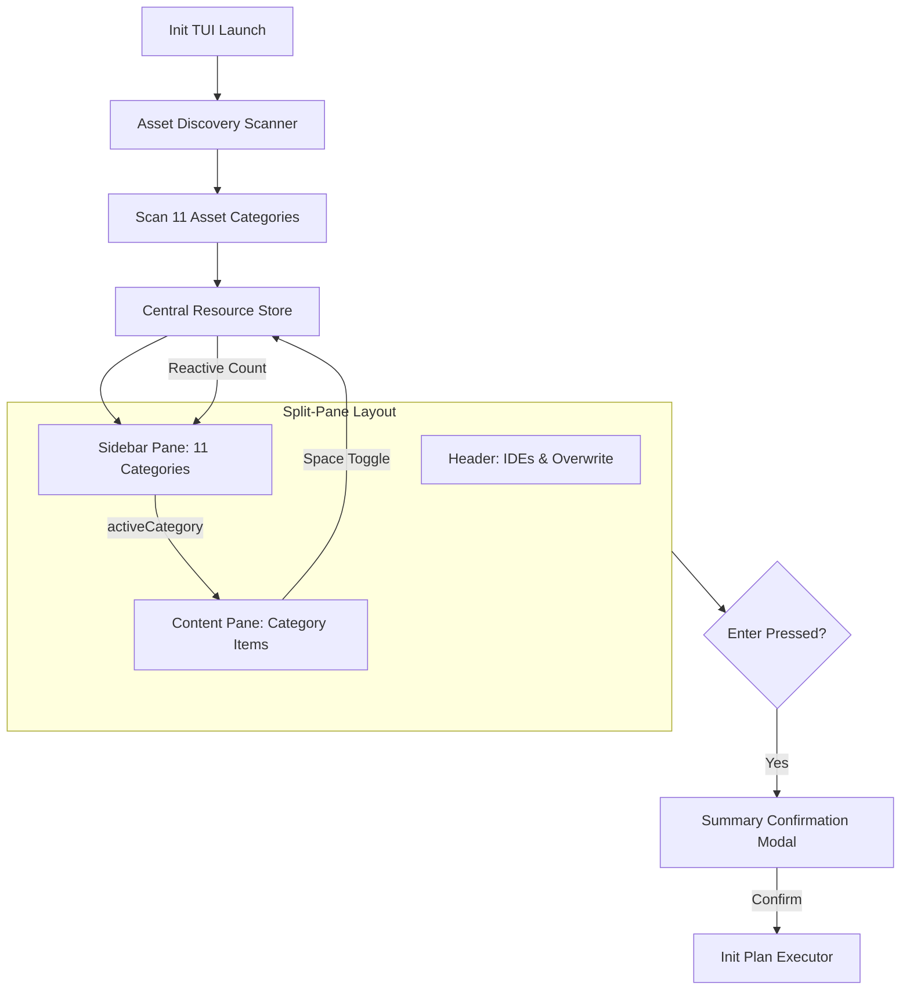

# Concept: TUI Init Sidebar cho từng thành phần trong Assets

## 1. Problem & Goal (Vấn đề & Mục tiêu)

### Problem (Điểm nghẽn & Thiếu sót hiện tại)
- **Context & Trigger**: Người dùng khởi chạy TUI khởi tạo dự án bằng lệnh `only-one init` hoặc `only-one init --tui`.
- **Symptom & Defect**: Toàn bộ tài nguyên hiển thị dồn vào một danh sách phẳng duy nhất; không phân loại theo từng thành phần cấu hình.
- **Root Cause**: Kiến trúc giao diện chỉ có 1 viewport đơn luồng; scanner chỉ đọc 4 loại tài nguyên và bỏ sót 7 thư mục trong `assets`.
- **Impact / Blast Radius**: Trải nghiệm chọn lựa cồng kềnh; người dùng không thể cấu hình trực quan các thành phần như MCPs, Combos, Git hooks, VS Code.

### Goal (Kết quả kỹ thuật mục tiêu)
- **Core Goal**: Tái cấu trúc TUI `init` theo mô hình Split-Pane hai cột với Sidebar danh mục và Main Content Pane.
- **Acceptance Criteria**:
  - Sidebar hiển thị đầy đủ 11 danh mục thành phần từ thư mục `assets` kèm badge số lượng chọn `[selected/total]`.
  - Main Content Pane lọc và hiển thị danh sách item theo danh mục đang active trên Sidebar.
  - Phím điều hướng `[Tab]` và mũi tên hỗ trợ chuyển đổi mượt mà giữa Header, Sidebar và Main Pane.
  - Phím `[Space]` thay đổi trạng thái chọn item và tự động cập nhật badge số lượng trên Sidebar theo thời gian thực.
  - Hộp thoại tóm tắt trước khi thực thi phản ánh chính xác các lựa chọn thuộc toàn bộ danh mục.

## 2. Scope Boundaries (Ranh giới phạm vi)
- **In-Scope**:
  - Thiết kế thành phần Sidebar hiển thị 11 danh mục thành phần (`Combos`, `Skills`, `Rules`, `Packages`, `Configs`, `MCPs`, `Hooks`, `Git`, `VS Code`, `Ignore`, `ESLint`).
  - Mở rộng cơ chế quét trạng thái cài đặt cho toàn bộ các thành phần trong thư mục `assets`.
  - Nâng cấp bộ điều hướng bàn phím để hỗ trợ chuyển đổi giữa các pane trong giao diện hai cột.
  - Tích hợp dữ liệu từ tất cả danh mục vào kế hoạch khởi tạo và báo cáo tóm tắt.
- **Explicit Out-of-Scope**:
  - Không thay đổi hành vi thực thi của các lệnh CLI dạng headless (`only-one init --step ...`).
  - Không thay đổi cấu trúc lưu trữ vật lý của các file trong thư mục `assets`.
  - Chưa bổ sung tính năng tìm kiếm văn bản trực tiếp (fuzzy search) trong phiên bản này.

## 3. Proposed Solution & Core Mechanism (Giải pháp đề xuất & Cơ chế cốt lõi)

### Core Mechanism
Hệ thống sử dụng mô hình **Split-Pane Projection Model**:
1. Khởi tạo một mảng trạng thái tập trung chứa toàn bộ tài nguyên quét được từ 11 thành phần trong `assets`.
2. Sidebar giữ vai trò bộ lọc hiển thị (Projection Filter) xác định danh mục đang kích hoạt (`activeCategory`).
3. Main Content Pane chỉ kết xuất các phần tử thuộc danh mục được chọn từ mảng trạng thái tập trung.
4. Thao tác chọn phần tử cập nhật trực tiếp vào mảng trạng thái; Sidebar tự động tái kết xuất số lượng đã chọn.

### Conceptual Flow / Domain Model



### UI Wireframe

```text
┌─ ONLY-ONE INIT WIZARD ────────────────────────────────────────────────────────┐
│ Target IDEs: [●] Antigravity  [ ] Cursor  [ ] Claude  [ ] Codex  | Overwrite: [ ]│
├──────────────────────┬────────────────────────────────────────────────────────┤
│ ASSETS CATEGORIES    │ ITEMS: Skills (2/4 selected)                           │
│                      │                                                        │
│   01. Combos    [0]  │ > [x] karpathy-ste100-discipline        [✓] installed │
│ > 02. Skills    [2]  │       Enforce Karpathy 4 Disciplines & STE-100         │
│   03. Rules     [1]  │   [x] only-one-idea                     [✓] installed │
│   04. Packages  [3]  │       Concept discovery & specification interview      │
│   05. Configs   [2]  │   [ ] only-one-plan                     [+] will add  │
│   06. MCPs      [1]  │       Implementation plan with unified diffs           │
│   07. Hooks     [0]  │   [ ] only-one-review                   (not installed)│
│   08. Git       [1]  │                                                        │
│   09. VS Code   [0]  │                                                        │
│   10. Ignore    [1]  │                                                        │
│   11. ESLint    [0]  │                                                        │
├──────────────────────┴────────────────────────────────────────────────────────┤
│ [Tab] Switch Pane | [←/→] IDEs | [↑/↓] Navigate | [Space] Toggle | [Enter] Apply │
└───────────────────────────────────────────────────────────────────────────────┘
```

## 4. Critical Risks & Edge Cases (Rủi ro & Xử lý ngoại lệ)
- **Kích thước cửa sổ Terminal hẹp (< 80 cột)**:
  - *Rủi ro*: Giao diện hai cột bị gãy dòng hoặc chồng lấn chữ khi terminal có chiều rộng nhỏ.
  - *Giải pháp*: Thiết lập min-width cho Sidebar (cố định 22 ký tự), Content Pane co giãn linh hoạt theo phần còn lại; ẩn phần mô tả phụ khi độ rộng dưới ngưỡng tối thiểu.
- **Thành phần chưa có tài nguyên cài đặt**:
  - *Rủi ro*: Người dùng chọn danh mục rỗng dẫn đến crash hiển thị hoặc lỗi con trỏ điều hướng.
  - *Giải pháp*: Content Pane hiển thị thông điệp rỗng an toàn (`No items available`) và vô hiệu hóa phím chọn.
- **Đồng bộ hóa Combos với từng thành phần đơn lẻ**:
  - *Rủi ro*: Xung đột trạng thái khi vừa chọn combo vừa bỏ chọn các skill thuộc combo đó.
  - *Giải pháp*: Áp dụng quy tắc phân rã combo tại thời điểm xác nhận kế hoạch (Plan Building Phase), đảm bảo tính toàn vẹn phụ thuộc.
