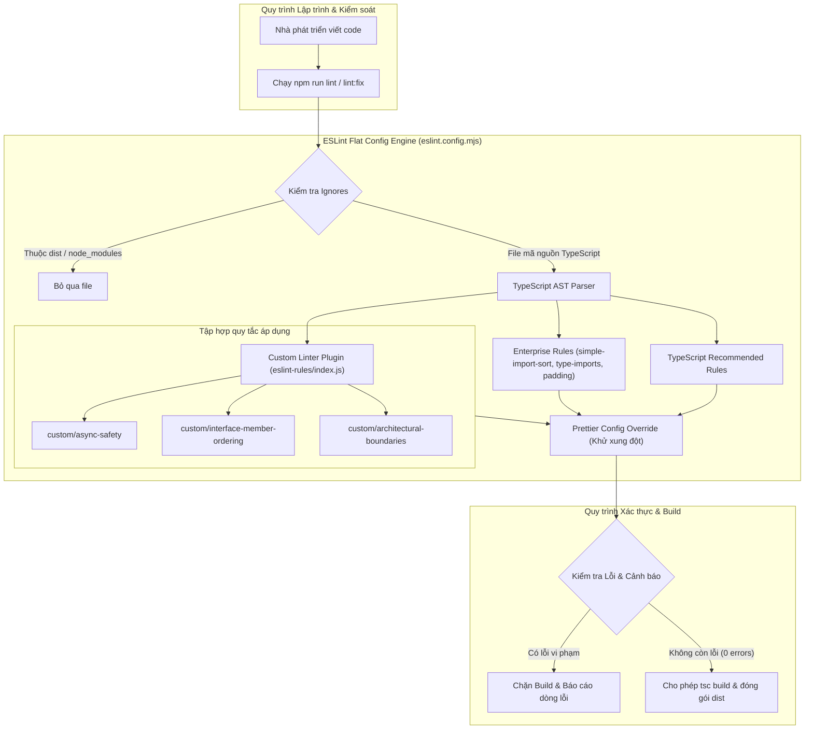

# Concept: Triển khai bộ quy tắc ESLint nội bộ cho hệ thống only-one-cli

## 1. Problem & Goal (Vấn đề & Mục tiêu)

### Problem (Điểm nghẽn & Thiếu sót hiện tại)
- **Context & Trigger**: Kho mã nguồn `only-one-cli` phát triển nhanh với nhiều tính năng phức tạp (assets, combos, skills, runtime). Dự án hiện chỉ sử dụng Prettier (`format:check`) để kiểm tra định dạng khoảng trắng.
- **Symptom & Defect**: Thiếu cơ chế phân tích tĩnh tự động để phát hiện lỗi logic tiềm ẩn, lỗi Promise không được await, cấu trúc imports lộn xộn giữa các module, và khai báo interface thiếu nhất quán.
- **Root Cause**: Chưa thiết lập hệ thống ESLint với bộ quy tắc phù hợp cho kiến trúc Node.js TypeScript ES Module.
- **Impact / Blast Radius**: Nguy cơ rò rỉ lỗi runtime (floating promises, unhandled rejections) ra môi trường người dùng; kiến trúc module dễ bị phụ thuộc vòng hoặc vi phạm ranh giới phân tầng.

### Goal (Kết quả kỹ thuật mục tiêu)
- **Core Goal**: Thiết lập hoàn chỉnh hệ thống kiểm tra mã nguồn tĩnh ESLint Flat Config (`eslint.config.mjs`) tích hợp bộ quy tắc chuẩn TypeScript Enterprise, tự động sắp xếp imports, ép kiểu type-only imports, và custom rules nội bộ đặt tại thư mục `eslint-rules/` độc lập ở cấp root (không để trong `assets/`).
- **Acceptance Criteria**:
  - Tách bạch độc lập bộ rule nội bộ vào thư mục `eslint-rules/` tại root, bảo vệ thư mục `assets/` không bị pha trộn công cụ phát triển.
  - Tự động sắp xếp và gom nhóm imports theo 4 tầng (Node built-ins -> Third-party -> `@/` aliases -> Relative) qua `simple-import-sort`.
  - Ép buộc sử dụng `import type` cho các khai báo kiểu dữ liệu qua `@typescript-eslint/consistent-type-imports`.
  - Bắt buộc dòng trống ngăn cách các câu lệnh điều khiển (`return`, `if`, `for`, `try`) qua `padding-line-between-statements`.
  - Dự án chạy kiểm tra lint thành công qua lệnh `npm run lint` và tự động sửa qua `npm run lint:fix`.
  - Bộ rule kích hoạt đầy đủ kiểm tra TypeScript chuẩn kết hợp với custom rules (`async-safety`, `interface-member-ordering`, và `architectural-boundaries`).
  - Hoàn toàn tương thích và không xung đột với cấu hình Prettier hiện hành.
  - Tích hợp kiểm tra lint vào lệnh `npm run build` để chặn mã nguồn không đạt chuẩn trước khi build artifact.
  - Toàn bộ codebase hiện tại đạt 0 lỗi khi chạy `npm run lint`.

## 2. Scope Boundaries (Ranh giới phạm vi)

- **In-Scope**:
  - Khởi tạo thư mục `eslint-rules/` tại thư mục gốc repository chứa custom plugin nội bộ (`index.js`, `presets/`, `rules/`).
  - Khởi tạo file cấu hình chuẩn `eslint.config.mjs` tại thư mục gốc của repository, import từ `./eslint-rules/index.js`.
  - Cài đặt các devDependencies tối thiểu cần thiết (`eslint`, `typescript-eslint`, `eslint-config-prettier`, `eslint-plugin-simple-import-sort`).
  - Cấu hình nhóm quy tắc Enterprise cho CLI: `simple-import-sort`, `consistent-type-imports`, `padding-line-between-statements`, `max-lines`.
  - Thiết lập luật `architectural-boundaries` phù hợp kiến trúc 3 tầng của CLI (`cli` -> `commands` -> `core`).
  - Cập nhật scripts trong `package.json` (`lint`, `lint:fix`, và móc nối vào `build`).
  - Rà soát và giải quyết dứt điểm các cảnh báo hoặc lỗi lint phát sinh trên codebase hiện tại.
- **Explicit Out-of-Scope**:
  - Tuyệt đối không can thiệp, sửa đổi hay đặt quy tắc linter nội bộ của repository vào thư mục `assets/`.
  - Không kích hoạt các preset và rules dành riêng cho frontend/web (`react-nextjs`, `react-refresh`, `design-system`, `i18n`, `jsx-a11y`, `react/forbid-elements`).
  - Không ép tiền tố `I` cho interface hay cấm `enum` để bảo toàn kiến trúc hiện tại của `only-one-cli`.
  - Không xuất bản bộ rule này thành npm package riêng biệt để phân phối ra ngoài (chỉ phục vụ nội bộ `only-one-cli`).
  - Không thay đổi hành vi nghiệp vụ của các tính năng CLI hiện có.

## 3. Proposed Solution & Core Mechanism (Giải pháp đề xuất & Cơ chế cốt lõi)

### Core Mechanism (Cơ chế vận hành)
- **Tách biệt ranh giới công cụ (Tooling Isolation)**: Đặt toàn bộ custom rules tại thư mục `eslint-rules/` ở root dự án, đảm bảo thư mục `assets/` chỉ phục vụ các template phân phối cho CLI.
- **Cấu hình Flat Config đa tầng**: Sử dụng mảng cấu hình phẳng `eslint.config.mjs` theo chuẩn ESLint v9+.
- **Tầng Bỏ qua (Ignores Layer)**: Bỏ qua các thư mục build và assets sinh tự động (`dist/`, `node_modules/`, `coverage/`, `.agents/`).
- **Tầng Chuẩn hóa TypeScript Enterprise**:
  - Tích hợp `@eslint/js` và `typescript-eslint` để phân tích AST TypeScript cho toàn bộ thư mục `src/` và `test/`.
  - Kích hoạt `@typescript-eslint/consistent-type-imports` (bắt buộc `import type`).
  - Kích hoạt `eslint-plugin-simple-import-sort` (tự động sort imports).
  - Kích hoạt `padding-line-between-statements` và `max-lines` (500 dòng).
- **Tầng Quy tắc Custom Nội bộ (`eslint-rules/`)**: Nạp trực tiếp `customRulesPlugin` từ `./eslint-rules/index.js`.
  - `custom/async-safety`: Ép buộc await hoặc handle lỗi cho toàn bộ hàm bất đồng bộ.
  - `custom/interface-member-ordering`: Sắp xếp các trường bắt buộc đứng trước trường tùy chọn trong interface.
  - `custom/architectural-boundaries`: Ngăn chặn tầng `core` import ngược phụ thuộc từ tầng `commands` hoặc `cli`.
- **Tầng Khử xung đột Prettier**: Đặt `eslint-config-prettier` tại vị trí cuối cùng trong mảng cấu hình để tắt toàn bộ rule định dạng trùng lặp với Prettier.

### Conceptual Flow / Domain Model (Luồng kiểm tra mã nguồn)

### UI Wireframe
- *Không áp dụng*: Tính năng thuộc nhóm Công cụ Phát triển & Phân tích Tĩnh (CLI / Developer Tooling), không có giao diện đồ họa người dùng (GUI).

## 4. Critical Risks & Edge Cases (Phân tích Rủi ro & Cơ chế Phòng vệ)

- **Rủi ro 1: Nhầm lẫn giữa Tooling nội bộ và Distribution Assets**
  - *Mặt tiêu cực / Nguy cơ*: Đặt code linter nội bộ vào `assets/` khiến các lệnh packaging, distribution hoặc asset syncing của CLI đóng gói nhầm file linter vào template người dùng.
  - *Cơ chế phòng vệ*: Chuyển toàn bộ rules nội bộ ra thư mục `eslint-rules/` độc lập ở root; giữ nguyên `assets/` cho tài nguyên phân phối.

- **Rủi ro 2: Vi phạm hàng loạt import sorting và type-only imports trên codebase hiện tại**
  - *Mặt tiêu cực / Nguy cơ*: Khi bật `simple-import-sort` và `consistent-type-imports`, có thể xuất hiện hàng trăm cảnh báo trên toàn bộ `src/`.
  - *Cơ chế phòng vệ*: Cả 2 quy tắc này đều hỗ trợ `eslint --fix` tự động 100%. Lập trình viên chỉ cần chạy `npm run lint:fix` một lần duy nhất để chuẩn hóa toàn bộ dự án mà không cần sửa tay.

- **Rủi ro 3: Xung đột định dạng giữa ESLint và Prettier**
  - *Mặt tiêu cực / Nguy cơ*: Quy tắc format của ESLint sửa đổi code ngược lại với cấu hình `.prettierrc`, gây ra vòng lặp sửa lỗi hoặc làm fail lệnh `npm run format:check` trong CI.
  - *Cơ chế phòng vệ*: Sử dụng `eslint-config-prettier` đặt ở phần tử cuối cùng của mảng cấu hình flat config để vô hiệu hóa hoàn toàn mọi quy tắc về khoảng trắng, dấu phẩy, và dấu ngoặc của ESLint.

- **Rủi ro 4: Báo động giả (False Positives) từ quy tắc Architectural Boundaries**
  - *Mặt tiêu cực / Nguy cơ*: Quy tắc `architectural-boundaries` báo lỗi sai khi import các utils nội bộ trong cùng tầng.
  - *Cơ chế phòng vệ*: Cấu hình boundaries chính xác cho `only-one-cli`: Module `src/core/` chỉ cấm import ngược từ `src/commands/` hoặc `src/cli/`, cho phép toàn bộ import nội bộ `@/core/` và Node.js built-ins.
