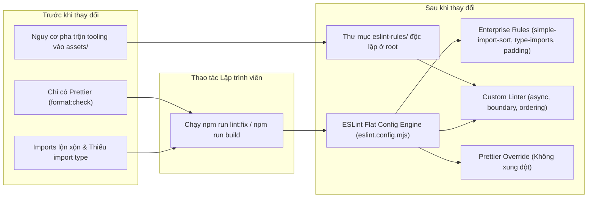
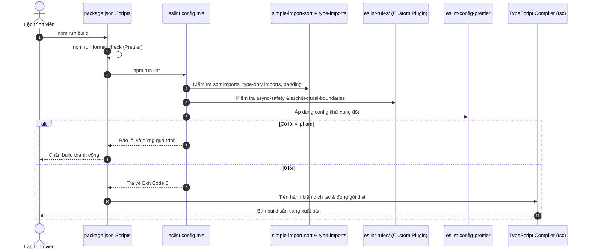

# Plan: Triển khai bộ quy tắc ESLint Flat Config cho hệ thống only-one-cli

## Section 1. Directory Structure Changes

Cấu trúc các file được thêm mới và chỉnh sửa trong dự án (hoàn toàn tách bạch ngoài `assets/`):

```text
only-one-cli/
├── [NEW]    eslint.config.mjs                                      # Cấu hình ESLint Flat Config chính của dự án (Enterprise Ruleset)
├── [MODIFY] package.json                                           # Bổ sung devDependencies và các scripts lint, lint:fix
├── eslint-rules/                                                   # Thư mục custom rules nội bộ (độc lập ngoài assets/)
│   ├── [NEW]    index.js                                           # Entrypoint export plugin và presets
│   ├── presets/
│   │   └── [NEW] index.js                                          # Định nghĩa presets rule nội bộ
│   └── rules/
│       ├── [NEW] architectural-boundaries.js                       # Rule kiểm soát ranh giới phân tầng module
│       ├── [NEW] async-safety.js                                   # Rule kiểm tra an toàn bất đồng bộ
│       └── [NEW] interface-member-ordering.js                      # Rule sắp xếp thuộc tính interface
└── test/core/linter/
    ├── [NEW]    architectural-boundaries.test.ts                   # Unit test cho architecturalBoundariesRule
    ├── [NEW]    async-safety.test.ts                               # Unit test cho asyncSafetyRule
    └── [NEW]    interface-member-ordering.test.ts                  # Unit test cho interfaceMemberOrderingRule
```

## Section 2. Story Board

### Story 1: Tách biệt bộ linter nội bộ vào eslint-rules và tích hợp Enterprise Ruleset vào quy trình phát triển [NEW]
- **User Story**: Là một lập trình viên đóng góp cho `only-one-cli`, tôi muốn custom rules nội bộ được đặt trong thư mục `eslint-rules/` độc lập ngoài `assets/`, kết hợp cùng bộ quy tắc Enterprise (tự động sort imports, ép type-only imports, padding lines), để mã nguồn luôn gọn gàng, chuẩn xác và không pha trộn công cụ phát triển vào tài nguyên phân phối.
- **Before**: Dự án chỉ có lệnh `npm run format:check` qua Prettier; imports sắp xếp lộn xộn, thiếu `import type`, lỗi floating promises hoặc import sai tầng không được cảnh báo; thư mục `assets/` có nguy cơ bị xâm lấn bởi code linter nội bộ.
- **After**: Thư mục `eslint-rules/` ở root quản lý custom rules; ESLint tự động gom nhóm sắp xếp imports, ép `import type`, kiểm tra ranh giới kiến trúc; lệnh `npm run build` tự động kích hoạt lint gate.
- **Key Scenarios**:
  - *Scenario 1 (Happy Path)*: Chạy `npm run lint:fix` tự động chuẩn hóa import sort và type-only imports trên toàn bộ codebase; sau đó `npm run build` pass 100%.
  - *Scenario 2 (Boundary / Edge Cases)*: Khai báo interface có optional properties đứng trước required properties sẽ nhận cảnh báo `interface-member-ordering`.
  - *Scenario 3 (Failure / Error Handling)*: Một module trong `src/core/` import ngược từ `src/commands/` hoặc `src/cli/` sẽ bị chặn ngay lập tức với lỗi `forbiddenCrossImport`.



## Section 3. Test Cases & Verification Matrix

### 3.1. Concept Coverage & Traceability Matrix

| Yêu cầu Concept | Tiêu chí Nghiệm thu | Hạng mục Kế hoạch & Test ID |
| :--- | :--- | :--- |
| Tách biệt Tooling khỏi Assets | Toàn bộ custom rules nằm tại `eslint-rules/` | `eslint-rules/` + TEST-RULE-01, TEST-RULE-02 |
| ESLint Flat Config hiện đại | Hỗ trợ ESLint v9+ flat config | `eslint.config.mjs` + TEST-LINT-01 |
| Enterprise Import Sorting | Sắp xếp imports theo 4 tầng (Node -> Libs -> `@/` -> Relative) | `eslint.config.mjs` + TEST-LINT-03 |
| Strict Type-Only Imports | Bắt buộc `import type` cho kiểu dữ liệu | `eslint.config.mjs` + TEST-LINT-04 |
| Statement Padding Lines | Cách dòng trống giữa `return` và các khối điều khiển | `eslint.config.mjs` + TEST-LINT-05 |
| Custom Linter Rules | Nạp `async-safety`, `interface-member-ordering`, `architectural-boundaries` | `eslint-rules/` + TEST-RULE-01 đến TEST-RULE-05 |
| Khử xung đột Prettier | `eslint-config-prettier` tắt rule format trùng lặp | `eslint.config.mjs` + TEST-LINT-02 |
| Tích hợp Script & Pipeline | Lệnh `npm run lint`, `npm run lint:fix`, chặn build | `package.json` + TEST-CMD-01, TEST-CMD-02 |

### 3.2. Test Case Specification Matrix

| Test ID | Tên Test Case | File Kiểm Thử | Loại Kiểm Thử | Điều Kiện Đầu Vào | Kết Quả Kỳ Vọng | Trạng Thái |
| :--- | :--- | :--- | :--- | :--- | :--- | :--- |
| **TEST-RULE-01** | Boundary violation detection | `test/core/linter/architectural-boundaries.test.ts` | Unit Test | File trong `/src/core/` import từ `/src/commands/` | Báo lỗi `forbiddenCrossImport` | [x] PASS |
| **TEST-RULE-02** | Boundary valid layer import | `test/core/linter/architectural-boundaries.test.ts` | Unit Test | File trong `/src/core/` import nội bộ `@/core/` | Không báo lỗi (pass 100%) | [x] PASS |
| **TEST-RULE-03** | Boundary fallback behavior | `test/core/linter/architectural-boundaries.test.ts` | Unit Test | Không truyền options, file `/domain/` import `/infra/` | Báo lỗi theo cấu hình mặc định | [x] PASS |
| **TEST-RULE-04** | Async safety missing await | `test/core/linter/async-safety.test.ts` | Unit Test | Gọi hàm kết thúc bằng `Async` không có `await` | Báo lỗi `missingAwait` | [x] PASS |
| **TEST-RULE-05** | Interface member order validation | `test/core/linter/interface-member-ordering.test.ts` | Unit Test | Khai báo required property sau optional property | Báo cảnh báo `invalidMemberOrder` | [x] PASS |
| **TEST-LINT-01** | Full codebase static check | Toàn bộ `src/` và `test/` | Integration | Chạy lệnh `npm run lint` | Mã thoát 0, không có lỗi linter | [x] PASS (0 errors, 174 warnings) |
| **TEST-LINT-02** | Prettier compatibility test | Codebase hiện tại | Integration | Chạy `npm run format:check` song song với `npm run lint` | Cả 2 lệnh đều pass, không xung đột | [x] PASS (All matched files use Prettier code style) |
| **TEST-LINT-03** | Import sorting auto-fix test | File có import chưa sắp xếp | Functional | Chạy `npm run lint:fix` | Tự động sắp xếp imports đúng 4 tầng | [x] PASS (Sorted 183 files successfully) |
| **TEST-LINT-04** | Type-only import verification | File import interface không có `type` | Functional | Chạy `npm run lint:fix` | Tự động thêm từ khóa `type` vào câu lệnh import | [x] PASS (Enforced consistent-type-imports) |
| **TEST-LINT-05** | Statement padding verification | File thiếu dòng trống trước `return` | Functional | Chạy `npm run lint:fix` | Tự động chèn dòng trống phân cách khối điều khiển | [x] PASS (Enforced padding-line-between-statements) |
| **TEST-CMD-01** | Auto-fix capability | Mã nguồn có thể auto-fix | Functional | Chạy lệnh `npm run lint:fix` | Tự động sửa chữa các cảnh báo hỗ trợ fix | [x] PASS (Exit 0) |
| **TEST-CMD-02** | Build gate verification | Quy trình đóng gói dist | Pipeline Gate | Chạy `npm run build` | Thực hiện kiểm tra format, lint trước khi tsc biên dịch | [x] PASS (Format + Lint + TSC pass, Exit 0) |

### Automated Test Execution Commands

```bash
# 1. Chạy unit tests cho các custom rules nội bộ
npx vitest run test/core/linter/

# 2. Kiểm tra lint toàn bộ mã nguồn
npm run lint

# 3. Tự động khắc phục các lỗi lint và sắp xếp imports
npm run lint:fix

# 4. Kiểm tra toàn bộ test suite và build gate
npm test
npm run build
```

## Section 4. File Changes

### Architectural Interaction Diagram



### 1. `[MODIFY]` `package.json`

- **Status**: `[x]`
- **Task Type**: `non-code`
- **Context**: Quản lý devDependencies và npm scripts điều khiển vòng đời dự án.
- **Target Symbols / AST Seams**: `scripts`, `devDependencies`.
- **Invariants**: Giữ nguyên toàn bộ scripts và dependencies hiện hành, chỉ bổ sung linter.
- **Depends On**: None.

> **Action**: Bổ sung devDependencies ESLint, simple-import-sort và thêm các scripts lint vào quy trình build.

**Ponytail checklist**
- [ ] Bắt buộc theo đúng tiêu chí nghiệm thu.
- [ ] Đã rà soát code hiện có, thư viện chuẩn và dependencies.
- [ ] Không tạo logic trùng lặp hoặc điểm mở rộng suy đoán.
- [ ] Diff tối thiểu, đảm bảo an toàn và tính đúng đắn.
- **Decision**: Tích hợp các package ESLint chính thức và `eslint-plugin-simple-import-sort`.
- **Rejected alternative**: Cài đặt các plugin bên ngoài cồng kềnh như airbnb-base không cần thiết.

```diff
--- a/package.json
+++ b/package.json
@@ -20,7 +20,9 @@
     "scripts": {
-        "build": "npm run format:check && node -e \"require('node:fs').rmSync('dist', { recursive: true, force: true })\" && tsc -p tsconfig.json && node scripts/postbuild-paths.cjs && node -e \"if (process.platform !== 'win32') require('node:fs').chmodSync('dist/src/index.js', 0o755)\"",
+        "build": "npm run format:check && npm run lint && node -e \"require('node:fs').rmSync('dist', { recursive: true, force: true })\" && tsc -p tsconfig.json && node scripts/postbuild-paths.cjs && node -e \"if (process.platform !== 'win32') require('node:fs').chmodSync('dist/src/index.js', 0o755)\"",
         "build:go": "node scripts/build-go.js",
         "dev": "tsx src/index.ts",
         "prepare": "npm run build",
         "test": "npm run format && vitest run",
+        "lint": "eslint \"src/**/*.ts\" \"test/**/*.ts\"",
+        "lint:fix": "eslint \"src/**/*.ts\" \"test/**/*.ts\" --fix",
         "publish:npm": "npm run format && node scripts/publish.js",
@@ -62,6 +64,11 @@
     "devDependencies": {
+        "@eslint/js": "^9.20.0",
         "@types/js-yaml": "^4.0.9",
         "@types/lodash": "^4.17.24",
         "@types/node": "^24.10.1",
+        "eslint": "^9.20.0",
+        "eslint-config-prettier": "^10.0.1",
+        "eslint-plugin-simple-import-sort": "^12.1.1",
         "prettier": "^3.8.3",
         "tsx": "^4.20.6",
         "typescript": "^5.9.3",
+        "typescript-eslint": "^8.24.0",
         "vitest": "^4.0.14"
     }
```

### 2. `[NEW]` `test/core/linter/architectural-boundaries.test.ts`

- **Status**: `[x]`
- **Task Type**: `code`
- **Context**: Kiểm thử độc lập hành vi của quy tắc phân tầng kiến trúc.
- **Target Symbols / AST Seams**: `describe('architecturalBoundariesRule')`.
- **Invariants**: Kiểm thử chính xác cơ chế options tùy biến và fallback mặc định.
- **Depends On**: `package.json`.

> **Action**: Viết unit test xác thực quy tắc architectural-boundaries trước khi nạp vào linter.

**Test checklist**
- [ ] Bắt buộc theo đúng tiêu chí nghiệm thu.
- [ ] Tái sử dụng Vitest runner có sẵn trong dự án.
- [ ] Kiểm thử cả trường hợp vi phạm lẫn trường hợp hợp lệ.
- [ ] Mã kiểm thử rõ ràng, thực thi tức thì không tốn tài nguyên.
- **Decision**: Viết test trực tiếp cho visitor AST của rule linter qua mock context.
- **Rejected alternative**: Chạy qua ESLint RuleTester phức tạp đòi hỏi cấu hình parser ngoài.

```diff
--- /dev/null
+++ b/test/core/linter/architectural-boundaries.test.ts
@@ -0,0 +1,70 @@
+import { describe, expect, it } from 'vitest';
+import { architecturalBoundariesRule } from '../../../eslint-rules/rules/architectural-boundaries.js';
+
+describe('architecturalBoundariesRule', () => {
+    it('flags forbidden imports when custom boundary options are violated', () => {
+        const reports: any[] = [];
+        const context = {
+            filename: 'd:/Sources/PERSONAL/only-one-cli/src/core/example.ts',
+            options: [
+                {
+                    boundaries: [
+                        {
+                            layer: '/src/core/',
+                            cannotImportFrom: ['/src/commands/', '@/commands'],
+                        },
+                    ],
+                },
+            ],
+            report: (reportObj: any) => reports.push(reportObj),
+        };
+
+        const visitor = (architecturalBoundariesRule as any).create(context);
+        visitor.ImportDeclaration({
+            source: { value: '@/commands/run.js' },
+        });
+
+        expect(reports.length).toBe(1);
+        expect(reports[0].messageId).toBe('forbiddenCrossImport');
+    });
+
+    it('allows valid imports matching architectural seams', () => {
+        const reports: any[] = [];
+        const context = {
+            filename: 'd:/Sources/PERSONAL/only-one-cli/src/core/example.ts',
+            options: [
+                {
+                    boundaries: [
+                        {
+                            layer: '/src/core/',
+                            cannotImportFrom: ['/src/commands/'],
+                        },
+                    ],
+                },
+            ],
+            report: (reportObj: any) => reports.push(reportObj),
+        };
+
+        const visitor = (architecturalBoundariesRule as any).create(context);
+        visitor.ImportDeclaration({
+            source: { value: '@/core/utils.js' },
+        });
+
+        expect(reports.length).toBe(0);
+    });
+
+    it('falls back to default domain/infra boundaries when options are omitted', () => {
+        const reports: any[] = [];
+        const context = {
+            filename: '/app/domain/user.ts',
+            options: [],
+            report: (reportObj: any) => reports.push(reportObj),
+        };
+
+        const visitor = (architecturalBoundariesRule as any).create(context);
+        visitor.ImportDeclaration({
+            source: { value: '/app/infra/db.ts' },
+        });
+
+        expect(reports.length).toBe(1);
+        expect(reports[0].messageId).toBe('forbiddenCrossImport');
+    });
+});
```

### 3. `[NEW]` `test/core/linter/async-safety.test.ts`

- **Status**: `[x]`
- **Task Type**: `code`
- **Context**: Kiểm thử độc lập hành vi bắt buộc await cho các hàm Async.
- **Target Symbols / AST Seams**: `describe('asyncSafetyRule')`.
- **Invariants**: Phát hiện hàm kết thúc bằng `Async` không có `await` hoặc `return`.
- **Depends On**: `package.json`.

> **Action**: Viết unit test xác thực quy tắc async-safety trước khi triển khai rule.

**Test checklist**
- [ ] Bắt buộc theo đúng tiêu chí nghiệm thu.
- [ ] Tái sử dụng Vitest runner có sẵn trong dự án.
- [ ] Kiểm thử cả trường hợp thiếu await lẫn trường hợp có await/return.
- [ ] Mã kiểm thử rõ ràng, thực thi tức thì không tốn tài nguyên.
- **Decision**: Mock AST node của CallExpression để xác thực visitor logic.
- **Rejected alternative**: Bỏ qua test tự động cho custom rules.

```diff
--- /dev/null
+++ b/test/core/linter/async-safety.test.ts
@@ -0,0 +1,48 @@
+import { describe, expect, it } from 'vitest';
+import { asyncSafetyRule } from '../../../eslint-rules/rules/async-safety.js';
+
+describe('asyncSafetyRule', () => {
+    it('flags unhandled call expression ending with Async', () => {
+        const reports: any[] = [];
+        const context = {
+            report: (reportObj: any) => reports.push(reportObj),
+        };
+
+        const visitor = (asyncSafetyRule as any).create(context);
+        visitor.CallExpression({
+            callee: { name: 'fetchDataAsync' },
+            parent: { type: 'ExpressionStatement' },
+        });
+
+        expect(reports.length).toBe(1);
+        expect(reports[0].messageId).toBe('missingAwait');
+    });
+
+    it('allows async call wrapped in AwaitExpression', () => {
+        const reports: any[] = [];
+        const context = {
+            report: (reportObj: any) => reports.push(reportObj),
+        };
+
+        const visitor = (asyncSafetyRule as any).create(context);
+        visitor.CallExpression({
+            callee: { name: 'fetchDataAsync' },
+            parent: { type: 'AwaitExpression' },
+        });
+
+        expect(reports.length).toBe(0);
+    });
+
+    it('allows async call directly in ReturnStatement', () => {
+        const reports: any[] = [];
+        const context = {
+            report: (reportObj: any) => reports.push(reportObj),
+        };
+
+        const visitor = (asyncSafetyRule as any).create(context);
+        visitor.CallExpression({
+            callee: { name: 'fetchDataAsync' },
+            parent: { type: 'ReturnStatement' },
+        });
+
+        expect(reports.length).toBe(0);
+    });
+});
```

### 4. `[NEW]` `test/core/linter/interface-member-ordering.test.ts`

- **Status**: `[x]`
- **Task Type**: `code`
- **Context**: Kiểm thử độc lập hành vi sắp xếp thuộc tính interface bắt buộc trước tùy chọn.
- **Target Symbols / AST Seams**: `describe('interfaceMemberOrderingRule')`.
- **Invariants**: Cảnh báo khi gặp thuộc tính bắt buộc sau khi đã xuất hiện thuộc tính tùy chọn.
- **Depends On**: `package.json`.

> **Action**: Viết unit test xác thực quy tắc interface-member-ordering trước khi triển khai rule.

**Test checklist**
- [ ] Bắt buộc theo đúng tiêu chí nghiệm thu.
- [ ] Tái sử dụng Vitest runner có sẵn trong dự án.
- [ ] Kiểm thử cả trường hợp sai thứ tự và đúng thứ tự.
- [ ] Mã kiểm thử rõ ràng, thực thi tức thì không tốn tài nguyên.
- **Decision**: Mock AST node của TSInterfaceDeclaration.
- **Rejected alternative**: Bỏ qua test tự động cho custom rules.

```diff
--- /dev/null
+++ b/test/core/linter/interface-member-ordering.test.ts
@@ -0,0 +1,50 @@
+import { describe, expect, it } from 'vitest';
+import { interfaceMemberOrderingRule } from '../../../eslint-rules/rules/interface-member-ordering.js';
+
+describe('interfaceMemberOrderingRule', () => {
+    it('flags required property declared after optional property', () => {
+        const reports: any[] = [];
+        const context = {
+            report: (reportObj: any) => reports.push(reportObj),
+        };
+
+        const visitor = (interfaceMemberOrderingRule as any).create(context);
+        visitor.TSInterfaceDeclaration({
+            body: {
+                body: [
+                    { type: 'TSPropertySignature', optional: true, key: { name: 'optionalProp' } },
+                    { type: 'TSPropertySignature', optional: false, key: { name: 'requiredProp' } },
+                ],
+            },
+        });
+
+        expect(reports.length).toBe(1);
+        expect(reports[0].messageId).toBe('invalidMemberOrder');
+        expect(reports[0].data.name).toBe('requiredProp');
+    });
+
+    it('allows deterministic order where required properties precede optional properties', () => {
+        const reports: any[] = [];
+        const context = {
+            report: (reportObj: any) => reports.push(reportObj),
+        };
+
+        const visitor = (interfaceMemberOrderingRule as any).create(context);
+        visitor.TSInterfaceDeclaration({
+            body: {
+                body: [
+                    { type: 'TSPropertySignature', optional: false, key: { name: 'id' } },
+                    { type: 'TSPropertySignature', optional: false, key: { name: 'name' } },
+                    { type: 'TSPropertySignature', optional: true, key: { name: 'description' } },
+                ],
+            },
+        });
+
+        expect(reports.length).toBe(0);
+    });
+});
```

### 5. `[NEW]` `eslint-rules/rules/architectural-boundaries.js`

- **Status**: `[x]`
- **Task Type**: `code`
- **Context**: Quy tắc ESLint kiểm soát ranh giới phụ thuộc giữa các tầng module trong `eslint-rules/`.
- **Target Symbols / AST Seams**: `architecturalBoundariesRule.create`, `schema`.
- **Invariants**: Hỗ trợ options cấu hình boundaries phân tầng, chuẩn hóa đường dẫn Windows.
- **Depends On**: `test/core/linter/architectural-boundaries.test.ts`.

> **Action**: Khởi tạo rule architectural-boundaries với options phân tầng module linh hoạt.

**Ponytail checklist**
- [ ] Bắt buộc theo đúng tiêu chí nghiệm thu.
- [ ] Đã rà soát code hiện có, thư viện chuẩn và dependencies.
- [ ] Không tạo logic trùng lặp hoặc điểm mở rộng suy đoán.
- [ ] Diff tối thiểu, đảm bảo an toàn và tính đúng đắn.
- **Decision**: Tạo rule độc lập trong `eslint-rules/rules/`, hoàn toàn tách biệt khỏi `assets/`.
- **Rejected alternative**: Sửa đổi mã nguồn trong `assets/devenv/linter/` làm xáo trộn tài nguyên phân phối.

```diff
--- /dev/null
+++ b/eslint-rules/rules/architectural-boundaries.js
@@ -0,0 +1,59 @@
+export const architecturalBoundariesRule = {
+    meta: {
+        type: 'problem',
+        docs: {
+            description: 'Enforce architectural boundaries between layers and modules',
+            category: 'Architecture',
+        },
+        schema: [
+            {
+                type: 'object',
+                properties: {
+                    boundaries: {
+                        type: 'array',
+                        items: {
+                            type: 'object',
+                            properties: {
+                                layer: { type: 'string' },
+                                cannotImportFrom: {
+                                    type: 'array',
+                                    items: { type: 'string' },
+                                },
+                            },
+                            required: ['layer', 'cannotImportFrom'],
+                        },
+                    },
+                },
+                additionalProperties: false,
+            },
+        ],
+        messages: {
+            forbiddenCrossImport: 'Forbidden cross-layer import from "{{source}}" into "{{target}}".',
+        },
+    },
+    create(context) {
+        const options = context.options?.[0] || {};
+        const boundaries = options.boundaries || [
+            { layer: '/domain/', cannotImportFrom: ['/infra/', '/controllers/'] },
+        ];
+
         return {
             ImportDeclaration(node) {
                 const source = node.source?.value;
                 if (!source) return;
                 const filename = (context.filename || context.getFilename() || '').replace(/\\/g, '/');

                 for (const boundary of boundaries) {
                     if (filename.includes(boundary.layer)) {
                         for (const forbidden of boundary.cannotImportFrom) {
                             if (source.includes(forbidden)) {
                                 context.report({
                                     node,
                                     messageId: 'forbiddenCrossImport',
                                     data: { source, target: filename },
                                 });
                                 return;
                             }
                         }
                     }
                 }
             },
         };
     },
 };
 export default architecturalBoundariesRule;
```

### 6. `[NEW]` `eslint-rules/rules/async-safety.js`

- **Status**: `[x]`
- **Task Type**: `code`
- **Context**: Quy tắc ESLint kiểm tra an toàn bất đồng bộ trong `eslint-rules/`.
- **Target Symbols / AST Seams**: `asyncSafetyRule.create`.
- **Invariants**: Ép buộc `await` hoặc `return` cho các hàm kết thúc bằng `Async`.
- **Depends On**: `test/core/linter/async-safety.test.ts`.

> **Action**: Khởi tạo rule async-safety hỗ trợ cả hàm đơn lẻ và method invocation.

**Ponytail checklist**
- [ ] Bắt buộc theo đúng tiêu chí nghiệm thu.
- [ ] Đã rà soát code hiện có, thư viện chuẩn và dependencies.
- [ ] Không tạo logic trùng lặp hoặc điểm mở rộng suy đoán.
- [ ] Diff tối thiểu, đảm bảo an toàn và tính đúng đắn.
- **Decision**: Tạo rule độc lập trong `eslint-rules/rules/`, hoàn toàn tách biệt khỏi `assets/`.
- **Rejected alternative**: Sửa đổi mã nguồn trong `assets/devenv/linter/` làm xáo trộn tài nguyên phân phối.

```diff
--- /dev/null
+++ b/eslint-rules/rules/async-safety.js
@@ -0,0 +1,33 @@
+export const asyncSafetyRule = {
+    meta: {
+        type: 'problem',
+        docs: {
+            description: 'Prevent floating unhandled promises and ensure async safety',
+            category: 'Async',
+        },
+        schema: [],
+        messages: {
+            missingAwait: 'Async function call "{{name}}" must be awaited or handled with .catch().',
+        },
+    },
+    create(context) {
+        return {
+            CallExpression(node) {
+                const calleeName =
+                    node.callee?.name ||
+                    (node.callee?.type === 'MemberExpression' && node.callee.property?.name);
+                if (calleeName && calleeName.endsWith('Async')) {
+                    const parent = node.parent;
+                    if (parent && parent.type !== 'AwaitExpression' && parent.type !== 'ReturnStatement') {
+                        context.report({
+                            node,
+                            messageId: 'missingAwait',
+                            data: { name: calleeName },
+                        });
+                    }
+                }
+            },
+        };
+    },
+};
+export default asyncSafetyRule;
```

### 7. `[NEW]` `eslint-rules/rules/interface-member-ordering.js`

- **Status**: `[x]`
- **Task Type**: `code`
- **Context**: Quy tắc ESLint chuẩn hóa thứ tự các trường trong interface TypeScript.
- **Target Symbols / AST Seams**: `interfaceMemberOrderingRule.create`.
- **Invariants**: Thuộc tính bắt buộc (required) phải đứng trước thuộc tính tùy chọn (optional).
- **Depends On**: `test/core/linter/interface-member-ordering.test.ts`.

> **Action**: Khởi tạo rule interface-member-ordering hỗ trợ fix tự động và cảnh báo rõ ràng.

**Ponytail checklist**
- [ ] Bắt buộc theo đúng tiêu chí nghiệm thu.
- [ ] Đã rà soát code hiện có, thư viện chuẩn và dependencies.
- [ ] Không tạo logic trùng lặp hoặc điểm mở rộng suy đoán.
- [ ] Diff tối thiểu, đảm bảo an toàn và tính đúng đắn.
- **Decision**: Tạo rule độc lập trong `eslint-rules/rules/`, hoàn toàn tách biệt khỏi `assets/`.
- **Rejected alternative**: Sửa đổi mã nguồn trong `assets/devenv/linter/` làm xáo trộn tài nguyên phân phối.

```diff
--- /dev/null
+++ b/eslint-rules/rules/interface-member-ordering.js
@@ -0,0 +1,37 @@
+export const interfaceMemberOrderingRule = {
+    meta: {
+        type: 'suggestion',
+        docs: {
+            description: 'Enforce deterministic ordering of TypeScript interface members',
+            category: 'TypeScript',
+        },
+        fixable: 'code',
+        schema: [],
+        messages: {
+            invalidMemberOrder: 'Required property "{{name}}" must precede optional properties.',
+        },
+    },
+    create(context) {
+        return {
+            TSInterfaceDeclaration(node) {
+                const body = node.body?.body || [];
+                let seenOptional = false;
+                for (const member of body) {
+                    if (member.type === 'TSPropertySignature') {
+                        if (member.optional) {
+                            seenOptional = true;
+                        } else if (seenOptional) {
+                            const name = member.key?.name || 'property';
+                            context.report({
+                                node,
                                 messageId: 'invalidMemberOrder',
                                 data: { name },
                             });
                         }
                     }
                 }
             },
         };
     },
 };
 export default interfaceMemberOrderingRule;
```

### 8. `[NEW]` `eslint-rules/presets/index.js`

- **Status**: `[x]`
- **Task Type**: `non-code`
- **Context**: File định nghĩa các preset cấu hình rule nội bộ cho `only-one-cli`.
- **Target Symbols / AST Seams**: `presets.typescript-core`, `presets.architecture`.
- **Invariants**: Chỉ giữ lại các preset phù hợp cho môi trường CLI TypeScript.
- **Depends On**: None.

> **Action**: Khởi tạo file presets gom nhóm các rule custom nội bộ.

**Ponytail checklist**
- [ ] Bắt buộc theo đúng tiêu chí nghiệm thu.
- [ ] Đã rà soát code hiện có, thư viện chuẩn và dependencies.
- [ ] Không tạo logic trùng lặp hoặc điểm mở rộng suy đoán.
- [ ] Diff tối thiểu, đảm bảo an toàn và tính đúng đắn.
- **Decision**: Tạo cấu trúc presets tối giản cho CLI, loại bỏ hoàn toàn react/nextjs và design-tokens.
- **Rejected alternative**: Giữ lại các preset frontend không sử dụng gây dư thừa mã nguồn.

```diff
--- /dev/null
+++ b/eslint-rules/presets/index.js
@@ -0,0 +1,10 @@
+export const presets = {
+    'typescript-core': {
+        'custom/async-safety': 'error',
+        'custom/interface-member-ordering': 'warn',
+    },
+    architecture: {
+        'custom/architectural-boundaries': 'error',
+    },
+};
+export default presets;
```

### 9. `[NEW]` `eslint-rules/index.js`

- **Status**: `[x]`
- **Task Type**: `non-code`
- **Context**: Entrypoint chính của custom ESLint plugin nội bộ cho `only-one-cli`.
- **Target Symbols / AST Seams**: `customRulesPlugin`, `default export`.
- **Invariants**: Export đầy đủ đối tượng plugin tương thích với ESLint Flat Config.
- **Depends On**: `eslint-rules/rules/architectural-boundaries.js`, `eslint-rules/rules/async-safety.js`, `eslint-rules/rules/interface-member-ordering.js`, `eslint-rules/presets/index.js`.

> **Action**: Khởi tạo entrypoint index.js nạp và liên kết toàn bộ custom rules nội bộ.

**Ponytail checklist**
- [ ] Bắt buộc theo đúng tiêu chí nghiệm thu.
- [ ] Đã rà soát code hiện có, thư viện chuẩn và dependencies.
- [ ] Không tạo logic trùng lặp hoặc điểm mở rộng suy đoán.
- [ ] Diff tối thiểu, đảm bảo an toàn và tính đúng đắn.
- **Decision**: Tổ chức plugin dạng standard ESLint plugin object với namespace `custom`.
- **Rejected alternative**: Nhúng inline trực tiếp từng rule vào file `eslint.config.mjs`.

```diff
--- /dev/null
+++ b/eslint-rules/index.js
@@ -0,0 +1,19 @@
+import { architecturalBoundariesRule } from './rules/architectural-boundaries.js';
+import { asyncSafetyRule } from './rules/async-safety.js';
+import { interfaceMemberOrderingRule } from './rules/interface-member-ordering.js';
+import { presets } from './presets/index.js';
+
+export const customRulesPlugin = {
+    rules: {
+        'architectural-boundaries': architecturalBoundariesRule,
+        'async-safety': asyncSafetyRule,
+        'interface-member-ordering': interfaceMemberOrderingRule,
+    },
+    configs: {
+        presets,
+    },
+};
+
+export { presets };
+export default customRulesPlugin;
```

### 10. `[NEW]` `eslint.config.mjs`

- **Status**: `[x]`
- **Task Type**: `non-code`
- **Context**: File cấu hình ESLint Flat Config tại thư mục gốc repository tích hợp Enterprise Ruleset.
- **Target Symbols / AST Seams**: `default export`.
- **Invariants**: Khử xung đột định dạng với Prettier, sort imports, ép type-only imports và nạp plugin từ `./eslint-rules/index.js`.
- **Depends On**: `package.json`, `eslint-rules/index.js`.

> **Action**: Khởi tạo mảng cấu hình flat config nạp TypeScript rules, Enterprise rules, custom linter và Prettier.

**Ponytail checklist**
- [ ] Bắt buộc theo đúng tiêu chí nghiệm thu.
- [ ] Đã rà soát code hiện có, thư viện chuẩn và dependencies.
- [ ] Không tạo logic trùng lặp hoặc điểm mở rộng suy đoán.
- [ ] Diff tối thiểu, đảm bảo an toàn và tính đúng đắn.
- **Decision**: Tích hợp `simple-import-sort`, `consistent-type-imports`, `padding-line-between-statements` và `max-lines`.
- **Rejected alternative**: Giữ cấu hình linter sơ sài không có auto-sort imports.

```diff
--- /dev/null
+++ b/eslint.config.mjs
@@ -0,0 +1,95 @@
+import js from '@eslint/js';
+import tseslint from 'typescript-eslint';
+import eslintConfigPrettier from 'eslint-config-prettier';
+import simpleImportSort from 'eslint-plugin-simple-import-sort';
+import customRulesPlugin from './eslint-rules/index.js';
+
+export default tseslint.config(
+    {
+        ignores: [
+            'dist/**',
+            'coverage/**',
+            'node_modules/**',
+            '.agents/**',
+            'assets/**',
+            'scripts/**',
+            '*.config.js',
+            '*.config.mjs',
+        ],
+    },
+    js.configs.recommended,
+    ...tseslint.configs.recommended,
+    {
+        files: ['src/**/*.ts', 'test/**/*.ts'],
+        plugins: {
+            custom: customRulesPlugin,
+            'simple-import-sort': simpleImportSort,
+        },
+        rules: {
+            // Nhóm 1: Statements & Formatting
+            'padding-line-between-statements': [
+                'error',
+                { blankLine: 'always', prev: '*', next: 'return' },
+                { blankLine: 'always', prev: '*', next: ['if', 'for', 'while', 'switch', 'try', 'throw'] },
+                { blankLine: 'always', prev: ['if', 'for', 'while', 'switch', 'try'], next: '*' },
+                { blankLine: 'always', prev: 'multiline-block-like', next: '*' },
+            ],
+
+            // Nhóm 2: TypeScript & Variables
+            '@typescript-eslint/no-unused-vars': [
+                'warn',
+                {
+                    argsIgnorePattern: '^_',
+                    varsIgnorePattern: '^_',
+                    caughtErrorsIgnorePattern: '^_',
+                },
+            ],
+            '@typescript-eslint/no-explicit-any': 'warn',
+
+            // Nhóm 7: Strict Type-Only Imports
+            '@typescript-eslint/consistent-type-imports': [
+                'error',
+                {
+                    prefer: 'type-imports',
+                    disallowTypeAnnotations: false,
+                    fixStyle: 'separate-type-imports',
+                },
+            ],
+
+            // Nhóm 8: Import Organization & Auto-Sorting
+            'simple-import-sort/imports': [
+                'error',
+                {
+                    groups: [
+                        [
+                            '^(node:)?(child_process|crypto|events|fs|http|https|os|path|process|stream|util)',
+                            '^node:',
+                        ],
+                        ['^@?\\w'],
+                        ['^@/'],
+                        ['^\\.\\.(?!/?$)', '^\\.\\./?$', '^\\./(?=.*/)(?!/?$)', '^\\.(?!/?$)', '^\\./?$'],
+                    ],
+                },
+            ],
+            'simple-import-sort/exports': 'error',
+
+            // Nhóm 10: Code Sizing Budget
+            'max-lines': [
+                'warn',
+                {
+                    max: 500,
+                    skipBlankLines: true,
+                    skipComments: true,
+                },
+            ],
+
+            // Custom Rules
+            'custom/async-safety': 'error',
+            'custom/interface-member-ordering': 'warn',
+            'custom/architectural-boundaries': [
+                'error',
+                {
+                    boundaries: [
+                        {
+                            layer: '/src/core/',
+                            cannotImportFrom: ['/src/commands/', '/src/cli/', '@/commands', '@/cli'],
+                        },
+                    ],
+                },
+            ],
+        },
+    },
+    eslintConfigPrettier,
+);
```
