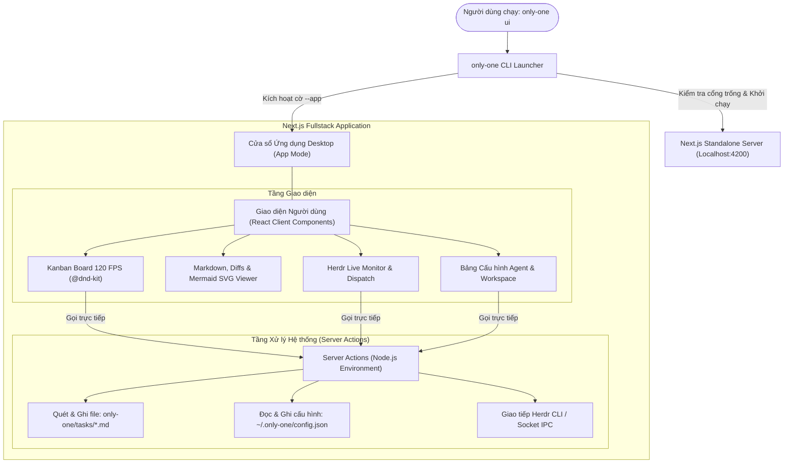

# Concept: Bảng điều khiển Quy trình Fullstack Next.js (All-in-One Dashboard)

## 1. Problem & Goal (Vấn đề & Mục tiêu)

### Problem (Điểm nghẽn & Thiếu sót hiện tại)
- **Context & Trigger**: Người dùng muốn theo dõi tiến độ các task, điều phối agent và xem tài liệu thiết kế thông qua giao diện trực quan, dễ thao tác thay vì chỉ dùng terminal.
- **Symptom & Defect**:
  - Giao diện terminal (TUI) bị giới hạn bởi lưới ký tự monospace, tạo cảm giác "quá mang tính dòng lệnh" và gò bó.
  - Không thể thực hiện các thao tác chuột tự nhiên như kéo thả thẻ (drag-and-drop) giữa các cột trạng thái.
  - Không thể hiển thị trực quan sơ đồ kiến trúc Mermaid, mã màu Diff chuẩn GitHub, hoặc đọc tài liệu Markdown dài một cách thoải mái.
  - Nếu xây dựng theo hướng tách rời Backend (Node.js API) và Frontend (Vite React), hệ thống sẽ phải quản lý 2 tiến trình server, cấu hình CORS phức tạp và dễ phát sinh xung đột cổng.
  - Nếu mở trực tiếp bằng trình duyệt web thông thường, người dùng dễ bị phân tâm bởi thanh địa chỉ (URL bar), các tab trình duyệt và tiện ích mở rộng.
- **Root Cause**:
  - Terminal không hỗ trợ các công nghệ hiển thị hiện đại (DOM, CSS transitions, Canvas, SVG).
  - Kiến trúc tách rời BE/FE truyền thống làm tăng độ phức tạp vận hành không cần thiết cho một công cụ CLI cá nhân.
- **Impact / Blast Radius**:
  - Giảm hiệu suất làm việc của lập trình viên khi quản lý nhiều luồng task song song.

### Goal (Kết quả kỹ thuật mục tiêu)
- **Core Goal**: Xây dựng bảng điều khiển **Fullstack Next.js All-in-One** tích hợp toàn bộ giao diện trực quan (Kanban kéo thả 120 FPS, Markdown/Mermaid Viewer, Herdr Monitor) và xử lý hệ sinh thái (Server Actions đọc/ghi task, điều phối Herdr) trong một ứng dụng duy nhất, khởi chạy dưới dạng **Cửa sổ Ứng dụng Desktop Độc lập (App Mode)** thông qua lệnh `only-one ui`.
- **Acceptance Criteria**:
  - Khởi chạy bằng một lệnh duy nhất: `only-one ui` (tự động bật Next.js standalone server và mở cửa sổ Desktop App Mode không có thanh URL).
  - Không tách rời BE/FE: Ứng dụng Next.js xử lý toàn bộ; Client Components gọi trực tiếp Server Actions để thao tác với file hệ thống và Herdr Socket/CLI.
  - Trải nghiệm ứng dụng Desktop Native: Chạy độc lập trong cửa sổ riêng (không thanh địa chỉ, không tab, có biểu tượng riêng trên Taskbar).
  - Bảng Kanban 4 cột (`CONCEPT`, `PLAN`, `PROCESSING`, `DONE`) hỗ trợ kéo thả chuột (drag-and-drop) mượt mà với phản hồi hình ảnh tức thì.
  - Trình xem tài liệu Markdown tích hợp: Render đầy đủ cú pháp GitHub-Flavored Markdown, Diff code màu sắc và sơ đồ Mermaid SVG sắc nét.
  - Panel giám sát Herdr Realtime: Hiển thị danh sách Pane/Tab, trạng thái Agent (`idle`, `working`, `blocked`), và gửi lệnh dispatch bằng 1 click.
  - Tối ưu đóng gói: Sử dụng Next.js Standalone build siêu nhẹ đi kèm gói CLI.

---

## 2. Scope Boundaries (Ranh giới phạm vi)

### In-Scope
- **Kiến trúc Next.js Fullstack All-in-One**:
  - Tầng Giao diện (Client Components): Kanban Board với drag-and-drop, Markdown/Mermaid Viewer Modal, Herdr Live Monitor, Settings Panel.
  - Tầng Xử lý Hệ thống (Server Actions): Đọc và ghi các file task SDLC, cập nhật cấu hình toàn cục, và giao tiếp với Herdr CLI / Socket IPC.
- **Cơ chế Khởi chạy Desktop App Mode**:
  - CLI tự động phát hiện trình duyệt nhân Chromium có sẵn trên máy (Microsoft Edge trên Windows, Google Chrome trên macOS/Linux) và kích hoạt chế độ `--app=http://localhost:<port>`.
  - Hỗ trợ cờ `--browser` để mở trên tab trình duyệt thông thường nếu người dùng muốn.
  - Tự động dò tìm cổng trống nếu cổng mặc định (4200) bị chiếm dụng.
- **Đóng gói & Tích hợp CLI**:
  - Tích hợp lệnh `only-one ui` (hoặc `only-one dashboard`) vào bộ định tuyến CLI hiện có.

### Explicit Out-of-Scope
- Không xây dựng server backend Node.js riêng biệt (không Express, không Fastify, không REST/CORS boilerplate).
- Không nhúng framework Electron hoặc Tauri cồng kềnh (tận dụng tính năng Native App Mode có sẵn của OS giúp kích thước gói siêu nhỏ).
- Không thay đổi quy ước định dạng và cấu trúc tài liệu SDLC (`concept.md`, `plan.md`, `debug.md`).

---

## 3. Proposed Solution & Core Mechanism (Giải pháp đề xuất & Cơ chế cốt lõi)

### So sánh các phương án giải pháp (Solution Trade-offs)

| Tiêu chí | Phương án 1: Next.js All-in-One + App Mode (Được chọn) | Phương án 2: Tách rời Vite FE + Node HTTP BE | Phương án 3: Electron / Tauri App |
| :--- | :--- | :--- | :--- |
| **Kiến trúc** | **Một dự án duy nhất (Next.js Fullstack)** | Phân mảnh 2 dự án (Vite Client + HTTP Server) | Đóng gói kèm runtime nhúng riêng |
| **Giao tiếp Dữ liệu** | **Server Actions trực tiếp, Type-safe** | REST API endpoints, fetch thủ công, CORS | IPC Bridge phức tạp |
| **Trải nghiệm Người dùng** | **Cửa sổ Desktop riêng biệt (không thanh URL/Tab)** | Mở tab trên trình duyệt web thông thường | Cửa sổ Desktop Native hoàn chỉnh |
| **Kích thước đóng gói** | **Gọn nhẹ (~10-15 MB standalone)** | Nhẹ (~5-8 MB) | Nặng (~80-150 MB cho Electron) |
| **Số lượng tiến trình** | **1 tiến trình duy nhất** | 2 tiến trình (Frontend dev server + Backend) | Quá trình renderer + main process |
| **Đánh giá** | **Tối ưu nhất: Đẹp, tiện, nhẹ, dễ bảo trì** | Phức tạp trong đồng bộ cổng và bảo trì | Quá cồng kềnh đối với một công cụ CLI |

### Trả lời câu hỏi: "Có phải chạy trên browser không?"
- **Không phải dạng tab web thông thường**: Mặc dù sử dụng engine web để render giao diện, ứng dụng khởi chạy dưới chế độ **Desktop App Mode** (`msedge --app=http://localhost:4200` trên Windows hoặc `chrome --app=...` trên macOS/Linux).
- **Đặc điểm của Desktop App Mode**:
  - Giao diện hiển thị trong một cửa sổ riêng biệt hoàn toàn, không có thanh nhập địa chỉ URL, không có thanh bookmark, không có các tab phụ.
  - Có icon riêng trên thanh tác vụ (Taskbar / Dock), có thể thu phóng, di chuyển và đóng mở như một phần mềm máy tính độc lập (tương tự trải nghiệm Slack, Notion, Linear desktop).

---

### Sơ đồ Kiến trúc Hệ thống (Architecture Flow)



---

### Thiết kế Bố cục Giao diện (UI Layout & Wireframe)

Giao diện áp dụng phong cách tối giản hiện đại (Dark Mode cao cấp, viền mờ phát sáng):

```text
+----------------------------------------------------------------------------------------------------+
| 🚀 ONLY-ONE DASHBOARD                  Workspace: /my-repo  ● HERDR: CONNECTED     [⚙ Settings] [🧹 Clean] |
+------------------------------------+---------------------------------------------------------------+
| HERDR AGENT MONITOR (Realtime)     | KANBAN WORKFLOW BOARD (Kéo thả thẻ giữa các cột trạng thái)   |
|                                    |                                                               |
| [w4:p1] agy-architect  ● IDLE      | 💡 CONCEPT (1)     📋 PLAN (2)      ⚡ PROCESSING (1)  ✅ DONE (3)   |
|   Tab: architect • cwd: /repo      | +---------------+  +---------------+  +---------------+  +--------+  |
|                                    | | auth-flow     |  | pane-routing  |  | dev-implement |  | unify  |  |
| [w4:p2] agy-dev        ⚡ WORKING   | | Thêm OAuth2   |  | Tách biệt target|  | [w4:p2] agy    |  | 100% ok|  |
|   Tab: implement • 65% wave 1      | |               |  |               |  | 67% complete   |  |        |  |
|                                    | | [View MD] [▶] |  | [View MD] [▶] |  | [View MD]      |  | [View] |  |
| [w4:p4] claude-review  ● IDLE      | +---------------+  +---------------+  +---------------+  +--------+  |
|   Tab: review • ready for audit    |                                                                       |
+------------------------------------+---------------------------------------------------------------+
| POPUP / MODAL XEM CHI TIẾT KHI CLICK "VIEW MD":                                                    |
| +------------------------------------------------------------------------------------------------+ |
| | concept.md  |  plan.md  |  debug.md                                           [x Đóng] [▶ Dispatch] | |
| |                                                                                                | |
| | # Plan: Chuẩn hóa Global Agents                                                                | |
| | ## 1. Sơ đồ Kiến trúc (Render sắc nét qua Mermaid SVG)                                         | |
| |    [ Sơ đồ trực quan với các khối màu và mũi tên kết nối chuẩn xác ]                            | |
| | ## 2. File Changes (Unified Diff với màu xanh/đỏ chuẩn GitHub)                                  | |
| +------------------------------------------------------------------------------------------------+ |
+----------------------------------------------------------------------------------------------------+
```

---

### Ma trận Xử lý Trạng thái Giao diện (UI State Handling Matrix)

| Thành phần UI | Trạng thái Trống (Empty State) | Trạng thái Tải (Loading State) | Trạng thái Lỗi (Error State) | Trạng thái Đầy đủ (Populated State) |
| :--- | :--- | :--- | :--- | :--- |
| **Kanban Board** | Hiển thị thông báo "Chưa có task nào. Hãy bắt đầu bằng /only-one-idea" kèm nút tạo task nhanh. | Khung xương thẻ mờ (Skeleton cards) với hiệu ứng sóng (wave animation) mượt mà. | Banner cảnh báo đỏ: "Không thể đọc thư mục tasks", kèm nút Thử lại (Retry). | Hiển thị đầy đủ 4 cột, các thẻ có thể kéo thả tự do giữa các cột. |
| **Markdown / Diff Modal** | Hiển thị "Task chưa có tài liệu tương ứng cho giai đoạn này". | Spinner phát sáng trung tâm cùng hiệu ứng mở mờ dần (fade-in). | Hiển thị lỗi phân tích Markdown/Mermaid hoặc cảnh báo file bị hỏng. | Render đầy đủ GFM, sơ đồ Mermaid SVG tương tác và khối code diff màu sắc. |
| **Herdr Monitor** | Hiển thị "Herdr chưa chạy hoặc không tìm thấy socket" kèm hướng dẫn bật herdr. | Hiệu ứng nhấp nháy đèn trạng thái "Đang kết nối Herdr...". | Đèn trạng thái chuyển màu xám/đỏ: "Mất kết nối tới Herdr". | Hiển thị danh sách Pane, trạng thái Agent (Idle/Working/Blocked) theo thời gian thực. |
| **Settings Panel** | Hiển thị cấu hình mặc định đề xuất của hệ thống. | Biểu tượng lưu xoay nhẹ khi áp dụng thay đổi. | Thông báo lỗi xác thực dữ liệu đầu vào (cổng không hợp lệ, đường dẫn sai). | Hiển thị form chỉnh sửa định tuyến agent, hotkeys và cài đặt tự động dọn dẹp. |

---

## 4. Critical Risks & Edge Cases (Rủi ro & Xử lý ngoại lệ)

- **Môi trường không có sẵn Microsoft Edge hoặc Google Chrome**:
  - *Rủi ro*: Trên một số bản phân phối Linux tối giản hoặc máy không cài Chromium, lệnh `--app` sẽ không chạy được.
  - *Giải pháp*: CLI sẽ thử lần lượt: Edge -> Chrome -> Trình duyệt mặc định hệ thống thông qua thư viện `open`. Luôn đảm bảo người dùng truy cập được giao diện.
- **Xung đột Cổng mạng (Port Collision)**:
  - *Rủi ro*: Cổng mặc định 4200 đang bị dịch vụ khác sử dụng.
  - *Giải pháp*: CLI sử dụng hàm kiểm tra socket để tìm cổng khả dụng tiếp theo (4201, 4202...) trước khi khởi chạy Next.js server.
- **Tính toàn vẹn dữ liệu khi Kéo thả Thẻ (Race Condition trong Task Moving)**:
  - *Rủi ro*: Người dùng kéo thẻ nhanh liên tục hoặc nhiều thao tác diễn ra đồng thời làm sai lệch trạng thái file Markdown.
  - *Giải pháp*: Áp dụng cơ chế cập nhật lạc quan (Optimistic UI update) trên giao diện Client, đồng thời Server Action sử dụng cơ chế ghi tuần tự và hoàn tác (rollback) giao diện nếu Server ghi thất bại.
- **Tối ưu Kích thước và Thời gian Khởi động**:
  - *Rủi ro*: Nếu chạy chế độ dev (`next dev`) sẽ tốn thời gian biên dịch lúc khởi động.
  - *Giải pháp*: Đóng gói sẵn bản build production bằng `next build` với `output: 'standalone'` khi xuất xưởng gói npm, giúp thời gian khởi động server chỉ mất ~0.2 - 0.4 giây.
