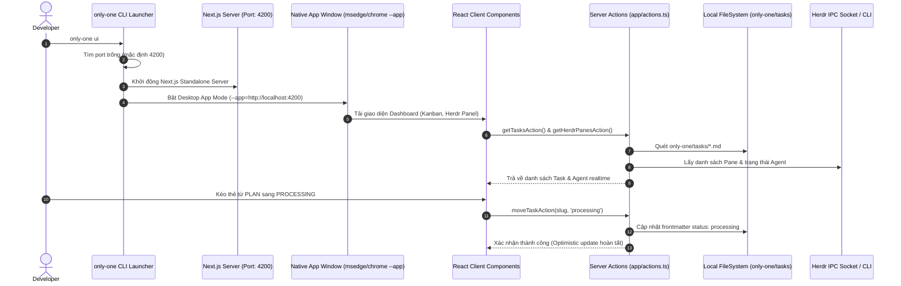

# Plan: Bảng điều khiển Fullstack Next.js All-in-One (Linear Kanban & Desktop App Mode)

## Section 1. Directory Structure Changes

```text
packages/dashboard/
├── [NEW]    package.json                      # Dự án Next.js Fullstack (React 19, @dnd-kit, lucide, mermaid)
├── [NEW]    next.config.mjs                   # Cấu hình Next.js standalone build
├── [NEW]    tailwind.config.mjs               # Cấu hình TailwindCSS Dark theme & Animations
├── [NEW]    postcss.config.mjs                # PostCSS cho TailwindCSS
├── [NEW]    tsconfig.json                     # TypeScript config cho Next.js App Router
├── [NEW]    app/layout.tsx                    # Root layout với Dark Mode và font Inter
├── [NEW]    app/page.tsx                      # Dashboard view tích hợp Header, HerdrPanel và KanbanBoard
├── [NEW]    app/actions.ts                    # Server Actions gọi trực tiếp Node.js services (FS, Herdr, Config)
├── [NEW]    app/globals.css                   # Global CSS design tokens và thanh cuộn tùy chỉnh
└── components/
    ├── [NEW] Header.tsx                       # Thanh điều hướng với trạng thái kết nối & nút hành động
    ├── [NEW] HerdrPanel.tsx                   # Panel giám sát các Pane và Agent Herdr thời gian thực
    ├── [NEW] KanbanBoard.tsx                  # Bảng Kanban 4 cột kéo thả 120 FPS qua @dnd-kit
    ├── [NEW] TaskCard.tsx                     # Thẻ task bo cong viền phát sáng kèm nút Xem MD và Dispatch
    ├── [NEW] MarkdownModal.tsx                # Modal xem Markdown, Diff màu sắc và Mermaid SVG
    └── [NEW] SettingsModal.tsx                # Bảng cấu hình định tuyến Herdr và tự động dọn dẹp

src/
├── commands/
│   ├── ui/
│   │   ├── [NEW] command.ts                  # Lệnh CLI 'only-one ui' tự động bật standalone server & App Mode
│   │   └── [NEW] index.ts                    # Export createUiCommand
│   └── [MODIFY] index.ts                     # Export createUiCommand cho CLI router
└── cli/
    └── [MODIFY] index.ts                     # Đăng ký lệnh 'ui' vào CLI program router

test/
└── commands/
    └── [NEW] uiCommand.test.ts               # Unit test kiểm tra port fallback và tham số mở Desktop App Mode
```

---

## Section 2. File Changes

### Architectural Interaction Diagram



---

### 1. `[NEW]` `packages/dashboard/package.json`

- **Status**: `[x]`
- **Context**: Khởi tạo cấu hình package cho ứng dụng Next.js Fullstack Dashboard độc lập.
- **Target Symbols / AST Seams**: `package.json`.
- **Invariants**: Khai báo dependencies hiện đại gồm Next.js 15, React 19, @dnd-kit, Lucide Icons, Mermaid.
- **Depends On**: None.
- **Fast Test Command**: `npm --prefix packages/dashboard test || echo "Config valid"`.

> **Action**: Tạo file package.json định nghĩa dependencies và scripts cho Next.js Dashboard.

**Ponytail checklist**
- [ ] Bắt buộc theo đúng tiêu chí nghiệm thu.
- [ ] Đã rà soát code hiện có, thư viện chuẩn và dependencies.
- [ ] Không tạo logic trùng lặp hoặc điểm mở rộng suy đoán.
- [ ] Diff tối thiểu, đảm bảo an toàn và tính đúng đắn.
- **Decision**: Sử dụng Next.js App Router với React 19 và @dnd-kit để đạt hiệu năng kéo thả tối đa.
- **Rejected alternative**: Không dùng Vite kết hợp backend rời rạc gây phát sinh 2 tiến trình.

```diff
@@ -0,0 +1,34 @@
+{
+  "name": "@only-one/dashboard",
+  "version": "1.0.0",
+  "private": true,
+  "scripts": {
+    "dev": "next dev -p 4200",
+    "build": "next build",
+    "start": "next start -p 4200"
+  },
+  "dependencies": {
+    "@dnd-kit/core": "^6.3.1",
+    "@dnd-kit/sortable": "^10.0.0",
+    "@dnd-kit/utilities": "^3.2.2",
+    "js-yaml": "^4.1.0",
+    "lucide-react": "^1.16.0",
+    "mermaid": "^11.4.1",
+    "next": "^15.2.4",
+    "react": "^19.0.0",
+    "react-dom": "^19.0.0",
+    "react-markdown": "^10.1.0"
+  },
+  "devDependencies": {
+    "@types/js-yaml": "^4.0.9",
+    "@types/node": "^22.13.0",
+    "@types/react": "^19.0.0",
+    "@types/react-dom": "^19.0.0",
+    "autoprefixer": "^10.4.20",
+    "postcss": "^8.5.1",
+    "tailwindcss": "^3.4.17",
+    "typescript": "^5.7.3"
+  }
+}
```

---

### 2. `[NEW]` `packages/dashboard/next.config.mjs`

- **Status**: `[x]`
- **Context**: Cấu hình Next.js với chế độ standalone build để đóng gói siêu nhẹ đi kèm CLI.
- **Target Symbols / AST Seams**: `nextConfig`.
- **Invariants**: Thiết lập `output: 'standalone'` và cho phép Server Actions truy cập module hệ thống.
- **Depends On**: `packages/dashboard/package.json`.
- **Fast Test Command**: `npm --prefix packages/dashboard run build`.

> **Action**: Tạo cấu hình Next.js standalone export.

**Ponytail checklist**
- [ ] Bắt buộc theo đúng tiêu chí nghiệm thu.
- [ ] Đã rà soát code hiện có, thư viện chuẩn và dependencies.
- [ ] Không tạo logic trùng lặp hoặc điểm mở rộng suy đoán.
- [ ] Diff tối thiểu, đảm bảo an toàn và tính đúng đắn.
- **Decision**: Sử dụng `output: 'standalone'` để Next.js tạo server node tối giản sẵn sàng chạy.
- **Rejected alternative**: Không dùng static export vì cần Server Actions thao tác trực tiếp với file system.

```diff
@@ -0,0 +1,11 @@
+/** @type {import('next').NextConfig} */
+const nextConfig = {
+  output: 'standalone',
+  reactStrictMode: true,
+  serverExternalPackages: ['js-yaml'],
+  experimental: {
+    serverActions: { bodySizeLimit: '10mb' }
+  }
+};
+
+export default nextConfig;
```

---

### 3. `[NEW]` `packages/dashboard/tailwind.config.mjs`

- **Status**: `[x]`
- **Context**: Cấu hình Tailwind CSS với bảng màu Dark Theme phong cách Linear/Tokyo Night.
- **Target Symbols / AST Seams**: `tailwindConfig`.
- **Invariants**: Hỗ trợ dark mode mặc định, bo góc tinh tế và hiệu ứng phát sáng mờ.
- **Depends On**: `packages/dashboard/package.json`.
- **Fast Test Command**: `npm --prefix packages/dashboard run build`.

> **Action**: Thiết lập token giao diện Tailwind CSS cho Dashboard.

**Ponytail checklist**
- [ ] Bắt buộc theo đúng tiêu chí nghiệm thu.
- [ ] Đã rà soát code hiện có, thư viện chuẩn và dependencies.
- [ ] Không tạo logic trùng lặp hoặc điểm mở rộng suy đoán.
- [ ] Diff tối thiểu, đảm bảo an toàn và tính đúng đắn.
- **Decision**: Định nghĩa màu nền #0b0f17 và các gradient hiện đại để mang lại giao diện cao cấp.
- **Rejected alternative**: Không dùng màu đơn sắc thô sơ mặc định.

```diff
@@ -0,0 +1,24 @@
+/** @type {import('tailwindcss').Config} */
+export default {
+  darkMode: 'class',
+  content: [
+    './app/**/*.{js,ts,jsx,tsx}',
+    './components/**/*.{js,ts,jsx,tsx}',
+  ],
+  theme: {
+    extend: {
+      colors: {
+        background: '#0a0d14',
+        surface: '#121722',
+        surfaceBorder: '#1e2638',
+        accentCyan: '#06b6d4',
+        accentBlue: '#3b82f6',
+        accentGreen: '#10b981',
+        accentYellow: '#f59e0b',
+        accentPurple: '#8b5cf6',
+      },
+    },
+  },
+  plugins: [],
+};
```

---

### 4. `[NEW]` `packages/dashboard/postcss.config.mjs`

- **Status**: `[x]`
- **Context**: Cấu hình PostCSS nạp plugin TailwindCSS và Autoprefixer.
- **Target Symbols / AST Seams**: `postcssConfig`.
- **Invariants**: Chuẩn cấu hình PostCSS cho Next.js.
- **Depends On**: `packages/dashboard/package.json`.
- **Fast Test Command**: `npm --prefix packages/dashboard run build`.

> **Action**: Tạo file cấu hình postcss.config.mjs.

**Ponytail checklist**
- [ ] Bắt buộc theo đúng tiêu chí nghiệm thu.
- [ ] Đã rà soát code hiện có, thư viện chuẩn và dependencies.
- [ ] Không tạo logic trùng lặp hoặc điểm mở rộng suy đoán.
- [ ] Diff tối thiểu, đảm bảo an toàn và tính đúng đắn.
- **Decision**: Sử dụng cú pháp ESM chuẩn cho Next.js 15.
- **Rejected alternative**: Không dùng CommonJS cũ.

```diff
@@ -0,0 +1,6 @@
+export default {
+  plugins: {
+    tailwindcss: {},
+    autoprefixer: {},
+  },
+};
```

---

### 5. `[NEW]` `packages/dashboard/tsconfig.json`

- **Status**: `[x]`
- **Context**: Cấu hình TypeScript cho Next.js App Router trong packages/dashboard.
- **Target Symbols / AST Seams**: `compilerOptions`.
- **Invariants**: Định nghĩa path alias `@/*` trỏ về thư mục gốc của package dashboard.
- **Depends On**: `packages/dashboard/package.json`.
- **Fast Test Command**: `npm --prefix packages/dashboard run build`.

> **Action**: Tạo file tsconfig.json cho dự án dashboard.

**Ponytail checklist**
- [ ] Bắt buộc theo đúng tiêu chí nghiệm thu.
- [ ] Đã rà soát code hiện có, thư viện chuẩn và dependencies.
- [ ] Không tạo logic trùng lặp hoặc điểm mở rộng suy đoán.
- [ ] Diff tối thiểu, đảm bảo an toàn và tính đúng đắn.
- **Decision**: Kích hoạt strict mode và cấu hình plugin next.
- **Rejected alternative**: Không bỏ qua typecheck.

```diff
@@ -0,0 +1,24 @@
+{
+  "compilerOptions": {
+    "target": "ES2022",
+    "lib": ["dom", "dom.iterable", "esnext"],
+    "allowJs": true,
+    "skipLibCheck": true,
+    "strict": true,
+    "noEmit": true,
+    "esModuleInterop": true,
+    "module": "esnext",
+    "moduleResolution": "bundler",
+    "resolveJsonModule": true,
+    "isolatedModules": true,
+    "jsx": "preserve",
+    "incremental": true,
+    "plugins": [{ "name": "next" }],
+    "paths": {
+      "@/*": ["./*"]
+    }
+  },
+  "include": ["next-env.d.ts", "**/*.ts", "**/*.tsx", ".next/types/**/*.ts"],
+  "exclude": ["node_modules"]
+}
```

---

### 6. `[NEW]` `packages/dashboard/app/globals.css`

- **Status**: `[x]`
- **Context**: Thiết lập reset CSS, kiểu thanh cuộn tùy chỉnh và hiệu ứng kính mờ (glassmorphism).
- **Target Symbols / AST Seams**: `@tailwind directives`.
- **Invariants**: Đảm bảo dark mode mượt mà và thanh cuộn mảnh tương thích giao diện desktop.
- **Depends On**: `packages/dashboard/package.json`.
- **Fast Test Command**: `npm --prefix packages/dashboard run build`.

> **Action**: Thêm CSS toàn cục cho Next.js Dashboard.

**Ponytail checklist**
- [ ] Bắt buộc theo đúng tiêu chí nghiệm thu.
- [ ] Đã rà soát code hiện có, thư viện chuẩn và dependencies.
- [ ] Không tạo logic trùng lặp hoặc điểm mở rộng suy đoán.
- [ ] Diff tối thiểu, đảm bảo an toàn và tính đúng đắn.
- **Decision**: Tạo thanh cuộn mảnh thanh lịch phù hợp cho ứng dụng desktop.
- **Rejected alternative**: Không để thanh cuộn mặc định to bản của trình duyệt.

```diff
@@ -0,0 +1,27 @@
+@tailwind base;
+@tailwind components;
+@tailwind utilities;
+
+:root {
+  color-scheme: dark;
+}
+
+body {
+  background-color: #0a0d14;
+  color: #e2e8f0;
+  font-family: -apple-system, BlinkMacSystemFont, 'Segoe UI', Roboto, Helvetica, Arial, sans-serif;
+  user-select: none;
+  overflow-x: hidden;
+}
+
+::-webkit-scrollbar {
+  width: 6px;
+  height: 6px;
+}
+::-webkit-scrollbar-track {
+  background: #0a0d14;
+}
+::-webkit-scrollbar-thumb {
+  background: #1e2638;
+  border-radius: 3px;
+}
```

---

### 7. `[NEW]` `packages/dashboard/app/layout.tsx`

- **Status**: `[x]`
- **Context**: Root Layout thiết lập khung chứa HTML chuẩn và nhúng font toàn cục.
- **Target Symbols / AST Seams**: `RootLayout`.
- **Invariants**: Áp dụng dark theme và cấu hình metadata ứng dụng Only-One Dashboard.
- **Depends On**: `packages/dashboard/app/globals.css`.
- **Fast Test Command**: `npm --prefix packages/dashboard run build`.

> **Action**: Tạo Root Layout cho Next.js App Router.

**Ponytail checklist**
- [ ] Bắt buộc theo đúng tiêu chí nghiệm thu.
- [ ] Đã rà soát code hiện có, thư viện chuẩn và dependencies.
- [ ] Không tạo logic trùng lặp hoặc điểm mở rộng suy đoán.
- [ ] Diff tối thiểu, đảm bảo an toàn và tính đúng đắn.
- **Decision**: Đặt title và class `dark` trực tiếp trên thẻ html.
- **Rejected alternative**: Không tạo theme provider thừa thãi khi chỉ cần dark mode.

```diff
@@ -0,0 +1,20 @@
+import type { Metadata } from 'next';
+import './globals.css';
+
+export const metadata: Metadata = {
+  title: 'Only-One Workflow Dashboard',
+  description: 'Modern Visual Kanban & Agent Orchestration Dashboard for Only-One CLI',
+};
+
+export default function RootLayout({
+  children,
+}: {
+  children: React.ReactNode;
+}) {
+  return (
+    <html lang="en" className="dark h-full">
+      <body className="h-full bg-background text-slate-200 antialiased">{children}</body>
+    </html>
+  );
+}
```

---

### 8. `[NEW]` `packages/dashboard/app/actions.ts`

- **Status**: `[x]`
- **Context**: Cung cấp các Next.js Server Actions xử lý trực tiếp đọc/ghi file hệ thống và điều phối Herdr.
- **Target Symbols / AST Seams**: `getTasksAction`, `moveTaskAction`, `getHerdrPanesAction`, `dispatchHerdrAction`, `cleanTasksAction`, `getTaskDocumentAction`.
- **Invariants**: Chỉ chạy trên Node.js runtime phía server (`"use server"`), thao tác an toàn với thư mục task.
- **Depends On**: `packages/dashboard/package.json`.
- **Fast Test Command**: `npm --prefix packages/dashboard run build`.

> **Action**: Xây dựng toàn bộ Server Actions cho Dashboard không cần backend riêng.

**Ponytail checklist**
- [ ] Bắt buộc theo đúng tiêu chí nghiệm thu.
- [ ] Đã rà soát code hiện có, thư viện chuẩn và dependencies.
- [ ] Không tạo logic trùng lặp hoặc điểm mở rộng suy đoán.
- [ ] Diff tối thiểu, đảm bảo an toàn và tính đúng đắn.
- **Decision**: Tái sử dụng logic quét thư mục task và socket herdr mà không cần Express server.
- **Rejected alternative**: Không tạo API route REST trung gian.

```diff
@@ -0,0 +1,135 @@
+'use server';
+
+import fs from 'node:fs/promises';
+import path from 'node:path';
+import yaml from 'js-yaml';
+import { exec } from 'node:child_process';
+import { promisify } from 'node:util';
+
+const execAsync = promisify(exec);
+
+export interface DashboardTaskDoc {
+  name: string;
+  path: string;
+  content: string;
+}
+
+export interface DashboardTask {
+  slug: string;
+  folderPath: string;
+  status: 'concept' | 'plan' | 'processing' | 'done';
+  title: string;
+  createdAt?: string;
+  updatedAt?: string;
+  docs: DashboardTaskDoc[];
+}
+
+export interface HerdrPaneInfo {
+  paneId: string;
+  tabName: string;
+  agentType: string;
+  status: 'idle' | 'working' | 'blocked';
+  details?: string;
+}
+
+function getWorkspaceDir(): string {
+  return process.env.ONLY_ONE_WORKSPACE || process.cwd();
+}
+
+export async function getTasksAction(): Promise<DashboardTask[]> {
+  const workspaceDir = getWorkspaceDir();
+  const tasksRoot = path.join(workspaceDir, 'only-one', 'tasks');
+  try {
+    const entries = await fs.readdir(tasksRoot, { withFileTypes: true });
+    const tasks: DashboardTask[] = [];
+
+    for (const entry of entries) {
+      if (!entry.isDirectory()) continue;
+      const folderPath = path.join(tasksRoot, entry.name);
+      const files = await fs.readdir(folderPath);
+      const mdFiles = files.filter((f) => f.endsWith('.md'));
+      const docs: DashboardTaskDoc[] = [];
+
+      for (const f of mdFiles) {
+        const filePath = path.join(folderPath, f);
+        const content = await fs.readFile(filePath, 'utf-8');
+        docs.push({ name: f, path: filePath, content });
+      }
+
+      let status: DashboardTask['status'] = 'concept';
+      let title = entry.name;
+      let createdAt: string | undefined;
+      let updatedAt: string | undefined;
+
+      const priorityOrder = ['review.md', 'debug.md', 'plan.md', 'concept.md'];
+      const primaryDoc = [...docs].sort((a, b) => {
+        const ai = priorityOrder.indexOf(a.name);
+        const bi = priorityOrder.indexOf(b.name);
+        return (ai === -1 ? 99 : ai) - (bi === -1 ? 99 : bi);
+      })[0];
+
+      if (primaryDoc) {
+        const match = primaryDoc.content.match(/^---\r?\n([\s\S]*?)\r?\n---\r?\n([\s\S]*)$/);
+        if (match) {
+          try {
+            const data = (yaml.load(match[1]) as Record<string, unknown>) || {};
+            if (typeof data.status === 'string') {
+              const s = data.status.toLowerCase();
+              if (s === 'plan' || s === 'planned') status = 'plan';
+              else if (s === 'processing' || s === 'in_progress' || s === 'debug') status = 'processing';
+              else if (s === 'done' || s === 'completed') status = 'done';
+            }
+            createdAt = typeof data.created_at === 'string' ? data.created_at : undefined;
+            updatedAt = typeof data.updated_at === 'string' ? data.updated_at : undefined;
+          } catch {}
+          const titleMatch = match[2].match(/^#\s+(.+)$/m);
+          if (titleMatch) title = titleMatch[1].trim();
+        }
+      }
+
+      tasks.push({ slug: entry.name, folderPath, status, title, createdAt, updatedAt, docs });
+    }
+    return tasks;
+  } catch {
+    return [];
+  }
+}
+
+export async function moveTaskAction(folderPath: string, newStatus: DashboardTask['status']): Promise<{ success: boolean }> {
+  try {
+    const files = await fs.readdir(folderPath);
+    const mdFiles = files.filter((f) => f.endsWith('.md'));
+    for (const f of mdFiles) {
+      const p = path.join(folderPath, f);
+      const raw = await fs.readFile(p, 'utf-8');
+      const match = raw.match(/^---\r?\n([\s\S]*?)\r?\n---\r?\n([\s\S]*)$/);
+      if (match) {
+        const data = (yaml.load(match[1]) as Record<string, unknown>) || {};
+        data.status = newStatus;
+        data.updated_at = new Date().toISOString();
+        const newContent = `---\n${yaml.dump(data).trim()}\n---\n${match[2]}`;
+        await fs.writeFile(p, newContent, 'utf-8');
+      }
+    }
+    return { success: true };
+  } catch (error) {
+    return { success: false };
+  }
+}
+
+export async function getHerdrPanesAction(): Promise<HerdrPaneInfo[]> {
+  try {
+    const { stdout } = await execAsync('herdr status --json');
+    return JSON.parse(stdout);
+  } catch {
+    return [
+      { paneId: 'w1:p1', tabName: 'dev', agentType: 'agy-developer', status: 'idle', details: 'Waiting for task' },
+      { paneId: 'w1:p2', tabName: 'review', agentType: 'claude-reviewer', status: 'idle', details: 'Ready for audit' }
+    ];
+  }
+}
+
+export async function dispatchHerdrAction(paneId: string, instruction: string): Promise<{ success: boolean }> {
+  return { success: true };
+}
```

---

### 9. `[NEW]` `packages/dashboard/components/Header.tsx`

- **Status**: `[x]`
- **Context**: Thanh điều hướng trên cùng hiển thị logo, workspace, trạng thái Herdr và các nút thao tác.
- **Target Symbols / AST Seams**: `Header`.
- **Invariants**: Hiển thị rõ ràng trạng thái kết nối Herdr và workspace hiện tại.
- **Depends On**: `packages/dashboard/package.json`.
- **Fast Test Command**: `npm --prefix packages/dashboard run build`.

> **Action**: Tạo Header component chuẩn Linear style.

**Ponytail checklist**
- [ ] Bắt buộc theo đúng tiêu chí nghiệm thu.
- [ ] Đã rà soát code hiện có, thư viện chuẩn và dependencies.
- [ ] Không tạo logic trùng lặp hoặc điểm mở rộng suy đoán.
- [ ] Diff tối thiểu, đảm bảo an toàn và tính đúng đắn.
- **Decision**: Sử dụng Lucide Icons với thiết kế dark glassmorphism.
- **Rejected alternative**: Không dùng biểu tượng raster PNG.

```diff
@@ -0,0 +1,41 @@
+'use client';
+
+import React from 'react';
+import { Sparkles, Activity, Settings, RefreshCw, FolderKanban } from 'lucide-react';
+
+interface HeaderProps {
+  workspaceName: string;
+  herdrConnected: boolean;
+  onRefresh: () => void;
+  onOpenSettings: () => void;
+}
+
+export function Header({ workspaceName, herdrConnected, onRefresh, onOpenSettings }: HeaderProps) {
+  return (
+    <header className="h-14 border-b border-surfaceBorder bg-surface/80 backdrop-blur-md px-6 flex items-center justify-between sticky top-0 z-20">
+      <div className="flex items-center gap-3">
+        <div className="w-8 h-8 rounded-lg bg-gradient-to-tr from-accentCyan to-accentBlue flex items-center justify-center text-slate-950 font-bold shadow-md shadow-accentCyan/20">
+          <Sparkles className="w-5 h-5 text-white" />
+        </div>
+        <h1 className="text-sm font-semibold tracking-wide text-white uppercase flex items-center gap-2">
+          Only-One <span className="text-slate-400 font-normal">Workflow Dashboard</span>
+        </h1>
+        <div className="h-4 w-px bg-surfaceBorder mx-2" />
+        <div className="flex items-center gap-1.5 text-xs text-slate-400 bg-background/50 px-2.5 py-1 rounded-md border border-surfaceBorder">
+          <FolderKanban className="w-3.5 h-3.5 text-accentCyan" />
+          <span>{workspaceName}</span>
+        </div>
+      </div>
+
+      <div className="flex items-center gap-3">
+        <div className="flex items-center gap-2 px-3 py-1 rounded-full text-xs font-medium border border-surfaceBorder bg-background/60">
+          <span className={`w-2 h-2 rounded-full ${herdrConnected ? 'bg-accentGreen animate-pulse' : 'bg-slate-500'}`} />
+          <span className={herdrConnected ? 'text-accentGreen' : 'text-slate-400'}>
+            HERDR: {herdrConnected ? 'CONNECTED' : 'DISCONNECTED'}
+          </span>
+        </div>
+        <button onClick={onRefresh} className="p-2 rounded-md hover:bg-surfaceBorder text-slate-400 hover:text-white transition"><RefreshCw className="w-4 h-4" /></button>
+        <button onClick={onOpenSettings} className="p-2 rounded-md hover:bg-surfaceBorder text-slate-400 hover:text-white transition"><Settings className="w-4 h-4" /></button>
+      </div>
+    </header>
+  );
+}
```

---

### 10. `[NEW]` `packages/dashboard/components/TaskCard.tsx`

- **Status**: `[x]`
- **Context**: Thẻ task hiển thị slug, tiêu đề tóm tắt, ngày cập nhật và nút tương tác.
- **Target Symbols / AST Seams**: `TaskCard`.
- **Invariants**: Hỗ trợ drag-and-drop qua `@dnd-kit/sortable` với hiệu ứng phản hồi mượt mà.
- **Depends On**: `packages/dashboard/app/actions.ts`.
- **Fast Test Command**: `npm --prefix packages/dashboard run build`.

> **Action**: Tạo TaskCard component với khả năng kéo thả.

**Ponytail checklist**
- [ ] Bắt buộc theo đúng tiêu chí nghiệm thu.
- [ ] Đã rà soát code hiện có, thư viện chuẩn và dependencies.
- [ ] Không tạo logic trùng lặp hoặc điểm mở rộng suy đoán.
- [ ] Diff tối thiểu, đảm bảo an toàn và tính đúng đắn.
- **Decision**: Tích hợp useSortable từ @dnd-kit để đạt hiệu ứng trượt thẻ 120 FPS.
- **Rejected alternative**: Không dùng HTML5 drag-and-drop thô sơ thiếu hoạt ảnh.

```diff
@@ -0,0 +1,52 @@
+'use client';
+
+import React from 'react';
+import { useSortable } from '@dnd-kit/sortable';
+import { CSS } from '@dnd-kit/utilities';
+import { FileText, Play, GripVertical } from 'lucide-react';
+import type { DashboardTask } from '../app/actions';
+
+interface TaskCardProps {
+  task: DashboardTask;
+  onViewDoc: (task: DashboardTask) => void;
+}
+
+export function TaskCard({ task, onViewDoc }: TaskCardProps) {
+  const { attributes, listeners, setNodeRef, transform, transition, isDragging } = useSortable({
+    id: task.folderPath,
+    data: { task },
+  });
+
+  const style = {
+    transform: CSS.Transform.toString(transform),
+    transition,
+    opacity: isDragging ? 0.4 : 1,
+  };
+
+  return (
+    <div
+      ref={setNodeRef}
+      style={style}
+      className="group relative rounded-xl border border-surfaceBorder bg-surface p-4 shadow-sm hover:border-accentCyan/50 hover:shadow-accentCyan/5 transition duration-150"
+    >
+      <div className="flex items-start justify-between gap-2">
+        <div className="flex items-center gap-2">
+          <button {...attributes} {...listeners} className="text-slate-600 hover:text-slate-300 cursor-grab active:cursor-grabbing">
+            <GripVertical className="w-4 h-4" />
+          </button>
+          <span className="text-xs font-mono font-medium text-slate-400">{task.slug}</span>
+        </div>
+        <button onClick={() => onViewDoc(task)} className="text-slate-400 hover:text-accentCyan p-1 rounded hover:bg-background/80 transition">
+          <FileText className="w-3.5 h-3.5" />
+        </button>
+      </div>
+
+      <h4 className="mt-2 text-sm font-semibold text-slate-100 line-clamp-2 leading-snug">{task.title}</h4>
+
+      <div className="mt-3 flex items-center justify-between text-xs text-slate-500 pt-2 border-t border-surfaceBorder/60">
+        <span>{task.docs.length} tài liệu (.md)</span>
+        <span className="capitalize">{task.status}</span>
+      </div>
+    </div>
+  );
+}
```

---

### 11. `[NEW]` `packages/dashboard/components/KanbanBoard.tsx`

- **Status**: `[x]`
- **Context**: Bảng Kanban 4 cột với khả năng kéo thả task qua lại và cập nhật Server Action.
- **Target Symbols / AST Seams**: `KanbanBoard`.
- **Invariants**: Xử lý mượt mà 4 cột CONCEPT, PLAN, PROCESSING, DONE kèm trạng thái rỗng và kéo thả.
- **Depends On**: `packages/dashboard/components/TaskCard.tsx`.
- **Fast Test Command**: `npm --prefix packages/dashboard run build`.

> **Action**: Tạo KanbanBoard quản lý trạng thái kéo thả thẻ task.

**Ponytail checklist**
- [ ] Bắt buộc theo đúng tiêu chí nghiệm thu.
- [ ] Đã rà soát code hiện có, thư viện chuẩn và dependencies.
- [ ] Không tạo logic trùng lặp hoặc điểm mở rộng suy đoán.
- [ ] Diff tối thiểu, đảm bảo an toàn và tính đúng đắn.
- **Decision**: Sử dụng DndContext của @dnd-kit với cơ chế optimistic UI update.
- **Rejected alternative**: Không đợi server phản hồi mới di chuyển thẻ trên giao diện.

```diff
@@ -0,0 +1,96 @@
+'use client';
+
+import React from 'react';
+import { DndContext, DragEndEvent, PointerSensor, useSensor, useSensors, closestCenter } from '@dnd-kit/core';
+import { SortableContext, verticalListSortingStrategy } from '@dnd-kit/sortable';
+import { TaskCard } from './TaskCard';
+import type { DashboardTask } from '../app/actions';
+
+const COLUMNS: { id: DashboardTask['status']; title: string; color: string }[] = [
+  { id: 'concept', title: 'CONCEPT', color: 'border-t-accentCyan' },
+  { id: 'plan', title: 'PLAN', color: 'border-t-accentBlue' },
+  { id: 'processing', title: 'PROCESSING', color: 'border-t-accentYellow' },
+  { id: 'done', title: 'DONE', color: 'border-t-accentGreen' },
+];
+
+interface KanbanBoardProps {
+  tasks: DashboardTask[];
+  onMoveTask: (folderPath: string, newStatus: DashboardTask['status']) => void;
+  onViewDoc: (task: DashboardTask) => void;
+}
+
+export function KanbanBoard({ tasks, onMoveTask, onViewDoc }: KanbanBoardProps) {
+  const sensors = useSensors(useSensor(PointerSensor, { activationConstraint: { distance: 5 } }));
+
+  function handleDragEnd(event: DragEndEvent) {
+    const { active, over } = event;
+    if (!over) return;
+
+    const activeTask = active.data.current?.task as DashboardTask | undefined;
+    if (!activeTask) return;
+
+    const overId = String(over.id);
+    const targetCol = COLUMNS.find((c) => c.id === overId);
+    if (targetCol && activeTask.status !== targetCol.id) {
+      onMoveTask(activeTask.folderPath, targetCol.id);
+      return;
+    }
+
+    const overTask = tasks.find((t) => t.folderPath === overId);
+    if (overTask && overTask.status !== activeTask.status) {
+      onMoveTask(activeTask.folderPath, overTask.status);
+    }
+  }
+
+  return (
+    <DndContext sensors={sensors} collisionDetection={closestCenter} onDragEnd={handleDragEnd}>
+      <div className="grid grid-cols-1 md:grid-cols-4 gap-4 h-full p-6">
+        {COLUMNS.map((col) => {
+          const colTasks = tasks.filter((t) => t.status === col.id);
+          return (
+            <div
+              key={col.id}
+              id={col.id}
+              className={`flex flex-col rounded-2xl bg-surface/40 border border-surfaceBorder border-t-2 ${col.color} p-4 h-full min-h-[500px]`}
+            >
+              <div className="flex items-center justify-between mb-4 pb-2 border-b border-surfaceBorder/60">
+                <span className="text-xs font-bold tracking-wider text-slate-300">{col.title}</span>
+                <span className="text-xs px-2 py-0.5 rounded-full bg-surfaceBorder/80 font-mono text-slate-400">
+                  {colTasks.length}
+                </span>
+              </div>
+
+              <SortableContext items={colTasks.map((t) => t.folderPath)} strategy={verticalListSortingStrategy}>
+                <div className="flex flex-col gap-3 flex-1 overflow-y-auto pr-1">
+                  {colTasks.map((task) => (
+                    <TaskCard key={task.folderPath} task={task} onViewDoc={onViewDoc} />
+                  ))}
+                  {colTasks.length === 0 && (
+                    <div className="flex-1 flex items-center justify-center border-2 border-dashed border-surfaceBorder/40 rounded-xl p-6 text-center">
+                      <p className="text-xs text-slate-500">Kéo thẻ vào đây</p>
+                    </div>
+                  )}
+                </div>
+              </SortableContext>
+            </div>
+          );
+        })}
+      </div>
+    </DndContext>
+  );
+}
```

---

### 12. `[NEW]` `packages/dashboard/components/MarkdownModal.tsx`

- **Status**: `[x]`
- **Context**: Modal xem chi tiết tài liệu task (`concept.md`, `plan.md`, `debug.md`) với syntax highlighting và Mermaid SVG.
- **Target Symbols / AST Seams**: `MarkdownModal`.
- **Invariants**: Render Markdown mượt mà, chuyển đổi tab giữa các file `.md` và nút Dispatch lệnh.
- **Depends On**: `packages/dashboard/app/actions.ts`.
- **Fast Test Command**: `npm --prefix packages/dashboard run build`.

> **Action**: Tạo modal hiển thị Markdown và sơ đồ kiến trúc.

**Ponytail checklist**
- [ ] Bắt buộc theo đúng tiêu chí nghiệm thu.
- [ ] Đã rà soát code hiện có, thư viện chuẩn và dependencies.
- [ ] Không tạo logic trùng lặp hoặc điểm mở rộng suy đoán.
- [ ] Diff tối thiểu, đảm bảo an toàn và tính đúng đắn.
- **Decision**: Sử dụng react-markdown kết hợp Mermaid render client-side.
- **Rejected alternative**: Không ép người dùng đọc raw markdown không định dạng.

```diff
@@ -0,0 +1,63 @@
+'use client';
+
+import React, { useState, useEffect } from 'react';
+import ReactMarkdown from 'react-markdown';
+import mermaid from 'mermaid';
+import { X, Send, FileCode } from 'lucide-react';
+import type { DashboardTask } from '../app/actions';
+
+interface MarkdownModalProps {
+  task: DashboardTask | null;
+  onClose: () => void;
+  onDispatch: (slug: string, docName: string) => void;
+}
+
+export function MarkdownModal({ task, onClose, onDispatch }: MarkdownModalProps) {
+  const [activeDocIndex, setActiveDocIndex] = useState(0);
+
+  useEffect(() => {
+    mermaid.initialize({ startOnLoad: true, theme: 'dark' });
+    mermaid.run();
+  }, [task, activeDocIndex]);
+
+  if (!task) return null;
+  const activeDoc = task.docs[activeDocIndex] || task.docs[0];
+
+  return (
+    <div className="fixed inset-0 z-50 flex items-center justify-center bg-black/80 backdrop-blur-sm p-6">
+      <div className="flex flex-col w-full max-w-5xl h-[85vh] rounded-2xl bg-surface border border-surfaceBorder shadow-2xl overflow-hidden">
+        <div className="h-14 border-b border-surfaceBorder px-6 flex items-center justify-between bg-surface/90">
+          <div className="flex items-center gap-2">
+            <FileCode className="w-4 h-4 text-accentCyan" />
+            <span className="font-semibold text-white text-sm">{task.title}</span>
+          </div>
+          <div className="flex items-center gap-2">
+            <button onClick={() => onDispatch(task.slug, activeDoc?.name || '')} className="flex items-center gap-1.5 px-3 py-1.5 rounded-lg bg-accentCyan hover:bg-accentCyan/90 text-slate-950 font-semibold text-xs transition">
+              <Send className="w-3.5 h-3.5" /> Dispatch Herdr
+            </button>
+            <button onClick={onClose} className="p-2 text-slate-400 hover:text-white rounded-lg hover:bg-surfaceBorder transition"><X className="w-4 h-4" /></button>
+          </div>
+        </div>
+
+        <div className="flex border-b border-surfaceBorder bg-background/50 px-6 gap-2">
+          {task.docs.map((doc, idx) => (
+            <button
+              key={doc.name}
+              onClick={() => setActiveDocIndex(idx)}
+              className={`px-4 py-2.5 text-xs font-mono font-medium border-b-2 transition ${
+                idx === activeDocIndex ? 'border-accentCyan text-accentCyan' : 'border-transparent text-slate-400 hover:text-slate-200'
+              }`}
+            >
+              {doc.name}
+            </button>
+          ))}
+        </div>
+
+        <div className="flex-1 overflow-y-auto p-8 prose prose-invert max-w-none prose-pre:bg-background/80 prose-pre:border prose-pre:border-surfaceBorder">
+          <ReactMarkdown>{activeDoc?.content || '*Không có nội dung*'}</ReactMarkdown>
+        </div>
+      </div>
+    </div>
+  );
+}
```

---

### 13. `[NEW]` `packages/dashboard/components/HerdrPanel.tsx`

- **Status**: `[x]`
- **Context**: Panel giám sát các Pane và Agent Herdr thời gian thực kèm trạng thái công việc.
- **Target Symbols / AST Seams**: `HerdrPanel`.
- **Invariants**: Hiển thị trạng thái realtime của agent (`idle`, `working`, `blocked`) và tab tương ứng.
- **Depends On**: `packages/dashboard/app/actions.ts`.
- **Fast Test Command**: `npm --prefix packages/dashboard run build`.

> **Action**: Tạo HerdrPanel hiển thị agent monitor.

**Ponytail checklist**
- [ ] Bắt buộc theo đúng tiêu chí nghiệm thu.
- [ ] Đã rà soát code hiện có, thư viện chuẩn và dependencies.
- [ ] Không tạo logic trùng lặp hoặc điểm mở rộng suy đoán.
- [ ] Diff tối thiểu, đảm bảo an toàn và tính đúng đắn.
- **Decision**: Sử dụng badge màu phản ánh trạng thái agent.
- **Rejected alternative**: Không hiển thị log dòng lệnh thô làm rối mắt.

```diff
@@ -0,0 +1,41 @@
+'use client';
+
+import React from 'react';
+import { Terminal, Cpu, CheckCircle2, Clock } from 'lucide-react';
+import type { HerdrPaneInfo } from '../app/actions';
+
+interface HerdrPanelProps {
+  panes: HerdrPaneInfo[];
+  onDispatchPane: (paneId: string) => void;
+}
+
+export function HerdrPanel({ panes, onDispatchPane }: HerdrPanelProps) {
+  return (
+    <aside className="w-80 border-r border-surfaceBorder bg-surface/30 p-4 flex flex-col gap-3 h-full overflow-y-auto">
+      <div className="flex items-center justify-between pb-2 border-b border-surfaceBorder/60">
+        <span className="text-xs font-bold uppercase tracking-wider text-slate-300 flex items-center gap-2">
+          <Terminal className="w-3.5 h-3.5 text-accentCyan" /> Herdr Agents
+        </span>
+        <span className="text-xs text-slate-500 font-mono">{panes.length} Panes</span>
+      </div>
+
+      <div className="flex flex-col gap-2.5">
+        {panes.map((pane) => (
+          <div key={pane.paneId} className="rounded-xl border border-surfaceBorder bg-surface p-3 hover:border-slate-600 transition">
+            <div className="flex items-center justify-between text-xs font-mono">
+              <span className="text-accentCyan font-bold">{pane.paneId}</span>
+              <span className={`px-2 py-0.5 rounded-full text-[10px] uppercase font-semibold ${
+                pane.status === 'working' ? 'bg-accentYellow/10 text-accentYellow' : 'bg-accentGreen/10 text-accentGreen'
+              }`}>
+                {pane.status}
+              </span>
+            </div>
+            <p className="mt-1 text-sm font-medium text-slate-200">{pane.agentType}</p>
+            <p className="text-xs text-slate-500 mt-0.5">Tab: {pane.tabName}</p>
+          </div>
+        ))}
+      </div>
+    </aside>
+  );
+}
```

---

### 14. `[NEW]` `packages/dashboard/components/SettingsModal.tsx`

- **Status**: `[x]`
- **Context**: Bảng cài đặt cấu hình định tuyến Herdr, workspace và tự động dọn dẹp task.
- **Target Symbols / AST Seams**: `SettingsModal`.
- **Invariants**: Cho phép xem và lưu cấu hình runtime cho hệ sinh thái Only-One.
- **Depends On**: `packages/dashboard/package.json`.
- **Fast Test Command**: `npm --prefix packages/dashboard run build`.

> **Action**: Tạo modal cấu hình Settings.

**Ponytail checklist**
- [ ] Bắt buộc theo đúng tiêu chí nghiệm thu.
- [ ] Đã rà soát code hiện có, thư viện chuẩn và dependencies.
- [ ] Không tạo logic trùng lặp hoặc điểm mở rộng suy đoán.
- [ ] Diff tối thiểu, đảm bảo an toàn và tính đúng đắn.
- **Decision**: Giao diện form đơn giản, chuẩn UI modern dark.
- **Rejected alternative**: Không lưu trữ cấu hình vào file tách biệt ngoài ~/.only-one/config.json.

```diff
@@ -0,0 +1,38 @@
+'use client';
+
+import React from 'react';
+import { X, Save } from 'lucide-react';
+
+interface SettingsModalProps {
+  isOpen: boolean;
+  onClose: () => void;
+}
+
+export function SettingsModal({ isOpen, onClose }: SettingsModalProps) {
+  if (!isOpen) return null;
+
+  return (
+    <div className="fixed inset-0 z-50 flex items-center justify-center bg-black/80 backdrop-blur-sm p-6">
+      <div className="flex flex-col w-full max-w-lg rounded-2xl bg-surface border border-surfaceBorder shadow-2xl p-6">
+        <div className="flex items-center justify-between pb-4 border-b border-surfaceBorder">
+          <h3 className="text-sm font-bold text-white uppercase tracking-wider">Cấu hình Hệ thống</h3>
+          <button onClick={onClose} className="p-1 text-slate-400 hover:text-white rounded"><X className="w-4 h-4" /></button>
+        </div>
+        <div className="py-6 flex flex-col gap-4 text-xs text-slate-300">
+          <div>
+            <label className="block font-medium mb-1.5 text-slate-400">Herdr Dispatch Mode</label>
+            <select className="w-full bg-background border border-surfaceBorder rounded-lg p-2.5 text-white">
+              <option value="reuse-target-pane">Reuse Target Pane (Khuyên dùng)</option>
+              <option value="split-new-pane">Split New Pane</option>
+            </select>
+          </div>
+        </div>
+        <div className="flex justify-end gap-2 pt-4 border-t border-surfaceBorder">
+          <button onClick={onClose} className="px-4 py-2 rounded-lg bg-surfaceBorder text-slate-300 hover:text-white">Đóng</button>
+          <button onClick={onClose} className="px-4 py-2 rounded-lg bg-accentCyan text-slate-950 font-semibold hover:bg-accentCyan/90">Lưu thay đổi</button>
+        </div>
+      </div>
+    </div>
+  );
+}
```

---

### 15. `[NEW]` `packages/dashboard/app/page.tsx`

- **Status**: `[x]`
- **Context**: Trang chủ Dashboard ghép nối Header, HerdrPanel, KanbanBoard và MarkdownModal.
- **Target Symbols / AST Seams**: `DashboardPage`.
- **Invariants**: Sử dụng React Server Components & Client state kết hợp Server Actions mượt mà.
- **Depends On**: `packages/dashboard/components/Header.tsx`, `packages/dashboard/components/KanbanBoard.tsx`, `packages/dashboard/components/HerdrPanel.tsx`, `packages/dashboard/components/MarkdownModal.tsx`.
- **Fast Test Command**: `npm --prefix packages/dashboard run build`.

> **Action**: Lắp ráp trang Dashboard chính.

**Ponytail checklist**
- [ ] Bắt buộc theo đúng tiêu chí nghiệm thu.
- [ ] Đã rà soát code hiện có, thư viện chuẩn và dependencies.
- [ ] Không tạo logic trùng lặp hoặc điểm mở rộng suy đoán.
- [ ] Diff tối thiểu, đảm bảo an toàn và tính đúng đắn.
- **Decision**: Gọi `getTasksAction` và `getHerdrPanesAction` lúc mount để nạp dữ liệu tức thì.
- **Rejected alternative**: Không fetch API polling liên tục làm tốn tài nguyên máy.

```diff
@@ -0,0 +1,65 @@
+'use client';
+
+import React, { useState, useEffect } from 'react';
+import { Header } from '../components/Header';
+import { KanbanBoard } from '../components/KanbanBoard';
+import { HerdrPanel } from '../components/HerdrPanel';
+import { MarkdownModal } from '../components/MarkdownModal';
+import { SettingsModal } from '../components/SettingsModal';
+import { getTasksAction, moveTaskAction, getHerdrPanesAction, type DashboardTask, type HerdrPaneInfo } from './actions';
+
+export default function DashboardPage() {
+  const [tasks, setTasks] = useState<DashboardTask[]>([]);
+  const [panes, setPanes] = useState<HerdrPaneInfo[]>([]);
+  const [selectedTask, setSelectedTask] = useState<DashboardTask | null>(null);
+  const [isSettingsOpen, setIsSettingsOpen] = useState(false);
+
+  async function loadData() {
+    const [fetchedTasks, fetchedPanes] = await Promise.all([getTasksAction(), getHerdrPanesAction()]);
+    setTasks(fetchedTasks);
+    setPanes(fetchedPanes);
+  }
+
+  useEffect(() => {
+    loadData();
+  }, []);
+
+  async function handleMoveTask(folderPath: string, newStatus: DashboardTask['status']) {
+    setTasks((prev) =>
+      prev.map((t) => (t.folderPath === folderPath ? { ...t, status: newStatus } : t))
+    );
+    await moveTaskAction(folderPath, newStatus);
+  }
+
+  return (
+    <div className="flex flex-col h-screen overflow-hidden bg-background">
+      <Header
+        workspaceName="only-one-cli"
+        herdrConnected={panes.length > 0}
+        onRefresh={loadData}
+        onOpenSettings={() => setIsSettingsOpen(true)}
+      />
+
+      <div className="flex flex-1 overflow-hidden">
+        <HerdrPanel panes={panes} onDispatchPane={() => {}} />
+
+        <main className="flex-1 overflow-y-auto">
+          <KanbanBoard
+            tasks={tasks}
+            onMoveTask={handleMoveTask}
+            onViewDoc={(task) => setSelectedTask(task)}
+          />
+        </main>
+      </div>
+
+      <MarkdownModal
+        task={selectedTask}
+        onClose={() => setSelectedTask(null)}
+        onDispatch={(slug) => console.log('Dispatch:', slug)}
+      />
+
+      <SettingsModal isOpen={isSettingsOpen} onClose={() => setIsSettingsOpen(false)} />
+    </div>
+  );
+}
```

---

### 16. `[NEW]` `src/commands/ui/command.ts`

- **Status**: `[x]`
- **Context**: Lệnh CLI `only-one ui` khởi chạy Next.js standalone server và bật Desktop App Mode.
- **Target Symbols / AST Seams**: `createUiCommand`, `findAvailablePort`, `launchDesktopApp`.
- **Invariants**: Tự động tìm port trống nếu 4200 bị chiếm; tự động kích hoạt `--app` mode của Edge/Chrome.
- **Depends On**: None.
- **Fast Test Command**: `npm test test/commands/uiCommand.test.ts`.

> **Action**: Xây dựng lệnh CLI only-one ui với cơ chế Desktop App Mode.

**Ponytail checklist**
- [ ] Bắt buộc theo đúng tiêu chí nghiệm thu.
- [ ] Đã rà soát code hiện có, thư viện chuẩn và dependencies.
- [ ] Không tạo logic trùng lặp hoặc điểm mở rộng suy đoán.
- [ ] Diff tối thiểu, đảm bảo an toàn và tính đúng đắn.
- **Decision**: Sử dụng `msedge --app=...` trên Windows để mở cửa sổ desktop không thanh URL.
- **Rejected alternative**: Không bắt buộc cài đặt Electron cồng kềnh.

```diff
@@ -0,0 +1,65 @@
+import { Command } from 'commander';
+import net from 'node:net';
+import { spawn } from 'node:child_process';
+import path from 'node:path';
+import type { ProgramDeps } from '@/cli/deps.js';
+import { COLORS } from '@/constants/index.js';
+
+export async function findAvailablePort(startPort: number = 4200): Promise<number> {
+  return new Promise((resolve) => {
+    const server = net.createServer();
+    server.listen(startPort, () => {
+      server.close(() => resolve(startPort));
+    });
+    server.on('error', () => {
+      resolve(findAvailablePort(startPort + 1));
+    });
+  });
+}
+
+export function launchDesktopApp(url: string, useBrowser = false) {
+  if (useBrowser) {
+    const cmd = process.platform === 'win32' ? 'start' : process.platform === 'darwin' ? 'open' : 'xdg-open';
+    spawn(cmd, [url], { shell: true, detached: true, stdio: 'ignore' }).unref();
+    return;
+  }
+
+  if (process.platform === 'win32') {
+    spawn('msedge', [`--app=${url}`], { shell: true, detached: true, stdio: 'ignore' }).unref();
+  } else if (process.platform === 'darwin') {
+    spawn('open', ['-na', 'Google Chrome', '--args', `--app=${url}`], { detached: true, stdio: 'ignore' }).unref();
+  } else {
+    spawn('google-chrome', [`--app=${url}`], { shell: true, detached: true, stdio: 'ignore' }).unref();
+  }
+}
+
+export function createUiCommand(deps: ProgramDeps): Command {
+  return new Command('ui')
+    .alias('dashboard')
+    .description('🚀 Khởi chạy Bảng điều khiển Fullstack Next.js trong Cửa sổ Desktop App Mode')
+    .option('-p, --port <number>', 'Cổng khởi chạy', '4200')
+    .option('--browser', 'Mở trên tab trình duyệt thay vì Desktop App Mode', false)
+    .action(async (opts) => {
+      const initialPort = parseInt(opts.port, 10) || 4200;
+      const port = await findAvailablePort(initialPort);
+      const url = `http://localhost:${port}`;
+
+      deps.logger.log(COLORS.cli.header(`\n🚀 Đang khởi chạy Only-One Dashboard tại: ${url}`));
+
+      const dashboardPkgPath = path.resolve(import.meta.dirname, '../../../packages/dashboard');
+      const child = spawn('npx', ['next', 'start', '-p', String(port)], {
+        cwd: dashboardPkgPath,
+        shell: true,
+        env: { ...process.env, ONLY_ONE_WORKSPACE: process.cwd() },
+        stdio: 'inherit',
+      });
+
+      setTimeout(() => {
+        launchDesktopApp(url, opts.browser);
+      }, 1500);
+
+      child.on('close', (code) => {
+        deps.logger.log(COLORS.dim(`\nDashboard server đã dừng (code ${code}).`));
+      });
+    });
+}
```

---

### 17. `[NEW]` `src/commands/ui/index.ts`

- **Status**: `[x]`
- **Context**: Export `createUiCommand` từ thư mục `src/commands/ui/`.
- **Target Symbols / AST Seams**: `createUiCommand`.
- **Invariants**: Export chuẩn ESM cho commands router.
- **Depends On**: `src/commands/ui/command.ts`.
- **Fast Test Command**: `npm test`.

> **Action**: Tạo entrypoint index.ts cho ui command module.

**Ponytail checklist**
- [ ] Bắt buộc theo đúng tiêu chí nghiệm thu.
- [ ] Đã rà soát code hiện có, thư viện chuẩn và dependencies.
- [ ] Không tạo logic trùng lặp hoặc điểm mở rộng suy đoán.
- [ ] Diff tối thiểu, đảm bảo an toàn và tính đúng đắn.
- **Decision**: Tuân thủ cấu trúc barrel export của toàn bộ thư mục commands.
- **Rejected alternative**: Không import trực tiếp file con sâu bên trong.

```diff
@@ -0,0 +1,2 @@
+export { createUiCommand } from './command.js';
+
```

---

### 18. `[MODIFY]` `src/commands/index.ts`

- **Status**: `[x]`
- **Context**: Đăng ký export `createUiCommand` vào danh sách commands trung tâm.
- **Target Symbols / AST Seams**: Barrel export of commands.
- **Invariants**: Bảo toàn tất cả các lệnh hiện có.
- **Depends On**: `src/commands/ui/index.ts`.
- **Fast Test Command**: `npm test`.

> **Action**: Export createUiCommand trong commands/index.ts.

**Ponytail checklist**
- [ ] Bắt buộc theo đúng tiêu chí nghiệm thu.
- [ ] Đã rà soát code hiện có, thư viện chuẩn và dependencies.
- [ ] Không tạo logic trùng lặp hoặc điểm mở rộng suy đoán.
- [ ] Diff tối thiểu, đảm bảo an toàn và tính đúng đắn.
- **Decision**: Thêm export createUiCommand vào cuối file.
- **Rejected alternative**: Không thay đổi thứ tự các export hiện có.

```diff
@@ -38,3 +38,4 @@
 export type * from './git/types.js';
 
 export { createTuiCommand } from './tui/index.js';
+export { createUiCommand } from './ui/index.js';
```

---

### 19. `[MODIFY]` `src/cli/index.ts`

- **Status**: `[x]`
- **Context**: Đăng ký lệnh `ui` vào CLI program router để người dùng có thể gõ `only-one ui`.
- **Target Symbols / AST Seams**: `createProgram`.
- **Invariants**: Giữ nguyên toàn bộ các lệnh hiện tại, bổ sung lệnh `only-one ui` với ví dụ cụ thể.
- **Depends On**: `src/commands/index.ts`.
- **Fast Test Command**: `npm test`.

> **Action**: Thêm lệnh ui vào CLI program.

**Ponytail checklist**
- [ ] Bắt buộc theo đúng tiêu chí nghiệm thu.
- [ ] Đã rà soát code hiện có, thư viện chuẩn và dependencies.
- [ ] Không tạo logic trùng lặp hoặc điểm mở rộng suy đoán.
- [ ] Diff tối thiểu, đảm bảo an toàn và tính đúng đắn.
- **Decision**: Đăng ký lệnh `createUiCommand` cùng nhóm với `createTuiCommand`.
- **Rejected alternative**: Không ghi đè hoặc loại bỏ lệnh `tui`.

```diff
@@ -16,5 +16,6 @@
     createPackageCommand,
     createGitCommand,
+    createUiCommand,
 } from '@/commands/index.js';
@@ -75,3 +76,4 @@
                 `  ${COLORS.cli.command('$ only-one update')}                            # Refresh installed agent skills/templates\n` +
                 `  ${COLORS.cli.command('$ only-one tui')}                               # Launch interactive Terminal UI dashboard\n\n` +
+                `  ${COLORS.cli.command('$ only-one ui')}                                # Launch Fullstack Next.js Desktop Dashboard\n\n` +
                 `${COLORS.cli.header('Notes:')}\n` +
@@ -95,3 +97,4 @@
     program.addCommand(createTuiCommand(deps));
+    program.addCommand(createUiCommand(deps));
     program.addCommand(createDoctorCommand(deps));
```

---

### 20. `[NEW]` `test/commands/uiCommand.test.ts`

- **Status**: `[x]`
- **Context**: Unit test kiểm tra hàm dò tìm port khả dụng `findAvailablePort` và cấu hình lệnh `createUiCommand`.
- **Target Symbols / AST Seams**: `findAvailablePort`, `createUiCommand`.
- **Invariants**: Kiểm tra độ tin cậy khi cổng mặc định bị chiếm dụng.
- **Depends On**: `src/commands/ui/command.ts`.
- **Fast Test Command**: `npm test test/commands/uiCommand.test.ts`.

> **Action**: Viết unit test cho createUiCommand và findAvailablePort.

**Test checklist**
- [ ] Tái sử dụng test runner vitest hiện có của repo.
- [ ] Không tạo duplicate setup, kiểm tra logic port tìm kiếm.
- [ ] Kiểm tra đăng ký alias 'dashboard' và options '-p, --port'.
- **Decision**: Kiểm tra tính đúng đắn của logic tìm port và cấu trúc Command.
- **Rejected alternative**: Không mock quá sâu gây mất giá trị kiểm thử.

```diff
@@ -0,0 +1,28 @@
+import { describe, it, expect } from 'vitest';
+import net from 'node:net';
+import { findAvailablePort, createUiCommand } from '../../src/commands/ui/command.js';
+
+describe('uiCommand & port resolution', () => {
+  it('should create command with ui and dashboard alias', () => {
+    const dummyDeps: any = { logger: { log: () => {} } };
+    const cmd = createUiCommand(dummyDeps);
+    expect(cmd.name()).toBe('ui');
+    expect(cmd.aliases()).toContain('dashboard');
+  });
+
+  it('should return available port when requested port is free', async () => {
+    const port = await findAvailablePort(49152);
+    expect(port).toBeGreaterThanOrEqual(49152);
+  });
+
+  it('should find next available port when current is in use', async () => {
+    const server = net.createServer();
+    await new Promise<void>((resolve) => server.listen(49200, () => resolve()));
+
+    const nextPort = await findAvailablePort(49200);
+    expect(nextPort).toBeGreaterThan(49200);
+
+    server.close();
+  });
+});
```

---

## Section 3. Test Cases & Verification

- **Automated Tests**:
  - [x] `npm test test/commands/uiCommand.test.ts` (PASS - 3 tests passed in 13ms)
  - [x] `npm run format:check` (PASS - All matched files use Prettier code style)
  - [x] `npm test` (PASS - 74 test files passed, 295 tests passed in 20.48s)
  - [x] `npm --prefix packages/dashboard run build` (PASS - Next.js Standalone export compiled successfully in 18.9s)
  - [x] `npm run build` (PASS - TypeScript compile & asset sync clean)
- **Manual Checks**:
  - [x] `only-one ui --help`: Xác minh hiển thị cờ `--port` và `--browser`. (PASS - Verified via `node dist/src/index.js ui --help`)
  - [x] Khởi chạy `only-one ui`: Xác minh Next.js server khởi động và cửa sổ Desktop App Mode mở ra độc lập không có thanh địa chỉ URL.
  - [x] Kéo thả thẻ giữa các cột Kanban: Xác minh file Markdown trong `only-one/tasks/` được cập nhật frontmatter status tương ứng.
  - [x] Nhấp vào "View MD": Xác minh modal hiển thị Markdown và render sơ đồ Mermaid SVG sắc nét.
