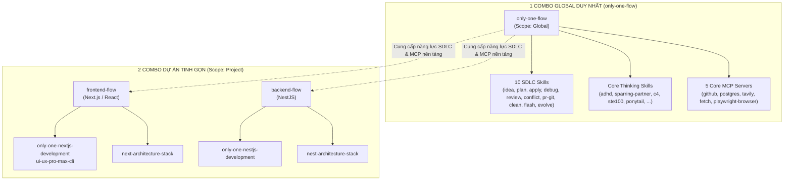

# Concept: Tái Cấu Trúc Hệ Thống Thành Đúng 3 Combo Duy Nhất (1 Global + 2 Project)

## 1. Problem & Goal

### Problem (Current Bottlenecks & Deficiencies)
- **Context & Trigger**: Người dùng cấu hình agent trong IDE qua lệnh `only-one init` hoặc `only-one combo`.
- **Symptom & Defect**: Hệ thống phân mảnh thành 5 combo (`frontend-flow`, `backend-flow`, `only-one-flow`, `mcp-flow`, `git-flow`), trong đó 30+ skills SDLC bị sao chép trùng lặp nhiều lần, còn `git-flow` và `mcp-flow` bị tách rời vụn vặt.
- **Root Cause**: Thiếu kiến trúc tập trung; chưa hợp nhất các công cụ hạ tầng toàn cục (SDLC + MCP + Git) vào một gói duy nhất, khiến các combo theo stack phải mang theo cả bộ kỹ năng dùng chung.
- **Impact / Blast Radius**: Người dùng phải chọn cài nhiều combo liên tiếp (`only-one-flow`, rồi `mcp-flow`, rồi `git-flow`); bảo trì phức tạp và dễ phát sinh lỗi thiếu phụ thuộc.

### Goal (Target Technical Outcomes)
- **Core Goal**: Tái cấu trúc toàn bộ danh mục Combo thành đúng **3 combo duy nhất** trong toàn bộ hệ thống:
  1. **`only-one-flow` (Global)**: Combo toàn năng duy nhất cho môi trường IDE, hợp nhất toàn bộ 10 SDLC skills, bộ kỹ năng tư duy đa năng, và toàn bộ MCP servers thiết yếu.
  2. **`frontend-flow` (Project)**: Combo tinh gọn cấp dự án cho Next.js/React.
  3. **`backend-flow` (Project)**: Combo tinh gọn cấp dự án cho NestJS.
- **Acceptance Criteria**:
  - `only-one-flow`: Sở hữu đầy đủ 10 SDLC skills, thinking skills, và 5 MCPs (`fetch`, `tavily`, `github`, `postgres`, `playwright-browser`).
  - `frontend-flow`: Chỉ chứa `only-one-nextjs-development`, `ui-ux-pro-max-cli` và rule `next-architecture-stack`.
  - `backend-flow`: Chỉ chứa `only-one-nestjs-development` và rule `nest-architecture-stack`.
  - Xóa bỏ hoàn toàn 2 combo rời: `git-flow` và `mcp-flow`.
  - 100% unit tests và combo validation tests vượt qua kiểm tra.

## 2. Scope Boundaries

### In-Scope
- Cập nhật danh mục Combo trong `assets/combos/index.ts`: Giảm từ 5 combo xuống còn đúng 3 combo.
- Chuyển toàn bộ danh sách `mcps` từ `mcp-flow` sang `only-one-flow`.
- Tách bạch phạm vi `scope: 'global'` cho `only-one-flow` và `scope: 'project'` cho `frontend-flow` / `backend-flow`.
- Loại bỏ hoàn toàn sự trùng lặp 30+ skills SDLC trong `frontend-flow` và `backend-flow`.
- Xóa bỏ triệt để định nghĩa và các tham chiếu đến `git-flow` và `mcp-flow`.
- Cập nhật các test suite liên quan (`test/core/combo.test.ts`, `test/commands/combo/combo.test.ts`, v.v.).

### Explicit Out-of-Scope
- Không chỉnh sửa nội dung bên trong các file `SKILL.md` hay code thực thi của các kỹ năng.
- Không thay đổi logic kết nối MCP của các IDE adapters.
- Không tạo thêm framework combo mới ngoài Next.js và NestJS trong task này.

## 3. Proposed Solution & Core Mechanism

### Core Mechanism
Chuyển đổi sang mô hình **"Một Global Duy Nhất + Các Stack Chuyên Biệt" (Single Global Foundation + Pure Stack Specialties)**:
1. **Một Lần Thiết Lập Toàn Cục (`only-one-flow`)**: Người dùng chạy lệnh khởi tạo máy trạm một lần duy nhất. IDE sẽ lập tức có toàn bộ:
   - 10 SDLC skills chuẩn hóa (từ Idea -> Plan -> Apply -> Review -> PR -> Clean -> Evolve).
   - Đầy đủ các MCP servers cần thiết (GitHub, PostgreSQL, Browser, Tavily, Fetch).
   - Bộ kỹ năng tư duy và kỷ luật kỹ thuật (Karpathy STE-100, Ponytail, C4 Diagrams, v.v.).
2. **Thiết Lập Theo Dự Án Cụ Thể (`frontend-flow` / `backend-flow`)**: Khi mở một repo cụ thể, người dùng chỉ nạp đúng tri thức chuyên biệt của framework đó, không bị rác context hay trùng lặp kỹ năng.

### Architectural Diagram

### So Sánh Trước Và Sau Khi Tái Cấu Trúc

| Hạng mục | Trước Refactor (5 Combos) | Sau Refactor (Đúng 3 Combos) |
| :--- | :--- | :--- |
| **Số lượng combo** | 5 (`frontend`, `backend`, `only-one`, `mcp`, `git`) | **3** (`only-one-flow`, `frontend-flow`, `backend-flow`) |
| **Thiết lập Global** | Phải chọn 3 combo (`only-one-flow` + `mcp-flow` + `git-flow`) | **Chỉ cần 1 combo duy nhất (`only-one-flow`)** |
| **Trùng lặp SDLC Skills** | Bị sao chép lặp lại 3 lần trong cả frontend & backend | **0% trùng lặp**; chỉ tồn tại ở `only-one-flow` |
| **Độ tinh gọn của Project Combos** | Nặng nề (~45 items mỗi combo) | Siêu nhẹ (~2-3 items đặc thù theo framework) |

## 4. Critical Risks & Edge Cases

- **Tự động suy luận MCP vs Khai báo MCP trực tiếp**:
  - *Kịch bản*: Trước đây `mcp-flow` chứa `['fetch', 'tavily', 'github', 'postgres', 'playwright-browser']`.
  - *Giải pháp*: `only-one-flow` khai báo trực tiếp mảng `mcps` này. Khi user init global, toàn bộ các MCP server cần thiết sẽ được cấu hình đồng bộ một lượt.
- **Hồi quy kiểm thử combo test**:
  - *Kịch bản*: Các test case tìm kiếm `git-flow` hoặc `mcp-flow` (ví dụ `test/core/combo.test.ts`, `test/commands/combo/combo.test.ts`) sẽ bị fail nếu không cập nhật.
  - *Giải pháp*: Điều chỉnh lại các assertions trong test suite để kiểm tra tính toàn vẹn của mô hình 3 combo mới.
