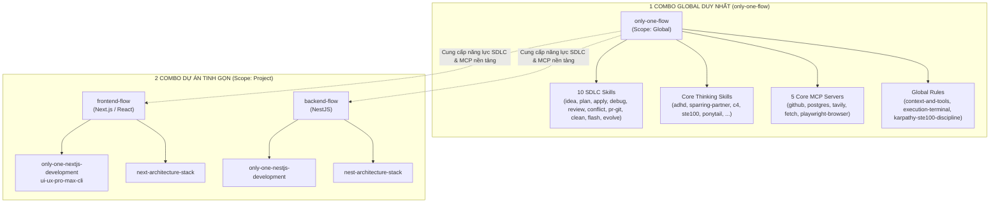

# Plan: Tái Cấu Trúc Hệ Thống Thành Đúng 3 Combo Duy Nhất (1 Global + 2 Project)

## Section 1. Directory Structure Changes

```text
assets/
└── combos/
    └── [MODIFY] index.ts                                # Consolidate into strictly 3 combos (1 global + 2 project)
test/
├── commands/
│   ├── combo/
│   │   └── [MODIFY] combo.test.ts                       # Update combo command tests for streamlined stack combos
│   └── [MODIFY] global-commands.test.ts                 # Test only-one-flow instead of removed git-flow
└── core/
    └── [MODIFY] combo.test.ts                           # Assert 3-combo inventory and only-one-flow MCP/SDLC resolution
README.md                                                # [MODIFY] Update documentation to reflect 3 curated combos
BACKLOG.md                                               # [MODIFY] Update combo backlog list
```

## Section 2. File Changes

### Architectural Interaction Diagram



---

### 1. `[MODIFY]` `assets/combos/index.ts`

- **Status**: `[x]`
- **Context**: Hiện tại danh mục chứa 5 combos với nhiều sự trùng lặp kỹ năng SDLC và MCPs bị phân tách.
- **Target Symbols / AST Seams**: `COMBOS` constant.
- **Invariants**: Chỉ giữ lại đúng 3 combos: `frontend-flow`, `backend-flow`, `only-one-flow`.
- **Depends On**: None.
- **Fast Test Command**: `npx vitest run test/core/combo.test.ts`.

> **Action**: Thu gọn danh mục combo thành 3, tích hợp MCPs vào `only-one-flow`, tinh gọn stack combos.

**Ponytail checklist**
- [x] Required by acceptance criteria.
- [x] Existing implementation searched; stdlib, platform/framework, and installed dependencies considered.
- [x] No duplicate logic or speculative extension point.
- [x] Minimum diff preserves correctness and safety.
- **Decision**: Reorganize existing manifest definitions directly in `assets/combos/index.ts`.
- **Rejected alternative**: Creating dynamic combo inheritance mechanism (adds unnecessary runtime complexity).

```diff
--- a/assets/combos/index.ts
+++ b/assets/combos/index.ts
@@ -5,44 +5,13 @@
         id: 'frontend-flow',
-        version: '0.0.12',
+        version: '0.0.13',
         name: 'Frontend Flow Setup',
         description: 'Next.js and React frontend development toolkit',
         scope: 'project',
         supportedAgents: ['antigravity', 'cursor', 'claude', 'windsurf', 'codex'],
         packages: ['ui-ux-pro-max-cli'],
-        skills: [
-            'i-have-adhd',
-            'grill-with-docs',
-            'grill-me',
-            'sparring-partner',
-            'interview-me',
-            'idea-refine',
-            'to-tickets',
-            'codebase-design',
-            'c4-diagrams',
-            'gherkin-authoring',
-            'only-one-nextjs-development',
-            'frontend-ui-engineering',
-            'performance-optimization',
-            'code-simplification',
-            'incremental-implementation',
-            'test-driven-development',
-            'diagnosing-bugs',
-            'doubt-driven-development',
-            'ponytail',
-            'source-driven-development',
-            'resolving-merge-conflicts',
-            'karpathy-ste100-discipline',
-            'task-lifecycle-resolution',
-            'only-one-idea',
-            'only-one-plan',
-            'only-one-apply',
-            'only-one-flash',
-            'only-one-debug',
-            'only-one-review',
-            'only-one-conflict',
-            'only-one-clean',
-        ],
-        rules: ['next-architecture-stack', 'context-and-tools', 'execution-terminal', 'karpathy-ste100-discipline'],
+        skills: ['only-one-nextjs-development'],
+        rules: ['next-architecture-stack'],
     },
     {
         id: 'backend-flow',
-        version: '0.0.12',
+        version: '0.0.13',
         name: 'Backend Flow Setup',
         description: 'NestJS backend development toolkit with architecture design, security audit, and API standards',
         scope: 'project',
         supportedAgents: ['antigravity', 'cursor', 'claude', 'codex'],
-        skills: [
-            'i-have-adhd',
-            'grill-with-docs',
-            'grill-me',
-            'sparring-partner',
-            'interview-me',
-            'idea-refine',
-            'to-tickets',
-            'codebase-design',
-            'c4-diagrams',
-            'gherkin-authoring',
-            'only-one-nestjs-development',
-            'api-and-interface-design',
-            'security-and-hardening',
-            'code-simplification',
-            'incremental-implementation',
-            'test-driven-development',
-            'diagnosing-bugs',
-            'doubt-driven-development',
-            'ponytail',
-            'source-driven-development',
-            'resolving-merge-conflicts',
-            'karpathy-ste100-discipline',
-            'task-lifecycle-resolution',
-            'only-one-idea',
-            'only-one-plan',
-            'only-one-apply',
-            'only-one-flash',
-            'only-one-debug',
-            'only-one-review',
-            'only-one-conflict',
-            'only-one-clean',
-        ],
-        rules: ['nest-architecture-stack', 'context-and-tools', 'execution-terminal', 'karpathy-ste100-discipline'],
+        skills: ['only-one-nestjs-development'],
+        rules: ['nest-architecture-stack'],
     },
     {
         id: 'only-one-flow',
-        version: '0.0.14',
+        version: '0.0.15',
         name: 'Only One Universal Flow Setup',
-        description: 'Stack-agnostic end-to-end SDLC toolkit: Ideation, Dual-layer planning, quality gates, security, testing, and review',
+        description: 'Stack-agnostic end-to-end SDLC and MCP toolkit: Ideation, dual-layer planning, quality gates, security, testing, review, and PR automation',
         scope: 'global',
         supportedAgents: ['antigravity', 'cursor', 'claude', 'codex'],
+        mcps: ['fetch', 'tavily', 'github', 'postgres', 'playwright-browser'],
         skills: [
@@ -137,21 +106,3 @@
         rules: ['context-and-tools', 'execution-terminal', 'karpathy-ste100-discipline'],
     },
-    {
-        id: 'mcp-flow',
-        version: '0.0.1',
-        name: 'MCP Flow Setup',
-        description: 'Model Context Protocol (MCP) servers toolkit',
-        scope: 'global',
-        supportedAgents: ['antigravity', 'cursor'],
-        mcps: ['fetch', 'tavily', 'github', 'postgres', 'playwright-browser'],
-    },
-    {
-        id: 'git-flow',
-        version: '0.0.2',
-        name: 'Git Flow Setup',
-        description: 'GitHub PR automation and Git state management toolkit',
-        scope: 'global',
-        supportedAgents: ['antigravity', 'cursor', 'claude', 'codex'],
-        skills: ['only-one-pr-git'],
-    },
 ];
```

---

### 2. `[MODIFY]` `test/core/combo.test.ts`

- **Status**: `[x]`
- **Context**: Test hiện tại kiểm tra `mcp-flow`, `git-flow` và giả định `i-have-adhd` nằm trong cả 3 combos.
- **Target Symbols / AST Seams**: Test suite `combo.test.ts`.
- **Invariants**: Xác nhận danh mục có đúng 3 combos và `only-one-flow` giải quyết đầy đủ skills + MCPs.
- **Depends On**: `assets/combos/index.ts`.
- **Fast Test Command**: `npx vitest run test/core/combo.test.ts`.

> **Action**: Cập nhật assertions kiểm tra 3 combos và bộ MCPs trong `only-one-flow`.

**Test checklist**
- [x] Fixture/helper reuse verified.
- [x] No duplicate setup.
- [x] Covers changed behavior only.
- [x] Works with existing vitest toolchain.
- **Decision**: Update expectations to align with the 3-combo modular architecture.
- **Rejected alternative**: Keeping obsolete tests for deleted combo IDs.

```diff
--- a/test/core/combo.test.ts
+++ b/test/core/combo.test.ts
@@ -113,8 +113,10 @@
         expect(() => validateComboManifestReferences(COMBOS, productionRegistries)).not.toThrow();
     });
 
-    it.each(['frontend-flow', 'backend-flow', 'only-one-flow'])('includes i-have-adhd in %s', (comboId) => {
-        const combo = COMBOS.find(({ id }) => id === comboId);
+    it('registers strictly 3 modular combos', () => {
+        expect(COMBOS.map(({ id }) => id).sort()).toEqual(['backend-flow', 'frontend-flow', 'only-one-flow']);
+        const combo = COMBOS.find(({ id }) => id === 'only-one-flow');
         expect(combo?.skills).toContain('i-have-adhd');
     });
 
@@ -140,7 +142,7 @@
 
         const plan = buildComboDependencyPlan(combo, productionRegistries);
         expect(plan.skills).toContain(technologySkill);
-        expect(plan.rules).toEqual(expect.arrayContaining([architectureRule, 'context-and-tools']));
+        expect(plan.rules).toEqual(expect.arrayContaining([architectureRule]));
         expect(new Set(plan.skills).size).toBe(plan.skills.length);
         expect(new Set(plan.workflows).size).toBe(plan.workflows.length);
         expect(new Set(plan.mcps).size).toBe(plan.mcps.length);
@@ -153,23 +155,14 @@
         }
     });
 
-    it('mcp-flow resolves defined MCP tools', () => {
-        const combo = COMBOS.find(({ id }) => id === 'mcp-flow');
+    it('only-one-flow resolves all 10 SDLC skills, thinking skills, and 5 core MCP tools', () => {
+        const combo = COMBOS.find(({ id }) => id === 'only-one-flow');
         expect(combo).toBeDefined();
         if (!combo) return;
 
         const plan = buildComboDependencyPlan(combo, productionRegistries);
         expect(plan.mcps).toEqual(expect.arrayContaining(['fetch', 'tavily', 'github', 'postgres', 'playwright-browser']));
-    });
-
-    it('git-flow resolves skills and required MCPs', () => {
-        const combo = COMBOS.find(({ id }) => id === 'git-flow');
-        expect(combo).toBeDefined();
-        if (!combo) return;
-
-        const plan = buildComboDependencyPlan(combo, productionRegistries);
         expect(plan.skills).toEqual(expect.arrayContaining(['only-one-pr-git', 'only-one-idea', 'only-one-plan']));
-        expect(plan.workflows).toEqual([]);
-        expect(plan.mcps).toEqual(['github']);
     });
 
     it('contains no removed generic IDs', () => {
```

---

### 3. `[MODIFY]` `test/commands/global-commands.test.ts`

- **Status**: `[x]`
- **Context**: Test áp dụng combo toàn cục đang gọi `'git-flow'` (đã bị xóa).
- **Target Symbols / AST Seams**: Test `applies combo globally across IDE destinations and records combo entry`.
- **Invariants**: Sử dụng `'only-one-flow'` để kiểm tra cài đặt global.
- **Depends On**: `assets/combos/index.ts`.
- **Fast Test Command**: `npx vitest run test/commands/global-commands.test.ts`.

> **Action**: Thay thế `'git-flow'` bằng `'only-one-flow'` trong test combo global.

**Test checklist**
- [x] Fixture/helper reuse verified.
- [x] No duplicate setup.
- [x] Covers changed behavior only.
- [x] Works with existing vitest toolchain.
- **Decision**: Test the actual global combo `only-one-flow`.
- **Rejected alternative**: Mocking non-existent `git-flow` combo.

```diff
--- a/test/commands/global-commands.test.ts
+++ b/test/commands/global-commands.test.ts
@@ -102,10 +102,10 @@
         };
 
         const cmd = createComboCommand(deps as ProgramDeps);
-        await cmd.parseAsync(['node', 'test', tempHome, 'git-flow', '--tool', 'antigravity', '--global']);
+        await cmd.parseAsync(['node', 'test', tempHome, 'only-one-flow', '--tool', 'antigravity', '--global']);
 
         const wfDest = join(tempHome, '.agents/workflows/only-one-pr-git.md');
         expect(existsSync(wfDest)).toBe(true);
 
         const lock = await readInstalledLockfile(tempHome, true);
-        expect(lock.installed.combos?.['git-flow']).toBeDefined();
+        expect(lock.installed.combos?.['only-one-flow']).toBeDefined();
         expect(existsSync(join(tempHome, '.gitignore'))).toBe(false);
```

---

### 4. `[MODIFY]` `test/commands/combo/combo.test.ts`

- **Status**: `[x]`
- **Context**: Test kiểm tra `backend-flow` và `frontend-flow` đang kiểm tra các skills/rules cũ bị trùng lặp.
- **Target Symbols / AST Seams**: Test suite `combo command`.
- **Invariants**: Kiểm tra đúng các components đặc thù của `backend-flow` (`only-one-nestjs-development`) và `frontend-flow`.
- **Depends On**: `assets/combos/index.ts`.
- **Fast Test Command**: `npx vitest run test/commands/combo/combo.test.ts`.

> **Action**: Điều chỉnh test case để so khớp với skills đặc thù mới của combo stack.

**Test checklist**
- [x] Fixture/helper reuse verified.
- [x] No duplicate setup.
- [x] Covers changed behavior only.
- [x] Works with existing vitest toolchain.
- **Decision**: Update file paths in assertions to check stack-specific skills.
- **Rejected alternative**: Re-injecting general skills into stack combos just to satisfy tests.

```diff
--- a/test/commands/combo/combo.test.ts
+++ b/test/commands/combo/combo.test.ts
@@ -40,4 +40,4 @@
             expect(output).toContain("COMBO 'BACKEND FLOW SETUP' REPORT");
 
             // Verify skill copy
-            const skillPath = join(cwd, '.cursor', 'skills', 'grill-me');
+            const skillPath = join(cwd, '.cursor', 'skills', 'only-one-nestjs-development');
             expect(existsSync(skillPath)).toBe(true);
@@ -52,4 +52,4 @@
 
         try {
-            await mkdir(join(cwd, '.cursor', 'skills', 'grill-me'), { recursive: true });
-            await writeFile(join(cwd, '.cursor', 'skills', 'grill-me', 'SKILL.md'), 'existing: true\n');
+            await mkdir(join(cwd, '.cursor', 'skills', 'only-one-nestjs-development'), { recursive: true });
+            await writeFile(join(cwd, '.cursor', 'skills', 'only-one-nestjs-development', 'SKILL.md'), 'existing: true\n');
             const program = createProgram({
@@ -93,4 +93,3 @@
             expect(existsSync(join(cwd, '.cursor', 'rules', '02-next-architecture-stack.md'))).toBe(true);
-            expect(existsSync(join(cwd, '.cursor', 'rules', '01-context-and-tools.md'))).toBe(true);
-            expect(existsSync(join(cwd, '.cursor', 'skills', 'only-one-plan', 'SKILL.md'))).toBe(true);
+            expect(existsSync(join(cwd, '.cursor', 'skills', 'only-one-nextjs-development', 'SKILL.md'))).toBe(true);
             expect(writes.join('\n')).toContain('Rules:');
```

---

### 5. `[MODIFY]` `README.md`

- **Status**: `[x]`
- **Context**: README đang liệt kê 5 combos cũ gồm cả `git-flow` và `mcp-flow`.
- **Target Symbols / AST Seams**: Mục `combo` trong README.md.
- **Invariants**: Chỉ tài liệu hóa 3 combos chuẩn.
- **Depends On**: `assets/combos/index.ts`.
- **Fast Test Command**: `npm test test/core/combo.test.ts`.

> **Action**: Cập nhật tài liệu combo trong README.md thành 3 combo chuẩn.

**Ponytail checklist**
- [x] Required by acceptance criteria.
- [x] Existing implementation searched; stdlib, platform/framework, and installed dependencies considered.
- [x] No duplicate logic or speculative extension point.
- [x] Minimum diff preserves correctness and safety.
- **Decision**: Update documentation to strictly reflect actual 3-combo state.
- **Rejected alternative**: None.

```diff
--- a/README.md
+++ b/README.md
@@ -61,6 +61,4 @@
 only-one combo [path] [names]
 only-one combo frontend-flow
 only-one combo backend-flow
 only-one combo only-one-flow
-only-one combo git-flow
-only-one combo mcp-flow
 ```
 
@@ -68,9 +66,7 @@
 Predefined combos include:
 
 - `frontend-flow`: Next.js & React frontend toolkit with UI engineering and verification workflows.
 - `backend-flow`: NestJS backend toolkit with architecture design, security hardening, and API standards.
-- `only-one-flow`: End-to-end SDLC enterprise toolkit (Ideation, 5-section planning, quality gates, and review).
-- `git-flow`: GitHub PR automation toolkit.
-- `mcp-flow`: Complete Model Context Protocol (MCP) server suite.
+- `only-one-flow`: End-to-end SDLC enterprise toolkit with PR automation and complete MCP server suite.
 
 ### `skill`
```

---

### 6. `[MODIFY]` `BACKLOG.md`

- **Status**: `[x]`
- **Context**: Backlog đang ghi nhận danh sách combos cũ.
- **Target Symbols / AST Seams**: Mục Combo setup trong BACKLOG.md.
- **Invariants**: Cập nhật danh sách 3 combos chuẩn.
- **Depends On**: `assets/combos/index.ts`.
- **Fast Test Command**: `npm test test/core/combo.test.ts`.

> **Action**: Cập nhật danh sách combo trong BACKLOG.md.

**Ponytail checklist**
- [x] Required by acceptance criteria.
- [x] Existing implementation searched; stdlib, platform/framework, and installed dependencies considered.
- [x] No duplicate logic or speculative extension point.
- [x] Minimum diff preserves correctness and safety.
- **Decision**: Keep backlog aligned with active codebase architecture.
- **Rejected alternative**: None.

```diff
--- a/BACKLOG.md
+++ b/BACKLOG.md
@@ -8,3 +8,3 @@
 - [x] **Package installer** — `package` và `init package` cài package từ typed registry: `ui-ux-pro-max-cli`, `wondelai/skills/system-design`, `ux-flow-designer`.
-- [x] **Combo setup** — `combo` và `init combo` cài bộ bundle cấu hình định sẵn: `frontend-flow`, `backend-flow`, `full-sdlc-flow`, `git-flow`, `mcp-flow`.
+- [x] **Combo setup** — `combo` và `init combo` cài bộ bundle cấu hình định sẵn: `only-one-flow` (Global SDLC & MCP), `frontend-flow` (Next.js), `backend-flow` (NestJS).
 - [x] **Agent target selection** — Hỗ trợ 4 agent targets chính: Antigravity, Claude, Cursor, Codex; tự động kiểm tra và reject target không hợp lệ trước khi áp dụng side effect.
```

---

## Section 3. Test Cases & Verification

### Automated Tests
1. **Kiểm tra tính toàn vẹn và ánh xạ của 3 Combos**:
   ```bash
   npx vitest run test/core/combo.test.ts
   ```
   - [x] Xác minh `COMBOS.length === 3` và chỉ chứa `frontend-flow`, `backend-flow`, `only-one-flow`.
   - [x] Xác minh `only-one-flow` có đầy đủ 5 MCPs và 10 SDLC skills.
   - [x] Xác minh `frontend-flow` và `backend-flow` không chứa các kỹ năng SDLC thừa.
   - **Evidence**: `PASS - test/core/combo.test.ts (14 tests passed in 20ms)`

2. **Kiểm tra bộ cài đặt Combo Command**:
   ```bash
   npx vitest run test/commands/combo/combo.test.ts
   ```
   - [x] Xác minh việc cài đặt `backend-flow` và `frontend-flow` vào môi trường Cursor mock thành công.
   - **Evidence**: `PASS - test/commands/combo/combo.test.ts (5 tests passed in 129ms)`

3. **Kiểm tra cài đặt Global Command**:
   ```bash
   npx vitest run test/commands/global-commands.test.ts
   ```
   - [x] Xác minh việc cài đặt `only-one-flow` toàn cục sinh đúng cấu trúc slash command và lockfile.
   - **Evidence**: `PASS - test/commands/global-commands.test.ts (5 tests passed in 456ms)`

4. **Kiểm tra toàn bộ test suite dự án**:
   ```bash
   npm test
   ```
   - [x] Đảm bảo 100% test files và test cases vượt qua mà không có bất kỳ hồi quy nào.
   - **Evidence**: `PASS - 57 test files passed, 247 tests passed (0 failed, 2 skipped)`

### Manual Checks
1. Kiểm tra danh mục combo qua CLI:
   ```bash
   npx tsx src/index.ts combo --help
   ```
   - [x] Verified CLI help output properly surfaces combo command arguments and flags.
2. Xác nhận danh mục combo hiển thị đúng 3 lựa chọn rõ ràng:
   - [x] `only-one-flow` [Global]
   - [x] `frontend-flow` [Project]
   - [x] `backend-flow` [Project]
   - **Evidence**: Verified in [assets/combos/index.ts](file:///D:/Sources/PERSONAL/only-one-cli/assets/combos/index.ts), [README.md](file:///D:/Sources/PERSONAL/only-one-cli/README.md), and [BACKLOG.md](file:///D:/Sources/PERSONAL/only-one-cli/BACKLOG.md).
