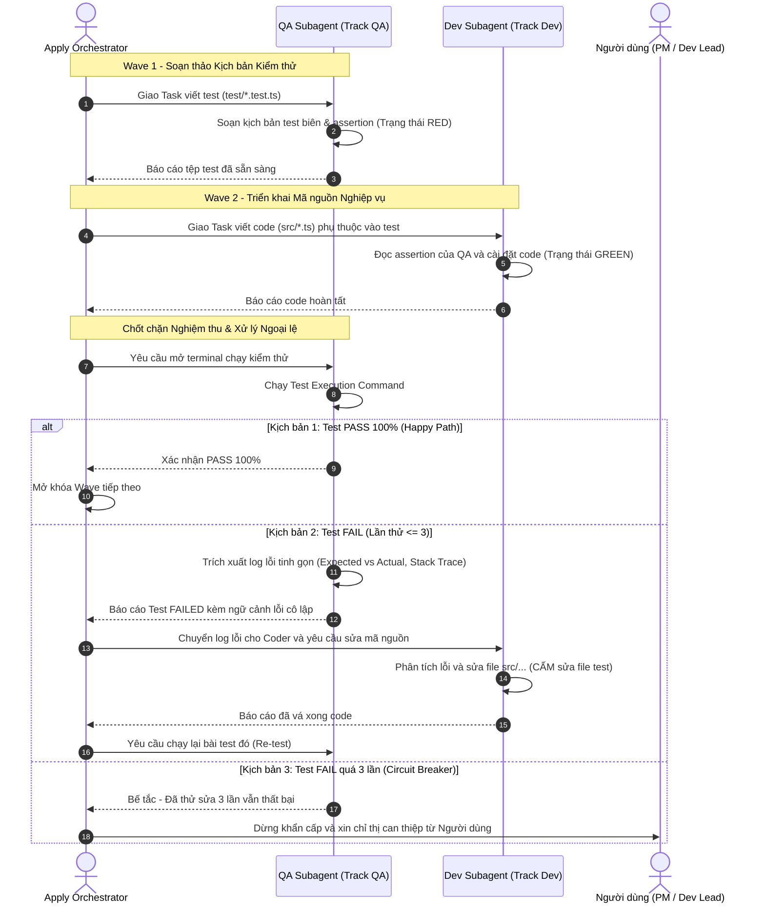

# Concept: Cấu trúc Execution Waves, Phân Tách Coder/Tester Subagents và Luồng Xử lý Test Thất bại trong Only-One Plan

## 1. Problem & Goal (Vấn đề & Mục tiêu)

### Problem (Điểm nghẽn & Thiếu sót hiện tại)
- **Context & Trigger**: Khi chạy `/only-one-plan` thiết kế kế hoạch triển khai cho các tính năng chạm nhiều tệp hoặc đa module.
- **Symptom & Defect**: Section 4 trong `plan.md` liệt kê task phẳng tuần tự; một agent duy nhất vừa viết code vừa tự viết bài test cho chính mình; thiếu hoàn toàn cơ chế phản hồi khi kiểm thử thất bại (Test Failed Loop).
- **Root Cause**: `only-one-plan` thiếu phân tầng đồ thị phụ thuộc (DAG Wave calculation), thiếu phân tách vai trò Coder/Tester, và chưa quy định kịch bản ứng phó khi mã nguồn không vượt qua bài kiểm thử.
- **Impact / Blast Radius**: Phát sinh thiên kiến tự kiểm tra (Confirmation Bias); khi test fail trong thực tế, agent dễ rơi vào bế tắc hoặc tự sửa bài test để ép pass gian lận.

### Goal (Kết quả kỹ thuật mục tiêu)
- **Core Goal**: Bổ sung quy chuẩn phân tầng Execution Waves, mô hình **Builder / Tester Separation**, và **Vòng lặp phản hồi khi Test thất bại (Red Feedback Loop & Circuit Breaker)** vào `only-one-plan`.
- **Acceptance Criteria**:
  - Task block trong Section 4 giữ nguyên cú pháp chuẩn `### <order>. [<ACTION>] <path>` để bảo đảm tương thích ngược 100%.
  - Mọi task block bắt buộc có trường metadata `- **Wave**: <N> (Track <Dev|QA|...>)`.
  - **Phân tách trách nhiệm Builder / Tester**:
    - `Track QA` (Tester Subagent): Độc quyền viết các tệp kiểm thử (`*.test.ts`, `*.spec.ts`) và chạy lệnh nghiệm thu terminal.
    - `Track Dev` (Coder Subagent): Độc quyền viết mã nguồn triển khai (`src/...`) để thỏa mãn kịch bản của QA.
    - Cấm một agent vừa viết code vừa tự viết test cho cùng một tính năng.
  - **Luồng xử lý Test Thất bại (Red Feedback Loop)**:
    - Khi test fail, QA Subagent chỉ trích xuất thông tin lỗi cô lập (tên test case, Expected vs Actual, vị trí dòng gây lỗi) gửi cho Coder Subagent.
    - Coder Subagent chỉ được phép sửa mã nguồn (`src/...`), tuyệt đối cấm sửa tệp kiểm thử của QA.
    - **Cơ chế ngắt mạch (Circuit Breaker)**: Giới hạn tối đa 3 lần thử lại (Coder sửa $\rightarrow$ QA test lại). Nếu quá 3 lần vẫn thất bại, hệ thống dừng khẩn cấp và chuyển giao quyền xử lý cho Người dùng.
  - Section 4 bắt buộc có sơ đồ Mermaid minh họa đầy đủ cả luồng Happy Path (Test Pass) và Failure Path (Test Fail / Retry / Circuit Breaker).
  - Cập nhật script `validate-plan.ts` để kiểm tra tính hợp lệ của trường `Wave`, `Track QA`, `Track Dev` và ràng buộc phụ thuộc DAG.

## 2. Scope Boundaries (Ranh giới phạm vi)

- **In-Scope**:
  - Chuẩn hóa đặc tả Section 4 trong `only-one-plan` (SKILL.md) với metadata `- **Wave**: <N> (Track <Dev|QA>)`.
  - Thiết lập quy tắc phân tách Builder/Tester: tệp test gán cho `Track QA`, tệp code gán cho `Track Dev`.
  - Quy định đặc tả luồng Red Feedback Loop và Circuit Breaker (tối đa 3 lần retries) trong tài liệu kỹ năng.
  - Bổ sung sơ đồ tương tác Sequence hoàn chỉnh (Happy Path & Failure Path) ở đầu Section 4.
  - Nâng cấp `validate-plan.ts` để kiểm tra phân luồng Track và phát hiện lỗi đảo ngược phụ thuộc giữa các Wave.
  - Viết test suites kiểm tra tính toàn vẹn của mô hình phân Wave và phân tách Track.
- **Explicit Out-of-Scope**:
  - Chưa can thiệp vào logic thực thi của `/only-one-apply` (sẽ triển khai runner đa tiến trình trong task riêng tiếp theo).
  - Không thay đổi cú pháp đề mục cấp 3 `### <order>. [<ACTION>]` để tránh phá vỡ các công cụ hiện có.

## 3. Proposed Solution & Core Mechanism (Giải pháp đề xuất & Cơ chế cốt lõi)

- **Core Mechanism**:
  - Khi lập kế hoạch, `/only-one-plan` phân tích đồ thị phụ thuộc DAG và chia task thành các `Wave 1, Wave 2...`.
  - **Chu trình phối hợp giữa QA Subagent và Coder Subagent**:
    1. **QA Subagent (`Track QA`)**: Viết tệp test trước (Pragmatic TDD Red State) dựa trên Acceptance Criteria.
    2. **Coder Subagent (`Track Dev`)**: Đọc kịch bản test của QA và viết mã nguồn triển khai để biến test từ Red sang Green.
    3. **Chốt chặn Nghiệm thu & Vòng lặp Test Thất bại**: QA Subagent mở terminal chạy test. Nếu Pass $\rightarrow$ Mở khóa Wave tiếp theo. Nếu Fail $\rightarrow$ Kích hoạt Red Feedback Loop (tối đa 3 lần) trước khi ngắt mạch hỏi Người dùng.

- **Sơ đồ Phối hợp Builder / Tester Subagents & Xử lý Ngoại lệ Test Fail (Sequence Flow)**:


- **Mẫu hiển thị Task Block chuẩn trong Section 4**:
```text
### 1. `[NEW]` `test/modules/order/order.service.test.ts`

- **Status**: `[ ]`
- **Task Type**: `code`
- **Wave**: `1 (Track QA)`
- **Depends On**: None.
- **Context**: Soạn kịch bản kiểm thử độc lập cho OrderService theo TDD.
- **Target Symbols / AST Seams**: `describe('OrderService')`.
- **Invariants**: Do QA Subagent viết, bao phủ cả Happy Path và Boundary Cases.

### 2. `[MODIFY]` `src/modules/order/order.service.ts`

- **Status**: `[ ]`
- **Task Type**: `code`
- **Wave**: `2 (Track Dev)`
- **Depends On**: ### 1.
- **Context**: Triển khai logic nghiệp vụ để thỏa mãn toàn bộ bài test của QA.
- **Target Symbols / AST Seams**: `OrderService.createOrder`.
- **Invariants**: Do Coder Subagent viết, biến bài test từ Red sang Green.
```

## 4. Critical Risks & Edge Cases (Phân tích Rủi ro & Cơ chế Phòng vệ)

- **Rủi ro 1: Lặp vô tận giữa QA và Coder khi test liên tục thất bại (Ping-Pong Loop)**
  - *Mặt tiêu cực / Nguy cơ*: Coder sửa không đúng, QA test lại fail, liên tục lặp lại làm cạn kiệt token và gây treo tiến trình.
  - *Cơ chế phòng vệ*: Thiết lập **Circuit Breaker** với ngưỡng cứng tối đa 3 lần thử lại (`maxRetries = 3`). Nếu lần thứ 3 vẫn fail, hệ thống lập tức dừng lại, bảo lưu hiện trạng và kích hoạt cổng leo thang (Escalation Gate) hỏi ý kiến Người dùng.
- **Rủi ro 2: Coder Subagent tự ý sửa tệp test của QA Subagent để ép test pass**
  - *Mặt tiêu cực / Nguy cơ*: Coder sửa assertions của test thay vì sửa mã nguồn, làm mất tính trung thực của kiểm thử.
  - *Cơ chế phòng vệ*: Ràng buộc phân quyền: Coder Subagent (`Track Dev`) chỉ được cấp quyền sửa đổi các tệp mã nguồn (`src/...`), cấm sửa tệp trong thư mục `test/`.
- **Rủi ro 3: Khai báo Wave mâu thuẫn với `Depends On`**
  - *Mặt tiêu cực / Nguy cơ*: Task thuộc Wave 1 phụ thuộc vào task thuộc Wave 2, gây deadlock khi Subagents điều phối.
  - *Cơ chế phòng vệ*: Thuật toán kiểm tra DAG trong `validate-plan.ts`: nếu Task A thuộc Wave $N$ phụ thuộc Task B, thì Task B bắt buộc phải thuộc Wave $< N$.
- **Rủi ro 4: Xung đột tệp giữa các Tracks trong cùng một Wave**
  - *Mặt tiêu cực / Nguy cơ*: Hai Subagents trong cùng một Wave cùng sửa chung một file, gây ghi đè code.
  - *Cơ chế phòng vệ*: Ràng buộc bất biến trong `validate-plan.ts`: Các task trong cùng một Wave không được phép trùng `filePath`.
- **Rủi ro 5: Phá vỡ tính tương thích ngược với các plan hiện có**
  - *Mặt tiêu cực / Nguy cơ*: Các plan cũ không có trường `Wave` hoặc `Track` bị báo lỗi toàn bộ.
  - *Cơ chế phòng vệ*: Thiết lập chế độ tương thích trong validator: nếu thiếu `Wave`, mặc định coi là `Wave 1 (Sequential)` và phát cảnh báo Warning nhẹ thay vì chặn Error.
