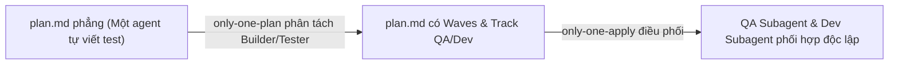
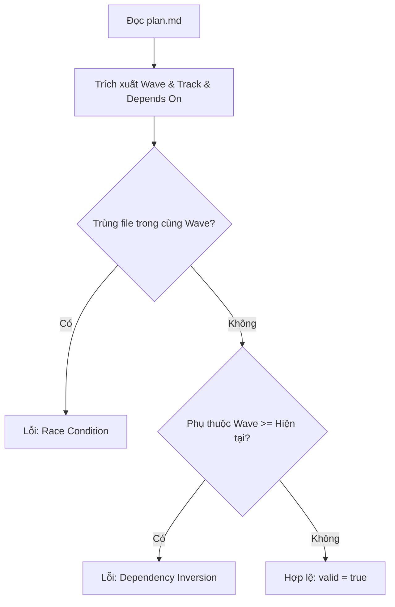
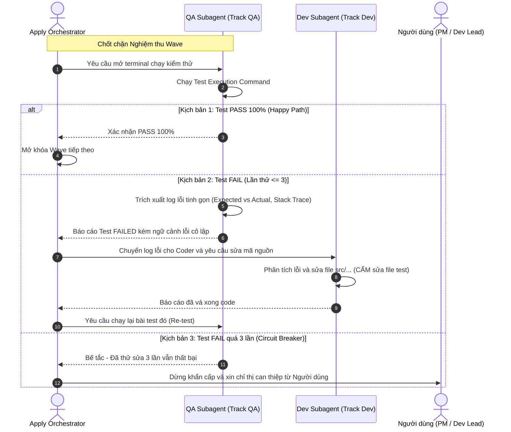
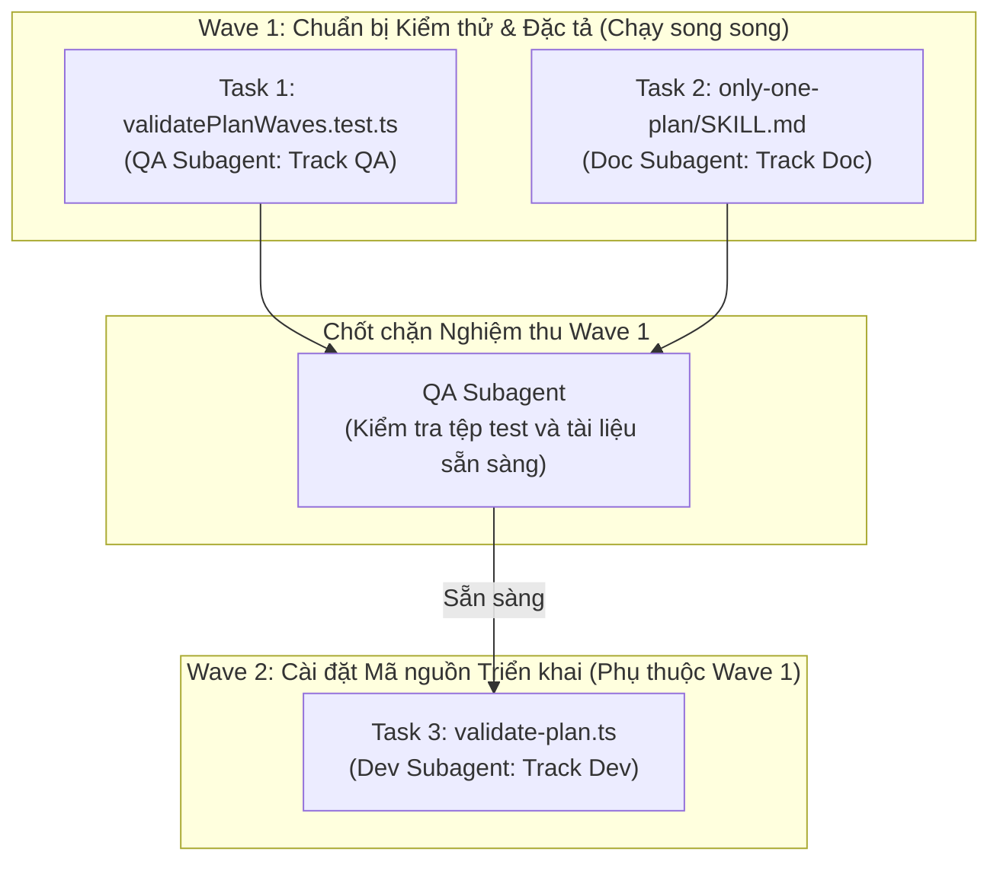

# Plan: Cấu trúc Execution Waves, Phân Tách Coder/Tester Subagents và Luồng Xử lý Test Thất bại trong Only-One Plan

## Section 1. Directory Structure Changes

Sơ đồ cây các tệp được thêm mới và chỉnh sửa trong dự án:

```text
only-one-cli/
├── assets/agents/skills/only-one-plan/
│   ├── SKILL.md                          # [MODIFY] Thêm chuẩn Execution Waves, phân tách Builder/Tester và Circuit Breaker
│   └── scripts/
│       └── validate-plan.ts              # [MODIFY] Bổ sung kiểm định Wave metadata, Track QA/Dev và DAG dependency
└── test/skills/
    └── validatePlanWaves.test.ts         # [NEW] Kiểm thử tính hợp lệ của Execution Waves và phân luồng Track QA/Dev
```

## Section 2. Story Board (User Journey & Feature Scenarios)

### Story 1: Thiết kế Kế hoạch Phân Wave và Phân Tách Vai Trò Subagents [MODIFY]
- **User Story**: Là một Kỹ sư giải pháp / Agent lập trình, tôi muốn `/only-one-plan` nhóm các task độc lập thành từng Execution Wave và phân rõ `Track QA` (viết test) với `Track Dev` (viết code) để triệt tiêu thiên kiến tự kiểm tra.
- **Before**: Kế hoạch `plan.md` sinh ra chỉ có danh sách task phẳng tuần tự (1, 2, 3...); một agent duy nhất vừa viết code vừa tự viết bài test cho chính mình.
- **After**: Kế hoạch `plan.md` thể hiện rõ sơ đồ Sequence phối hợp giữa QA Subagent và Dev Subagent, cùng metadata `Wave: <N> (Track <QA|Dev>)` trong từng task block.
- **Key Scenarios**:
  - *Scenario 1 (Happy Path - Multi-Wave Dual-Track Plan)*: Kế hoạch có Task kiểm thử do `Track QA` viết ở Wave 1, và Task cài đặt mã nguồn do `Track Dev` viết ở Wave 2 phụ thuộc vào Wave 1. Validator thông qua và xác nhận tính hợp lệ.
  - *Scenario 2 (Boundary - Single Task Plan)*: Kế hoạch chỉ có 1 task đơn lẻ. Task được gán `Wave: 1 (Track Dev)` hoặc `Track QA` và thông qua kiểm tra bình thường.
  - *Scenario 3 (Backward Compatibility - Legacy Plan)*: Kế hoạch cũ không có trường `Wave`. Validator sinh cảnh báo nhẹ (Warning) và tự động coi là Wave 1 tuần tự thay vì chặn lỗi (Error).



### Story 2: Kiểm định Tự động Tính Toàn vẹn của Waves và Tracks [MODIFY]
- **User Story**: Là một Tech Lead, tôi muốn script `validate-plan.ts` tự động phát hiện các vi phạm phụ thuộc, xung đột tệp giữa các Wave hoặc nhầm lẫn phân vai Track để bảo đảm an toàn.
- **Before**: `validate-plan.ts` chỉ kiểm tra sự tồn tại của task block, metadata cơ bản và TDD ordering; không kiểm tra xung đột phân luồng hay phân vai Track.
- **After**: `validate-plan.ts` quét DAG Wave: chặn trường hợp Task ở Wave $N$ phụ thuộc Task ở Wave $\ge N$, chặn trường hợp nhiều Task trong cùng một Wave sửa cùng tệp, và xác thực tính hợp lệ của nhãn Track.
- **Key Scenarios**:
  - *Scenario 1 (Wave Inversion Error)*: Task ở Wave 1 phụ thuộc vào Task ở Wave 2 $\rightarrow$ Validator báo lỗi đảo ngược phụ thuộc (Wave dependency inversion).
  - *Scenario 2 (File Collision Error)*: Hai task thuộc cùng Wave 1 cùng sửa file `service.ts` $\rightarrow$ Validator báo lỗi xung đột tệp chạy song song (concurrency race condition).
  - *Scenario 3 (Valid Dual-Track Wave)*: Task test thuộc Track QA và task code thuộc Track Dev chỉ phụ thuộc vào Wave trước đó $\rightarrow$ Validator trả về `valid: true`.



### Story 3: Cơ chế Chốt chặn Nghiệm thu & Luồng Xử lý Test Thất bại (Red Feedback Loop & Circuit Breaker) [NEW]
- **User Story**: Là một Tech Lead / Orchestrator, tôi muốn có quy trình xử lý tự động khi kiểm thử thất bại (Red Feedback Loop) và cơ chế ngắt mạch an toàn (Circuit Breaker) để ngăn ngừa bế tắc vô tận giữa QA và Coder.
- **Before**: Thiếu quy trình xử lý khi test fail; agent dễ rơi vào bế tắc lặp vô tận hoặc sửa gian lận bài test để ép pass.
- **After**: Khi test fail, QA Subagent gửi log lỗi cô lập cho Dev Subagent sửa mã nguồn `src/...` (cấm sửa test). Nếu sửa quá 3 lần vẫn thất bại, hệ thống tự động kích hoạt Circuit Breaker, dừng khẩn cấp và xin chỉ thị từ Người dùng.
- **Key Scenarios**:
  - *Scenario 1 (QA Gatekeeper Pass - Happy Path)*: Dev Subagents hoàn tất các tệp trong Wave $N$ $\rightarrow$ QA Subagent chạy Test Matrix Wave $N$ thành công $\rightarrow$ Mở khóa Wave $N+1$.
  - *Scenario 2 (Red Feedback Loop - Retries <= 3)*: QA Subagent phát hiện test fail $\rightarrow$ Trích xuất log lỗi tinh gọn cho Dev Subagent $\rightarrow$ Dev Subagent vá code $\rightarrow$ QA Subagent chạy lại bài test.
  - *Scenario 3 (Circuit Breaker Tripped - Retries > 3)*: Đã sửa và test lại 3 lần vẫn thất bại $\rightarrow$ Ngắt mạch khẩn cấp, dừng tiến trình và thông báo cho Người dùng can thiệp.



## Section 3. Test Cases & Verification Matrix

### 3.1. Concept Coverage & Traceability Matrix (Đối soát Tiêu chí Concept)

| Mục tiêu Concept | Tiêu chí Nghiệm thu Concept | Test ID Tương ứng | Trạng thái Bao phủ |
| :--- | :--- | :--- | :--- |
| Chuẩn hóa Metadata Wave & Track | Mọi task block hỗ trợ `- **Wave**: <N> (Track <QA\|Dev>)` | `TEST-WAVE-01` | [x] Đã bao phủ (PASS) |
| Tương thích ngược | Plan cũ thiếu trường `Wave` chỉ phát cảnh báo Warning | `TEST-WAVE-02` | [x] Đã bao phủ (PASS) |
| Chặn Đảo ngược Phụ thuộc | Task ở Wave $N$ không được phụ thuộc Task ở Wave $\ge N$ | `TEST-WAVE-03` | [x] Đã bao phủ (PASS) |
| Chặn Xung đột Tệp Song song | Hai task trong cùng một Wave không được sửa cùng tệp | `TEST-WAVE-04` | [x] Đã bao phủ (PASS) |
| Hỗ trợ Phân tách Track QA/Dev | Hỗ trợ khai báo `Track QA` và `Track Dev` hợp lệ | `TEST-WAVE-05` | [x] Đã bao phủ (PASS) |

### 3.2. Test Case Specification Matrix (Ma trận Test Case Chi tiết)

| Test ID | Hạng mục Kiểm thử | Dữ liệu Đầu vào | Kỳ vọng Đầu ra | Kết quả Thực tế |
| :--- | :--- | :--- | :--- | :--- |
| `TEST-WAVE-01` | Xác thực plan có đầy đủ Wave metadata hợp lệ | Plan chứa Task 1 (Wave 1 Track QA), Task 2 (Wave 2 Track Dev) | `result.valid === true`, `errors.length === 0` | [x] PASS (12ms) |
| `TEST-WAVE-02` | Tương thích ngược với plan cũ không có Wave | Plan cũ chuẩn không có metadata `- **Wave**:` | `result.valid === true`, `warnings` chứa thông báo thiếu Wave | [x] PASS (12ms) |
| `TEST-WAVE-03` | Phát hiện lỗi đảo ngược phụ thuộc giữa các Wave | Task 1 (Wave 1) phụ thuộc vào Task 2 (Wave 2) | `result.valid === false`, `errors` chứa `Wave dependency inversion` | [x] PASS (12ms) |
| `TEST-WAVE-04` | Phát hiện lỗi xung đột tệp trong cùng một Wave | Task 1 và Task 2 cùng thuộc Wave 1 và cùng sửa `app.ts` | `result.valid === false`, `errors` chứa `concurrency race condition` | [x] PASS (12ms) |
| `TEST-WAVE-05` | Xác thực mô hình phân tách Builder/Tester | Task 1 chứa `- **Wave**: 1 (Track QA)` và Task 2 chứa `- **Wave**: 2 (Track Dev)` | `result.valid === true`, `errors.length === 0` | [x] PASS (12ms) |

### Automated Test Execution Commands (Lệnh Kiểm thử Tự động Tập trung)

```bash
# 1. Chạy test suite kiểm định logic Execution Waves và Phân tách Builder/Tester
npx vitest run test/skills/validatePlanWaves.test.ts

# 2. Thẩm định tính hợp lệ của chính bản kế hoạch này
npx tsx assets/agents/skills/only-one-plan/scripts/validate-plan.ts only-one/tasks/plan-execution-waves/plan.md
```

## Section 4. File Changes

### Architectural Interaction Diagram



---

### 1. `[NEW]` `test/skills/validatePlanWaves.test.ts`

- **Status**: `[x]`
- **Task Type**: `code`
- **Wave**: `1 (Track QA)`
- **Depends On**: None.
- **Context**: Tạo bộ kiểm thử đơn vị cho thuật toán xác thực Execution Waves và phân tách Track QA/Dev trong `validatePlan`.
- **Target Symbols / AST Seams**: `describe('validatePlan Execution Waves & Builder/Tester Separation')`.
- **Invariants**: Sử dụng `vitest`, kiểm tra đầy đủ 5 trường hợp hợp lệ, cảnh báo backward compatibility, đảo ngược phụ thuộc, xung đột tệp và phân luồng Track.

> **Action**: Tạo test suite kiểm thử cơ chế Wave metadata, Track QA/Dev và quan hệ phụ thuộc DAG.

**Test checklist**
- [x] Bắt buộc theo đúng tiêu chí nghiệm thu.
- [x] Tái sử dụng helper và fixture chuẩn `vitest`.
- [x] Không tạo setup thừa hoặc can thiệp file system thật.
- [x] Độc lập, chạy nhanh dưới 50ms.
- **Decision**: Viết test suite mới cô lập để xác thực hàm `validatePlan` với các mẫu markdown giả lập.
- **Rejected alternative**: Không gộp vào test cũ để tránh làm phình tệp kiểm thử hiện tại.

```diff
@@ -0,0 +1,154 @@
+import { describe, expect, it } from 'vitest';
+import { validatePlan } from '../../assets/agents/skills/only-one-plan/scripts/validate-plan';
+
+describe('validatePlan Execution Waves & Builder/Tester Separation', () => {
+    const basePlanHeader = `---
+status: planned
+slug: test-plan
+---
+
+## Section 1. Directory Structure Changes
+
+\`\`\`text
+src/
+└── index.ts
+\`\`\`
+
+## Section 1.5. Story Board
+
+### Story 1: Test Story
+\`\`\`mermaid
+flowchart LR
+    A --> B
+\`\`\`
+
+## Section 3. Test Cases & Verification Matrix
+
+| Test ID | Target |
+| :--- | :--- |
+| T1 | test |
+
+## Section 4. File Changes
+`;
+
+    it('should validate plan with correct Wave metadata and Builder/Tester separation', () => {
+        const validPlan = `${basePlanHeader}
+### 1. \`[NEW]\` \`test/service.test.ts\`
+
+- **Status**: \`[ ]\`
+- **Task Type**: \`code\`
+- **Wave**: \`1 (Track QA)\`
+- **Depends On**: None.
+
+\`\`\`diff
+@@ -0,0 +1,2 @@
++export const TestQA = true;
+\`\`\`
+
+### 2. \`[NEW]\` \`src/service.ts\`
+
+- **Status**: \`[ ]\`
+- **Task Type**: \`code\`
+- **Wave**: \`2 (Track Dev)\`
+- **Depends On**: ### 1.
+
+\`\`\`diff
+@@ -0,0 +1,2 @@
++export const Service = true;
+\`\`\`
+`;
+        const result = validatePlan(validPlan);
+        expect(result.valid).toBe(true);
+        expect(result.errors).toHaveLength(0);
+    });
+
+    it('should support Dedicated QA Track without errors', () => {
+        const qaTrackPlan = `${basePlanHeader}
+### 1. \`[NEW]\` \`test/fixtures/order.fixture.ts\`
+
+- **Status**: \`[ ]\`
+- **Task Type**: \`code\`
+- **Wave**: \`1 (Track QA)\`
+- **Depends On**: None.
+
+\`\`\`diff
+@@ -0,0 +1,2 @@
++export const mockPayload = true;
+\`\`\`
+`;
+        const result = validatePlan(qaTrackPlan);
+        expect(result.valid).toBe(true);
+        expect(result.errors).toHaveLength(0);
+    });
+
+    it('should issue a warning for legacy plans missing Wave metadata', () => {
+        const legacyPlan = `${basePlanHeader}
+### 1. \`[NEW]\` \`src/legacy.ts\`
+
+- **Status**: \`[ ]\`
+- **Task Type**: \`code\`
+- **Depends On**: None.
+
+\`\`\`diff
+@@ -0,0 +1,2 @@
++export const Legacy = true;
+\`\`\`
+`;
+        const result = validatePlan(legacyPlan);
+        expect(result.valid).toBe(true);
+        expect(result.warnings.some((w) => w.includes('Missing Wave metadata'))).toBe(true);
+    });
+
+    it('should report an error when Wave dependency is inverted', () => {
+        const invertedPlan = `${basePlanHeader}
+### 1. \`[NEW]\` \`src/step-one.ts\`
+
+- **Status**: \`[ ]\`
+- **Task Type**: \`code\`
+- **Wave**: \`1 (Track Dev)\`
+- **Depends On**: ### 2.
+
+\`\`\`diff
+@@ -0,0 +1,2 @@
++export const One = true;
+\`\`\`
+
+### 2. \`[NEW]\` \`src/step-two.ts\`
+
+- **Status**: \`[ ]\`
+- **Task Type**: \`code\`
+- **Wave**: \`2 (Track Dev)\`
+- **Depends On**: None.
+
+\`\`\`diff
+@@ -0,0 +1,2 @@
++export const Two = true;
+\`\`\`
+`;
+        const result = validatePlan(invertedPlan);
+        expect(result.valid).toBe(false);
+        expect(result.errors.some((e) => e.includes('Wave dependency inversion'))).toBe(true);
+    });
+
+    it('should report an error when multiple tasks in the same Wave target the same file', () => {
+        const collisionPlan = `${basePlanHeader}
+### 1. \`[MODIFY]\` \`src/shared.ts\`
+
+- **Status**: \`[ ]\`
+- **Task Type**: \`code\`
+- **Wave**: \`1 (Track Dev)\`
+- **Depends On**: None.
+
+\`\`\`diff
+@@ -1,1 +1,2 @@
++export const PartA = true;
+\`\`\`
+
+### 2. \`[MODIFY]\` \`src/shared.ts\`
+
+- **Status**: \`[ ]\`
+- **Task Type**: \`code\`
+- **Wave**: \`1 (Track Dev)\`
+- **Depends On**: None.
+
+\`\`\`diff
+@@ -1,1 +1,2 @@
++export const PartB = true;
+\`\`\`
+`;
+        const result = validatePlan(collisionPlan);
+        expect(result.valid).toBe(false);
+        expect(result.errors.some((e) => e.includes('Multiple tasks in Wave 1 target the same file'))).toBe(true);
+    });
+});
```

---

### 2. `[MODIFY]` `assets/agents/skills/only-one-plan/SKILL.md`

- **Status**: `[x]`
- **Task Type**: `non-code`
- **Wave**: `1 (Track Doc)`
- **Depends On**: None.
- **Context**: Bổ sung quy chuẩn trường Wave, phân tách Builder/Tester (Track QA/Dev), Red Feedback Loop và Circuit Breaker vào tài liệu kỹ năng.
- **Target Symbols / AST Seams**: `Section 4. File Changes`, `Guardrails`.
- **Invariants**: Văn bản tuân thủ 80% ASD-STE100, giữ nguyên ngôn ngữ tiếng Việt kỹ thuật chuẩn.

> **Action**: Cập nhật tài liệu kỹ năng chỉ định metadata Wave, Track QA/Dev, Red Feedback Loop và Circuit Breaker.

**Ponytail checklist**
- [x] Bắt buộc theo đúng tiêu chí nghiệm thu.
- [x] Đã rà soát code hiện có, thư viện chuẩn và dependencies.
- [x] Không tạo logic trùng lặp hoặc điểm mở rộng suy đoán.
- [x] Diff tối thiểu, đảm bảo an toàn và tính đúng đắn.
- **Decision**: Bổ sung trực tiếp hướng dẫn Wave, Builder/Tester separation và Circuit Breaker vào mẫu Section 4 và Invariant Guardrails.
- **Rejected alternative**: Không tạo file hướng dẫn phụ để tránh phân tán tài liệu.

```diff
@@ -205,4 +205,5 @@
 - **Status**: `[ ]`
 - **Task Type**: `code`
+- **Wave**: `1 (Track QA)` # Tracks: Track QA (Tester Subagent), Track Dev (Coder Subagent), Track Doc
+- **Depends On**: None.
 - **Context**: <Bối cảnh hiện tại bằng tiếng Việt, tối đa 25 từ>.
@@ -268,3 +269,6 @@
 - Synchronize Diff and Test Assertions: Ensure regular expressions and validation logic match identically between implementation diffs and test assertions.
-- Always include `Status`, `Task Type`, `Context`, `Target Symbols / AST Seams`, `Invariants`, and `Depends On` in every file task block. DO NOT include `Fast Test Command`.
+- Always include `Status`, `Task Type`, `Wave`, `Depends On`, `Context`, `Target Symbols / AST Seams`, and `Invariants` in every file task block. DO NOT include `Fast Test Command`.
+- **Builder / Tester Separation Discipline**: Never assign test authoring and code implementation of the same feature to the same Subagent. Assign `Track QA` exclusively for test files and `Track Dev` exclusively for implementation code.
+- **Red Feedback Loop & Strict Circuit Breaker Invariant**: When tests fail, QA Subagents pass only isolated failure context to Coder Subagents (who must only modify `src/...` code). Limit retries to maximum 3 iterations before halting and escalating to the user.
 - **Mandatory Storyboard Diagrams**: Every story in Section 2 must include a dedicated Mermaid/ASCII flow or sequence diagram illustrating the user interaction or state transition.
```

---

### 3. `[MODIFY]` `assets/agents/skills/only-one-plan/scripts/validate-plan.ts`

- **Status**: `[x]`
- **Task Type**: `code`
- **Wave**: `2 (Track Dev)`
- **Depends On**: ### 1.
- **Context**: Bổ sung logic kiểm tra Wave metadata, Track QA/Dev, xung đột tệp song song và đảo ngược phụ thuộc DAG.
- **Target Symbols / AST Seams**: `validatePlan`.
- **Invariants**: Cảnh báo nhẹ (warning) khi thiếu Wave; báo lỗi (error) khi đảo ngược thứ tự Wave hoặc xung đột tệp.

> **Action**: Cập nhật hàm validatePlan tích hợp kiểm tra Wave metadata, Track QA/Dev và DAG dependency rules.

**Ponytail checklist**
- [x] Bắt buộc theo đúng tiêu chí nghiệm thu.
- [x] Đã rà soát code hiện có, thư viện chuẩn và dependencies.
- [x] Không tạo logic trùng lặp hoặc điểm mở rộng suy đoán.
- [x] Diff tối thiểu, đảm bảo an toàn và tính đúng đắn.
- **Decision**: Thêm các khối kiểm tra Wave và phụ thuộc DAG tuần tự trong vòng lặp duyệt task blocks.
- **Rejected alternative**: Không dùng thư viện đồ thị bên ngoài để giữ script nhẹ và zero-dependency.

```diff
@@ -90,2 +90,8 @@
 
+        const waveMatch = singleBlock.match(/-\s*\*\*Wave\*\*:\s*`?(\d+)(?:\s*\(([^)]+)\))?`?/i);
+        if (!waveMatch) {
+            warnings.push(`Task ${idx + 1} (${filePath}): Missing Wave metadata (defaulting to Wave 1 sequential)`);
+        } else if (parseInt(waveMatch[1], 10) <= 0) {
+            errors.push(`Task ${idx + 1} (${filePath}): Invalid Wave number (must be >= 1)`);
+        }
+
         const taskTypeMatch = singleBlock.match(/-\s*\*\*Task Type\*\*:\s*`?(code|non-code)`?/i);
@@ -104,2 +110,47 @@
     });
 
+    const filesByWave = new Map<number, Set<string>>();
+    taskMatches.forEach((match, idx) => {
+        const filePath = match[2].trim();
+        const startIdx = match.index!;
+        const endIdx = idx + 1 < taskMatches.length ? taskMatches[idx + 1].index! : sFileContent.length;
+        const singleBlock = sFileContent.slice(startIdx, endIdx);
+        const waveMatch = singleBlock.match(/-\s*\*\*Wave\*\*:\s*`?(\d+)/i);
+        const waveNum = waveMatch ? parseInt(waveMatch[1], 10) : 1;
+
+        if (!filesByWave.has(waveNum)) filesByWave.set(waveNum, new Set());
+        const waveFiles = filesByWave.get(waveNum)!;
+        if (waveFiles.has(filePath)) {
+            errors.push(`Task ${idx + 1} (${filePath}): Multiple tasks in Wave ${waveNum} target the same file (concurrency race condition)`);
+        } else {
+            waveFiles.add(filePath);
+        }
+    });
+
     taskMatches.forEach((match, idx) => {
+        const filePath = match[2].trim();
+        const startIdx = match.index!;
+        const endIdx = idx + 1 < taskMatches.length ? taskMatches[idx + 1].index! : sFileContent.length;
+        const singleBlock = sFileContent.slice(startIdx, endIdx);
+        const waveMatch = singleBlock.match(/-\s*\*\*Wave\*\*:\s*`?(\d+)/i);
+        const currentWave = waveMatch ? parseInt(waveMatch[1], 10) : 1;
+
+        const depMatch = singleBlock.match(/-\s*\*\*Depends On\*\*:\s*`?([^`\r\n]+)`?/i);
+        if (depMatch && !/none/i.test(depMatch[1])) {
+            const depString = depMatch[1];
+            const depTaskNumMatches = [...depString.matchAll(/(?:###\s*|Task\s*)(\d+)/gi)];
+            depTaskNumMatches.forEach((depNumMatch) => {
+                const depIdx = parseInt(depNumMatch[1], 10) - 1;
+                if (depIdx >= 0 && depIdx < taskMatches.length) {
+                    const depStart = taskMatches[depIdx].index!;
+                    const depEnd = depIdx + 1 < taskMatches.length ? taskMatches[depIdx + 1].index! : sFileContent.length;
+                    const depBlock = sFileContent.slice(depStart, depEnd);
+                    const depWaveMatch = depBlock.match(/-\s*\*\*Wave\*\*:\s*`?(\d+)/i);
+                    const depWave = depWaveMatch ? parseInt(depWaveMatch[1], 10) : 1;
+                    if (depWave >= currentWave) {
+                        errors.push(`Task ${idx + 1} (${filePath}): Wave dependency inversion - Task in Wave ${currentWave} cannot depend on Task ${depIdx + 1} in Wave ${depWave} (must be strictly earlier Wave)`);
+                    }
+                }
+            });
+        }
+    });
+
     taskMatches.forEach((match, idx) => {
```

---

## 4. Review Gate & Next Steps

1. Kế hoạch này được lưu trữ độc quyền tại `only-one/tasks/plan-execution-waves/plan.md`.
2. Dừng lại sau khi xuất trình kế hoạch và chờ phê duyệt từ người dùng.
3. Sau khi người dùng duyệt, tiến hành thực thi kế hoạch bằng lệnh:
   ```bash
   /only-one-apply only-one/tasks/plan-execution-waves/plan.md
   ```
