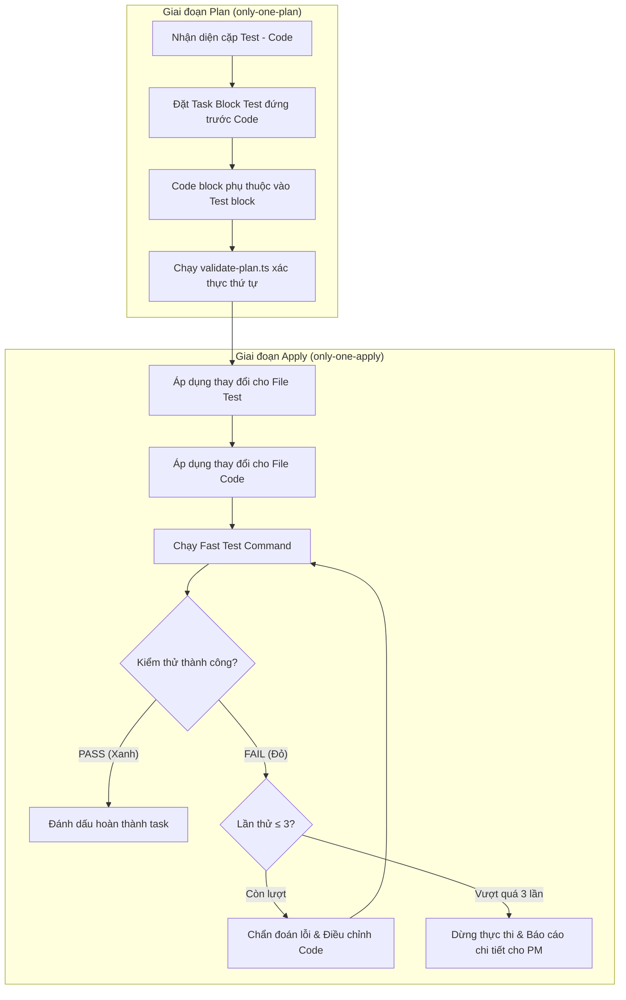

# Concept: Chu trình Pragmatic TDD cho Only-One Plan và Only-One Apply

## 1. Problem & Goal (Vấn đề & Mục tiêu)

### Problem (Điểm nghẽn & Thiếu sót hiện tại)
- **Context & Trigger**: Khi phát triển hoặc sửa đổi logic code có kiểm thử đi kèm qua `/only-one-plan` và `/only-one-apply`.
- **Symptom & Defect**: File code được tạo/sửa trước file test, và không có vòng lặp tự sửa khi test thất bại.
- **Root Cause**: Đặc tả `only-one-plan` chưa bắt buộc thứ tự test-first, và `only-one-apply` thiếu cơ chế red-green loop.
- **Impact / Blast Radius**: Tăng nguy cơ hồi quy mã nguồn, code dễ bị over-engineering, và giảm độ tin cậy của kiểm thử.

### Goal (Kết quả kỹ thuật mục tiêu)
- **Core Goal**: Thiết lập chu trình Pragmatic TDD (Test trước $\rightarrow$ Code $\rightarrow$ Run test $\rightarrow$ Tự sửa lỗi).
- **Acceptance Criteria**:
  - `only-one-plan` bắt buộc sắp xếp task block test đứng trước task block code tương ứng.
  - `validate-plan.ts` tự động kiểm tra và cảnh báo nếu phát hiện file code xuất hiện trước file test đi kèm.
  - `only-one-apply` thực thi theo luồng: Áp dụng test $\rightarrow$ Áp dụng code $\rightarrow$ Chạy `Fast Test Command`.
  - Nếu test thất bại (Red), `only-one-apply` tự động chẩn đoán và điều chỉnh code tối đa 3 lần thử.
  - Nếu sau 3 lần vẫn lỗi, dừng thực thi và báo cáo chi tiết cho người dùng.

## 2. Scope Boundaries (Ranh giới phạm vi)
- **In-Scope**:
  - Cập nhật đặc tả và template của `only-one-plan` (quy định thứ tự test-first).
  - Cập nhật script `validate-plan.ts` để kiểm tra thứ tự tương quan giữa test block và code block.
  - Cập nhật đặc tả Step 4 của `only-one-apply` để tích hợp vòng lặp Pragmatic TDD với retry limit = 3.
  - Đồng bộ thay đổi vào cả `assets/agents/skills/`, `C:\Users\ADMIN\.agents\skills/`, và `C:\Users\ADMIN\.gemini\config\skills/`.
- **Explicit Out-of-Scope**:
  - Không sửa đổi logic của `/only-one-idea`, `/only-one-debug`, hoặc `/only-one-review`.
  - Không bắt buộc Strict TDD (không chạy test ở trạng thái đỏ khi code chưa biên dịch được).

## 3. Proposed Solution & Core Mechanism (Giải pháp đề xuất & Cơ chế cốt lõi)
- **Core Mechanism**: Cơ chế phối hợp hai tầng: Linter kiểm tra tĩnh thứ tự task trong plan, và Runner thực thi vòng lặp tự sửa khi apply.
- **Conceptual Flow / Domain Model**:

## 4. Critical Risks & Edge Cases (Rủi ro & Xử lý ngoại lệ)
- **Lỗi biên dịch khi test gọi hàm chưa tồn tại**: Pragmatic TDD giải quyết bằng cách áp dụng cả file test và file code trước khi kích hoạt `Fast Test Command`.
- **Vòng lặp sửa code vô tận (Infinite Fix Loop)**: Khóa cứng giới hạn tối đa 3 lần thử tự sửa để đảm bảo an toàn context và thời gian thực thi.
- **Cặp file kiểm thử phức tạp**: Trường hợp một file test bao phủ nhiều file code, linter sẽ kiểm tra file test xuất hiện trước tất cả các file code phụ thuộc.
