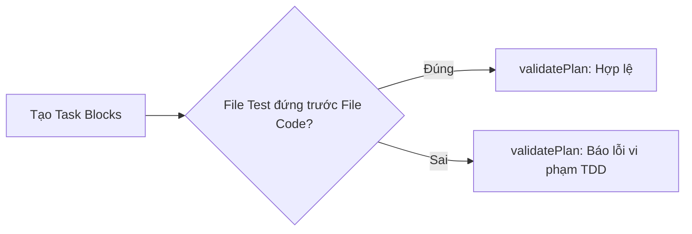
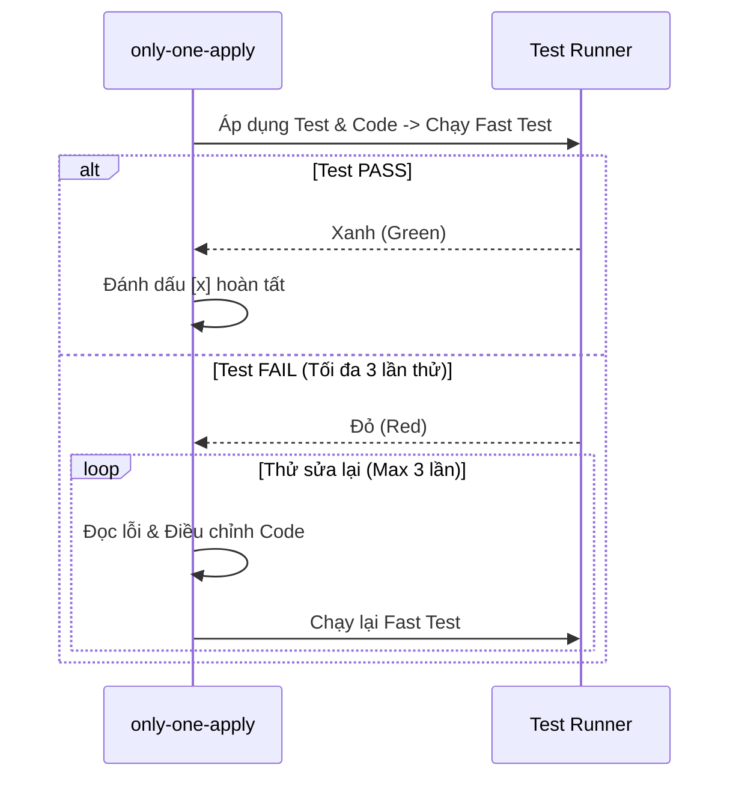
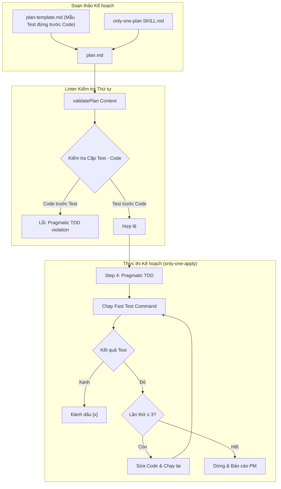

# Plan: Chu trình Pragmatic TDD cho Only-One Plan và Only-One Apply

## Section 1. Directory Structure Changes

```text
assets/agents/skills/
├── only-one-plan/
│   ├── [MODIFY] SKILL.md                          # Quy định thứ tự test-first trong Section 2
│   ├── assets/
│   │   └── [MODIFY] plan-template.md              # Sắp xếp mẫu task test đứng trước task code
│   └── scripts/
│       └── [MODIFY] validate-plan.ts              # Kiểm tra ràng buộc thứ tự test-first cho cặp file
└── only-one-apply/
    └── [MODIFY] SKILL.md                          # Triển khai quy trình Step 4 Pragmatic TDD với retry limit = 3

test/core/
└── [MODIFY] skill-sdlc-scripts.test.ts            # Bổ sung test case kiểm tra vi phạm thứ tự test-first

C:/Users/ADMIN/.agents/skills/
├── only-one-plan/
│   ├── [MODIFY] SKILL.md                          # Đồng bộ đặc tả mới sang Canonical Global
│   ├── assets/
│   │   └── [MODIFY] plan-template.md              # Đồng bộ mẫu template mới sang Canonical Global
│   └── scripts/
│       └── [MODIFY] validate-plan.ts              # Đồng bộ script linter sang Canonical Global
└── only-one-apply/
    └── [MODIFY] SKILL.md                          # Đồng bộ đặc tả mới sang Canonical Global
```

## Section 1.5. Story Board (User Journey & Feature Scenarios)

### Story 1: Tự động bảo vệ thứ tự Test-First trong Plan [MODIFY]
- **User Story**: Là một Tech Lead, tôi muốn linter `validate-plan.ts` tự động phát hiện và cảnh báo nếu task block code bị xếp trước task block test tương ứng để luôn giữ đúng kỷ luật TDD.
- **Before**: Kế hoạch thường vô tình sắp xếp task block code trước rồi mới đến task block test, khiến agent áp dụng code trước khi có test định hình hành vi.
- **After**: Kế hoạch bắt buộc xếp task block test đứng trước task block code. `validate-plan.ts` sẽ từ chối các plan vi phạm thứ tự này.
- **Key Scenarios**:
  - *Scenario 1 (Hợp lệ)*: Task 1 là `file.test.ts`, Task 2 là `file.ts` $\rightarrow$ Linter xác thực hợp lệ.
  - *Scenario 2 (Vi phạm)*: Task 1 là `file.ts`, Task 2 là `file.test.ts` $\rightarrow$ Linter báo lỗi `Pragmatic TDD violation` yêu cầu đảo lại thứ tự.



### Story 2: Chu trình Tự sửa lỗi (Self-Healing Red Loop) khi Apply [NEW]
- **User Story**: Là một Developer, tôi muốn `/only-one-apply` sau khi áp dụng test và code sẽ tự chạy test, và nếu test đỏ (fail) thì tự chẩn đoán sửa code tối đa 3 lần trước khi dừng lại xin ý kiến.
- **Before**: Agent áp dụng diff liên tục mà không chạy test tức thời, hoặc nếu test fail thì không có cơ chế lặp có giới hạn rõ ràng.
- **After**: Agent áp dụng test $\rightarrow$ áp dụng code $\rightarrow$ chạy `Fast Test Command`. Nếu fail, lặp lại việc sửa code tối đa 3 lần. Nếu vẫn fail sau 3 lần, dừng lại báo cáo chi tiết cho PM.
- **Key Scenarios**:
  - *Scenario 1 (Pass ngay)*: Test chạy xanh ngay lần đầu $\rightarrow$ Đánh dấu `[x]` và đi tiếp.
  - *Scenario 2 (Tự sửa thành công)*: Test fail ở lần 1 $\rightarrow$ Agent đọc stack trace, chỉnh sửa code $\rightarrow$ Test xanh ở lần 2 $\rightarrow$ Đánh dấu `[x]`.
  - *Scenario 3 (Chạm ngưỡng retry)*: Test fail cả 3 lần $\rightarrow$ Agent dừng lại, giữ `[/]` và xuất báo cáo lỗi chi tiết.



---

## Section 2. File Changes

### Architectural Interaction Diagram



---

### 1. `[MODIFY]` `test/core/skill-sdlc-scripts.test.ts`

- **Status**: `[x]`
- **Task Type**: `code`
- **Context**: File test hiện tại cần bổ sung test case xác thực quy tắc kiểm tra thứ tự test-first của validatePlan.
- **Target Symbols / AST Seams**: `describe('Deterministic SDLC Skills Scripts')`.
- **Invariants**: Tất cả các test cases hiện hữu và mới đều phải pass.
- **Depends On**: None.
- **Fast Test Command**: `npx vitest run test/core/skill-sdlc-scripts.test.ts`.

> **Action**: Thêm test case xác thực plan hợp lệ khi test đứng trước code và phát lỗi khi code đứng trước test.

**Test checklist**
- [ ] Bắt buộc theo đúng tiêu chí nghiệm thu.
- [ ] Tái sử dụng cú pháp test sẵn có của vitest.
- [ ] Kiểm tra cả trường hợp hợp lệ (test trước code) và trường hợp vi phạm (code trước test).
- **Decision**: Bổ sung test case trực tiếp vào bộ test `validatePlan` trong `skill-sdlc-scripts.test.ts`.
- **Rejected alternative**: Tạo file test mới gây phân mảnh bộ kiểm thử skill.

```diff
@@ line 150 @@
         const res = validatePlan(invalidPlan);
         expect(res.valid).toBe(false);
         expect(res.errors.some((e) => e.includes('Non-code tasks must not target test files'))).toBe(true);
     });
+
+    it('flags error when code task appears before its corresponding test task', () => {
+        const invalidOrderPlan = `---
+slug: test
+status: planned
+---
+# Plan
+## Section 1. Directory Structure Changes
+## Section 1.5. Story Board
+### Story 1: Feature [MODIFY]
+- **Before**: Old.
+- **After**: New.
+\`\`\`mermaid
+flowchart LR
+    A --> B
+\`\`\`
+## Section 2. File Changes
+### 1. [MODIFY] src/service.ts
+- **Status**: [ ]
+- **Task Type**: code
+- **Fast Test Command**: npm test src/service.test.ts
+\`\`\`diff
++ line
+\`\`\`
+### 2. [NEW] src/service.test.ts
+- **Status**: [ ]
+- **Task Type**: code
+- **Depends On**: None
+- **Fast Test Command**: npm test src/service.test.ts
+**Test Matrix**:
+- [ ] Happy Path
+- [ ] Boundary / Edge Cases
+- [ ] Failure / Error Handling
+\`\`\`diff
++ line
+\`\`\`
+## Section 3. Test Cases & Verification
+`;
+        const res = validatePlan(invalidOrderPlan);
+        expect(res.valid).toBe(false);
+        expect(res.errors.some((e) => e.includes('Pragmatic TDD violation'))).toBe(true);
+    });
```

---

### 2. `[MODIFY]` `assets/agents/skills/only-one-plan/scripts/validate-plan.ts`

- **Status**: `[x]`
- **Task Type**: `code`
- **Context**: Hàm validatePlan cần bổ sung logic kiểm tra thứ tự xuất hiện của file test và file code.
- **Target Symbols / AST Seams**: `validatePlan`.
- **Invariants**: Giữ nguyên chữ ký hàm `validatePlan(content: string): PlanValidationResult`.
- **Depends On**: `test/core/skill-sdlc-scripts.test.ts`.
- **Fast Test Command**: `npx vitest run test/core/skill-sdlc-scripts.test.ts`.

> **Action**: Bổ sung thuật toán so sánh vị trí task block test và code block tương ứng trong Section 2.

**Ponytail checklist**
- [ ] Bắt buộc theo đúng tiêu chí nghiệm thu.
- [ ] Đã rà soát code hiện có, regex và logic slicing.
- [ ] Không tạo logic trùng lặp hoặc điểm mở rộng suy đoán.
- [ ] Diff tối thiểu, đảm bảo an toàn và tính đúng đắn.
- **Decision**: Dùng phép biến đổi đường dẫn test $\rightarrow$ base code path để so sánh index trong mảng taskMatches.
- **Rejected alternative**: Dùng hardcode tên file làm giảm tính tổng quát.

```diff
@@ line 113 @@
         if (!/-\s*\*\*Fast Test Command\*\*:/i.test(singleBlock)) warnings.push(`Task ${idx + 1} (${filePath}): Missing Fast Test Command`);
         if (!/```diff[\s\S]*?```/i.test(singleBlock)) errors.push(`Task ${idx + 1} (${filePath}): Missing Git Unified Diff block`);
     });
+
+    taskMatches.forEach((match, idx) => {
+        const filePath = match[2].trim();
+        if (testFileRegex.test(filePath)) {
+            const basePath = filePath.replace(/\.(test|spec)\./, '.').replace(/_test\./, '.');
+            const codeTaskIdx = taskMatches.findIndex((m) => m[2].trim() === basePath);
+            if (codeTaskIdx !== -1 && codeTaskIdx < idx) {
+                errors.push(
+                    `Task ${idx + 1} (${filePath}): Pragmatic TDD violation - test task must appear before code task '${basePath}' (Task ${codeTaskIdx + 1})`
+                );
+            }
+        }
+    });
 
     return {
         valid: errors.length === 0,
```

---

### 3. `[MODIFY]` `assets/agents/skills/only-one-plan/assets/plan-template.md`

- **Status**: `[x]`
- **Task Type**: `non-code`
- **Context**: File template hiện tại đang để task block code ở vị trí 1 và task block test ở vị trí 2.
- **Target Symbols / AST Seams**: Section 2 File Changes block ordering.
- **Invariants**: Giữ nguyên cấu trúc frontmatter và Section 1, 1.5, 3.
- **Depends On**: None.
- **Fast Test Command**: `None (Non-code task)`.

> **Action**: Đảo vị trí task block test lên vị trí 1 và task block code xuống vị trí 2 trong Section 2.

**Ponytail checklist**
- [ ] Bắt buộc theo đúng tiêu chí nghiệm thu.
- [ ] Không tạo logic trùng lặp hoặc điểm mở rộng suy đoán.
- [ ] Diff tối thiểu, đảm bảo an toàn và tính đúng đắn.
- **Decision**: Đổi thứ tự trong template mẫu để agent mặc định sinh plan theo chuẩn test-first.
- **Rejected alternative**: Giữ nguyên template cũ khiến agent tiếp tục tạo code trước test.

```diff
@@ line 34 @@
 ## Section 2. File Changes
 
-### 1. `[MODIFY]` `path/to/file.ts`
+### 1. `[NEW]` `path/to/file.test.ts`
+
+- **Status**: `[ ]`
+- **Task Type**: `code`
+- **Context**: <Test suite purpose>.
+- **Target Symbols / AST Seams**: `describe('...')`.
+- **Invariants**: <Invariants>.
+- **Depends On**: None.
+- **Fast Test Command**: `npm test path/to/file.test.ts`.
+
+> **Action**: <Add test cases specifying target behavior>.
+
+**Test Matrix**
+- [ ] Happy Path: <Scenario>.
+- [ ] Boundary / Edge Cases: <Scenario>.
+- [ ] Failure / Error Handling: <Scenario>.
+
+```diff
+<unified diff>
+```
+
+### 2. `[MODIFY]` `path/to/file.ts`
 
 - **Status**: `[ ]`
 - **Task Type**: `code`
 - **Context**: <Current mechanism in one sentence>.
 - **Target Symbols / AST Seams**: `Class.methodName`.
 - **Invariants**: <Constraint that must not be broken in one sentence>.
-- **Depends On**: None.
+- **Depends On**: `path/to/file.test.ts`.
 - **Fast Test Command**: `npm test path/to/file.test.ts`.
 
 > **Action**: <Brief one-sentence description of modification purpose>.
 
 ```diff
 <unified diff>
 ```
-
-### 2. `[NEW]` `path/to/file.test.ts`
-
-- **Status**: `[ ]`
-- **Task Type**: `code`
-- **Context**: <Test suite purpose>.
-- **Target Symbols / AST Seams**: `describe('...')`.
-- **Invariants**: <Invariants>.
-- **Depends On**: `path/to/file.ts`.
-- **Fast Test Command**: `npm test path/to/file.test.ts`.
-
-> **Action**: <Add test cases for file.ts>.
-
-**Test Matrix**
-- [ ] Happy Path: <Scenario>.
-- [ ] Boundary / Edge Cases: <Scenario>.
-- [ ] Failure / Error Handling: <Scenario>.
-
-```diff
-<unified diff>
-```
```

---

### 4. `[MODIFY]` `assets/agents/skills/only-one-plan/SKILL.md`

- **Status**: `[x]`
- **Task Type**: `non-code`
- **Context**: Đặc tả only-one-plan cần bổ sung quy định bất biến về thứ tự test-first trong Section 2.
- **Target Symbols / AST Seams**: Section 2 File Changes & Guardrails.
- **Invariants**: Duy trì ngôn ngữ tiếng Việt cho giải thích và tiếng Anh cho thuật ngữ kỹ thuật.
- **Depends On**: None.
- **Fast Test Command**: `None (Non-code task)`.

> **Action**: Cập nhật hướng dẫn sắp xếp task block test trước task block code và bổ sung Guardrail Pragmatic TDD.

**Ponytail checklist**
- [ ] Bắt buộc theo đúng tiêu chí nghiệm thu.
- [ ] Diff tối thiểu, đảm bảo an toàn và tính đúng đắn.
- **Decision**: Ghi nhận rõ ràng quy tắc test-first vào Guardrails của kỹ năng.
- **Rejected alternative**: Chỉ sửa template mà không cập nhật tài liệu hướng dẫn.

```diff
@@ line 53 @@
   - **Machine Layer (Standardized English & Unified Diffs)**:
     - Section 2 must use ordered machine-readable file task blocks with headings `### <order>. [<ACTION>] <path>`.
+    - Tasks must adhere to **Pragmatic TDD ordering**: test file task blocks must appear BEFORE their corresponding code implementation task blocks.
     - Every task block must contain fixed metadata keys: `Status`, `Task Type`, `Context`, `Target Symbols / AST Seams`, `Invariants`, `Depends On`, and `Fast Test Command` before its checklist and diff.
@@ line 265 @@
 - **Strict Test Policy by Task Type**:
+  - **Test-First Ordering**: Test task blocks must always precede their companion code implementation task blocks in Section 2.
   - `Task Type: code`: Mandatory accompanying test task block (e.g. `*.test.ts`) and full Test Matrix (`Happy Path`, `Boundary / Edge Cases`, `Failure / Error Handling`).
```

---

### 5. `[MODIFY]` `assets/agents/skills/only-one-apply/SKILL.md`

- **Status**: `[x]`
- **Task Type**: `non-code`
- **Context**: Bước Step 4 trong only-one-apply cần được tái cấu trúc theo chu trình Pragmatic TDD với retry limit = 3.
- **Target Symbols / AST Seams**: Section Step 4 — Apply File Changes.
- **Invariants**: Giữ nguyên các định dạng báo cáo hoàn tất ở Step 5.
- **Depends On**: None.
- **Fast Test Command**: `None (Non-code task)`.

> **Action**: Viết lại Step 4 quy định rõ ràng luồng: Áp dụng test $\rightarrow$ Áp dụng code $\rightarrow$ Chạy Fast Test $\rightarrow$ Tự sửa tối đa 3 lần.

**Ponytail checklist**
- [ ] Bắt buộc theo đúng tiêu chí nghiệm thu.
- [ ] Loại bỏ mâu thuẫn giữa "không dừng lại chạy test" và "chạy Fast Test per file".
- [ ] Khóa cứng giới hạn 3 lần thử tự chẩn đoán.
- **Decision**: Thay thế đoạn mô tả Step 4 cũ bằng quy trình Pragmatic TDD 4 bước chuẩn xác.
- **Rejected alternative**: Giữ nguyên quy trình batch coding cũ không chạy test tức thời.

```diff
@@ line 178 @@
-### Step 4 — Apply File Changes Sequentially (Zero Sub-agents Batch Coding)
-
-Main Agent directly applies each file diff in sequence adhering strictly to `Depends On` ordering without sub-agent overhead:
-
-1. **Direct Sequential Application**:
-   - Mark task `Status` as `[/]` in `plan.md` or `debug.md`.
-   - Inspect target file imports and enforce Reuse-First Invariant.
-   - Normalize target file line endings to LF before performing string replacements on Windows.
-   - Apply code modification precisely via `replace_file_content` or `write_to_file`.
-   - Mark task `Status` as `[x]`.
-   - Proceed immediately to the next task block without pausing to run test commands.
-
-2. **Fast Continuous Workflow**:
-   - Continue applying all remaining task blocks until 100% of planned files are written to disk.
+### Step 4 — Apply File Changes with Pragmatic TDD Workflow
+
+Main Agent directly executes task blocks in sequence adhering strictly to `Depends On` ordering and Pragmatic TDD discipline:
+
+1. **Test-First Application**:
+   - Đối với các task code có test đi kèm: luôn áp dụng task block test trước, sau đó áp dụng task block code logic.
+   - Chuẩn hóa line endings sang LF trước khi sửa file trên Windows.
+   - Đánh dấu trạng thái task đang xử lý là `Status: [/]`.
+2. **Execute Fast Test Command**:
+   - Chạy ngay lệnh `Fast Test Command` được chỉ định cho cặp task.
+   - Nếu test **PASS (Green)**: Đánh dấu `Status: [x]` cho cả task test và task code, chuyển sang task block tiếp theo.
+3. **Self-Healing Red Loop (Tối đa 3 lần thử)**:
+   - Nếu test **FAIL (Red)**:
+     - Dừng lại, đọc thông báo lỗi từ test runner (stack trace, assertion failure).
+     - Khu biệt nguyên nhân và điều chỉnh mã nguồn triển khai.
+     - Chạy lại `Fast Test Command`.
+     - Lặp lại tối đa 3 lần thử (Retry limit: 3).
+     - Nếu sau 3 lần thử vẫn thất bại: Dừng toàn bộ tiến trình, giữ nguyên trạng thái `Status: [/]`, và báo cáo chi tiết nguyên nhân lỗi cho PM để xin chỉ dẫn.
+4. **Non-code Tasks**:
+   - Đối với các task `non-code`: Áp dụng diff, kiểm tra syntax/lint nếu có, và đánh dấu `[x]` mà không kích hoạt test loop.
```

---

### 6. `[MODIFY]` `C:/Users/ADMIN/.agents/skills/only-one-plan/scripts/validate-plan.ts`

- **Status**: `[x]`
- **Task Type**: `code`
- **Context**: Đồng bộ thuật toán kiểm tra thứ tự test-first sang Canonical Global.
- **Target Symbols / AST Seams**: `validatePlan`.
- **Invariants**: Đồng nhất hành vi với file trong assets.
- **Depends On**: `assets/agents/skills/only-one-plan/scripts/validate-plan.ts`.
- **Fast Test Command**: `npx vitest run test/core/skill-sdlc-scripts.test.ts`.

> **Action**: Đồng bộ logic kiểm tra thứ tự task sang Canonical Global storage.

**Ponytail checklist**
- [ ] Bắt buộc theo đúng tiêu chí nghiệm thu.
- [ ] Diff tối thiểu, đảm bảo an toàn và tính đúng đắn.
- **Decision**: Đồng bộ trực tiếp nội dung hoàn chỉnh sang Canonical Global.
- **Rejected alternative**: Không đồng bộ khiến IDE sử dụng phiên bản cũ.

```diff
@@ line 113 @@
         if (!/-\s*\*\*Fast Test Command\*\*:/i.test(singleBlock)) warnings.push(`Task ${idx + 1} (${filePath}): Missing Fast Test Command`);
         if (!/```diff[\s\S]*?```/i.test(singleBlock)) errors.push(`Task ${idx + 1} (${filePath}): Missing Git Unified Diff block`);
     });
+
+    taskMatches.forEach((match, idx) => {
+        const filePath = match[2].trim();
+        if (testFileRegex.test(filePath)) {
+            const basePath = filePath.replace(/\.(test|spec)\./, '.').replace(/_test\./, '.');
+            const codeTaskIdx = taskMatches.findIndex((m) => m[2].trim() === basePath);
+            if (codeTaskIdx !== -1 && codeTaskIdx < idx) {
+                errors.push(
+                    `Task ${idx + 1} (${filePath}): Pragmatic TDD violation - test task must appear before code task '${basePath}' (Task ${codeTaskIdx + 1})`
+                );
+            }
+        }
+    });
 
     return {
         valid: errors.length === 0,
```

---

### 7. `[MODIFY]` `C:/Users/ADMIN/.agents/skills/only-one-plan/assets/plan-template.md`

- **Status**: `[x]`
- **Task Type**: `non-code`
- **Context**: Đồng bộ template thứ tự test-first sang Canonical Global.
- **Target Symbols / AST Seams**: Section 2 File Changes block ordering.
- **Invariants**: Giữ nguyên placeholder chuẩn.
- **Depends On**: `assets/agents/skills/only-one-plan/assets/plan-template.md`.
- **Fast Test Command**: `None (Non-code task)`.

> **Action**: Đồng bộ mẫu template mới sang Canonical Global.

**Ponytail checklist**
- [ ] Bắt buộc theo đúng tiêu chí nghiệm thu.
- [ ] Diff tối thiểu, đảm bảo an toàn và tính đúng đắn.
- **Decision**: Đồng bộ trực tiếp sang Canonical Global.
- **Rejected alternative**: Bỏ qua Canonical Global.

```diff
@@ line 34 @@
 ## Section 2. File Changes
 
-### 1. `[MODIFY]` `path/to/file.ts`
+### 1. `[NEW]` `path/to/file.test.ts`
+
+- **Status**: `[ ]`
+- **Task Type**: `code`
+- **Context**: <Test suite purpose>.
+- **Target Symbols / AST Seams**: `describe('...')`.
+- **Invariants**: <Invariants>.
+- **Depends On**: None.
+- **Fast Test Command**: `npm test path/to/file.test.ts`.
+
+> **Action**: <Add test cases specifying target behavior>.
+
+**Test Matrix**
+- [ ] Happy Path: <Scenario>.
+- [ ] Boundary / Edge Cases: <Scenario>.
+- [ ] Failure / Error Handling: <Scenario>.
+
+```diff
+<unified diff>
+```
+
+### 2. `[MODIFY]` `path/to/file.ts`
 
 - **Status**: `[ ]`
 - **Task Type**: `code`
 - **Context**: <Current mechanism in one sentence>.
 - **Target Symbols / AST Seams**: `Class.methodName`.
 - **Invariants**: <Constraint that must not be broken in one sentence>.
-- **Depends On**: None.
+- **Depends On**: `path/to/file.test.ts`.
 - **Fast Test Command**: `npm test path/to/file.test.ts`.
 
 > **Action**: <Brief one-sentence description of modification purpose>.
 
 ```diff
 <unified diff>
 ```
```

---

### 8. `[MODIFY]` `C:/Users/ADMIN/.agents/skills/only-one-plan/SKILL.md`

- **Status**: `[x]`
- **Task Type**: `non-code`
- **Context**: Đồng bộ đặc tả only-one-plan sang Canonical Global.
- **Target Symbols / AST Seams**: Section 2 File Changes & Guardrails.
- **Invariants**: Giữ nguyên định dạng Antigravity skill chuẩn.
- **Depends On**: `assets/agents/skills/only-one-plan/SKILL.md`.
- **Fast Test Command**: `None (Non-code task)`.

> **Action**: Đồng bộ đặc tả mới sang Canonical Global.

**Ponytail checklist**
- [ ] Bắt buộc theo đúng tiêu chí nghiệm thu.
- [ ] Diff tối thiểu, đảm bảo an toàn và tính đúng đắn.
- **Decision**: Đồng bộ trực tiếp sang Canonical Global.
- **Rejected alternative**: Bỏ qua Canonical Global.

```diff
@@ line 53 @@
   - **Machine Layer (Standardized English & Unified Diffs)**:
     - Section 2 must use ordered machine-readable file task blocks with headings `### <order>. [<ACTION>] <path>`.
+    - Tasks must adhere to **Pragmatic TDD ordering**: test file task blocks must appear BEFORE their corresponding code implementation task blocks.
     - Every task block must contain fixed metadata keys: `Status`, `Task Type`, `Context`, `Target Symbols / AST Seams`, `Invariants`, `Depends On`, and `Fast Test Command` before its checklist and diff.
@@ line 265 @@
 - **Strict Test Policy by Task Type**:
+  - **Test-First Ordering**: Test task blocks must always precede their companion code implementation task blocks in Section 2.
   - `Task Type: code`: Mandatory accompanying test task block (e.g. `*.test.ts`) and full Test Matrix (`Happy Path`, `Boundary / Edge Cases`, `Failure / Error Handling`).
```

---

### 9. `[MODIFY]` `C:/Users/ADMIN/.agents/skills/only-one-apply/SKILL.md`

- **Status**: `[x]`
- **Task Type**: `non-code`
- **Context**: Đồng bộ đặc tả only-one-apply với Step 4 Pragmatic TDD sang Canonical Global.
- **Target Symbols / AST Seams**: Section Step 4 — Apply File Changes.
- **Invariants**: Giữ nguyên định dạng Antigravity skill chuẩn.
- **Depends On**: `assets/agents/skills/only-one-apply/SKILL.md`.
- **Fast Test Command**: `None (Non-code task)`.

> **Action**: Đồng bộ đặc tả mới sang Canonical Global.

**Ponytail checklist**
- [ ] Bắt buộc theo đúng tiêu chí nghiệm thu.
- [ ] Diff tối thiểu, đảm bảo an toàn và tính đúng đắn.
- **Decision**: Đồng bộ trực tiếp sang Canonical Global.
- **Rejected alternative**: Bỏ qua Canonical Global.

```diff
@@ line 178 @@
-### Step 4 — Apply File Changes Sequentially (Zero Sub-agents Batch Coding)
-
-Main Agent directly applies each file diff in sequence adhering strictly to `Depends On` ordering without sub-agent overhead:
-
-1. **Direct Sequential Application**:
-   - Mark task `Status` as `[/]` in `plan.md` or `debug.md`.
-   - Inspect target file imports and enforce Reuse-First Invariant.
-   - Normalize target file line endings to LF before performing string replacements on Windows.
-   - Apply code modification precisely via `replace_file_content` or `write_to_file`.
-   - Mark task `Status` as `[x]`.
-   - Proceed immediately to the next task block without pausing to run test commands.
-
-2. **Fast Continuous Workflow**:
-   - Continue applying all remaining task blocks until 100% of planned files are written to disk.
+### Step 4 — Apply File Changes with Pragmatic TDD Workflow
+
+Main Agent directly executes task blocks in sequence adhering strictly to `Depends On` ordering and Pragmatic TDD discipline:
+
+1. **Test-First Application**:
+   - Đối với các task code có test đi kèm: luôn áp dụng task block test trước, sau đó áp dụng task block code logic.
+   - Chuẩn hóa line endings sang LF trước khi sửa file trên Windows.
+   - Đánh dấu trạng thái task đang xử lý là `Status: [/]`.
+2. **Execute Fast Test Command**:
+   - Chạy ngay lệnh `Fast Test Command` được chỉ định cho cặp task.
+   - Nếu test **PASS (Green)**: Đánh dấu `Status: [x]` cho cả task test và task code, chuyển sang task block tiếp theo.
+3. **Self-Healing Red Loop (Tối đa 3 lần thử)**:
+   - Nếu test **FAIL (Red)**:
+     - Dừng lại, đọc thông báo lỗi từ test runner (stack trace, assertion failure).
+     - Khu biệt nguyên nhân và điều chỉnh mã nguồn triển khai.
+     - Chạy lại `Fast Test Command`.
+     - Lặp lại tối đa 3 lần thử (Retry limit: 3).
+     - Nếu sau 3 lần thử vẫn thất bại: Dừng toàn bộ tiến trình, giữ nguyên trạng thái `Status: [/]`, và báo cáo chi tiết nguyên nhân lỗi cho PM để xin chỉ dẫn.
+4. **Non-code Tasks**:
+   - Đối với các task `non-code`: Áp dụng diff, kiểm tra syntax/lint nếu có, và đánh dấu `[x]` mà không kích hoạt test loop.
```

---

## Section 3. Test Cases & Verification

- **Automated Tests**:
  - `npx vitest run test/core/skill-sdlc-scripts.test.ts`: Xác nhận 12/12 test cases passed, bao gồm test case vi phạm thứ tự test-first.
  - `npx tsx assets/agents/skills/only-one-plan/scripts/validate-plan.ts only-one/tasks/pragmatic-tdd-plan-and-apply/plan.md`: Xác nhận file `plan.md` đạt chuẩn 100%.
  - `npm run build`: Xác nhận build TypeScript và format check thành công.

- **Manual Checks**:
  - Kiểm tra `plan-template.md` hiển thị mẫu task block test xuất hiện trước task block code.
  - Kiểm tra `only-one-apply/SKILL.md` quy định rõ ràng chu trình Pragmatic TDD và giới hạn 3 lần thử tự sửa lỗi.
  - Kiểm tra toàn bộ thay đổi đã được đồng bộ đồng nhất vào `C:\Users\ADMIN\.agents\skills\`.
