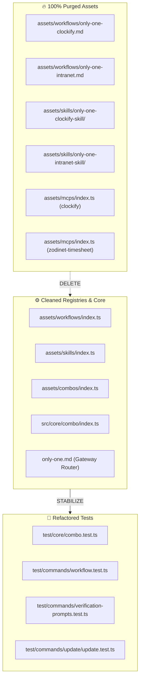

# Concept: Loại Bỏ Triệt Để Hệ Sinh Thái Chấm Công (Timesheet Ecosystem Purge)

## 1. Problem & Goal (Vấn đề & Mục tiêu)

### Problem (Vấn đề & Điểm nghẽn Hiện tại)
- **Bối cảnh & Điểm kích hoạt**: `only-one-cli` ban đầu tích hợp 2 workflow chấm công (`only-one-clockify`, `only-one-intranet`), 2 skill đi kèm (`only-one-clockify-skill`, `only-one-intranet-skill`) và 2 MCP servers (`clockify`, `zodinet-timesheet`).
- **Hiện tượng & Khiếm khuyết kỹ thuật**: Các thành phần này mang tính đặc thù nội bộ/cá nhân, gây phình to danh mục asset dùng chung, làm loãng năng lực cốt lõi của CLI (vốn tập trung vào quản lý môi trường lập trình, đồng bộ VS Code/Editor và SDLC workflows cho AI Agent).
- **Nguyên nhân cốt lõi (Root Cause)**: Thiếu sự phân tách ranh giới giữa bộ công cụ nền tảng dùng chung và các tiện ích nghiệp vụ timesheet mang tính tổ chức cục bộ.
- **Tác động (Impact / Blast Radius)**:
  - Tăng kích thước phân phối npm package không cần thiết.
  - Làm phức tạp danh mục combo cấu hình (`assets/combos/index.ts`).
  - Gây nhiễu router định tuyến tổng [`only-one.md`](file:///d:/Sources/PERSONAL/only-one-cli/assets/workflows/only-one.md).
  - Phân mảnh bảo trì kiểm thử với các test case phụ thuộc vào timesheet mock.

### Goal (Mục tiêu Kỹ thuật Cần đạt)
- **Mục tiêu cốt lõi**: Phẫu thuật loại bỏ triệt để 100% tệp tin, định nghĩa manifest, logic phụ thuộc, bài test và tài liệu liên quan đến hệ sinh thái chấm công mà không gây hồi quy (zero regressions).
- **Tiêu chí nghiệm thu (Acceptance Criteria)**:
  - Xóa sạch 2 tệp workflow: `only-one-clockify.md` và `only-one-intranet.md` (cả trong `assets/workflows/` và `.agents/workflows/`).
  - Xóa sạch 2 thư mục skills: `only-one-clockify-skill` và `only-one-intranet-skill` (cả trong `assets/skills/` và `.agents/skills/`).
  - Xóa 2 MCP servers: `clockify` và `zodinet-timesheet` khỏi [assets/mcps/index.ts](file:///d:/Sources/PERSONAL/only-one-cli/assets/mcps/index.ts) (thu gọn danh mục về đúng 5 server chuẩn: `fetch`, `github`, `playwright-browser`, `postgres`, `tavily`).
  - Cập nhật manifest registry: [assets/workflows/index.ts](file:///d:/Sources/PERSONAL/only-one-cli/assets/workflows/index.ts), [assets/skills/index.ts](file:///d:/Sources/PERSONAL/only-one-cli/assets/skills/index.ts), [assets/combos/index.ts](file:///d:/Sources/PERSONAL/only-one-cli/assets/combos/index.ts).
  - Loại bỏ các dòng định tuyến timesheet trong gateway workflow [only-one.md](file:///d:/Sources/PERSONAL/only-one-cli/assets/workflows/only-one.md) và [.agents/workflows/only-one.md](file:///d:/Sources/PERSONAL/only-one-cli/.agents/workflows/only-one.md).
  - Refactor các bài test đang dùng timesheet làm mẫu (chuyển sang dùng `only-one-pr-git` hoặc fixture chuẩn).
  - Dọn dẹp tài liệu [README.md](file:///d:/Sources/PERSONAL/only-one-cli/README.md) và [BACKLOG.md](file:///d:/Sources/PERSONAL/only-one-cli/BACKLOG.md).
  - 100% test suite (`npm test`), format (`npm run format:check`) và build (`npm run build`) vượt qua.

## 2. Scope Boundaries (Ranh giới Phạm vi)

- **In-Scope**:
  - `assets/workflows/only-one-clockify.md`, `assets/workflows/only-one-intranet.md`, `.agents/workflows/only-one-clockify.md`, `.agents/workflows/only-one-intranet.md`.
  - `assets/skills/only-one-clockify-skill/`, `assets/skills/only-one-intranet-skill/`, `.agents/skills/only-one-clockify-skill/`, `.agents/skills/only-one-intranet-skill/`.
  - `assets/mcps/index.ts` (xóa entries `clockify` và `zodinet-timesheet`).
  - `assets/combos/index.ts` và `src/core/combo/index.ts` (loại bỏ timesheet skills/workflows khỏi `full-sdlc-flow` và các combo liên quan).
  - `src/core/templates/agent-workflows.ts` và `src/core/skill/index.ts` (loại bỏ enums/constants liên quan đến clockify/intranet).
  - Gateway router `only-one.md` (xóa hàng Timesheet Logging).
  - Unit/Integration tests: `test/core/combo.test.ts`, `test/core/agent-workflows.test.ts`, `test/commands/workflow.test.ts`, `test/commands/verification-prompts.test.ts`, `test/commands/update/update.test.ts`.
  - Tài liệu: `README.md`, `BACKLOG.md`.
  - Khóa cài đặt: `only-one/installed.json` (nếu có bản ghi).
- **Explicit Out-of-Scope**:
  - Không thay đổi bất kỳ workflow cốt lõi nào (`only-one-idea`, `only-one-plan`, `only-one-apply`, `only-one-clean`, `only-one-debug`, `only-one-review`, `only-one-flash`, `only-one-pr-git`, `only-one-conflict`).
  - Không thay đổi các dev skills chuẩn (`c4-diagrams`, `karpathy-ste100-discipline`, `sparring-partner`, `task-lifecycle-resolution`, `nestjs-development`...).
  - Không thay đổi 5 MCP servers tiêu chuẩn còn lại (`fetch`, `github`, `playwright-browser`, `postgres`, `tavily`).

## 3. Proposed Solution & Core Mechanism (Giải pháp Đề xuất & Cơ chế)

### 3.1. Phân Tích Phương Án Giải Pháp (Solution Options)

#### Phương án 1: Big-Bang Hard Deletion (Xóa Đồng Loạt Trong Một Lần)
- **Mô tả**: Xóa vật lý toàn bộ các file/folder và cùng lúc sửa code, tests.
- **Ưu điểm**: Thực hiện nhanh.
- **Nhược điểm**: Rủi ro gãy vỡ test diện rộng khó định vị điểm lỗi do nhiều module phụ thuộc vào timesheet làm fixture test.

#### Phương án 2: Phased Surgical Purge & Test Surrogate Refactoring (Khuyến nghị)
- **Mô tả**:
  1. *Pha 1 — Thay thế Test Fixtures & Core References*: Thay thế các tham chiếu timesheet trong `test/` và `src/core/` bằng các asset chuẩn (`only-one-pr-git`, `c4-diagrams`).
  2. *Pha 2 — Cắt bỏ Manifest & Registries*: Loại bỏ khỏi `assets/mcps/index.ts`, `assets/workflows/index.ts`, `assets/skills/index.ts`, `assets/combos/index.ts`.
  3. *Pha 3 — Xóa File Vật Lý*: Xóa các file `.md` và folder skill trong `assets/` và `.agents/`.
  4. *Pha 4 — Parity & Lockfile Sync*: Đồng bộ version gate và cập nhật `only-one/installed.json`.
- **Ưu điểm**: Kiểm soát tuyệt đối blast radius, bảo toàn tính liên tục của test suite, dễ rollback.
- **Độ phức tạp**: Trung bình.
- **Trade-offs**: Cần nhiều bước kiểm thử cục bộ hơn nhưng loại bỏ hoàn toàn rủi ro sót mồ côi (orphaned symbols).

### 3.2. Sơ Đồ Cắt Bỏ Ranh Giới (Purge Boundary Diagram)

## 4. Critical Risks & Edge Cases (Rủi ro & Kịch bản Biên)

- **Rủi ro 1: Test Suite Broken do phụ thuộc Hardcoded Fixtures**:
  - *Hiện tượng*: Một số test trong `test/commands/workflow.test.ts` và `verification-prompts.test.ts` dùng trực tiếp chuỗi `'only-one-clockify'` và `'only-one-clockify-skill'` để kiểm tra prompt/input.
  - *Biện pháp*: Đổi fixture sang `'only-one-pr-git'` và `'only-one-pr-git-skill'` (đây là các built-in asset chuẩn sẵn có).
- **Rủi ro 2: Combo Schema Inconsistency**:
  - *Hiện tượng*: `full-sdlc-flow` hoặc các combo khác khai báo dependency vào timesheet skills/workflows. Nếu xóa asset mà không gỡ khỏi combo, lệnh `only-one combo` sẽ ném lỗi missing asset.
  - *Biện pháp*: Cập nhật danh sách skills/workflows/mcps trong [assets/combos/index.ts](file:///d:/Sources/PERSONAL/only-one-cli/assets/combos/index.ts) và hàm `suggestComboComponents()` trong [src/core/combo/index.ts](file:///d:/Sources/PERSONAL/only-one-cli/src/core/combo/index.ts).
- **Rủi ro 3: Asset Version Gate Failures**:
  - *Hiện tượng*: Xóa file template hoặc sửa manifest làm kích hoạt chốt chặn version gate.
  - *Biện pháp*: Chạy `npx vitest run test/core/assets/version-gate.test.ts` ngay sau khi cập nhật manifests.
