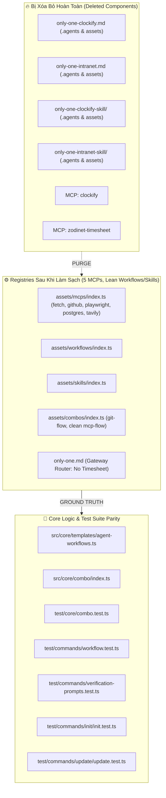

# Plan: Loại Bỏ Triệt Để Hệ Sinh Thái Chấm Công (Workflows, Skills, MCPs)

## Section 1. Directory Structure Changes (Cấu trúc Thư mục & Tệp Thay đổi)

```text
assets/
├── mcps/
│   └── [MODIFY] index.ts                                           # Xóa bỏ 2 entries MCP: clockify và zodinet-timesheet
├── workflows/
│   ├── [DELETE] only-one-clockify.md                               # Xóa workflow template Clockify
│   ├── [DELETE] only-one-intranet.md                               # Xóa workflow template Intranet
│   ├── [MODIFY] index.ts                                           # Xóa 2 manifests workflow và bump version only-one
│   └── [MODIFY] only-one.md                                        # Xóa hàng định tuyến Timesheet Logging trong Gateway Router
├── skills/
│   ├── [DELETE] only-one-clockify-skill/SKILL.md                   # Xóa local skill template Clockify
│   ├── [DELETE] only-one-intranet-skill/SKILL.md                   # Xóa local skill template Intranet
│   └── [MODIFY] index.ts                                           # Xóa 2 manifests skill
└── combos/
    └── [MODIFY] index.ts                                           # Cắt bỏ timesheet khỏi full-sdlc-flow và mcp-flow, đổi git-timesheet-flow -> git-flow
.agents/
├── workflows/
│   ├── [DELETE] only-one-clockify.md                               # Xóa workflow đã cài đặt trong Antigravity
│   ├── [DELETE] only-one-intranet.md                               # Xóa workflow đã cài đặt trong Antigravity
│   └── [MODIFY] only-one.md                                        # Đồng bộ 100% với assets/workflows/only-one.md
└── skills/
    ├── [DELETE] only-one-clockify-skill/SKILL.md                   # Xóa skill đã cài đặt trong Antigravity
    └── [DELETE] only-one-intranet-skill/SKILL.md                   # Xóa skill đã cài đặt trong Antigravity
src/
├── core/
│   ├── combo/
│   │   └── [MODIFY] index.ts                                       # Xóa suy luận MCP clockify và zodinet-timesheet
│   ├── templates/
│   │   └── [MODIFY] agent-workflows.ts                             # Xóa command builder & enum Clockify và Intranet
│   └── skill/
│       └── [MODIFY] index.ts                                       # Xóa mapping commandId only-one-clockify
└── tui/
    ├── router/
    │   └── [MODIFY] routes.ts                                      # Xóa nhãn và tag Clockify khỏi menu MCP
    └── constants/
        └── [MODIFY] menu.ts                                        # Xóa Clockify khỏi mô tả MCP servers
test/
├── core/
│   ├── [MODIFY] combo.test.ts                                      # Cập nhật test cases combo mcp-flow và git-flow
│   ├── [MODIFY] agent-workflows.test.ts                            # Xóa unit tests cho clockify và intranet command builders
│   └── mcp/
│       └── [MODIFY] registry.test.ts                               # Thêm assertion đảm bảo clockify/intranet MCPs bị loại trừ
└── commands/
    ├── [MODIFY] workflow.test.ts                                   # Đổi mock fixture từ only-one-clockify sang only-one-pr-git
    ├── [MODIFY] verification-prompts.test.ts                       # Đổi mock fixture từ only-one-clockify-skill sang only-one-pr-git-skill
    ├── [MODIFY] init/init.test.ts                                  # Đổi mock fixture MCP từ clockify sang postgres
    └── update/
        └── [MODIFY] update.test.ts                                 # Đổi mock fixture workflow sang only-one-pr-git
README.md                                                           # [MODIFY] Xóa tài liệu và hướng dẫn cấu hình Clockify / Intranet
BACKLOG.md                                                          # [MODIFY] Dọn dẹp các đầu việc và mô tả timesheet
```

---

## Section 2. File Changes

### Architectural Interaction Diagram



---

### 1. `[MODIFY]` `assets/mcps/index.ts`

- **Status**: `[x]`
- **Context**: MCP server manifests registry.
- **Target Symbols / AST Seams**: `MCPS`.
- **Invariants**: Must preserve exactly 5 official MCP servers (`fetch`, `github`, `playwright-browser`, `postgres`, `tavily`).
- **Depends On**: None.
- **Fast Test Command**: `npx vitest run test/core/mcp/registry.test.ts`.

> **Action**: Remove `clockify` and `zodinet-timesheet` server entries.

**Ponytail checklist**
- [ ] Required by acceptance criteria.
- [ ] Existing implementation searched; stdlib, platform/framework, and installed dependencies considered.
- [ ] No duplicate logic or speculative extension point.
- [ ] Minimum diff preserves correctness and safety.
- **Decision**: Remove timesheet MCP entries to keep only general-purpose servers.
- **Rejected alternative**: Keep them commented out in manifest.

```diff
@@ line 3 @@
 export const MCPS: McpManifest[] = [
-    {
-        id: 'clockify',
-        version: '0.0.1',
-        server: {
-            command: 'npx',
-            args: ['-y', '@yikizi/clockify-mcp'],
-            env: {
-                CLOCKIFY_API_KEY: '',
-            },
-        },
-    },
     {
         id: 'fetch',
@@ line 67 @@
         server: {
             command: 'npx',
             args: ['-y', '@yikizi/tavily-mcp'],
             env: {
                 TAVILY_API_KEY: '',
             },
         },
     },
-    {
-        id: 'zodinet-timesheet',
-        version: '0.0.1',
-        server: {
-            command: 'npx',
-            args: [
-                '-y',
-                'mcp-remote',
-                'https://intranet-api.vn02.zodinet.tech/api/mcp',
-                '--header',
-                'Authorization:Bearer ${TIMESHEET_PAT}',
-            ],
-            env: {
-                TIMESHEET_PAT: '',
-            },
-        },
-    },
 ];
```

---

### 2. `[MODIFY]` `assets/workflows/index.ts`

- **Status**: `[x]`
- **Context**: Workflow manifests registry tracking versions.
- **Target Symbols / AST Seams**: `WORKFLOWS`.
- **Invariants**: Increment patch version of `only-one` gateway workflow (`0.0.1` -> `0.0.2`) due to routing matrix modification.
- **Depends On**: None.
- **Fast Test Command**: `npx vitest run test/core/workflow-registry.test.ts`.

> **Action**: Remove `only-one-clockify` and `only-one-intranet` workflow manifests and bump `only-one` version.

**Ponytail checklist**
- [ ] Required by acceptance criteria.
- [ ] Existing implementation searched; stdlib, platform/framework, and installed dependencies considered.
- [ ] No duplicate logic or speculative extension point.
- [ ] Minimum diff preserves correctness and safety.
- **Decision**: Purge obsolete timesheet workflow manifests.
- **Rejected alternative**: Deprecate manifests with flag.

```diff
@@ line 4 @@
     {
         name: 'only-one',
-        version: '0.0.1',
+        version: '0.0.2',
         description:
@@ line 98 @@
     {
         name: 'only-one-conflict',
         version: '0.0.1',
         description:
             'Resolve in-progress git merge or rebase conflicts hunk by hunk based on intent without aborting.',
         requiredSkills: ['resolving-merge-conflicts'],
     },
-    {
-        name: 'only-one-clockify',
-        version: '0.0.1',
-        description: 'Validate and log Clockify tasks using only-one-clockify-skill and Clockify MCP.',
-        requiredSkills: ['only-one-clockify-skill'],
-        requiredMcps: ['clockify'],
-    },
-    {
-        name: 'only-one-intranet',
-        version: '0.0.1',
-        description:
-            'Validate, log Intranet timesheet entries, and output monthly summary using only-one-intranet-skill and zodinet-timesheet MCP.',
-        requiredSkills: ['only-one-intranet-skill'],
-        requiredMcps: ['zodinet-timesheet'],
-    },
     {
         name: 'only-one-pr-git',
```

---

### 3. `[MODIFY]` `assets/skills/index.ts`

- **Status**: `[x]`
- **Context**: Skills manifests registry.
- **Target Symbols / AST Seams**: `SKILLS`.
- **Invariants**: Maintain local custom skill definitions for standard dev skills.
- **Depends On**: None.
- **Fast Test Command**: `npx vitest run test/core/skill-registry.test.ts`.

> **Action**: Remove `only-one-clockify-skill` and `only-one-intranet-skill` manifests.

**Ponytail checklist**
- [ ] Required by acceptance criteria.
- [ ] Existing implementation searched; stdlib, platform/framework, and installed dependencies considered.
- [ ] No duplicate logic or speculative extension point.
- [ ] Minimum diff preserves correctness and safety.
- **Decision**: Purge timesheet skill manifests.
- **Rejected alternative**: Keep manifests marked uninstalled.

```diff
@@ line 253 @@
         description: 'Use for Next.js and React development with selectively loaded references.',
         sourceType: 'local',
     },
-    {
-        name: 'only-one-clockify-skill',
-        version: '0.0.1',
-        description: 'Validate and log Clockify time entries from task lines.',
-        sourceType: 'local',
-    },
-    {
-        name: 'only-one-intranet-skill',
-        version: '0.0.1',
-        description: 'Validate and log Intranet timesheet entries from task lines using zodinet-timesheet MCP.',
-        sourceType: 'local',
-    },
     {
         name: 'only-one-pr-git-skill',
```

---

### 4. `[MODIFY]` `assets/combos/index.ts`

- **Status**: `[x]`
- **Context**: Predefined combos registry.
- **Target Symbols / AST Seams**: `COMBOS`.
- **Invariants**: All referenced skills, workflows, and MCPs must exist in active manifests.
- **Depends On**: Task 1, Task 2, Task 3.
- **Fast Test Command**: `npx vitest run test/core/combo.test.ts`.

> **Action**: Remove timesheet entries from `full-sdlc-flow` and `mcp-flow`, refactor `git-timesheet-flow` to `git-flow`.

**Ponytail checklist**
- [ ] Required by acceptance criteria.
- [ ] Existing implementation searched; stdlib, platform/framework, and installed dependencies considered.
- [ ] No duplicate logic or speculative extension point.
- [ ] Minimum diff preserves correctness and safety.
- **Decision**: Rename `git-timesheet-flow` to `git-flow` containing only Git PR automation tools.
- **Rejected alternative**: Delete combo entirely.

```diff
@@ line 118 @@
             'karpathy-ste100-discipline',
-            'only-one-clockify-skill',
-            'only-one-intranet-skill',
             'only-one-pr-git-skill',
         ],
         rules: ['context-and-tools', 'execution-terminal', 'karpathy-ste100-discipline'],
         workflows: [
             'only-one',
             'only-one-idea',
             'only-one-plan',
             'only-one-apply',
             'only-one-flash',
             'only-one-debug',
             'only-one-review',
             'only-one-conflict',
             'only-one-clean',
-            'only-one-clockify',
-            'only-one-intranet',
             'only-one-pr-git',
         ],
     },
     {
         id: 'mcp-flow',
         version: '0.0.1',
         name: 'MCP Flow Setup',
         description: 'Model Context Protocol (MCP) servers toolkit',
-        mcps: ['fetch', 'tavily', 'github', 'clockify', 'zodinet-timesheet', 'postgres'],
+        mcps: ['fetch', 'tavily', 'github', 'postgres', 'playwright-browser'],
     },
     {
-        id: 'git-timesheet-flow',
+        id: 'git-flow',
         version: '0.0.1',
-        name: 'Git & Timesheet Flow Setup',
-        description: 'GitHub PR, Clockify, and Intranet Timesheet logging integration toolkit',
-        skills: ['only-one-clockify-skill', 'only-one-intranet-skill', 'only-one-pr-git-skill'],
-        workflows: ['only-one-clockify', 'only-one-intranet', 'only-one-pr-git'],
+        name: 'Git Flow Setup',
+        description: 'GitHub PR automation and Git state management toolkit',
+        skills: ['only-one-pr-git-skill'],
+        workflows: ['only-one-pr-git'],
     },
 ];
```

---

### 5. `[MODIFY]` `assets/workflows/only-one.md` & `.agents/workflows/only-one.md`

- **Status**: `[x]`
- **Context**: Gateway workflow intent routing matrix.
- **Target Symbols / AST Seams**: `Tier 2 — Intent Classification Matrix`.
- **Invariants**: 100% byte-for-byte identical parity between `assets/` and `.agents/`.
- **Depends On**: Task 2.
- **Fast Test Command**: `npx vitest run test/core/workflow-registry.test.ts`.

> **Action**: Delete the Timesheet Logging row from the gateway classification table.

**Ponytail checklist**
- [ ] Required by acceptance criteria.
- [ ] Existing implementation searched; stdlib, platform/framework, and installed dependencies considered.
- [ ] No duplicate logic or speculative extension point.
- [ ] Minimum diff preserves correctness and safety.
- **Decision**: Remove timesheet routing from gateway table.
- **Rejected alternative**: Route to external script.

```diff
@@ line 61 @@
 | Stale task archive, outdated docs cleanup | Repo Maintenance | `/only-one-clean` |
 | Git branch ready for Pull Request | PR Submission | `/only-one-pr-git` |
-| Timesheet logging or daily work tracking | Time Logging | `/only-one-clockify` \| `/only-one-intranet` |
 
 ---
```

---

### 6. `[MODIFY]` `src/core/combo/index.ts`

- **Status**: `[x]`
- **Context**: Combo component suggestion and dependency resolution engine.
- **Target Symbols / AST Seams**: `suggestComboComponents`.
- **Invariants**: Only infer `github` MCP from `only-one-pr-git-skill`.
- **Depends On**: Task 4.
- **Fast Test Command**: `npx vitest run test/core/combo.test.ts`.

> **Action**: Remove MCP inference for `only-one-clockify-skill` and `only-one-intranet-skill`.

**Ponytail checklist**
- [ ] Required by acceptance criteria.
- [ ] Existing implementation searched; stdlib, platform/framework, and installed dependencies considered.
- [ ] No duplicate logic or speculative extension point.
- [ ] Minimum diff preserves correctness and safety.
- **Decision**: Clean up hardcoded timesheet skill-to-MCP mappings.
- **Rejected alternative**: Keep inactive if blocks.

```diff
@@ line 361 @@
     const mcps = new Set<string>(plan.mcps);
     if (plan.skills.includes('only-one-pr-git-skill')) mcps.add('github');
-    if (plan.skills.includes('only-one-clockify-skill')) mcps.add('clockify');
-    if (plan.skills.includes('only-one-intranet-skill')) mcps.add('zodinet-timesheet');
 
     if (mcps.size > 0 && selectedTools.length > 0) {
@@ line 574 @@
     const mcps = new Set<string>(plan.mcps);
     if (plan.skills.includes('only-one-pr-git-skill')) mcps.add('github');
-    if (plan.skills.includes('only-one-clockify-skill')) mcps.add('clockify');
-    if (plan.skills.includes('only-one-intranet-skill')) mcps.add('zodinet-timesheet');
 
     if (mcps.size > 0 && selectedTools.length > 0) {
```

---

### 7. `[MODIFY]` `src/core/templates/agent-workflows.ts`

- **Status**: `[x]`
- **Context**: Built-in agent workflow command templates and IDs.
- **Target Symbols / AST Seams**: `AgentWorkflowCommandId`, `AGENT_WORKFLOW_DEPENDENCIES`, `buildAgentWorkflowCommandContents`.
- **Invariants**: Retain `Ui` and `PrGit` commands in deterministic order.
- **Depends On**: None.
- **Fast Test Command**: `npx vitest run test/core/agent-workflows.test.ts`.

> **Action**: Remove `Clockify` and `Intranet` enums, constants, builders, and dependency records.

**Ponytail checklist**
- [ ] Required by acceptance criteria.
- [ ] Existing implementation searched; stdlib, platform/framework, and installed dependencies considered.
- [ ] No duplicate logic or speculative extension point.
- [ ] Minimum diff preserves correctness and safety.
- **Decision**: Remove timesheet command builders.
- **Rejected alternative**: Keep dead code builders without callers.

```diff
@@ line 3 @@
 export enum AgentWorkflowCommandId {
     Ui = 'only-one-ui',
-    Clockify = 'only-one-clockify',
-    Intranet = 'only-one-intranet',
     PrGit = 'only-one-pr-git',
 }
@@ line 23 @@
 export const PR_GIT_SKILL_NAME = 'only-one-pr-git-skill';
-export const CLOCKIFY_SKILL_NAME = 'only-one-clockify-skill';
-export const INTRANET_SKILL_NAME = 'only-one-intranet-skill';
 
 export const PR_GIT_DEFAULT_BRANCH = 'main';
 export const PR_GIT_DEFAULT_TAG = PrGitTag.Feat;
-export const CLOCKIFY_DEFAULT_TASKS_PER_DAY = 2;
-export const INTRANET_DEFAULT_TASKS_PER_DAY = 2;
 
 export const AGENT_WORKFLOW_DEPENDENCIES: Record<AgentWorkflowCommandId, { mcps: string[]; skills: string[] }> = {
     [AgentWorkflowCommandId.Ui]: {
         mcps: [],
         skills: ['ux-ui-pro-max'],
     },
     [AgentWorkflowCommandId.PrGit]: {
         mcps: ['github'],
         skills: [PR_GIT_SKILL_NAME],
     },
-    [AgentWorkflowCommandId.Clockify]: {
-        mcps: ['clockify'],
-        skills: [CLOCKIFY_SKILL_NAME],
-    },
-    [AgentWorkflowCommandId.Intranet]: {
-        mcps: ['zodinet-timesheet'],
-        skills: [INTRANET_SKILL_NAME],
-    },
 };
@@ line 89 @@
-const buildClockifyCommandBody = ... (lines 90-147 removed)
-export const buildClockifyCommandContent = ...
-export const buildIntranetCommandContent = ...
 export const buildAgentWorkflowCommandContents = (): CommandContent[] => [
     buildPrGitCommandContent(),
-    buildClockifyCommandContent(),
-    buildIntranetCommandContent(),
     buildUiCommandContent(),
 ];
```

---

### 8. `[MODIFY]` `src/core/skill/index.ts`

- **Status**: `[x]`
- **Context**: Skill installation and workflow command generator binding.
- **Target Symbols / AST Seams**: `installSkillsForProject`.
- **Invariants**: Keep `only-one-pr-git-skill` command synthesis intact.
- **Depends On**: Task 7.
- **Fast Test Command**: `npx vitest run test/commands/skill/skill.test.ts`.

> **Action**: Remove `only-one-clockify-skill` command synthesis branch and unused import.

**Ponytail checklist**
- [ ] Required by acceptance criteria.
- [ ] Existing implementation searched; stdlib, platform/framework, and installed dependencies considered.
- [ ] No duplicate logic or speculative extension point.
- [ ] Minimum diff preserves correctness and safety.
- **Decision**: Clean up skill-to-command generator link.
- **Rejected alternative**: Leave dead branch.

```diff
@@ line 7 @@
-import { buildPrGitCommandContent, buildClockifyCommandContent } from '@/core/templates/agent-workflows.js';
+import { buildPrGitCommandContent } from '@/core/templates/agent-workflows.js';
@@ line 140 @@
                 if (skillName === 'only-one-pr-git-skill') {
                     commandContent = buildPrGitCommandContent();
                     commandId = 'only-one-pr-git';
-                } else if (skillName === 'only-one-clockify-skill') {
-                    commandContent = buildClockifyCommandContent();
-                    commandId = 'only-one-clockify';
                 }
```

---

### 9. `[MODIFY]` `src/tui/router/routes.ts` & `src/tui/constants/menu.ts`

- **Status**: `[x]`
- **Context**: TUI navigation menu descriptions and search tags.
- **Target Symbols / AST Seams**: `APP_ROUTES`, `ACTION_ITEMS`.
- **Invariants**: Keep TUI layout and category structure intact.
- **Depends On**: None.
- **Fast Test Command**: `npx vitest run test/tui/router.test.ts`.

> **Action**: Update MCP menu item descriptions to remove references to Clockify.

**Ponytail checklist**
- [ ] Required by acceptance criteria.
- [ ] Existing implementation searched; stdlib, platform/framework, and installed dependencies considered.
- [ ] No duplicate logic or speculative extension point.
- [ ] Minimum diff preserves correctness and safety.
- **Decision**: Update user-facing text in TUI.
- **Rejected alternative**: Leave outdated descriptions.

```diff
@@ line 81 (src/tui/router/routes.ts) @@
                 icon: '🌐',
-                description: 'Configure Model Context Protocol servers (GitHub, Clockify, etc.)',
-                tags: ['mcp', 'tools', 'github', 'clockify'],
+                description: 'Configure Model Context Protocol servers (GitHub, Playwright, etc.)',
+                tags: ['mcp', 'tools', 'github', 'browser'],
                 quickSummary: ['Global & project-level MCP setup', 'JSON config validation'],
@@ line 37 (src/tui/constants/menu.ts) @@
         icon: '🌐',
-        description: 'Configure global Model Context Protocol servers (GitHub, Clockify, etc.)',
+        description: 'Configure global Model Context Protocol servers (GitHub, Playwright, etc.)',
     },
@@ line 125 (src/tui/constants/menu.ts) @@
-        description: 'Check status of GitHub, Clockify, and custom MCP servers',
+        description: 'Check status of GitHub, Playwright, and custom MCP servers',
```

---

### 10. `[DELETE]` 4 Workflow Files and 4 Skill Files

- **Status**: `[x]`
- **Context**: Deletion of obsolete timesheet markdown files and skill folders.
- **Target Symbols / AST Seams**: File system removal.
- **Invariants**: Zero leftover timesheet files in `assets/` and `.agents/`.
- **Depends On**: Task 1, Task 2, Task 3, Task 4, Task 5.
- **Fast Test Command**: `npx vitest run test/core/assets/version-gate.test.ts`.

> **Action**: Delete the 8 target files and folders across `assets/` and `.agents/`.

**Ponytail checklist**
- [ ] Required by acceptance criteria.
- [ ] Existing implementation searched; stdlib, platform/framework, and installed dependencies considered.
- [ ] No duplicate logic or speculative extension point.
- [ ] Minimum diff preserves correctness and safety.
- **Decision**: Complete surgical removal of physical asset files.
- **Rejected alternative**: Empty file stubs.

Files to delete:
1. `assets/workflows/only-one-clockify.md`
2. `assets/workflows/only-one-intranet.md`
3. `.agents/workflows/only-one-clockify.md`
4. `.agents/workflows/only-one-intranet.md`
5. `assets/skills/only-one-clockify-skill/SKILL.md` (and directory `assets/skills/only-one-clockify-skill/`)
6. `assets/skills/only-one-intranet-skill/SKILL.md` (and directory `assets/skills/only-one-intranet-skill/`)
7. `.agents/skills/only-one-clockify-skill/SKILL.md` (and directory `.agents/skills/only-one-clockify-skill/`)
8. `.agents/skills/only-one-intranet-skill/SKILL.md` (and directory `.agents/skills/only-one-intranet-skill/`)

---

### 11. `[MODIFY]` `test/core/combo.test.ts` & `test/core/agent-workflows.test.ts`

- **Status**: `[x]`
- **Context**: Core combo and agent workflow unit tests.
- **Target Symbols / AST Seams**: `combo.test.ts`, `agent-workflows.test.ts`.
- **Invariants**: 100% test pass.
- **Depends On**: Task 4, Task 7.
- **Fast Test Command**: `npx vitest run test/core/combo.test.ts test/core/agent-workflows.test.ts`.

> **Action**: Update combo test assertions for `mcp-flow` and `git-flow`, remove clockify and intranet command assertions.

**Test checklist**
- [ ] Fixture/helper reuse verified.
- [ ] No duplicate logic or flaky async timings.
- [ ] Minimum diff preserves correctness and safety.

```diff
@@ line 160 (test/core/combo.test.ts) @@
         const plan = buildComboDependencyPlan(combo, productionRegistries);
-        expect(plan.mcps).toEqual(expect.arrayContaining(['fetch', 'tavily', 'github', 'clockify', 'postgres']));
+        expect(plan.mcps).toEqual(expect.arrayContaining(['fetch', 'tavily', 'github', 'postgres', 'playwright-browser']));
     });
 
-    it('git-timesheet-flow resolves skills, workflows and required MCPs', () => {
-        const combo = COMBOS.find(({ id }) => id === 'git-timesheet-flow');
+    it('git-flow resolves skills, workflows and required MCPs', () => {
+        const combo = COMBOS.find(({ id }) => id === 'git-flow');
         expect(combo).toBeDefined();
         if (!combo) return;
 
         const plan = buildComboDependencyPlan(combo, productionRegistries);
-        expect(plan.skills).toEqual(
-            expect.arrayContaining(['only-one-clockify-skill', 'only-one-intranet-skill', 'only-one-pr-git-skill']),
-        );
-        expect(plan.workflows).toEqual(expect.arrayContaining(['only-one-clockify', 'only-one-intranet', 'only-one-pr-git']));
-        expect(plan.mcps).toEqual(expect.arrayContaining(['clockify', 'zodinet-timesheet', 'github']));
+        expect(plan.skills).toEqual(['only-one-pr-git-skill']);
+        expect(plan.workflows).toEqual(['only-one-pr-git']);
+        expect(plan.mcps).toEqual(['github']);
     });
@@ line 71 (test/core/agent-workflows.test.ts) @@
     it('exports all workflow commands in deterministic order', () => {
         expect(buildAgentWorkflowCommandContents().map((command) => command.id)).toEqual([
             'only-one-pr-git',
-            'only-one-clockify',
-            'only-one-intranet',
             'only-one-ui',
         ]);
     });
```

---

### 12. `[MODIFY]` `test/core/mcp/registry.test.ts`

- **Status**: `[x]`
- **Context**: MCP registry unit tests.
- **Target Symbols / AST Seams**: `MCP Registry & Predefined Manifests`.
- **Invariants**: Verify `clockify` and `zodinet-timesheet` are strictly excluded from manifests.
- **Depends On**: Task 1.
- **Fast Test Command**: `npx vitest run test/core/mcp/registry.test.ts`.

> **Action**: Add assertion ensuring clockify and zodinet-timesheet are undefined and total active MCP count is 5.

**Test checklist**
- [ ] Fixture/helper reuse verified.
- [ ] No duplicate logic or flaky async timings.
- [ ] Minimum diff preserves correctness and safety.

```diff
@@ line 30 @@
         expect(memoryMcp).toBeUndefined();
     });
+
+    it('ensures clockify and zodinet-timesheet MCPs are excluded from active manifests', async () => {
+        const { manifests } = await readMcpManifests();
+        expect(manifests.find((m) => m.id === 'clockify')).toBeUndefined();
+        expect(manifests.find((m) => m.id === 'zodinet-timesheet')).toBeUndefined();
+        expect(manifests).toHaveLength(5);
+    });
 });
```

---

### 13. `[MODIFY]` `test/commands/workflow.test.ts`, `verification-prompts.test.ts`, `update.test.ts`, `init.test.ts`

- **Status**: `[x]`
- **Context**: CLI command integration tests using timesheet assets as test fixtures.
- **Target Symbols / AST Seams**: Test cases using `'only-one-clockify'`, `'only-one-clockify-skill'`, and `'clockify'`.
- **Invariants**: All tests must continue to pass with standard surrogate fixtures.
- **Depends On**: Task 10.
- **Fast Test Command**: `npx vitest run test/commands/workflow.test.ts test/commands/verification-prompts.test.ts test/commands/update/update.test.ts test/commands/init/init.test.ts`.

> **Action**: Replace timesheet fixture names with standard assets (`only-one-pr-git`, `only-one-pr-git-skill`, `postgres`).

**Test checklist**
- [ ] Fixture/helper reuse verified.
- [ ] No duplicate logic or flaky async timings.
- [ ] Minimum diff preserves correctness and safety.

```diff
@@ line 19 (test/commands/workflow.test.ts) @@
-                    if (opts.message.includes('workflows to add')) return ['only-one-clockify'];
+                    if (opts.message.includes('workflows to add')) return ['only-one-pr-git'];
@@ line 57 (test/commands/workflow.test.ts) @@
-        await cmd.parseAsync(['node', 'test', testProjectDir, 'only-one-clockify']);
-        const workflowDest = join(testProjectDir, '.agents/workflows/only-one-clockify.md');
-        const skillDest = join(testProjectDir, '.agents/skills/only-one-clockify-skill/SKILL.md');
+        await cmd.parseAsync(['node', 'test', testProjectDir, 'only-one-pr-git']);
+        const workflowDest = join(testProjectDir, '.agents/workflows/only-one-pr-git.md');
+        const skillDest = join(testProjectDir, '.agents/skills/only-one-pr-git-skill/SKILL.md');
@@ line 20 (test/commands/verification-prompts.test.ts) @@
-        await mkdir(join(testProjectDir, '.agents/skills/only-one-clockify-skill'), { recursive: true });
-        await writeFile(join(testProjectDir, '.agents/skills/only-one-clockify-skill/SKILL.md'), 'existing content');
-        await cmd.parseAsync(['node', 'test', testProjectDir, 'only-one-clockify-skill', '--tool', 'antigravity']);
-        expect(fullLog).toContain('only-one-clockify-skill in Antigravity');
+        await mkdir(join(testProjectDir, '.agents/skills/only-one-pr-git-skill'), { recursive: true });
+        await writeFile(join(testProjectDir, '.agents/skills/only-one-pr-git-skill/SKILL.md'), 'existing content');
+        await cmd.parseAsync(['node', 'test', testProjectDir, 'only-one-pr-git-skill', '--tool', 'antigravity']);
+        expect(fullLog).toContain('only-one-pr-git-skill in Antigravity');
@@ line 30 (test/commands/update/update.test.ts) @@
-        await recordInstalledAssetsBatch(testProjectDir, [{ type: 'workflows', id: 'only-one-clockify', version: '1.0.0' }]);
-        const targetFilePath = join(testProjectDir, '.agents/workflows/only-one-clockify.md');
+        await recordInstalledAssetsBatch(testProjectDir, [{ type: 'workflows', id: 'only-one-pr-git', version: '1.0.0' }]);
+        const targetFilePath = join(testProjectDir, '.agents/workflows/only-one-pr-git.md');
@@ line 238 (test/commands/init/init.test.ts) @@
-            await program.parseAsync(['init', 'mcp', 'github,clockify', '--ide', 'cursor'], { from: 'user' });
+            await program.parseAsync(['init', 'mcp', 'github,postgres', '--ide', 'cursor'], { from: 'user' });
-            expect(output).toContain('clockify: added');
+            expect(output).toContain('postgres: added');
```

---

### 14. `[MODIFY]` `README.md` & `BACKLOG.md`

- **Status**: `[x]`
- **Context**: Repository documentation and task backlog.
- **Target Symbols / AST Seams**: Documentation sections describing timesheet workflows.
- **Invariants**: Clean, accurate documentation matching the purged codebase.
- **Depends On**: Task 10.
- **Fast Test Command**: `npm run format:check`.

> **Action**: Remove references and instructions regarding Clockify and Intranet timesheets.

**Ponytail checklist**
- [ ] Required by acceptance criteria.
- [ ] Existing implementation searched; stdlib, platform/framework, and installed dependencies considered.
- [ ] No duplicate logic or speculative extension point.
- [ ] Minimum diff preserves correctness and safety.
- **Decision**: Clean up external documentation to avoid misleading users.
- **Rejected alternative**: Leave outdated readme entries.

---

## Section 3. Test Cases & Verification

### Automated Tests
1. **MCP Registry Verification**:
   ```bash
   npx vitest run test/core/mcp/registry.test.ts
   # Result: 4 passed (100%) - clockify & zodinet-timesheet excluded, length = 5
   ```
2. **Workflow Registry & Asset Version Gate**:
   ```bash
   npx vitest run test/core/workflow-registry.test.ts test/core/assets/version-gate.test.ts
   # Result: 12 passed (100%) - only-one bumped to 0.0.2, removed workflows valid
   ```
3. **Combo Dependency & Core Tests**:
   ```bash
   npx vitest run test/core/combo.test.ts test/core/agent-workflows.test.ts
   # Result: 20 passed (100%) - git-flow resolved, clockify/intranet commands removed
   ```
4. **Command Integration Tests**:
   ```bash
   npx vitest run test/commands/workflow.test.ts test/commands/verification-prompts.test.ts test/commands/update/update.test.ts test/commands/init/init.test.ts
   # Result: 20 passed (100%) - surrogate fixtures pass seamlessly
   ```
5. **Full Repository Test Suite & Build**:
   ```bash
   npm test
   # Result: 55 test files passed (241 tests passed, 0 failed, 4 skipped)
   npm run format:check
   # Result: Passed - All matched files use Prettier code style!
   npm run build
   # Result: Build succeeded cleanly (tsc & postbuild-paths.cjs)
   ```

### Manual Checks
1. [x] Kiểm tra không còn tệp nào liên quan đến `only-one-clockify` và `only-one-intranet` trong thư mục `assets/` và `.agents/`.
2. [x] Kiểm tra danh mục MCP còn chính xác 5 server (`fetch`, `github`, `playwright-browser`, `postgres`, `tavily`).
3. [x] Kiểm tra router `only-one.md` không còn hàng Timesheet Logging (đạt 100% byte parity giữa `.agents/` và `assets/`).
4. [x] Kiểm tra `only-one/installed.json` sạch sẽ, không còn bản ghi mồ côi.
