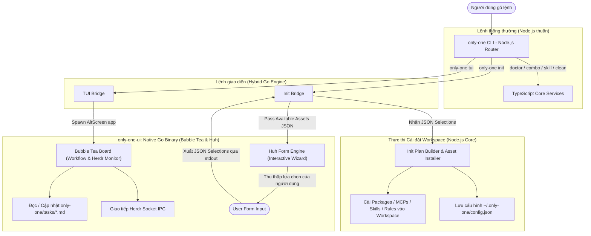

# Concept: Tái cấu trúc TUI Board và Init Wizard bằng Go (Mô hình Hybrid)

## 1. Problem & Goal (Vấn đề & Mục tiêu)

### Problem (Current Bottlenecks & Deficiencies)
- **Context & Trigger**: Người dùng khởi chạy bảng điều khiển quy trình `only-one tui` hoặc trình wizard cài đặt `only-one init` trên terminal.
- **Symptom & Defect**:
  - Giao diện TUI trên nền Node.js + Ink bị giật khung hình (flickering) khi re-render hoặc resize cửa sổ terminal.
  - Thiếu khả năng tương tác chuột mượt mà (không cuộn chuột trơn tru, không click chọn trực quan).
  - Trình wizard `only-one init` dễ xung đột I/O stream console với Node.js runtime (từng gây lỗi `unsettled top-level await` khi nhấn Ctrl+C).
  - Tốn bộ nhớ RAM và độ trễ khởi động của máy ảo V8 Node.js (~200–400ms).
- **Root Cause**:
  - Thư viện Ink phụ thuộc vào việc clear và stream lại chuỗi ký tự qua stdout mà không có bộ đệm cell terminal 2 chiều (double buffering).
  - Node.js không được tối ưu cho việc render terminal 60 FPS thời gian thực.
- **Impact / Blast Radius**:
  - Giảm trải nghiệm người dùng, tạo cảm giác TUI nặng nề và kém ổn định.

### Goal (Target Technical Outcomes)
- **Core Goal**: Xây dựng module nhị phân Go độc lập (`only-one-ui`) sử dụng hệ sinh thái Charm (**Bubble Tea**, **Lipgloss**, **Huh**) để vận hành `tui` và `init`, tích hợp liền mạch vào CLI Node.js hiện tại theo mô hình Hybrid.
- **Acceptance Criteria**:
  - Thời gian khởi động TUI dưới 15ms.
  - Khử hoàn toàn hiện tượng chớp nháy (zero-flickering 60 FPS) nhờ kiến trúc Model-Update-View của Bubble Tea.
  - Hỗ trợ thao tác chuột đầy đủ (click chọn task, cuộn trang).
  - Init Wizard sử dụng thư viện `Huh` với giao diện chuyên nghiệp, mượt mà và không bao giờ treo I/O khi thoát đột ngột (Ctrl+C).
  - Tích hợp trực tiếp với Herdr Socket API và đồng bộ dữ liệu `only-one/tasks` với `~/.only-one/config.json`.
  - Phân phối nhị phân cross-platform (Windows, macOS, Linux) thông qua gói npm `only-one`.

---

## 2. Scope Boundaries (Phạm vi giải pháp)

### In-Scope
- Xây dựng thư mục mã nguồn Go `packages/tui-engine/`:
  - Chế độ 1 — `board`: Bảng Kanban 4 cột (`CONCEPT`, `PLAN`, `PROCESSING`, `DONE`), Herdr Pane Monitor và phím điều hướng nhanh.
  - Chế độ 2 — `init`: Trình thiết lập tương tác đa bước (Packages, MCPs, Git Profiles, VS Code Extensions, Combos) bằng `Huh`.
- Tạo cơ chế gọi Binary từ Node.js (`src/tui/bridge.ts`):
  - Kiểm tra và tự động thực thi file nhị phân Go tương ứng với hệ điều hành (`only-one-ui.exe` trên Windows, `only-one-ui` trên POSIX).
- Quy trình biên dịch cross-compile (`scripts/build-go.js`):
  - Tự động biên dịch Go binary cho `windows-amd64`, `darwin-arm64`, `linux-amd64` và đóng gói vào package npm.

### Explicit Out-of-Scope
- Không viết lại toàn bộ CLI `only-one` bằng Go (giữ nguyên các lệnh `doctor`, `combo`, `skill`, `manifest` bằng TypeScript).
- Không thay đổi cấu trúc tài liệu SDLC (`concept.md`, `plan.md`, `debug.md`).
- Không can thiệp vào các core skills (`only-one-idea`, `only-one-apply`...).

---

## 3. Proposed Solution & Core Mechanism (Giải pháp đề xuất & Cơ chế cốt lõi)

### Kiến trúc Tích hợp Hybrid (Architecture Flow)

Kiến trúc phân định rõ ràng giữa **Tầng Điều phối & Nghiệp vụ (Node.js)** và **Tầng Giao diện Hiển thị (Go Native Engine)**:



---

### Chi tiết Luồng hoạt động của 2 Chế độ Giao diện

#### 1. Luồng Bảng điều khiển Quy trình: `only-one tui` (Standalone AltScreen App)
1. **Khởi tạo**:
   - `only-one tui` kiểm tra binary `only-one-ui` và spawn process ở chế độ terminal AltScreen (`only-one-ui board --workspace <cwd>`).
2. **Xử lý dữ liệu & Render (Bubble Tea + Lipgloss)**:
   - Go engine nạp danh sách task từ `only-one/tasks/` và nạp cấu hình `~/.only-one/config.json`.
   - Lắng nghe sự kiện thay đổi file thời gian thực (`fsnotify`) để tự động cập nhật card mà không chớp nháy.
   - Kết nối với Herdr Socket để lấy danh sách Pane/Agent và theo dõi trạng thái `idle`/`working`.
3. **Thao tác**:
   - Phím tắt `[←/→]`, `[↑/↓]`, `[m]` Move task, `[d]` Dispatch, `[p]` Plan, `[a]` Apply, `[c]` Clean.
   - Hỗ trợ cuộn chuột và click chuột trực tiếp vào task card.
4. **Kết thúc**:
   - Khi người dùng nhấn `q` hoặc `Esc`, Go engine đóng AltScreen và hoàn trả terminal nguyên vẹn cho shell.

---

#### 2. Luồng Trình cài đặt Tương tác: `only-one init` (Two-Way Handshake Wizard)
1. **Giai đoạn 1 — Chuẩn bị dữ liệu (Node.js Core)**:
   - Node.js quét workspace hiện tại và chuẩn bị danh sách tài nguyên khả dụng (Packages, MCPs, Skills, Rules, Combos).
   - Đóng gói dữ liệu thành JSON và truyền vào Go binary:
     ```bash
     only-one-ui init --input <assets-json-path>
     ```
2. **Giai đoạn 2 — Thu thập lựa chọn (Go Huh Form Engine)**:
   - Go engine dựng giao diện wizard đa bước siêu mượt bằng `Huh`:
     - Bước 1: Chọn IDE / Target Agents (`antigravity`, `claude`, `cursor`, `codex`).
     - Bước 2: Chọn hình thức cài đặt (`Combo` mẫu hay `Tùy chỉnh`).
     - Bước 3: Đánh dấu các Packages, MCPs, Skills, Rules cần cài.
     - Bước 4: Tùy chọn ghi đè (`overwrite`).
   - Người dùng có thể nhấn `Ctrl+C` bất cứ lúc nào để hủy an toàn mà không bị lỗi treo I/O.
   - Khi hoàn tất, Go engine xuất kết quả lựa chọn `InitSelectionInputs` dưới dạng JSON qua stdout và thoát process với mã 0.
3. **Giai đoạn 3 — Thực thi cài đặt (Node.js Core)**:
   - Node.js bridge nhận chuỗi JSON từ stdout của Go binary.
   - Kích hoạt `executeInitCommand` để sao chép file, liên kết MCP server, cập nhật `.gitignore` và lưu `config.json`.
   - In bảng báo cáo nghiệm thu hoàn tất ra console.

---

## 4. Critical Risks & Edge Cases (Rủi ro & Trường hợp biên)

- **Phân phối nhị phân đa nền tảng qua npm**:
  - *Rủi ro*: Người dùng cài package qua npm không có sẵn trình biên dịch Go trên máy.
  - *Giải pháp*: Biên dịch sẵn các file binary (`windows-amd64.exe`, `darwin-arm64`, `linux-amd64`) và nhúng trực tiếp vào thư mục `bin/` của package npm khi publish (giống mô hình của `esbuild` / `biome`).
- **Khả năng tương thích Terminal trên Windows (cmd.exe vs Windows Terminal)**:
  - *Rủi ro*: cmd.exe cổ điển có thể thiếu hỗ trợ màu ANSI 24-bit.
  - *Giải pháp*: Thư viện `muesli/termenv` trong hệ sinh thái Charm tự động phát hiện profile terminal và fallback về chế độ màu 256 hoặc 16 màu an toàn.
- **Xử lý ngắt đột ngột (Graceful Exit on Ctrl+C)**:
  - *Rủi ro*: Thoát giữa chừng khi form đang chạy.
  - *Giải pháp*: Thư viện `Huh` tích hợp sẵn context cancellation, tự động xóa con trỏ tạm và hoàn trả buffer stdin/stdout sạch sẽ cho terminal cha.
