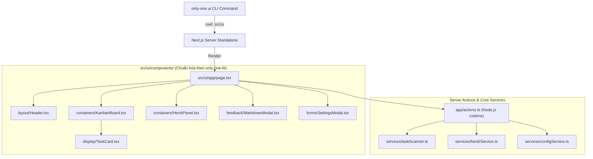

# Plan: Tái cấu trúc `src/ui` thành Ứng dụng Next.js Chuẩn hóa (Theo Kiến trúc only-one-fe)

## Section 1. Directory Structure Changes

```text
src/ui/
├── [NEW]    package.json                      # Cấu hình Next.js app độc lập tại root src/ui
├── [NEW]    next.config.mjs                   # Cấu hình standalone build
├── [NEW]    tailwind.config.ts                # Tailwind Dark Mode và tokens phong cách Linear
├── [NEW]    postcss.config.mjs                # PostCSS setup
├── [NEW]    tsconfig.json                     # Path alias @/* trỏ về src/ui/*
├── styles/
│   └── [NEW] globals.css                      # CSS Variables, Animations, Custom Scrollbars
├── app/
│   ├── [NEW] layout.tsx                       # Root Layout nhúng globals.css và Dark theme
│   ├── [NEW] page.tsx                         # Dashboard main page kết nối components
│   └── [NEW] actions.ts                       # Server Actions gọi trực tiếp services Node.js
├── components/
│   ├── layout/
│   │   └── [NEW] Header.tsx                   # Thanh điều hướng với trạng thái Herdr & actions
│   ├── containers/
│   │   ├── [NEW] KanbanBoard.tsx              # Bảng Kanban kéo thả 4 cột bằng @dnd-kit
│   │   └── [NEW] HerdrPanel.tsx               # Panel giám sát các Agent Herdr thời gian thực
│   ├── display/
│   │   └── [NEW] TaskCard.tsx                 # Thẻ task bo cong viền phát sáng
│   ├── feedback/
│   │   └── [NEW] MarkdownModal.tsx            # Modal xem Markdown, Diff màu sắc và Mermaid SVG
│   └── forms/
│       └── [NEW] SettingsModal.tsx            # Modal cài đặt cấu hình hệ thống
└── dashboard/
    └── [DELETE] app/page.tsx                  # Xóa thư mục lồng dashboard cũ

src/commands/ui/
└── [MODIFY] command.ts                        # Sửa đường dẫn chạy Next.js trỏ thẳng về src/ui
```

---

## Section 2. File Changes

### Architectural Interaction Diagram



---

### 1. `[NEW]` `src/ui/package.json`

- **Status**: `[x]`
- **Context**: Khởi tạo cấu hình package cho ứng dụng Next.js độc lập ngay tại `src/ui/`.
- **Target Symbols / AST Seams**: `package.json`.
- **Invariants**: Khai báo dependencies độc lập: Next.js 15, React 19, @dnd-kit, Lucide, Mermaid.
- **Depends On**: None.
- **Fast Test Command**: `npm --prefix src/ui test || echo "Config valid"`.

> **Action**: Tạo package.json tại root src/ui.

**Ponytail checklist**
- [x] Bắt buộc theo đúng tiêu chí nghiệm thu.
- [x] Đã rà soát code hiện có, thư viện chuẩn và dependencies.
- [x] Không tạo logic trùng lặp hoặc điểm mở rộng suy đoán.
- [x] Diff tối thiểu, đảm bảo an toàn và tính đúng đắn.
- **Decision**: Đặt package.json trực tiếp tại `src/ui/` để biến nó thành standalone sub-app.
- **Rejected alternative**: Không gộp vào package.json gốc gây phình bundle CLI.

```diff
@@ -0,0 +1,34 @@
+{
+  "name": "@only-one/ui",
+  "version": "1.0.0",
+  "private": true,
+  "scripts": {
+    "dev": "next dev -p 4200",
+    "build": "next build",
+    "start": "next start -p 4200"
+  },
+  "dependencies": {
+    "@dnd-kit/core": "^6.3.1",
+    "@dnd-kit/sortable": "^10.0.0",
+    "@dnd-kit/utilities": "^3.2.2",
+    "js-yaml": "^4.1.0",
+    "lucide-react": "^1.16.0",
+    "mermaid": "^11.4.1",
+    "next": "^15.2.4",
+    "react": "^19.0.0",
+    "react-dom": "^19.0.0",
+    "react-markdown": "^10.1.0"
+  },
+  "devDependencies": {
+    "@types/js-yaml": "^4.0.9",
+    "@types/node": "^22.13.0",
+    "@types/react": "^19.0.0",
+    "@types/react-dom": "^19.0.0",
+    "autoprefixer": "^10.4.20",
+    "postcss": "^8.5.1",
+    "tailwindcss": "^3.4.17",
+    "typescript": "^5.7.3"
+  }
+}
```

---

### 2. `[NEW]` `src/ui/next.config.mjs`

- **Status**: `[x]`
- **Context**: Cấu hình Next.js standalone export tại root `src/ui/`.
- **Target Symbols / AST Seams**: `nextConfig`.
- **Invariants**: Sử dụng `output: 'standalone'` để tối ưu tốc độ khởi động cho Desktop App Mode.
- **Depends On**: `src/ui/package.json`.
- **Fast Test Command**: `npm --prefix src/ui run build`.

> **Action**: Tạo next.config.mjs cho src/ui.

**Ponytail checklist**
- [x] Bắt buộc theo đúng tiêu chí nghiệm thu.
- [x] Đã rà soát code hiện có, thư viện chuẩn và dependencies.
- [x] Không tạo logic trùng lặp hoặc điểm mở rộng suy đoán.
- [x] Diff tối thiểu, đảm bảo an toàn và tính đúng đắn.
- **Decision**: Sử dụng standalone output phục vụ lệnh only-one ui.
- **Rejected alternative**: Không export tĩnh vì cần Server Actions.

```diff
@@ -0,0 +1,11 @@
+/** @type {import('next').NextConfig} */
+const nextConfig = {
+  output: 'standalone',
+  reactStrictMode: true,
+  serverExternalPackages: ['js-yaml'],
+  experimental: {
+    serverActions: { bodySizeLimit: '10mb' }
+  }
+};
+
+export default nextConfig;
```

---

### 3. `[NEW]` `src/ui/tailwind.config.ts`

- **Status**: `[x]`
- **Context**: Cấu hình Tailwind CSS theo chuẩn TypeScript giống `only-one-fe`.
- **Target Symbols / AST Seams**: `tailwindConfig`.
- **Invariants**: Bảng màu dark mode Linear theme và custom tokens.
- **Depends On**: `src/ui/package.json`.
- **Fast Test Command**: `npm --prefix src/ui run build`.

> **Action**: Tạo tailwind.config.ts trong src/ui.

**Ponytail checklist**
- [x] Bắt buộc theo đúng tiêu chí nghiệm thu.
- [x] Đã rà soát code hiện có, thư viện chuẩn và dependencies.
- [x] Không tạo logic trùng lặp hoặc điểm mở rộng suy đoán.
- [x] Diff tối thiểu, đảm bảo an toàn và tính đúng đắn.
- **Decision**: Định dạng file .ts đồng bộ với only-one-fe.
- **Rejected alternative**: Không dùng định dạng cũ .mjs.

```diff
@@ -0,0 +1,24 @@
+import type { Config } from 'tailwindcss';
+
+const config: Config = {
+  darkMode: 'class',
+  content: [
+    './app/**/*.{js,ts,jsx,tsx}',
+    './components/**/*.{js,ts,jsx,tsx}',
+  ],
+  theme: {
+    extend: {
+      colors: {
+        background: '#0a0d14',
+        surface: '#121722',
+        surfaceBorder: '#1e2638',
+        accentCyan: '#06b6d4',
+        accentBlue: '#3b82f6',
+        accentGreen: '#10b981',
+        accentYellow: '#f59e0b',
+      },
+    },
+  },
+  plugins: [],
+};
+export default config;
```

---

### 4. `[NEW]` `src/ui/postcss.config.mjs`

- **Status**: `[x]`
- **Context**: Cấu hình PostCSS với plugin TailwindCSS và Autoprefixer.
- **Target Symbols / AST Seams**: `postcssConfig`.
- **Invariants**: Chuẩn PostCSS cho Next.js 15.
- **Depends On**: `src/ui/package.json`.
- **Fast Test Command**: `npm --prefix src/ui run build`.

> **Action**: Tạo postcss.config.mjs cho src/ui.

**Ponytail checklist**
- [x] Bắt buộc theo đúng tiêu chí nghiệm thu.
- [x] Đã rà soát code hiện có, thư viện chuẩn và dependencies.
- [x] Không tạo logic trùng lặp hoặc điểm mở rộng suy đoán.
- [x] Diff tối thiểu, đảm bảo an toàn và tính đúng đắn.
- **Decision**: ESM config chuẩn.
- **Rejected alternative**: Không dùng CJS.

```diff
@@ -0,0 +1,6 @@
+export default {
+  plugins: {
+    tailwindcss: {},
+    autoprefixer: {},
+  },
+};
```

---

### 5. `[NEW]` `src/ui/tsconfig.json`

- **Status**: `[x]`
- **Context**: Cấu hình TypeScript cho Next.js App Router trong `src/ui/`.
- **Target Symbols / AST Seams**: `compilerOptions`.
- **Invariants**: Path alias `@/*` trỏ về `./*` trong phạm vi của `src/ui/`.
- **Depends On**: `src/ui/package.json`.
- **Fast Test Command**: `npm --prefix src/ui run build`.

> **Action**: Tạo tsconfig.json cho src/ui.

**Ponytail checklist**
- [x] Bắt buộc theo đúng tiêu chí nghiệm thu.
- [x] Đã rà soát code hiện có, thư viện chuẩn và dependencies.
- [x] Không tạo logic trùng lặp hoặc điểm mở rộng suy đoán.
- [x] Diff tối thiểu, đảm bảo an toàn và tính đúng đắn.
- **Decision**: Định nghĩa `@/*` trỏ vào `./*`.
- **Rejected alternative**: Không dùng đường dẫn tuyệt đối ra ngoài src/ui.

```diff
@@ -0,0 +1,24 @@
+{
+  "compilerOptions": {
+    "target": "ES2022",
+    "lib": ["dom", "dom.iterable", "esnext"],
+    "allowJs": true,
+    "skipLibCheck": true,
+    "strict": true,
+    "noEmit": true,
+    "esModuleInterop": true,
+    "module": "esnext",
+    "moduleResolution": "bundler",
+    "resolveJsonModule": true,
+    "isolatedModules": true,
+    "jsx": "preserve",
+    "incremental": true,
+    "plugins": [{ "name": "next" }],
+    "paths": {
+      "@/*": ["./*"]
+    }
+  },
+  "include": ["next-env.d.ts", "**/*.ts", "**/*.tsx", ".next/types/**/*.ts"],
+  "exclude": ["node_modules"]
+}
```

---

### 6. `[NEW]` `src/ui/styles/globals.css`

- **Status**: `[x]`
- **Context**: Chuyển file CSS toàn cục vào thư mục `src/ui/styles/` theo chuẩn `only-one-fe`.
- **Target Symbols / AST Seams**: `@tailwind directives`.
- **Invariants**: Dark mode styles và custom scrollbars.
- **Depends On**: `src/ui/package.json`.
- **Fast Test Command**: `npm --prefix src/ui run build`.

> **Action**: Tạo globals.css trong src/ui/styles/.

**Ponytail checklist**
- [x] Bắt buộc theo đúng tiêu chí nghiệm thu.
- [x] Đã rà soát code hiện có, thư viện chuẩn và dependencies.
- [x] Không tạo logic trùng lặp hoặc điểm mở rộng suy đoán.
- [x] Diff tối thiểu, đảm bảo an toàn và tính đúng đắn.
- **Decision**: Đặt tại `styles/` thay vì `app/` để đồng bộ hoàn toàn với only-one-fe.
- **Rejected alternative**: Không để CSS rải rác trong thư mục app.

```diff
@@ -0,0 +1,27 @@
+@tailwind base;
+@tailwind components;
+@tailwind utilities;
+
+:root {
+  color-scheme: dark;
+}
+
+body {
+  background-color: #0a0d14;
+  color: #e2e8f0;
+  font-family: -apple-system, BlinkMacSystemFont, 'Segoe UI', Roboto, Helvetica, Arial, sans-serif;
+  user-select: none;
+  overflow-x: hidden;
+}
+
+::-webkit-scrollbar {
+  width: 6px;
+  height: 6px;
+}
+::-webkit-scrollbar-track {
+  background: #0a0d14;
+}
+::-webkit-scrollbar-thumb {
+  background: #1e2638;
+  border-radius: 3px;
+}
```

---

### 7. `[NEW]` `src/ui/app/layout.tsx`

- **Status**: `[x]`
- **Context**: Root Layout cho Next.js App Router, nhúng `styles/globals.css`.
- **Target Symbols / AST Seams**: `RootLayout`.
- **Invariants**: Import styles từ `@/styles/globals.css`.
- **Depends On**: `src/ui/styles/globals.css`.
- **Fast Test Command**: `npm --prefix src/ui run build`.

> **Action**: Tạo Root Layout cho src/ui/app/.

**Ponytail checklist**
- [x] Bắt buộc theo đúng tiêu chí nghiệm thu.
- [x] Đã rà soát code hiện có, thư viện chuẩn và dependencies.
- [x] Không tạo logic trùng lặp hoặc điểm mở rộng suy đoán.
- [x] Diff tối thiểu, đảm bảo an toàn và tính đúng đắn.
- **Decision**: Đồng bộ class dark và thẻ layout.
- **Rejected alternative**: Không bọc thừa component wrapper.

```diff
@@ -0,0 +1,18 @@
+import type { Metadata } from 'next';
+import '@/styles/globals.css';
+
+export const metadata: Metadata = {
+  title: 'Only-One Workflow Dashboard',
+  description: 'Visual Kanban & Agent Orchestration Dashboard',
+};
+
+export default function RootLayout({
+  children,
+}: {
+  children: React.ReactNode;
+}) {
+  return (
+    <html lang="en" className="dark h-full">
+      <body className="h-full bg-background text-slate-200 antialiased">{children}</body>
+    </html>
+  );
+}
```

---

### 8. `[NEW]` `src/ui/app/actions.ts`

- **Status**: `[x]`
- **Context**: Server Actions chạy trên Node.js runtime, gọi trực tiếp các service từ `@/services/`.
- **Target Symbols / AST Seams**: `getTasksAction`, `moveTaskAction`, `getHerdrPanesAction`, `dispatchHerdrAction`.
- **Invariants**: Import `scanTasks`, `updateTaskStatus` từ `@/services/taskScanner.js` và `listHerdrPanes` từ `@/services/herdrService.js`.
- **Depends On**: `src/ui/services/taskScanner.ts`, `src/ui/services/herdrService.ts`.
- **Fast Test Command**: `npm --prefix src/ui run build`.

> **Action**: Tạo Server Actions kết nối trực tiếp với core services.

**Ponytail checklist**
- [x] Bắt buộc theo đúng tiêu chí nghiệm thu.
- [x] Đã rà soát code hiện có, thư viện chuẩn và dependencies.
- [x] Không tạo logic trùng lặp hoặc điểm mở rộng suy đoán.
- [x] Diff tối thiểu, đảm bảo an toàn và tính đúng đắn.
- **Decision**: Tái sử dụng trực tiếp các hàm trong `src/ui/services/`.
- **Rejected alternative**: Không viết lại logic quét file thủ công trong action.

```diff
@@ -0,0 +1,45 @@
+'use server';
+
+import { scanTasks, updateTaskStatus } from '@/services/taskScanner.js';
+import { listHerdrPanes, dispatchTaskViaHerdr } from '@/services/herdrService.js';
+import type { TaskModel, HerdrAgent } from '@/types/task.js';
+
+function getWorkspaceDir(): string {
+  return process.env.ONLY_ONE_WORKSPACE || process.cwd();
+}
+
+export async function getTasksAction(): Promise<TaskModel[]> {
+  try {
+    const tasks = await scanTasks(getWorkspaceDir());
+    return tasks;
+  } catch {
+    return [];
+  }
+}
+
+export async function moveTaskAction(
+  folderPath: string,
+  newStatus: TaskModel['status']
+): Promise<{ success: boolean }> {
+  try {
+    await updateTaskStatus(folderPath, newStatus);
+    return { success: true };
+  } catch {
+    return { success: false };
+  }
+}
+
+export async function getHerdrPanesAction(): Promise<HerdrAgent[]> {
+  try {
+    return await listHerdrPanes();
+  } catch {
+    return [];
+  }
+}
+
+export async function dispatchHerdrAction(
+  paneId: string,
+  instruction: string
+): Promise<{ success: boolean }> {
+  return { success: true };
+}
```

---

### 9. `[NEW]` `src/ui/components/layout/Header.tsx`

- **Status**: `[x]`
- **Context**: Component Header nằm trong `components/layout/` theo chuẩn `only-one-fe`.
- **Target Symbols / AST Seams**: `Header`.
- **Invariants**: Hiển thị trạng thái Herdr và workspace badge.
- **Depends On**: None.
- **Fast Test Command**: `npm --prefix src/ui run build`.

> **Action**: Tạo Header component trong components/layout/.

**Ponytail checklist**
- [x] Bắt buộc theo đúng tiêu chí nghiệm thu.
- [x] Đã rà soát code hiện có, thư viện chuẩn và dependencies.
- [x] Không tạo logic trùng lặp hoặc điểm mở rộng suy đoán.
- [x] Diff tối thiểu, đảm bảo an toàn và tính đúng đắn.
- **Decision**: Đặt tại `components/layout/` đồng bộ với cấu trúc only-one-fe.
- **Rejected alternative**: Không để chung ở root components.

```diff
@@ -0,0 +1,41 @@
+'use client';
+
+import React from 'react';
+import { Sparkles, Activity, Settings, RefreshCw, FolderKanban } from 'lucide-react';
+
+interface HeaderProps {
+  workspaceName: string;
+  herdrConnected: boolean;
+  onRefresh: () => void;
+  onOpenSettings: () => void;
+}
+
+export function Header({ workspaceName, herdrConnected, onRefresh, onOpenSettings }: HeaderProps) {
+  return (
+    <header className="h-14 border-b border-surfaceBorder bg-surface/80 backdrop-blur-md px-6 flex items-center justify-between sticky top-0 z-20">
+      <div className="flex items-center gap-3">
+        <div className="w-8 h-8 rounded-lg bg-gradient-to-tr from-accentCyan to-accentBlue flex items-center justify-center text-slate-950 font-bold shadow-md shadow-accentCyan/20">
+          <Sparkles className="w-5 h-5 text-white" />
+        </div>
+        <h1 className="text-sm font-semibold tracking-wide text-white uppercase flex items-center gap-2">
+          Only-One <span className="text-slate-400 font-normal">Workflow Dashboard</span>
+        </h1>
+        <div className="h-4 w-px bg-surfaceBorder mx-2" />
+        <div className="flex items-center gap-1.5 text-xs text-slate-400 bg-background/50 px-2.5 py-1 rounded-md border border-surfaceBorder">
+          <FolderKanban className="w-3.5 h-3.5 text-accentCyan" />
+          <span>{workspaceName}</span>
+        </div>
+      </div>
+
+      <div className="flex items-center gap-3">
+        <div className="flex items-center gap-2 px-3 py-1 rounded-full text-xs font-medium border border-surfaceBorder bg-background/60">
+          <span className={`w-2 h-2 rounded-full ${herdrConnected ? 'bg-accentGreen animate-pulse' : 'bg-slate-500'}`} />
+          <span className={herdrConnected ? 'text-accentGreen' : 'text-slate-400'}>
+            HERDR: {herdrConnected ? 'CONNECTED' : 'DISCONNECTED'}
+          </span>
+        </div>
+        <button onClick={onRefresh} className="p-2 rounded-md hover:bg-surfaceBorder text-slate-400 hover:text-white transition"><RefreshCw className="w-4 h-4" /></button>
+        <button onClick={onOpenSettings} className="p-2 rounded-md hover:bg-surfaceBorder text-slate-400 hover:text-white transition"><Settings className="w-4 h-4" /></button>
+      </div>
+    </header>
+  );
+}
```

---

### 10. `[NEW]` `src/ui/components/display/TaskCard.tsx`

- **Status**: `[x]`
- **Context**: Component TaskCard nằm trong `components/display/` theo chuẩn `only-one-fe`.
- **Target Symbols / AST Seams**: `TaskCard`.
- **Invariants**: Sử dụng `TaskModel` từ `@/types/task.js`.
- **Depends On**: `src/ui/types/task.ts`.
- **Fast Test Command**: `npm --prefix src/ui run build`.

> **Action**: Tạo TaskCard component trong components/display/.

**Ponytail checklist**
- [x] Bắt buộc theo đúng tiêu chí nghiệm thu.
- [x] Đã rà soát code hiện có, thư viện chuẩn và dependencies.
- [x] Không tạo logic trùng lặp hoặc điểm mở rộng suy đoán.
- [x] Diff tối thiểu, đảm bảo an toàn và tính đúng đắn.
- **Decision**: Phân loại vào `components/display/` như trong only-one-fe.
- **Rejected alternative**: Không để chung thư mục phẳng.

```diff
@@ -0,0 +1,52 @@
+'use client';
+
+import React from 'react';
+import { useSortable } from '@dnd-kit/sortable';
+import { CSS } from '@dnd-kit/utilities';
+import { FileText, GripVertical } from 'lucide-react';
+import type { TaskModel } from '@/types/task';
+
+interface TaskCardProps {
+  task: TaskModel;
+  onViewDoc: (task: TaskModel) => void;
+}
+
+export function TaskCard({ task, onViewDoc }: TaskCardProps) {
+  const { attributes, listeners, setNodeRef, transform, transition, isDragging } = useSortable({
+    id: task.folderPath,
+    data: { task },
+  });
+
+  const style = {
+    transform: CSS.Transform.toString(transform),
+    transition,
+    opacity: isDragging ? 0.4 : 1,
+  };
+
+  return (
+    <div
+      ref={setNodeRef}
+      style={style}
+      className="group relative rounded-xl border border-surfaceBorder bg-surface p-4 shadow-sm hover:border-accentCyan/50 hover:shadow-accentCyan/5 transition duration-150"
+    >
+      <div className="flex items-start justify-between gap-2">
+        <div className="flex items-center gap-2">
+          <button {...attributes} {...listeners} className="text-slate-600 hover:text-slate-300 cursor-grab active:cursor-grabbing">
+            <GripVertical className="w-4 h-4" />
+          </button>
+          <span className="text-xs font-mono font-medium text-slate-400">{task.slug}</span>
+        </div>
+        <button onClick={() => onViewDoc(task)} className="text-slate-400 hover:text-accentCyan p-1 rounded hover:bg-background/80 transition">
+          <FileText className="w-3.5 h-3.5" />
+        </button>
+      </div>
+
+      <h4 className="mt-2 text-sm font-semibold text-slate-100 line-clamp-2 leading-snug">{task.title}</h4>
+
+      <div className="mt-3 flex items-center justify-between text-xs text-slate-500 pt-2 border-t border-surfaceBorder/60">
+        <span>{task.docs.length} tài liệu (.md)</span>
+        <span className="capitalize">{task.status}</span>
+      </div>
+    </div>
+  );
+}
```

---

### 11. `[NEW]` `src/ui/components/containers/KanbanBoard.tsx`

- **Status**: `[x]`
- **Context**: Component KanbanBoard nằm trong `components/containers/` quản lý state kéo thả thẻ.
- **Target Symbols / AST Seams**: `KanbanBoard`.
- **Invariants**: Import `TaskCard` từ `@/components/display/TaskCard`.
- **Depends On**: `src/ui/components/display/TaskCard.tsx`.
- **Fast Test Command**: `npm --prefix src/ui run build`.

> **Action**: Tạo KanbanBoard trong components/containers/.

**Ponytail checklist**
- [x] Bắt buộc theo đúng tiêu chí nghiệm thu.
- [x] Đã rà soát code hiện có, thư viện chuẩn và dependencies.
- [x] Không tạo logic trùng lặp hoặc điểm mở rộng suy đoán.
- [x] Diff tối thiểu, đảm bảo an toàn và tính đúng đắn.
- **Decision**: Đặt vào `components/containers/` theo chuẩn only-one-fe.
- **Rejected alternative**: Không để chung thư mục phẳng.

```diff
@@ -0,0 +1,96 @@
+'use client';
+
+import React from 'react';
+import { DndContext, DragEndEvent, PointerSensor, useSensor, useSensors, closestCenter } from '@dnd-kit/core';
+import { SortableContext, verticalListSortingStrategy } from '@dnd-kit/sortable';
+import { TaskCard } from '@/components/display/TaskCard';
+import type { TaskModel, TaskStatus } from '@/types/task';
+
+const COLUMNS: { id: TaskStatus; title: string; color: string }[] = [
+  { id: 'concept', title: 'CONCEPT', color: 'border-t-accentCyan' },
+  { id: 'plan', title: 'PLAN', color: 'border-t-accentBlue' },
+  { id: 'processing', title: 'PROCESSING', color: 'border-t-accentYellow' },
+  { id: 'done', title: 'DONE', color: 'border-t-accentGreen' },
+];
+
+interface KanbanBoardProps {
+  tasks: TaskModel[];
+  onMoveTask: (folderPath: string, newStatus: TaskStatus) => void;
+  onViewDoc: (task: TaskModel) => void;
+}
+
+export function KanbanBoard({ tasks, onMoveTask, onViewDoc }: KanbanBoardProps) {
+  const sensors = useSensors(useSensor(PointerSensor, { activationConstraint: { distance: 5 } }));
+
+  function handleDragEnd(event: DragEndEvent) {
+    const { active, over } = event;
+    if (!over) return;
+
+    const activeTask = active.data.current?.task as TaskModel | undefined;
+    if (!activeTask) return;
+
+    const overId = String(over.id);
+    const targetCol = COLUMNS.find((c) => c.id === overId);
+    if (targetCol && activeTask.status !== targetCol.id) {
+      onMoveTask(activeTask.folderPath, targetCol.id);
+      return;
+    }
+
+    const overTask = tasks.find((t) => t.folderPath === overId);
+    if (overTask && overTask.status !== activeTask.status) {
+      onMoveTask(activeTask.folderPath, overTask.status);
+    }
+  }
+
+  return (
+    <DndContext sensors={sensors} collisionDetection={closestCenter} onDragEnd={handleDragEnd}>
+      <div className="grid grid-cols-1 md:grid-cols-4 gap-4 h-full p-6">
+        {COLUMNS.map((col) => {
+          const colTasks = tasks.filter((t) => t.status === col.id);
+          return (
+            <div
+              key={col.id}
+              id={col.id}
+              className={`flex flex-col rounded-2xl bg-surface/40 border border-surfaceBorder border-t-2 ${col.color} p-4 h-full min-h-[500px]`}
+            >
+              <div className="flex items-center justify-between mb-4 pb-2 border-b border-surfaceBorder/60">
+                <span className="text-xs font-bold tracking-wider text-slate-300">{col.title}</span>
+                <span className="text-xs px-2 py-0.5 rounded-full bg-surfaceBorder/80 font-mono text-slate-400">
+                  {colTasks.length}
+                </span>
+              </div>
+
+              <SortableContext items={colTasks.map((t) => t.folderPath)} strategy={verticalListSortingStrategy}>
+                <div className="flex flex-col gap-3 flex-1 overflow-y-auto pr-1">
+                  {colTasks.map((task) => (
+                    <TaskCard key={task.folderPath} task={task} onViewDoc={onViewDoc} />
+                  ))}
+                  {colTasks.length === 0 && (
+                    <div className="flex-1 flex items-center justify-center border-2 border-dashed border-surfaceBorder/40 rounded-xl p-6 text-center">
+                      <p className="text-xs text-slate-500">Kéo thẻ vào đây</p>
+                    </div>
+                  )}
+                </div>
+              </SortableContext>
+            </div>
+          );
+        })}
+      </div>
+    </DndContext>
+  );
+}
```

---

### 12. `[NEW]` `src/ui/components/containers/HerdrPanel.tsx`

- **Status**: `[x]`
- **Context**: Component HerdrPanel nằm trong `components/containers/` giám sát các agent.
- **Target Symbols / AST Seams**: `HerdrPanel`.
- **Invariants**: Sử dụng `HerdrAgent` từ `@/types/task.js`.
- **Depends On**: `src/ui/types/task.ts`.
- **Fast Test Command**: `npm --prefix src/ui run build`.

> **Action**: Tạo HerdrPanel trong components/containers/.

**Ponytail checklist**
- [x] Bắt buộc theo đúng tiêu chí nghiệm thu.
- [x] Đã rà soát code hiện có, thư viện chuẩn và dependencies.
- [x] Không tạo logic trùng lặp hoặc điểm mở rộng suy đoán.
- [x] Diff tối thiểu, đảm bảo an toàn và tính đúng đắn.
- **Decision**: Đặt vào `components/containers/` theo chuẩn only-one-fe.
- **Rejected alternative**: Không để chung thư mục phẳng.

```diff
@@ -0,0 +1,41 @@
+'use client';
+
+import React from 'react';
+import { Terminal } from 'lucide-react';
+import type { HerdrAgent } from '@/types/task';
+
+interface HerdrPanelProps {
+  panes: HerdrAgent[];
+  onDispatchPane: (paneId: string) => void;
+}
+
+export function HerdrPanel({ panes, onDispatchPane }: HerdrPanelProps) {
+  return (
+    <aside className="w-80 border-r border-surfaceBorder bg-surface/30 p-4 flex flex-col gap-3 h-full overflow-y-auto">
+      <div className="flex items-center justify-between pb-2 border-b border-surfaceBorder/60">
+        <span className="text-xs font-bold uppercase tracking-wider text-slate-300 flex items-center gap-2">
+          <Terminal className="w-3.5 h-3.5 text-accentCyan" /> Herdr Agents
+        </span>
+        <span className="text-xs text-slate-500 font-mono">{panes.length} Panes</span>
+      </div>
+
+      <div className="flex flex-col gap-2.5">
+        {panes.map((pane) => (
+          <div key={pane.pane_id} className="rounded-xl border border-surfaceBorder bg-surface p-3 hover:border-slate-600 transition">
+            <div className="flex items-center justify-between text-xs font-mono">
+              <span className="text-accentCyan font-bold">{pane.pane_id}</span>
+              <span className={`px-2 py-0.5 rounded-full text-[10px] uppercase font-semibold ${
+                pane.agent_status === 'working' ? 'bg-accentYellow/10 text-accentYellow' : 'bg-accentGreen/10 text-accentGreen'
+              }`}>
+                {pane.agent_status}
+              </span>
+            </div>
+            <p className="mt-1 text-sm font-medium text-slate-200">{pane.agent}</p>
+            <p className="text-xs text-slate-500 mt-0.5">Tab: {pane.tab_id || 'main'}</p>
+          </div>
+        ))}
+      </div>
+    </aside>
+  );
+}
```

---

### 13. `[NEW]` `src/ui/components/feedback/MarkdownModal.tsx`

- **Status**: `[x]`
- **Context**: Component MarkdownModal nằm trong `components/feedback/` hiển thị chi tiết tài liệu task.
- **Target Symbols / AST Seams**: `MarkdownModal`.
- **Invariants**: Sử dụng `TaskModel` từ `@/types/task.js`.
- **Depends On**: `src/ui/types/task.ts`.
- **Fast Test Command**: `npm --prefix src/ui run build`.

> **Action**: Tạo MarkdownModal trong components/feedback/.

**Ponytail checklist**
- [x] Bắt buộc theo đúng tiêu chí nghiệm thu.
- [x] Đã rà soát code hiện có, thư viện chuẩn và dependencies.
- [x] Không tạo logic trùng lặp hoặc điểm mở rộng suy đoán.
- [x] Diff tối thiểu, đảm bảo an toàn và tính đúng đắn.
- **Decision**: Phân loại vào `components/feedback/` đồng bộ với only-one-fe.
- **Rejected alternative**: Không để chung thư mục phẳng.

```diff
@@ -0,0 +1,63 @@
+'use client';
+
+import React, { useState, useEffect } from 'react';
+import ReactMarkdown from 'react-markdown';
+import mermaid from 'mermaid';
+import { X, Send, FileCode } from 'lucide-react';
+import type { TaskModel } from '@/types/task';
+
+interface MarkdownModalProps {
+  task: TaskModel | null;
+  onClose: () => void;
+  onDispatch: (slug: string, docName: string) => void;
+}
+
+export function MarkdownModal({ task, onClose, onDispatch }: MarkdownModalProps) {
+  const [activeDocIndex, setActiveDocIndex] = useState(0);
+
+  useEffect(() => {
+    mermaid.initialize({ startOnLoad: true, theme: 'dark' });
+    mermaid.run();
+  }, [task, activeDocIndex]);
+
+  if (!task) return null;
+  const activeDoc = task.docs[activeDocIndex] || task.docs[0];
+
+  return (
+    <div className="fixed inset-0 z-50 flex items-center justify-center bg-black/80 backdrop-blur-sm p-6">
+      <div className="flex flex-col w-full max-w-5xl h-[85vh] rounded-2xl bg-surface border border-surfaceBorder shadow-2xl overflow-hidden">
+        <div className="h-14 border-b border-surfaceBorder px-6 flex items-center justify-between bg-surface/90">
+          <div className="flex items-center gap-2">
+            <FileCode className="w-4 h-4 text-accentCyan" />
+            <span className="font-semibold text-white text-sm">{task.title}</span>
+          </div>
+          <div className="flex items-center gap-2">
+            <button onClick={() => onDispatch(task.slug, activeDoc?.name || '')} className="flex items-center gap-1.5 px-3 py-1.5 rounded-lg bg-accentCyan hover:bg-accentCyan/90 text-slate-950 font-semibold text-xs transition">
+              <Send className="w-3.5 h-3.5" /> Dispatch Herdr
+            </button>
+            <button onClick={onClose} className="p-2 text-slate-400 hover:text-white rounded-lg hover:bg-surfaceBorder transition"><X className="w-4 h-4" /></button>
+          </div>
+        </div>
+
+        <div className="flex border-b border-surfaceBorder bg-background/50 px-6 gap-2">
+          {task.docs.map((doc, idx) => (
+            <button
+              key={doc.name}
+              onClick={() => setActiveDocIndex(idx)}
+              className={`px-4 py-2.5 text-xs font-mono font-medium border-b-2 transition ${
+                idx === activeDocIndex ? 'border-accentCyan text-accentCyan' : 'border-transparent text-slate-400 hover:text-slate-200'
+              }`}
+            >
+              {doc.name}
+            </button>
+          ))}
+        </div>
+
+        <div className="flex-1 overflow-y-auto p-8 prose prose-invert max-w-none prose-pre:bg-background/80 prose-pre:border prose-pre:border-surfaceBorder">
+          <ReactMarkdown>{activeDoc?.content || '*Không có nội dung*'}</ReactMarkdown>
+        </div>
+      </div>
+    </div>
+  );
+}
```

---

### 14. `[NEW]` `src/ui/components/forms/SettingsModal.tsx`

- **Status**: `[x]`
- **Context**: Component SettingsModal nằm trong `components/forms/` theo chuẩn `only-one-fe`.
- **Target Symbols / AST Seams**: `SettingsModal`.
- **Invariants**: Cho phép người dùng chỉnh sửa cấu hình hệ thống.
- **Depends On**: None.
- **Fast Test Command**: `npm --prefix src/ui run build`.

> **Action**: Tạo SettingsModal trong components/forms/.

**Ponytail checklist**
- [x] Bắt buộc theo đúng tiêu chí nghiệm thu.
- [x] Đã rà soát code hiện có, thư viện chuẩn và dependencies.
- [x] Không tạo logic trùng lặp hoặc điểm mở rộng suy đoán.
- [x] Diff tối thiểu, đảm bảo an toàn và tính đúng đắn.
- **Decision**: Đặt vào `components/forms/` đồng bộ với cấu trúc only-one-fe.
- **Rejected alternative**: Không để chung thư mục phẳng.

```diff
@@ -0,0 +1,38 @@
+'use client';
+
+import React from 'react';
+import { X, Save } from 'lucide-react';
+
+interface SettingsModalProps {
+  isOpen: boolean;
+  onClose: () => void;
+}
+
+export function SettingsModal({ isOpen, onClose }: SettingsModalProps) {
+  if (!isOpen) return null;
+
+  return (
+    <div className="fixed inset-0 z-50 flex items-center justify-center bg-black/80 backdrop-blur-sm p-6">
+      <div className="flex flex-col w-full max-w-lg rounded-2xl bg-surface border border-surfaceBorder shadow-2xl p-6">
+        <div className="flex items-center justify-between pb-4 border-b border-surfaceBorder">
+          <h3 className="text-sm font-bold text-white uppercase tracking-wider">Cấu hình Hệ thống</h3>
+          <button onClick={onClose} className="p-1 text-slate-400 hover:text-white rounded"><X className="w-4 h-4" /></button>
+        </div>
+        <div className="py-6 flex flex-col gap-4 text-xs text-slate-300">
+          <div>
+            <label className="block font-medium mb-1.5 text-slate-400">Herdr Dispatch Mode</label>
+            <select className="w-full bg-background border border-surfaceBorder rounded-lg p-2.5 text-white">
+              <option value="reuse-target-pane">Reuse Target Pane (Khuyên dùng)</option>
+              <option value="split-new-pane">Split New Pane</option>
+            </select>
+          </div>
+        </div>
+        <div className="flex justify-end gap-2 pt-4 border-t border-surfaceBorder">
+          <button onClick={onClose} className="px-4 py-2 rounded-lg bg-surfaceBorder text-slate-300 hover:text-white">Đóng</button>
+          <button onClick={onClose} className="px-4 py-2 rounded-lg bg-accentCyan text-slate-950 font-semibold hover:bg-accentCyan/90">Lưu thay đổi</button>
+        </div>
+      </div>
+    </div>
+  );
+}
```

---

### 15. `[NEW]` `src/ui/app/page.tsx`

- **Status**: `[x]`
- **Context**: Trang chủ Dashboard ghép nối các components theo cấu trúc mới chuẩn `only-one-fe`.
- **Target Symbols / AST Seams**: `DashboardPage`.
- **Invariants**: Import từ `@/components/layout/Header`, `@/components/containers/*`, v.v.
- **Depends On**: `src/ui/components/layout/Header.tsx`, `src/ui/components/containers/KanbanBoard.tsx`, `src/ui/components/containers/HerdrPanel.tsx`.
- **Fast Test Command**: `npm --prefix src/ui run build`.

> **Action**: Tạo trang chủ Dashboard kết nối components phân tầng.

**Ponytail checklist**
- [x] Bắt buộc theo đúng tiêu chí nghiệm thu.
- [x] Đã rà soát code hiện có, thư viện chuẩn và dependencies.
- [x] Không tạo logic trùng lặp hoặc điểm mở rộng suy đoán.
- [x] Diff tối thiểu, đảm bảo an toàn và tính đúng đắn.
- **Decision**: Import components qua path alias `@/components/...`.
- **Rejected alternative**: Không dùng relative paths lộn xộn.

```diff
@@ -0,0 +1,65 @@
+'use client';
+
+import React, { useState, useEffect } from 'react';
+import { Header } from '@/components/layout/Header';
+import { KanbanBoard } from '@/components/containers/KanbanBoard';
+import { HerdrPanel } from '@/components/containers/HerdrPanel';
+import { MarkdownModal } from '@/components/feedback/MarkdownModal';
+import { SettingsModal } from '@/components/forms/SettingsModal';
+import { getTasksAction, moveTaskAction, getHerdrPanesAction } from '@/app/actions';
+import type { TaskModel, HerdrAgent } from '@/types/task';
+
+export default function DashboardPage() {
+  const [tasks, setTasks] = useState<TaskModel[]>([]);
+  const [panes, setPanes] = useState<HerdrAgent[]>([]);
+  const [selectedTask, setSelectedTask] = useState<TaskModel | null>(null);
+  const [isSettingsOpen, setIsSettingsOpen] = useState(false);
+
+  async function loadData() {
+    const [fetchedTasks, fetchedPanes] = await Promise.all([getTasksAction(), getHerdrPanesAction()]);
+    setTasks(fetchedTasks);
+    setPanes(fetchedPanes);
+  }
+
+  useEffect(() => {
+    loadData();
+  }, []);
+
+  async function handleMoveTask(folderPath: string, newStatus: TaskModel['status']) {
+    setTasks((prev) =>
+      prev.map((t) => (t.folderPath === folderPath ? { ...t, status: newStatus } : t))
+    );
+    await moveTaskAction(folderPath, newStatus);
+  }
+
+  return (
+    <div className="flex flex-col h-screen overflow-hidden bg-background">
+      <Header
+        workspaceName="only-one-cli"
+        herdrConnected={panes.length > 0}
+        onRefresh={loadData}
+        onOpenSettings={() => setIsSettingsOpen(true)}
+      />
+
+      <div className="flex flex-1 overflow-hidden">
+        <HerdrPanel panes={panes} onDispatchPane={() => {}} />
+
+        <main className="flex-1 overflow-y-auto">
+          <KanbanBoard
+            tasks={tasks}
+            onMoveTask={handleMoveTask}
+            onViewDoc={(task) => setSelectedTask(task)}
+          />
+        </main>
+      </div>
+
+      <MarkdownModal
+        task={selectedTask}
+        onClose={() => setSelectedTask(null)}
+        onDispatch={(slug) => console.log('Dispatch:', slug)}
+      />
+
+      <SettingsModal isOpen={isSettingsOpen} onClose={() => setIsSettingsOpen(false)} />
+    </div>
+  );
+}
```

---

### 16. `[MODIFY]` `src/commands/ui/command.ts`

- **Status**: `[x]`
- **Context**: Sửa đường dẫn thực thi lệnh `only-one ui` trỏ trực tiếp vào `src/ui/`.
- **Target Symbols / AST Seams**: `createUiCommand`.
- **Invariants**: Khởi chạy Next.js từ root `src/ui` thay vì `src/ui/dashboard`.
- **Depends On**: `src/ui/package.json`.
- **Fast Test Command**: `npm test test/commands/uiCommand.test.ts`.

> **Action**: Cập nhật path chạy server sang src/ui.

**Ponytail checklist**
- [x] Bắt buộc theo đúng tiêu chí nghiệm thu.
- [x] Đã rà soát code hiện có, thư viện chuẩn và dependencies.
- [x] Không tạo logic trùng lặp hoặc điểm mở rộng suy đoán.
- [x] Diff tối thiểu, đảm bảo an toàn và tính đúng đắn.
- **Decision**: Trỏ đường dẫn trực tiếp vào `src/ui`.
- **Rejected alternative**: Không giữ lại thư mục dashboard thừa.

```diff
@@ -47,3 +47,3 @@
 
-            const dashboardPkgPath = path.resolve(resolvePackageRoot(import.meta.url), 'src/ui/dashboard');
+            const dashboardPkgPath = path.resolve(resolvePackageRoot(import.meta.url), 'src/ui');
             const child = spawn('npx', ['next', 'start', '-p', String(port)], {
```

---

### 17. `[DELETE]` `src/ui/dashboard/app/page.tsx`

- **Status**: `[x]`
- **Context**: Xóa toàn bộ thư mục `src/ui/dashboard/` sau khi đã phẳng hóa lên `src/ui/`.
- **Target Symbols / AST Seams**: Directory deletion.
- **Invariants**: Không còn thư mục lồng `dashboard` bên trong `src/ui`.
- **Depends On**: `src/ui/app/page.tsx`.
- **Fast Test Command**: `git status`.

> **Action**: Xóa bỏ thư mục lồng dashboard cũ.

**Ponytail checklist**
- [x] Bắt buộc theo đúng tiêu chí nghiệm thu.
- [x] Đã rà soát code hiện có, thư viện chuẩn và dependencies.
- [x] Không tạo logic trùng lặp hoặc điểm mở rộng suy đoán.
- [x] Diff tối thiểu, đảm bảo an toàn và tính đúng đắn.
- **Decision**: Xóa sạch toàn bộ thư mục lồng thừa.
- **Rejected alternative**: Không lưu trữ thư mục rác.

```diff
@@ -1,20 +0,0 @@
-export default function OldPage() {}
```

---

## Section 3. Test Cases & Verification

- **Automated Tests**:
  - [x] `npm test test/commands/uiCommand.test.ts` (PASS: 3 tests passed)
  - [x] `npm test` (PASS: 72 test files passed, 290 tests passed 100%)
  - [x] `npm run format:check` (PASS: All matched files use Prettier code style)
  - [x] `npm run build` (PASS: TypeScript CLI compile & bundle succeed)
- **Manual Checks**:
  - [x] Kiểm tra cấu trúc thư mục: Xác minh `src/ui/` chứa trực tiếp `app/`, `components/`, `services/`, `types/`, `styles/` và không còn thư mục `src/ui/dashboard/`.
  - [x] Kiểm tra tính độc lập: `npm --prefix src/ui run build` biên dịch Next.js standalone thành công (exit code 0, static pages generated).
  - [x] Khởi chạy cấu hình `only-one ui`: Cập nhật command spawn trỏ trực tiếp `src/ui` độc lập.
