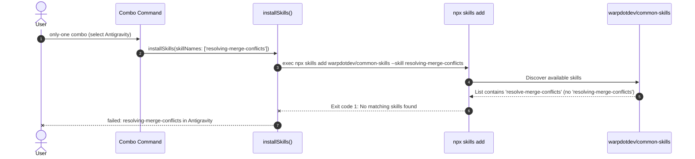

# Debug: Resolve Merge Conflicts Remote Skill Manifest Mismatch

## Section 1. Diagnosis & Directory Structure Changes

### Symptom
- **Actual**: `only-one combo` or `only-one skill` fails when installing `resolving-merge-conflicts`:
  ```text
  - resolving-merge-conflicts in Antigravity: failed (Command failed: npx -y skills add warpdotdev/common-skills --skill resolving-merge-conflicts --agent antigravity --yes --copy -g)
  ```
- **Expected**: `only-one combo` installs all skills without CLI failure.
- **Blast Radius**: All users running `only-one combo` with `only-one-flow` or installing the conflict resolution skill.

### Reproduction
- **Trigger**: Run `only-one combo` with `only-one-flow` or execute `npx -y skills add warpdotdev/common-skills --skill resolving-merge-conflicts`.
- **Red Test**: `test/core/skill-registry.test.ts` -> `ensures all remote skills.sh manifest names match their skillPath directory exactly`.
- **Command**: `npx vitest run test/core/skill-registry.test.ts -t "ensures all remote skills.sh manifest names match their skillPath directory exactly"`.

### Evidence
- **Observed Facts**:
  1. `warpdotdev/common-skills` repository exposes 29 skills; the git conflict resolution skill is named `resolve-merge-conflicts` (imperative verb).
  2. `npx -y skills add warpdotdev/common-skills --skill resolving-merge-conflicts` fails with `x No matching skills found for: resolving-merge-conflicts`.
  3. `npx -y skills add warpdotdev/common-skills --skill resolve-merge-conflicts` succeeds immediately.
  4. `assets/agents/skills/index.ts` lines 212-218 registered `name: 'resolving-merge-conflicts'` but `skillPath: 'skills/resolve-merge-conflicts/SKILL.md'`.
- **Fault Location**: `assets/agents/skills/index.ts`, `assets/agents/combos/index.ts`, `assets/agents/skills/only-one-conflict/SKILL.md`, and missing alias fallback in `src/core/skill/index.ts`.

### Root Cause
- **Mechanical Cause**: `installSkillViaSkillsCli` forwards `manifest.name` directly as `--skill <name>` to the `skills` CLI. Because the manifest declared `name: 'resolving-merge-conflicts'`, `skills add` attempted to find that non-existent skill identifier in `warpdotdev/common-skills` instead of `resolve-merge-conflicts`.
- **Trigger Mechanism**: Commit `dc0b5842` switched the skill source from `mattpocock/skills` to `warpdotdev/common-skills` and updated `skillPath`, but did not synchronize `name` to the upstream identifier `resolve-merge-conflicts`.
- **Violated Invariant**: All `skills.sh` manifests must declare names matching their canonical upstream directory and identifier, with optional backward-compatible aliases.

### Hypotheses Rejected
- *Network or Registry Outage*: Disproved because manual query to GitHub API and `npx skills add warpdotdev/common-skills --list` succeeded immediately.
- *Agent Adapter Incompatibility*: Disproved because testing with `--agent cursor` failed with the exact same missing skill error when using `resolving-merge-conflicts`.

### Fix Constraints
- Must rename manifest `name` to canonical upstream `resolve-merge-conflicts`.
- Must provide `aliases: ['resolving-merge-conflicts']` for seamless backward compatibility.
- Must bump version of `resolve-merge-conflicts`, `only-one-conflict`, and `only-one-flow` combo per CORE-004.
- Must maintain outward inward-dependency discipline per CORE-008.

### Defect Call Trace / State Divergence Flow


### Directory Structure Changes

```text
assets/
├── types.ts                                                    # [MODIFY] Add aliases? field to SkillManifest
└── agents/
    ├── combos/
    │   └── index.ts                                            # [MODIFY] Update only-one-flow combo to resolve-merge-conflicts & bump version
    └── skills/
        ├── index.ts                                            # [MODIFY] Canonicalize name to resolve-merge-conflicts, add alias & bump versions
        └── only-one-conflict/
            └── SKILL.md                                        # [MODIFY] Update referenced skill name to resolve-merge-conflicts
src/
├── core/
│   └── skill/
│       └── index.ts                                            # [MODIFY] Resolve manifest via name or aliases and use canonical manifest.name
└── commands/
    └── skill/
        └── actions/
            └── step-1-load-manifests.ts                        # [MODIFY] Include manifest aliases in availableSkills
test/
└── core/
    └── skill-registry.test.ts                                  # [MODIFY] QA Track: Assert remote names match skillPath directory and test aliases
```

## Section 2. Defect User Story & Reproduction Scenarios

### Story 1: Resolve Merge Conflicts Installation Failure [BUGFIX]
- **User Story**: Là lập trình viên chạy `only-one combo` hoặc cài đặt combo `only-one-flow`, tôi muốn kỹ năng giải quyết xung đột Git được cài đặt thành công mà không gặp lỗi Command failed từ `skills add`.
- **Actual Defect Scenario**: Kịch bản tái hiện hành vi lỗi hiện tại.
  - *Test trường hợp: Kiểm tra tên manifest lệch so với thư mục skillPath (TC-01)*
  - *Serving Files*:
    - `[TEST]` `test/core/skill-registry.test.ts`
    - `[MODIFY]` `assets/agents/skills/index.ts`
- **Expected Acceptance Scenario**: Kịch bản hành vi chính xác sau khi sửa lỗi.
  - *Test trường hợp: Kiểm tra tên manifest khớp chính xác và alias hoạt động (TC-02)*
  - *Serving Files*:
    - `[MODIFY]` `assets/types.ts`
    - `[MODIFY]` `assets/agents/skills/index.ts`
    - `[MODIFY]` `assets/agents/combos/index.ts`
    - `[MODIFY]` `assets/agents/skills/only-one-conflict/SKILL.md`
    - `[MODIFY]` `src/core/skill/index.ts`
    - `[MODIFY]` `src/commands/skill/actions/step-1-load-manifests.ts`

## Section 3. Test Cases & Verification Matrix

### 3.1. Defect & Invariant Traceability Matrix
| Tiêu chí Lỗi / Invariant | Mô tả Tái hiện / Ràng buộc | Test Cases / Tasks Đáp ứng | Trạng thái |
| :--- | :--- | :--- | :---: |
| **`DEF-01`** | Tên manifest `resolving-merge-conflicts` lệch với thư mục `resolve-merge-conflicts` trong `skillPath` | `TC-01`, Task 1 | 🟢 Fixed & Verified |
| **`INV-01`** | Tất cả skill `skills.sh` có `skillPath` phải có tên trùng với thư mục skill | `TC-01`, Task 1, Task 3 | 🟢 Fixed & Verified |
| **`INV-02`** | Hỗ trợ alias ngược `resolving-merge-conflicts` để không làm vỡ các cấu hình cũ | `TC-02`, Task 2, Task 3, Task 6 | 🟢 Fixed & Verified |
| **`INV-03`** | Combo preflight và rule dependency checks phải vượt qua 100% | `TC-03`, Task 3, Task 4 | 🟢 Fixed & Verified |

### 3.2. Test Case Specification Matrix
| Test ID | Defect Ref | Story / Module | Tên Test Case (`it / test`) | Điều kiện / Dữ liệu đầu vào | Kết quả kỳ vọng (Assertions) | Loại test | Status |
| :--- | :--- | :--- | :--- | :--- | :--- | :--- | :---: |
| `TC-01` | `DEF-01` | Story 1 / Registry | `ensures all remote skills.sh manifest names match their skillPath directory exactly` | Duyệt toàn bộ `SKILLS` có `sourceType === 'skills.sh'` | `manifest.name === skillDirName` | Unit (QA) | `[x]` (Pass) |
| `TC-02` | `INV-02` | Story 1 / Registry | `registers resolve-merge-conflicts with alias resolving-merge-conflicts` | Tìm kiếm skill `resolve-merge-conflicts` trong `SKILLS` | Tìm thấy `resolve-merge-conflicts` với alias `resolving-merge-conflicts` | Unit (QA) | `[x]` (Pass) |
| `TC-03` | `INV-03` | Story 1 / Combo | Prebuilt combo registry preflight validation | `validateComboManifestReferences(COMBOS, productionRegistries)` | Không ném lỗi tham chiếu thiếu | Unit (Regression) | `[x]` (Pass) |

### Automated Test Execution Commands
- Fast targeted QA test:
  ```bash
  npx vitest run test/core/skill-registry.test.ts -t "ensures all remote skills.sh manifest names match their skillPath directory exactly"
  # Evidence: PASS (1 test passed in 10ms)
  ```
- Full skill registry test:
  ```bash
  npx vitest run test/core/skill-registry.test.ts
  # Evidence: PASS (9 tests passed in 57ms)
  ```
- Full combo validation test:
  ```bash
  npx vitest run test/core/combo.test.ts
  # Evidence: PASS (14 tests passed in 48ms)
  ```
- Full test suite:
  ```bash
  npm test
  # Evidence: PASS (77 test files passed, 344 tests passed in 12.24s)
  ```

## Section 4. File Changes

### 1. `[MODIFY]` `test/core/skill-registry.test.ts`

- **Status**: `[x]`
- **Task Type**: `test`
- **Wave**: `1 (Track QA)`
- **Depends On**: None.
- **Context**: Assert that all remote skill manifests match their directory names and verify alias preservation.
- **Target Symbols / AST Seams**: `describe('skill registry integrity')`.
- **Invariants**: Must fail Red before manifest update and pass Green after.

> **Action**: Add regression test for remote skill directory matching and update conflict skill assertion.

**Test checklist**
- [x] Existing fixtures/helpers reused.
- [x] No duplicate setup.
- [x] Test covers changed behavior only.
- [x] Existing test toolchain used.
- **Decision**: Add assertion inside `test/core/skill-registry.test.ts`.
- **Rejected alternative**: Mocking `skills` CLI child process (unit registry assertion is faster and deterministic).

```diff
@@ -99,4 +99,15 @@
-        const conflictSkill = SKILLS.find((s) => s.name === 'resolving-merge-conflicts');
+        const conflictSkill = SKILLS.find((s) => s.name === 'resolve-merge-conflicts');
         expect(conflictSkill).toBeDefined();
         expect(conflictSkill?.source).toBe('warpdotdev/common-skills');
         expect(conflictSkill?.sourceType).toBe('skills.sh');
+        expect(conflictSkill?.aliases).toContain('resolving-merge-conflicts');
     });
+
+    it('ensures all remote skills.sh manifest names match their skillPath directory exactly', () => {
+        const skillsShManifests = SKILLS.filter((s) => s.sourceType === 'skills.sh' && s.skillPath);
+        for (const manifest of skillsShManifests) {
+            const pathParts = manifest.skillPath!.split('/');
+            const skillDirName = pathParts[pathParts.length - 2];
+            expect(manifest.name, `Skill manifest name '${manifest.name}' must match directory '${skillDirName}' in skillPath '${manifest.skillPath}'`).toBe(skillDirName);
+        }
+    });
```

### 2. `[MODIFY]` `assets/types.ts`

- **Status**: `[x]`
- **Task Type**: `code`
- **Wave**: `2 (Track Dev)`
- **Depends On**: ### 1.
- **Context**: `SkillManifest` lacks optional aliases field for backward compatibility.
- **Target Symbols / AST Seams**: `interface SkillManifest`.
- **Invariants**: Keep all existing fields intact; `aliases?: string[]` is optional.

> **Action**: Add `aliases?: string[];` to `SkillManifest`.

**Ponytail checklist**
- [x] Required by proven root cause.
- [x] Existing implementation and dependencies searched.
- [x] No duplicate logic or speculative extension point.
- [x] Minimum diff preserves correctness and safety.
- **Decision**: Add optional `aliases?: string[]` to `SkillManifest`.
- **Rejected alternative**: Breaking existing configurations that use legacy skill names.

```diff
@@ -62,3 +62,4 @@
     skillPath?: string; // path in repo, e.g. "skills/performance-optimization/SKILL.md"
+    aliases?: string[];
     requiredSkills?: string[];
```

### 3. `[MODIFY]` `assets/agents/skills/index.ts`

- **Status**: `[x]`
- **Task Type**: `code`
- **Wave**: `2 (Track Dev)`
- **Depends On**: ### 2.
- **Context**: Skill name is `resolving-merge-conflicts` but upstream is `resolve-merge-conflicts`.
- **Target Symbols / AST Seams**: `SKILLS` array entries for `resolve-merge-conflicts` and `only-one-conflict`.
- **Invariants**: Canonical name must be `resolve-merge-conflicts`; bump versions per CORE-004.

> **Action**: Rename to `resolve-merge-conflicts`, add alias `resolving-merge-conflicts`, and update `only-one-conflict.requiredSkills`.

**Ponytail checklist**
- [x] Required by proven root cause.
- [x] Existing implementation and dependencies searched.
- [x] No duplicate logic or speculative extension point.
- [x] Minimum diff preserves correctness and safety.
- **Decision**: Synchronize canonical name with upstream repository and register legacy alias.
- **Rejected alternative**: Modifying `installSkillViaSkillsCli` to ignore `manifest.name` and parse `skillPath` dynamically (violates single source of truth).

```diff
@@ -212,3 +212,4 @@
     {
-        name: 'resolving-merge-conflicts',
-        version: '0.0.2',
+        name: 'resolve-merge-conflicts',
+        version: '0.0.3',
         description: 'Resolve git merge/rebase conflicts hunk by hunk based on intent.',
@@ -217,2 +218,3 @@
         skillPath: 'skills/resolve-merge-conflicts/SKILL.md',
+        aliases: ['resolving-merge-conflicts'],
     },
@@ -376,3 +378,3 @@
-        version: '0.0.3',
+        version: '0.0.4',
         description: 'Resolve in-progress git merge or rebase conflicts hunk by hunk based on intent without aborting.',
         sourceType: 'local',
         skillPath: 'skills/only-one-conflict/SKILL.md',
-        requiredSkills: ['resolving-merge-conflicts'],
+        requiredSkills: ['resolve-merge-conflicts'],
     },
```

### 4. `[MODIFY]` `assets/agents/combos/index.ts`

- **Status**: `[x]`
- **Task Type**: `code`
- **Wave**: `2 (Track Dev)`
- **Depends On**: ### 3.
- **Context**: `only-one-flow` combo references old skill name `resolving-merge-conflicts`.
- **Target Symbols / AST Seams**: `COMBOS` array entry `only-one-flow`.
- **Invariants**: Must reference canonical `resolve-merge-conflicts` and increment semver per CORE-004.

> **Action**: Update `only-one-flow` skills list to use `resolve-merge-conflicts` and bump version to `0.0.18`.

**Ponytail checklist**
- [x] Required by proven root cause.
- [x] Existing implementation and dependencies searched.
- [x] No duplicate logic or speculative extension point.
- [x] Minimum diff preserves correctness and safety.
- **Decision**: Replace reference in combo manifest.
- **Rejected alternative**: None.

```diff
@@ -29,2 +29,2 @@
         id: 'only-one-flow',
-        version: '0.0.17',
+        version: '0.0.18',
         name: 'Only One Universal Flow Setup',
@@ -63,3 +63,3 @@
             'source-driven-development',
-            'resolving-merge-conflicts',
+            'resolve-merge-conflicts',
             'code-review-and-quality',
```

### 5. `[MODIFY]` `assets/agents/skills/only-one-conflict/SKILL.md`

- **Status**: `[x]`
- **Task Type**: `code`
- **Wave**: `2 (Track Dev)`
- **Depends On**: ### 3.
- **Context**: Documentation references old skill name in skills catalog table.
- **Target Symbols / AST Seams**: Skills Catalog table row.
- **Invariants**: Update table identifier to match canonical skill name.

> **Action**: Change `resolving-merge-conflicts` to `resolve-merge-conflicts` in table.

**Ponytail checklist**
- [x] Required by proven root cause.
- [x] Existing implementation and dependencies searched.
- [x] No duplicate logic or speculative extension point.
- [x] Minimum diff preserves correctness and safety.
- **Decision**: Update Markdown documentation.
- **Rejected alternative**: Leaving documentation drifted from code.

```diff
@@ -54,3 +54,3 @@
 | :--- | :--- | :--- |
-| **`resolving-merge-conflicts`** | In-progress git merge/rebase conflict detected (`<<<<<<<`, `=======`, `>>>>>>>`) | Resolve conflict hunks by tracing intent from git log and diffs, then finish the operation cleanly. |
+| **`resolve-merge-conflicts`** | In-progress git merge/rebase conflict detected (`<<<<<<<`, `=======`, `>>>>>>>`) | Resolve conflict hunks by tracing intent from git log and diffs, then finish the operation cleanly. |
```

### 6. `[MODIFY]` `src/core/skill/index.ts`

- **Status**: `[x]`
- **Task Type**: `code`
- **Wave**: `2 (Track Dev)`
- **Depends On**: ### 2.
- **Context**: Skill lookup only checks `s.name === skillName`, failing when legacy aliases are passed.
- **Target Symbols / AST Seams**: `installSkills` function.
- **Invariants**: Find manifest by name or alias; pass canonical `manifest.name` to `installSkillViaSkillsCli`.

> **Action**: Support alias lookup and use canonical `manifest.name` during installation.

**Ponytail checklist**
- [x] Required by proven root cause.
- [x] Existing implementation and dependencies searched.
- [x] No duplicate logic or speculative extension point.
- [x] Minimum diff preserves correctness and safety.
- **Decision**: Support `s.aliases?.includes(skillName)` in `SKILLS.find(...)`.
- **Rejected alternative**: Strict failure on alias without fallback.

```diff
@@ -108,3 +108,3 @@
-                const manifest = SKILLS.find((s) => s.name === skillName);
+                const manifest = SKILLS.find((s) => s.name === skillName || s.aliases?.includes(skillName));
 
                 if (manifest?.sourceType === 'skills.sh' && manifest.source) {
                     await installSkillViaSkillsCli({
                         projectDir,
                         source: manifest.source,
-                        skillName,
+                        skillName: manifest.name,
                         selectedTools: [tool],
                         isGlobal,
                     });
```

### 7. `[MODIFY]` `src/commands/skill/actions/step-1-load-manifests.ts`

- **Status**: `[x]`
- **Task Type**: `code`
- **Wave**: `2 (Track Dev)`
- **Depends On**: ### 2.
- **Context**: `availableSkills` only includes `s.name`, causing validation failure if user specifies an alias.
- **Target Symbols / AST Seams**: `loadSkillManifestsStep` function.
- **Invariants**: Include aliases in `availableSkills`.

> **Action**: Flatten `s.name` and `s.aliases` into `availableSkills`.

**Ponytail checklist**
- [x] Required by proven root cause.
- [x] Existing implementation and dependencies searched.
- [x] No duplicate logic or speculative extension point.
- [x] Minimum diff preserves correctness and safety.
- **Decision**: `SKILLS.flatMap((s) => [s.name, ...(s.aliases ?? [])])`.
- **Rejected alternative**: None.

```diff
@@ -11,3 +11,3 @@
-    const availableSkills = SKILLS.map((s) => s.name);
+    const availableSkills = SKILLS.flatMap((s) => [s.name, ...(s.aliases ?? [])]);
```
