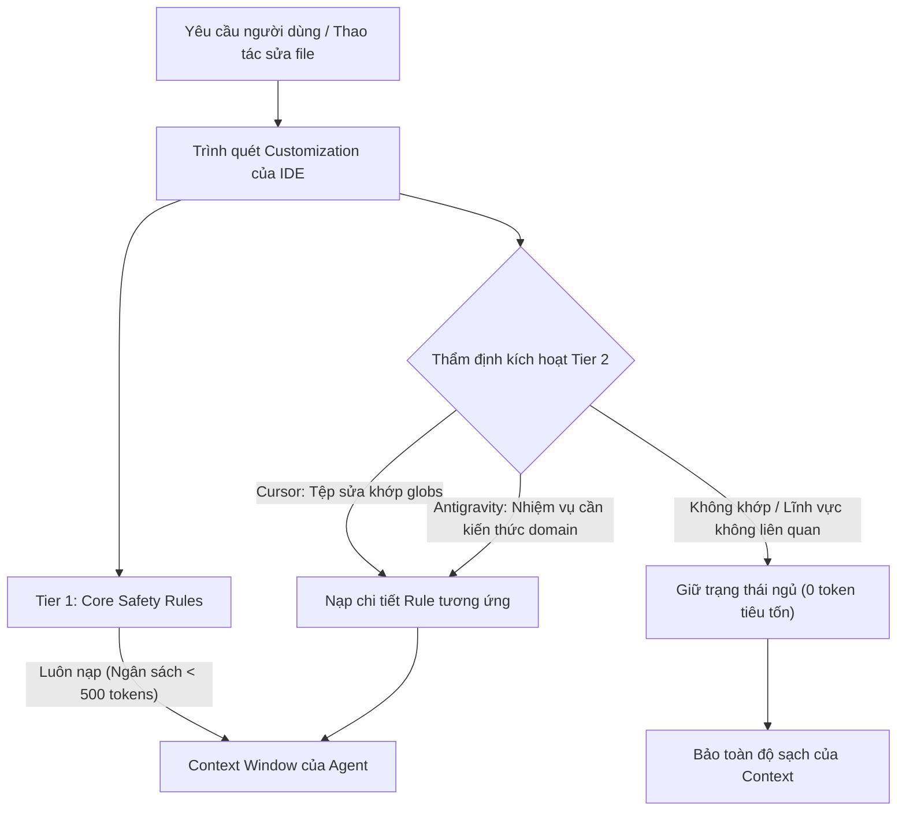

# Concept: Rules Progressive Disclosure & Context Shield (Phân phối Quy tắc Tiệm tiến & Lá chắn Context)

## 1. Problem & Goal (Vấn đề & Mục tiêu)

### Problem (Điểm nghẽn & Thiếu sót hiện tại)
- **Context & Trigger**: Người dùng cài đặt rules qua lệnh `only-one combo` hoặc `only-one rule install` vào thư mục Toàn cục (`~/.gemini/config/rules/`, `~/.claude/rules/`) hoặc Cục bộ Workspace (`.cursor/rules/`, `.agents/rules/`).
- **Symptom & Defect**: Mọi lượt prompt trong Agent đều bị ép nhét (inline) toàn bộ nội dung của cả 5 tệp rules vào Context Window, làm lãng phí 3.000 đến 5.000 tokens nền tảng. Khi chỉ chỉnh sửa một tệp stylesheet CSS hoặc ghi chú markdown, Agent vẫn phải tải toàn bộ rules kiến trúc NestJS DI và Next.js.
- **Root Cause**: Toàn bộ 5 tệp markdown trong `assets/agents/rules/` đều gắn cứng cấu hình `alwaysApply: true` ở phần frontmatter, không có `globs`, thiếu tóm tắt mục đích kích hoạt, và thiếu chỉ thị `trigger: model_decision`.
- **Impact / Blast Radius**: Làm phình ngân sách token, tăng độ trễ phản hồi, gây phân tán sự chú ý của mô hình (LLM attention drift), và gây xung đột trực tiếp khi hai framework đối lập (Next.js và NestJS) cùng nằm chung trong thư mục global.

### Goal (Kết quả kỹ thuật mục tiêu)
- **Core Goal**: Tái cấu trúc cơ chế phân phối rules sang mô hình Progressive Disclosure (nạp tiệm tiến theo nhu cầu) tương thích đồng thời trên Antigravity, Cursor và Claude Code.
- **Acceptance Criteria**:
  - Phân tách rules thành hai tầng kiến trúc rõ rệt: **Tier 1 (Core Safety Rules - Luôn bật)** và **Tier 2 (Domain & Stack Rules - Nạp tiệm tiến theo nhu cầu)**.
  - Tinh gọn nội dung Tier 1 (`01-context-and-tools.md`, `03-execution-terminal.md`) dưới 30 dòng mỗi tệp, giữ nguyên `alwaysApply: true`.
  - Chuyển đổi Tier 2 (`02-next-architecture-stack.md`, `02-nest-architecture-stack.md`, `04-karpathy-ste100-discipline.md`) sang cơ chế on-demand với `alwaysApply: false`, cấu hình `globs` cụ thể, và thiết lập `trigger: model_decision`.
  - Mở rộng schema `RuleManifest` với các trường metadata (`alwaysApply`, `globs`, `trigger`) và cập nhật toàn bộ bài kiểm thử liên quan.

## 2. Scope Boundaries (Ranh giới phạm vi)
- **In-Scope**:
  - Chuẩn hóa cấu trúc frontmatter và tinh gọn nội dung toàn bộ 5 tệp trong `assets/agents/rules/`.
  - Cập nhật interface `RuleManifest` trong `assets/types.ts` và khai báo trong `assets/agents/rules/index.ts`.
  - Xây dựng chuẩn header lai (hybrid frontmatter) tương thích đa nền tảng cho Cursor (`alwaysApply`, `globs`) và Antigravity (`trigger`, `description`).
  - Viết unit tests kiểm định hợp đồng frontmatter tiệm tiến và tính toàn vẹn phụ thuộc rules.
- **Explicit Out-of-Scope**:
  - Không sửa đổi logic nội bộ của các skills framework (`only-one-nextjs-development`, `only-one-nestjs-development`).
  - Không thay đổi cơ chế phân phối của skills hoặc subagents.
  - Không tạo cấu hình globs tùy biến ngoài các quy chuẩn mở rộng chuẩn mực.

## 3. Proposed Solution & Core Mechanism (Giải pháp đề xuất & Cơ chế cốt lõi)

### Mô hình Kiến trúc Phân tầng (Two-Tier Rules Architecture)

1. **Tier 1: Core Safety & Execution Rules (Luôn bật - Always-On)**
   - Tệp áp dụng: `01-context-and-tools.md`, `03-execution-terminal.md`.
   - Ngân sách: Tổng cộng < 60 dòng (< 500 tokens).
   - Hành vi: Nạp vào context ở mọi lượt prompt để ngăn chặn tuyệt đối lệnh sleep lặp vô tận và cưỡng chế thu hẹp phạm vi đọc file.

2. **Tier 2: Domain & Stack Rules (Nạp tiệm tiến theo nhu cầu - On-Demand Progressive Disclosure)**
   - Tệp áp dụng: `02-next-architecture-stack.md`, `02-nest-architecture-stack.md`, `04-karpathy-ste100-discipline.md`.
   - **Cursor**: Thiết lập `alwaysApply: false`, chỉ kích hoạt khi tệp đang chỉnh sửa khớp với `globs` (ví dụ `**/*.{ts,tsx}` hoặc `**/*.md`).
   - **Antigravity**: Thiết lập `trigger: model_decision`, chỉ đưa mô tả ngắn gọn vào system prompt; Agent chỉ tải toàn văn khi tác vụ yêu cầu.
   - **Claude Code**: Nạp có chọn lọc qua workspace hoặc để skills chuyên biệt tham chiếu trực tiếp khi cần.

### Sơ đồ Luồng Quyết định (Decision Seam)



### Chuẩn Frontmatter Lai Đa IDE (Hybrid Multi-IDE Header)

```yaml
---
description: "Quy chuẩn kiến trúc Next.js, TypeScript nghiêm ngặt, ranh giới runtime và hợp đồng công khai"
globs: "**/*.{ts,tsx,jsx,js}"
alwaysApply: false
trigger: model_decision
---
```

## 4. Critical Risks & Edge Cases (Phân tích Rủi ro & Cơ chế Phòng vệ)
- **Rủi ro 1: Cursor bỏ qua rule khi globs không khớp đường dẫn monorepo sâu**
  - *Mặt tiêu cực / Nguy cơ*: Agent không áp dụng tiêu chuẩn TypeScript nghiêm ngặt khi lập trình viên thao tác trong `packages/shared/...` hoặc `apps/web/...`.
  - *Cơ chế phòng vệ*: Sử dụng định dạng globs đệ quy chuẩn `**/*.{ts,tsx,js,jsx}` thay vì đường dẫn cứng. Đồng thời, các skills (`only-one-plan`, `only-one-nextjs-development`) luôn trỏ trực tiếp đến rule trong checklist thẩm định.
- **Rủi ro 2: Antigravity không tự đọc rule khi trigger là model_decision**
  - *Mặt tiêu cực / Nguy cơ*: Agent bỏ qua quy tắc nếu phần mô tả `description` quá ngắn hoặc mơ hồ.
  - *Cơ chế phòng vệ*: Soạn thảo trường `description` theo cấu trúc STE-100 rõ ràng, nêu đích danh đối tượng và thời điểm kích hoạt (ví dụ: *"Sử dụng khi tạo mới, chỉnh sửa, hoặc kiểm tra các components Next.js, routes, hoặc React hooks"*).
