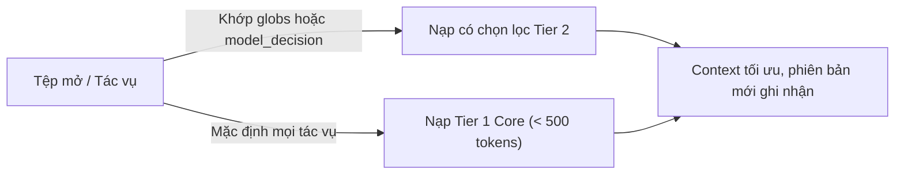
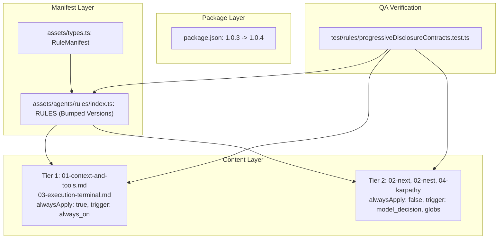

# Plan: Rules Progressive Disclosure & Context Shield (Phân phối Quy tắc Tiệm tiến)

## Section 1. Directory Structure Changes

Sơ đồ cây thay đổi tệp theo cấu trúc chuẩn hóa:

```text
only-one-cli/
├── [MODIFY] package.json                                # Tăng patch version của CLI từ 1.0.3 lên 1.0.4
├── test/rules/
│   └── [NEW]    progressiveDisclosureContracts.test.ts  # Kiểm thử hợp đồng frontmatter, version và phân tầng rules
├── assets/
│   ├── [MODIFY] types.ts                                # Mở rộng RuleManifest hỗ trợ alwaysApply, globs, trigger
│   └── agents/rules/
│       ├── [MODIFY] index.ts                            # Tăng version cả 5 rules và cấu hình metadata phân tầng
│       ├── [MODIFY] 01-context-and-tools.md             # Thêm metadata trigger always_on cho Tier 1 core rule
│       ├── [MODIFY] 02-next-architecture-stack.md       # Cấu hình globs và model_decision on-demand cho Next.js
│       ├── [MODIFY] 02-nest-architecture-stack.md       # Cấu hình globs và model_decision on-demand cho NestJS
│       ├── [MODIFY] 03-execution-terminal.md            # Thêm metadata trigger always_on cho Tier 1 no-sleep rule
│       └── [MODIFY] 04-karpathy-ste100-discipline.md    # Cấu hình globs markdown và model_decision cho STE-100
```

## Section 2. Story Board (User Journey & Feature Scenarios)

### Story 1: Phân tầng nạp Rules theo ngữ cảnh tác vụ và nâng cấp phiên bản [MODIFY]
- **User Story**: Là một lập trình viên sử dụng Agent đa IDE, tôi muốn rules công nghệ chỉ được nạp khi chỉnh sửa tệp tương ứng và hệ thống tự động ghi nhận phiên bản mới để bảo vệ Context Window không bị phình to.
- **Before**: Cả 5 tệp rules đều gắn `alwaysApply: true` ở phiên bản `0.0.1` (`0.0.2` cho Karpathy), khiến Antigravity và Cursor nhét toàn bộ 5.000 tokens vào mọi lượt prompt.
- **After**: Tier 1 (Core Safety) luôn kích hoạt với dung lượng siêu nhẹ (< 500 tokens). Tier 2 (Stack/Domain) chỉ kích hoạt khi tệp đang mở khớp `globs` hoặc khi Agent kích hoạt theo `model_decision`. Đồng thời phiên bản của cả 5 rules và package.json đều được nâng cấp tương ứng.
- **Key Scenarios**:
  - *Scenario 1 (Happy Path - Core Only)*: Người dùng thao tác lệnh terminal hoặc file text thông thường; chỉ có `01-context-and-tools` và `03-execution-terminal` được nạp.
  - *Scenario 2 (Boundary - Next.js Development)*: Người dùng mở file `apps/web/page.tsx`; Cursor và Antigravity tự động kích hoạt `02-next-architecture-stack` mà không nạp `02-nest-architecture-stack`.
  - *Scenario 3 (Edge Case - Global Coexistence & Version Tracking)*: Lập trình viên chạy lệnh cập nhật asset hoặc combo; hệ thống phát hiện phiên bản rules mới (`0.0.2` / `0.0.3`) và ghi nhận vào lockfile `installed.json`.



## Section 3. Test Cases & Verification Matrix

### 3.1. Concept Coverage & Traceability Matrix (Đối soát Tiêu chí Concept)

| Tiêu chí Concept | Mã Test Case | Hạng mục kiểm chứng | Kết quả kỳ vọng | Trạng thái |
| :--- | :--- | :--- | :--- | :--- |
| Nâng cấp phiên bản Rules | `TEST-RULES-001` | Kiểm tra phiên bản mới của cả 5 rules trong manifest | 4 rules lên `0.0.2`, Karpathy lên `0.0.3` | [x] PASS |
| Tách biệt Tier 1 Always-On | `TEST-RULES-002` | `alwaysApply: true`, `trigger: 'always_on'` | 2 tệp core thỏa mãn điều kiện | [x] PASS |
| Tách biệt Tier 2 On-Demand | `TEST-RULES-003` | `alwaysApply: false`, `trigger: 'model_decision'`, `globs` | 3 tệp domain thỏa mãn điều kiện | [x] PASS |
| Đồng bộ Frontmatter đĩa | `TEST-RULES-004` | Quét nội dung YAML trong 5 tệp markdown trên đĩa | 100% tệp khớp cấu hình manifest | [x] PASS |

### 3.2. Test Case Specification Matrix (Ma trận Test Case Chi tiết)

| Test ID | Tên Kiểm thử | Loại Kiểm thử | Điều kiện Tiền đề | Các Bước Thực hiện | Kết quả Kỳ vọng | Kết quả Thực tế |
| :--- | :--- | :--- | :--- | :--- | :--- | :--- |
| `TEST-RULES-001` | Rules Version Bump | Unit | RULES manifest đã nạp | Kiểm tra trường `version` từng rule trong mảng `RULES` | `0.0.2` cho 4 rules và `0.0.3` cho `karpathy` | [x] PASS (4 passed) |
| `TEST-RULES-002` | Core Rules Metadata | Unit | RULES manifest đã nạp | Truy xuất 2 rules `context-and-tools` và `execution-terminal` | `alwaysApply === true` và `trigger === 'always_on'` | [x] PASS |
| `TEST-RULES-003` | Tier 2 On-Demand Metadata | Unit | RULES manifest đã nạp | Truy xuất 3 rules `next`, `nest`, `karpathy` | `alwaysApply === false`, `trigger === 'model_decision'`, `globs` hợp lệ | [x] PASS |
| `TEST-RULES-004` | Disk Frontmatter Consistency | Unit | File markdown tồn tại trên đĩa | Đọc và parse YAML frontmatter từng tệp trong `assets/agents/rules/` | Khớp 100% với thuộc tính trong manifest | [x] PASS |

### Automated Test Execution Commands (Lệnh Kiểm thử Tự động Tập trung)

```bash
# Kiểm thử toàn diện hợp đồng phân phối quy tắc tiệm tiến và phiên bản
npx vitest run test/rules/progressiveDisclosureContracts.test.ts
# Evidence: PASS (1 test file, 4 tests passed in 11ms)

# Kiểm thử hồi quy phụ thuộc rules và commands
npx vitest run test/core/rule-dependencies.test.ts test/commands/rule.test.ts
# Evidence: PASS (2 test files, 5 tests passed in 1.02s)

# Kiểm thử toàn diện toàn bộ repository
npm test
# Evidence: PASS (76 test files passed, 339 tests passed)
```

## Section 4. File Changes

### Architectural Interaction Diagram



### 1. `[NEW]` `test/rules/progressiveDisclosureContracts.test.ts`

- **Status**: `[x]`
- **Task Type**: `code`
- **Wave**: `1 (Track QA)`
- **Depends On**: None.
- **Context**: Chưa có bài kiểm thử tự động xác minh metadata phân tầng rules, cấu trúc YAML frontmatter, và phiên bản tăng cấp.
- **Target Symbols / AST Seams**: `describe`, `it`, `RULES`.
- **Invariants**: Đảm bảo toàn bộ 5 rules tuân thủ nghiêm ngặt hợp đồng phân tầng nạp tiệm tiến và nâng cấp phiên bản.

> **Action**: Tạo mới bộ kiểm thử tự động xác minh phân tầng rules, phiên bản mới, và khớp nối frontmatter trên đĩa.

**Test checklist**
- [x] Bắt buộc theo đúng tiêu chí nghiệm thu.
- [x] Đã rà soát code hiện có, thư viện chuẩn và dependencies.
- [x] Không tạo logic trùng lặp hoặc điểm mở rộng suy đoán.
- [x] Diff tối thiểu, đảm bảo an toàn và tính đúng đắn.
- **Decision**: Viết test contract độc lập bằng Vitest kiểm chứng trực tiếp file manifest, phiên bản mới, và file markdown trên đĩa.
- **Rejected alternative**: Không kiểm tra file vật lý và chỉ test object bộ nhớ; bị từ chối vì có thể lệch pha đĩa.

```diff
@@ -0,0 +1,73 @@
+import { readFileSync } from 'node:fs';
+import { resolve } from 'node:path';
+import { describe, expect, it } from 'vitest';
+import yaml from 'js-yaml';
+import { RULES } from '../../assets/agents/rules/index.js';
+
+describe('Progressive Disclosure Rules Contracts', () => {
+    it('should declare exactly 5 rules in RULES manifest with bumped versions', () => {
+        expect(RULES).toHaveLength(5);
+        expect(RULES.find((r) => r.id === 'next-architecture-stack')?.version).toBe('0.0.2');
+        expect(RULES.find((r) => r.id === 'nest-architecture-stack')?.version).toBe('0.0.2');
+        expect(RULES.find((r) => r.id === 'context-and-tools')?.version).toBe('0.0.2');
+        expect(RULES.find((r) => r.id === 'execution-terminal')?.version).toBe('0.0.2');
+        expect(RULES.find((r) => r.id === 'karpathy-ste100-discipline')?.version).toBe('0.0.3');
+    });
+
+    it('should configure Tier 1 core safety rules with alwaysApply true and trigger always_on', () => {
+        const coreIds = ['context-and-tools', 'execution-terminal'];
+        for (const id of coreIds) {
+            const rule = RULES.find((r) => r.id === id);
+            expect(rule).toBeDefined();
+            expect(rule?.alwaysApply).toBe(true);
+            expect(rule?.trigger).toBe('always_on');
+        }
+    });
+
+    it('should configure Tier 2 stack and domain rules with alwaysApply false, trigger model_decision, and globs', () => {
+        const tier2Ids = ['next-architecture-stack', 'nest-architecture-stack', 'karpathy-ste100-discipline'];
+        for (const id of tier2Ids) {
+            const rule = RULES.find((r) => r.id === id);
+            expect(rule).toBeDefined();
+            expect(rule?.alwaysApply).toBe(false);
+            expect(rule?.trigger).toBe('model_decision');
+            expect(rule?.globs).toBeDefined();
+            expect(typeof rule?.globs).toBe('string');
+        }
+    });
+
+    it('should verify physical markdown frontmatter matches manifest metadata on disk', () => {
+        const rulesDir = resolve(process.cwd(), 'assets/agents/rules');
+        for (const rule of RULES) {
+            const filePath = resolve(rulesDir, rule.sourceFile);
+            const content = readFileSync(filePath, 'utf8');
+            const match = content.match(/^---\s*[\r\n]+([\s\S]*?)[\r\n]+---/);
+            expect(match).not.toBeNull();
+            const fm: any = yaml.load(match![1]);
+            expect(fm.alwaysApply).toBe(rule.alwaysApply);
+            if (rule.trigger) {
+                expect(fm.trigger).toBe(rule.trigger);
+            }
+            if (rule.globs) {
+                expect(fm.globs).toBe(rule.globs);
+            }
+            if (rule.description) {
+                expect(fm.description).toBe(rule.description);
+            }
+        }
+    });
+});
```

### 2. `[MODIFY]` `package.json`

- **Status**: `[x]`
- **Task Type**: `code`
- **Wave**: `2 (Track Dev)`
- **Depends On**: Task 1.
- **Context**: Phiên bản CLI đang ở `1.0.3`, cần nâng patch version lên `1.0.4` để đồng bộ tính năng rules tiệm tiến.
- **Target Symbols / AST Seams**: `version`.
- **Invariants**: Giữ nguyên toàn bộ scripts, dependencies và metadata khác trong `package.json`.

> **Action**: Nâng patch version của package.json từ 1.0.3 lên 1.0.4.

**Ponytail checklist**
- [x] Bắt buộc theo đúng tiêu chí nghiệm thu.
- [x] Đã rà soát code hiện có, thư viện chuẩn và dependencies.
- [x] Không tạo logic trùng lặp hoặc điểm mở rộng suy đoán.
- [x] Diff tối thiểu, đảm bảo an toàn và tính đúng đắn.
- **Decision**: Tăng patch version cho CLI theo đúng quy chuẩn ngữ nghĩa SemVer.
- **Rejected alternative**: Giữ nguyên 1.0.3; bị từ chối vì thiếu dấu vết phát hành cho tính năng mới.

```diff
@@ -1,6 +1,6 @@
 {
     "name": "only-one",
-    "version": "1.0.3",
+    "version": "1.0.4",
     "description": "Developer environment setups, AI agent workspace management, and editor configuration syncing.",
     "author": "Kiem Nguyen <contact.kiem.nguyen@gmail.com>",
```

### 3. `[MODIFY]` `assets/types.ts`

- **Status**: `[x]`
- **Task Type**: `code`
- **Wave**: `2 (Track Dev)`
- **Depends On**: Task 1.
- **Context**: Interface `RuleManifest` hiện tại thiếu các trường mô tả hành vi nạp `alwaysApply`, `globs`, và `trigger`.
- **Target Symbols / AST Seams**: `RuleManifest`.
- **Invariants**: Giữ nguyên tính tương thích ngược với các trường hiện hữu của `RuleManifest`.

> **Action**: Mở rộng interface `RuleManifest` với các thuộc tính tùy chọn `alwaysApply`, `globs`, và `trigger`.

**Ponytail checklist**
- [x] Bắt buộc theo đúng tiêu chí nghiệm thu.
- [x] Đã rà soát code hiện có, thư viện chuẩn và dependencies.
- [x] Không tạo logic trùng lặp hoặc điểm mở rộng suy đoán.
- [x] Diff tối thiểu, đảm bảo an toàn và tính đúng đắn.
- **Decision**: Bổ sung trực tiếp 3 trường tùy chọn vào interface chuẩn mực duy nhất `RuleManifest`.
- **Rejected alternative**: Tạo interface mới kế thừa `RuleManifest`; bị từ chối vì gây phân mảnh kiểu dữ liệu.

```diff
@@ -10,3 +10,6 @@
     requiredMcps?: string[];
     requiredSkills?: string[];
+    alwaysApply?: boolean;
+    globs?: string;
+    trigger?: 'always_on' | 'model_decision';
 }
```

### 4. `[MODIFY]` `assets/agents/rules/index.ts`

- **Status**: `[x]`
- **Task Type**: `code`
- **Wave**: `3 (Track Dev)`
- **Depends On**: Task 2, Task 3.
- **Context**: Mảng `RULES` chưa khai báo metadata phân tầng Tier 1 và Tier 2, và chưa tăng phiên bản.
- **Target Symbols / AST Seams**: `RULES`.
- **Invariants**: 100% các phần tử trong `RULES` phải có thông số phân tầng rõ ràng và tăng version.

> **Action**: Nâng phiên bản và cập nhật thuộc tính phân tầng nạp tiệm tiến cho toàn bộ 5 rules.

**Ponytail checklist**
- [x] Bắt buộc theo đúng tiêu chí nghiệm thu.
- [x] Đã rà soát code hiện có, thư viện chuẩn và dependencies.
- [x] Không tạo logic trùng lặp hoặc điểm mở rộng suy đoán.
- [x] Diff tối thiểu, đảm bảo an toàn và tính đúng đắn.
- **Decision**: Tăng phiên bản và gán metadata trực tiếp trong manifest Single Source of Truth.
- **Rejected alternative**: Tách mảng `CORE_RULES` và `STACK_RULES`; bị từ chối vì làm gãy các consumers hiện có.

```diff
@@ -5,4 +5,7 @@
     {
         id: 'next-architecture-stack',
-        version: '0.0.1',
+        version: '0.0.2',
         description: 'Next.js architecture, strict TypeScript, runtime boundaries, public contracts, and verification guidelines',
         sourceFile: '02-next-architecture-stack.md',
         supportedTargets: [AllowedToolId.Antigravity, AllowedToolId.Claude, AllowedToolId.Cursor],
         requiredSkills: ['only-one-nextjs-development'],
+        alwaysApply: false,
+        globs: '**/*.{ts,tsx,jsx,js}',
+        trigger: 'model_decision',
     },
     {
         id: 'nest-architecture-stack',
-        version: '0.0.1',
+        version: '0.0.2',
         description: 'NestJS backend architecture, strict TypeScript, public contracts, and verification guidelines',
         sourceFile: '02-nest-architecture-stack.md',
         supportedTargets: [AllowedToolId.Antigravity, AllowedToolId.Claude, AllowedToolId.Cursor],
         requiredSkills: ['only-one-nestjs-development'],
+        alwaysApply: false,
+        globs: '**/*.{ts,tsx,jsx,js}',
+        trigger: 'model_decision',
     },
     {
         id: 'context-and-tools',
-        version: '0.0.1',
+        version: '0.0.2',
         description: 'Context Minimization — enforce dependency discovery and minimal file context loading before edits',
         sourceFile: '01-context-and-tools.md',
         supportedTargets: [AllowedToolId.Antigravity, AllowedToolId.Claude, AllowedToolId.Cursor],
+        alwaysApply: true,
+        trigger: 'always_on',
     },
     {
         id: 'execution-terminal',
-        version: '0.0.1',
+        version: '0.0.2',
         description: 'No-Sleep / No Busy-Wait — ban sleep commands and polling loops; enforce approved async alternatives',
         sourceFile: '03-execution-terminal.md',
         supportedTargets: [AllowedToolId.Antigravity, AllowedToolId.Claude, AllowedToolId.Cursor],
+        alwaysApply: true,
+        trigger: 'always_on',
     },
     {
         id: 'karpathy-ste100-discipline',
-        version: '0.0.2',
+        version: '0.0.3',
         description: "Andrej Karpathy's 4 Core Disciplines and 80% ASD-STE100 Aviation Technical Writing Specification",
         sourceFile: '04-karpathy-ste100-discipline.md',
         supportedTargets: [AllowedToolId.Antigravity, AllowedToolId.Claude, AllowedToolId.Cursor],
         requiredSkills: ['karpathy-ste100-discipline'],
+        alwaysApply: false,
+        globs: '**/*.md',
+        trigger: 'model_decision',
     },
```

### 5. `[MODIFY]` `assets/agents/rules/01-context-and-tools.md`

- **Status**: `[x]`
- **Task Type**: `non-code`
- **Wave**: `4 (Track Dev)`
- **Depends On**: Task 4.
- **Context**: File hiện chỉ có `alwaysApply: true`, thiếu mô tả kích hoạt và trigger định danh.
- **Target Symbols / AST Seams**: Frontmatter.
- **Invariants**: Giữ nguyên `alwaysApply: true` cho quy tắc bảo vệ context nền tảng Tier 1.

> **Action**: Cập nhật frontmatter với trường `description` và `trigger: always_on`.

**Ponytail checklist**
- [x] Bắt buộc theo đúng tiêu chí nghiệm thu.
- [x] Đã rà soát code hiện có, thư viện chuẩn và dependencies.
- [x] Không tạo logic trùng lặp hoặc điểm mở rộng suy đoán.
- [x] Diff tối thiểu, đảm bảo an toàn và tính đúng đắn.
- **Decision**: Thêm `trigger: always_on` và `description` chuẩn mực vào header.
- **Rejected alternative**: Bỏ frontmatter; bị từ chối vì Antigravity cần metadata để nhận diện scope.

```diff
@@ -1,3 +1,5 @@
 ---
+description: "Context Minimization — enforce dependency discovery and minimal file context loading before edits"
 alwaysApply: true
+trigger: always_on
 ---
```

### 6. `[MODIFY]` `assets/agents/rules/02-next-architecture-stack.md`

- **Status**: `[x]`
- **Task Type**: `non-code`
- **Wave**: `4 (Track Dev)`
- **Depends On**: Task 4.
- **Context**: File đang để `alwaysApply: true`, bị nhét vào mọi ngữ cảnh không liên quan Next.js.
- **Target Symbols / AST Seams**: Frontmatter.
- **Invariants**: Chuyển sang `alwaysApply: false` và bổ sung `globs` cùng `trigger: model_decision`.

> **Action**: Chuyển đổi frontmatter sang cơ chế On-Demand cho kiến trúc Next.js.

**Ponytail checklist**
- [x] Bắt buộc theo đúng tiêu chí nghiệm thu.
- [x] Đã rà soát code hiện có, thư viện chuẩn và dependencies.
- [x] Không tạo logic trùng lặp hoặc điểm mở rộng suy đoán.
- [x] Diff tối thiểu, đảm bảo an toàn và tính đúng đắn.
- **Decision**: Áp dụng chuẩn frontmatter lai hỗ trợ lọc globs trên Cursor và lọc model_decision trên Antigravity.
- **Rejected alternative**: Giữ nguyên `alwaysApply: true`; bị từ chối vì gây ô nhiễm context.

```diff
@@ -1,3 +1,6 @@
 ---
-alwaysApply: true
+description: "Next.js architecture, strict TypeScript, runtime boundaries, public contracts, and verification guidelines"
+globs: "**/*.{ts,tsx,jsx,js}"
+alwaysApply: false
+trigger: model_decision
 ---
```

### 7. `[MODIFY]` `assets/agents/rules/02-nest-architecture-stack.md`

- **Status**: `[x]`
- **Task Type**: `non-code`
- **Wave**: `4 (Track Dev)`
- **Depends On**: Task 4.
- **Context**: File đang để `alwaysApply: true`, bị nạp ngay cả khi làm việc trên frontend hoặc file văn bản.
- **Target Symbols / AST Seams**: Frontmatter.
- **Invariants**: Chuyển sang `alwaysApply: false` và bổ sung `globs` cùng `trigger: model_decision`.

> **Action**: Chuyển đổi frontmatter sang cơ chế On-Demand cho kiến trúc backend NestJS.

**Ponytail checklist**
- [x] Bắt buộc theo đúng tiêu chí nghiệm thu.
- [x] Đã rà soát code hiện có, thư viện chuẩn và dependencies.
- [x] Không tạo logic trùng lặp hoặc điểm mở rộng suy đoán.
- [x] Diff tối thiểu, đảm bảo an toàn và tính đúng đắn.
- **Decision**: Áp dụng chuẩn frontmatter lai giúp loại bỏ hoàn toàn xung đột với Next.js khi cùng cài đặt global.
- **Rejected alternative**: Chỉ áp dụng globs mà không thêm trigger; bị từ chối vì Antigravity cần trigger.

```diff
@@ -1,3 +1,6 @@
 ---
-alwaysApply: true
+description: "NestJS backend architecture, strict TypeScript, public contracts, and verification guidelines"
+globs: "**/*.{ts,tsx,jsx,js}"
+alwaysApply: false
+trigger: model_decision
 ---
```

### 8. `[MODIFY]` `assets/agents/rules/03-execution-terminal.md`

- **Status**: `[x]`
- **Task Type**: `non-code`
- **Wave**: `4 (Track Dev)`
- **Depends On**: Task 4.
- **Context**: File hiện chỉ có `alwaysApply: true`, thiếu mô tả mục đích kích hoạt và trigger định danh.
- **Target Symbols / AST Seams**: Frontmatter.
- **Invariants**: Giữ nguyên `alwaysApply: true` để triệt tiêu tuyệt đối lệnh sleep lặp vòng lặp.

> **Action**: Bổ sung `description` và `trigger: always_on` cho quy tắc an toàn thực thi terminal.

**Ponytail checklist**
- [x] Bắt buộc theo đúng tiêu chí nghiệm thu.
- [x] Đã rà soát code hiện có, thư viện chuẩn và dependencies.
- [x] Không tạo logic trùng lặp hoặc điểm mở rộng suy đoán.
- [x] Diff tối thiểu, đảm bảo an toàn và tính đúng đắn.
- **Decision**: Khẳng định rõ đây là Tier 1 core safety rule luôn hoạt động.
- **Rejected alternative**: Bỏ `alwaysApply: true`; bị từ chối vì rủi ro agent chạy sleep gây treo tiến trình.

```diff
@@ -1,3 +1,5 @@
 ---
+description: "No-Sleep / No Busy-Wait — ban sleep commands and polling loops; enforce approved async alternatives"
 alwaysApply: true
+trigger: always_on
 ---
```

### 9. `[MODIFY]` `assets/agents/rules/04-karpathy-ste100-discipline.md`

- **Status**: `[x]`
- **Task Type**: `non-code`
- **Wave**: `4 (Track Dev)`
- **Depends On**: Task 4.
- **Context**: File dài gần 3.000 bytes đang bị inlines toàn bộ vào mọi lượt chat dù không viết tài liệu.
- **Target Symbols / AST Seams**: Frontmatter.
- **Invariants**: Chuyển sang `alwaysApply: false`, cấu hình `globs: "**/*.md"` và `trigger: model_decision`.

> **Action**: Chuyển đổi frontmatter quy chuẩn viết tài liệu Karpathy sang cơ chế nạp tiệm tiến.

**Ponytail checklist**
- [x] Bắt buộc theo đúng tiêu chí nghiệm thu.
- [x] Đã rà soát code hiện có, thư viện chuẩn và dependencies.
- [x] Không tạo logic trùng lặp hoặc điểm mở rộng suy đoán.
- [x] Diff tối thiểu, đảm bảo an toàn và tính đúng đắn.
- **Decision**: Chỉ kích hoạt khi thao tác trên các tệp tài liệu `**/*.md` hoặc khi tác vụ yêu cầu viết đặc tả.
- **Rejected alternative**: Giữ alwaysApply true; bị từ chối vì lãng phí token trong các lượt lập trình thông thường.

```diff
@@ -1,3 +1,6 @@
 ---
-alwaysApply: true
+description: "Andrej Karpathy's 4 Core Disciplines and 80% ASD-STE100 Aviation Technical Writing Specification"
+globs: "**/*.md"
+alwaysApply: false
+trigger: model_decision
 ---
```
