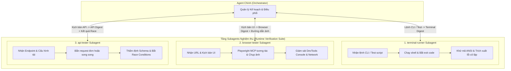

# Concept: Runtime Verification Subagents Suite (Terminal, Browser, API)

## 1. Problem & Goal

### Problem (Current Bottlenecks & Deficiencies)
- **Context & Trigger**: Khi Agent chính cần nghiệm thu runtime đa nền tảng (kiểm thử lệnh CLI, duyệt web bằng trình duyệt, hoặc kiểm thử endpoint API).
- **Symptom & Defect**: Hàng ngàn dòng log terminal ANSI, cây DOM HTML khổng lồ, ảnh base64 và payload JSON thô đổ trực tiếp vào transcript làm cạn kiệt context window.
- **Root Cause**: Thiếu kiến trúc phân tầng tác tử chuyên trách để cô lập các tác vụ tương tác runtime và khử nhiễu dữ liệu trước khi gửi về cho Agent chính.
- **Impact / Blast Radius**: Hiện tượng *Lost-in-the-Middle*, tê liệt khả năng ra quyết định của Agent chính và bỏ sót các lỗi tranh chấp dữ liệu (Race Conditions) hoặc lỗi giao diện.

### Goal (Target Technical Outcomes)
- **Core Goal**: Thiết lập bộ 3 Subagents nghiệm thu runtime độc lập (`terminal-runner`, `browser-tester`, `api-tester`) hoạt động trong sandbox riêng biệt để bảo vệ context chính.
- **Acceptance Criteria**:
  - **`terminal-runner`**: Thực thi lệnh shell, kiểm thử các cờ của ứng dụng CLI, khử sạch mã màu ANSI escape, tách biệt `stdout`/`stderr` và bắt mã thoát `exit code`.
  - **`browser-tester`**: Điều hướng giao diện qua Playwright MCP, chụp ảnh màn hình lưu vào đĩa, giám sát DevTools console/network và cấm in thô cây DOM.
  - **`api-tester`**: Thẩm định JSON schema API, đo lường độ trễ P95/P99, kiểm tra cơ chế chống trùng lặp (Idempotency) và kịch bản bắn request đồng thời kiểm tra race conditions.
  - Toàn bộ 3 Subagents chỉ trả về bản tóm tắt nén **Verification Digest** (Zero Raw Log / Zero Raw Payload Dump).

## 2. Scope Boundaries
- **In-Scope**:
  - Định nghĩa 3 Subagents chuyên trách: `terminal-runner.md`, `browser-tester.md`, `api-tester.md`.
  - Giao thức yêu cầu - phản hồi (Request-Digest Contract) chuẩn hóa cho cả 3 tác tử.
  - Thuật toán khử mã màu ANSI escape và bộ trích xuất stack trace lỗi cô lập.
  - Cơ chế chụp ảnh màn hình Playwright và lưu trữ tệp ảnh ngoại vi.
  - Trợ thủ tạo kịch bản bắn request đồng thời (Concurrency Burst Tester) cho API.
- **Explicit Out-of-Scope**:
  - Không sửa đổi mã nguồn ứng dụng web hoặc CLI.
  - Không nhúng dữ liệu ảnh base64 trực tiếp vào tin nhắn chat.
  - Không thực hiện tấn công quá tải gây sập môi trường hạ tầng ngoài phạm vi test.

## 3. Proposed Solution & Core Mechanism
- **Core Mechanism**: 
  - Agent chính đóng vai trò Điều phối viên trung tâm. Tùy theo loại tác vụ nghiệm thu, Agent chính ủy thác cho đúng Subagent chuyên trách.
  - Mỗi Subagent chạy trong context riêng, tương tác với công cụ runtime (Shell, Playwright MCP, HTTP Client) và nén kết quả thành một **Verification Digest** duy nhất gửi về qua tin nhắn Agent-to-Agent.

- **Conceptual Flow / Domain Model**:


- **CLI / Protocol Wireframe**:
```text
+---------------------------------------------------------------------------------+
| UNIFIED RUNTIME VERIFICATION PROTOCOL                                           |
+---------------------------------------------------------------------------------+
| [1] Terminal Runner Digest:                                                     |
|   Command: "only-one init --dry-run"                                            |
|   Result:  Status: PASS | Exit Code: 0 | Stdout: "[DRY-RUN] Success"            |
|            ANSI Stripped: 45 escape sequences removed                           |
|                                                                                 |
| [2] Browser Tester Digest:                                                      |
|   Target:  "http://localhost:3000/login"                                        |
|   Result:  Status: PASS | Screenshot: file:///artifacts/login_page.png          |
|            DevTools: 0 Console Errors | Failed Network Requests: 0              |
|                                                                                 |
| [3] API Tester Digest:                                                          |
|   Target:  "POST /api/orders (Concurrency: 10 requests)"                        |
|   Result:  Status: PASS | Concurrency Outcome: 1 Success (200), 9 Blocked (409) |
|            P95 Latency: 32ms | Data Integrity: Verified                         |
|   (Zero Context Noise Dump)                                                     |
+---------------------------------------------------------------------------------+
```

## 4. Critical Risks & Edge Cases (Phân tích Rủi ro & Cơ chế Phòng vệ)

- **Rủi ro 1: Lệnh terminal hoặc trình duyệt bị treo tiến trình vô hạn**
  * *Mặt tiêu cực / Nguy cơ*: Selector UI không xuất hiện hoặc lệnh terminal chờ nhập `stdin` làm treo Subagent.
  * *Cơ chế phòng vệ*: Áp dụng quy tắc Timeout cứng cho mọi tác tử: Selector tối đa 5 giây, lệnh shell tối đa 30 giây. Quá hạn tự động ngắt và báo lỗi timeout.

- **Rủi ro 2: Kiểm thử tải làm sập dịch vụ backend cục bộ**
  * *Mặt tiêu cực / Nguy cơ*: Số lượng request song song quá lớn gây kiệt quệ connection pool cơ sở dữ liệu.
  * *Cơ chế phòng vệ*: Giới hạn cứng mức độ đồng thời trong môi trường phát triển (mặc định ≤ 20 concurrent requests); tự động dừng nếu tỷ lệ lỗi vượt quá 50%.

- **Rủi ro 3: Tràn ngập ảnh chụp màn hình trong thư mục artifacts**
  * *Mặt tiêu cực / Nguy cơ*: Chụp ảnh liên tục làm đầy dung lượng ổ đĩa của người dùng.
  * *Cơ chế phòng vệ*: Chỉ lưu tối đa 1 ảnh cho trạng thái hoàn thành cuối cùng hoặc 1 ảnh tại điểm phát sinh lỗi đầu tiên.
