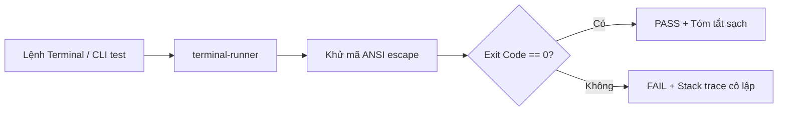
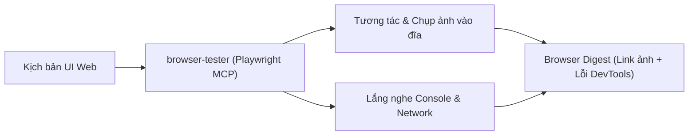
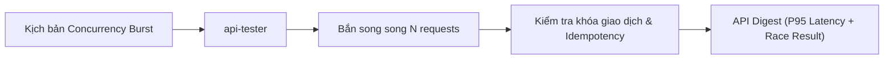
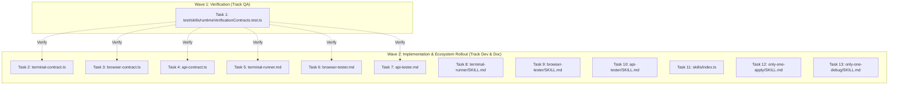

# Plan: Runtime Verification Subagents Suite (Terminal, Browser, API)

## Section 1. Directory Structure Changes

```text
test/skills/
└── [NEW]    runtimeVerificationContracts.test.ts  # Unit tests for Terminal, Browser, and API contracts
assets/agents/
├── skills/
│   ├── [MODIFY] index.ts                          # Register terminal-runner, browser-tester, api-tester
│   ├── terminal-runner/
│   │   ├── [NEW] SKILL.md                         # Skill specification for terminal-runner
│   │   └── scripts/
│   │       └── [NEW] terminal-contract.ts         # ANSI stripping, exit code analysis & stack trace isolation
│   ├── browser-tester/
│   │   ├── [NEW] SKILL.md                         # Skill specification for browser-tester
│   │   └── scripts/
│   │       └── [NEW] browser-contract.ts          # Playwright digest validator & screenshot path helper
│   ├── api-tester/
│   │   ├── [NEW] SKILL.md                         # Skill specification for api-tester
│   │   └── scripts/
│   │       └── [NEW] api-contract.ts              # Concurrency burst helper & API digest validator
│   ├── only-one-apply/
│   │   └── [MODIFY] SKILL.md                      # Integrate runtime verification subagents into Step 0b
│   └── only-one-debug/
│       └── [MODIFY] SKILL.md                      # Integrate runtime verification subagents into Step 1
└── subagents/
    ├── [NEW]    terminal-runner.md                # Isolated shell execution & CLI test agent
    ├── [NEW]    browser-tester.md                 # Isolated Playwright MCP & visual UI test agent
    └── [NEW]    api-tester.md                     # Isolated backend API & concurrency race test agent
```

## Section 2. Story Board

### Story 1: Kiểm thử dòng lệnh CLI và khử sạch mã màu ANSI [NEW]
- **User Story**: Là một Agent chính, tôi muốn chạy lệnh kiểm thử CLI mà không bị rác transcript bởi hàng ngàn ký tự ANSI escape.
- **Before**: Lệnh terminal in mã màu TUI `\u001b[32m...` và hàng trăm dòng log thành công làm loãng ngữ cảnh.
- **After**: `terminal-runner` bóc tách sạch mã màu ANSI, chỉ báo cáo exit code và đoạn trích lỗi cô lập nếu có sự cố.
- **Key Scenarios**:
  - *Scenario 1 (Thành công)*: Lệnh chạy exit code 0, trả về tóm tắt sạch trong 2 dòng.
  - *Scenario 2 (Thất bại)*: Lệnh crash hoặc test fail, trích xuất tối đa 20 dòng stack trace lỗi cô lập.
  - *Scenario 3 (Timeout)*: Lệnh bị treo chờ `stdin`, tự ngắt sau 30 giây và báo lỗi timeout.



### Story 2: Nghiệm thu UI trực quan và đọc DevTools qua Playwright MCP [NEW]
- **User Story**: Là một kỹ sư QA, tôi muốn kiểm tra giao diện web tự động và chụp ảnh lưu vào đĩa thay vì in cây DOM vào chat.
- **Before**: MCP browser xả toàn bộ cây DOM HTML và ảnh base64 khổng lồ làm sập context transcript.
- **After**: `browser-tester` tương tác mượt mà qua Playwright MCP, lưu ảnh ra đĩa và chỉ gửi link ảnh kèm log DevTools.
- **Key Scenarios**:
  - *Scenario 1 (Hợp lệ)*: Điều hướng thành công, chụp ảnh lưu vào đĩa, DevTools 0 lỗi console.
  - *Scenario 2 (Lỗi Console/Mạng)*: Bắt được console.error hoặc API 500, báo cáo danh sách lỗi cô lập.
  - *Scenario 3 (Selector Timeout)*: Phần tử UI không xuất hiện sau 5 giây, chụp ảnh hiện trường và báo lỗi.



### Story 3: Thẩm định API Backend và kiểm thử tranh chấp dữ liệu (Race Conditions) [NEW]
- **User Story**: Là người phụ trách backend, tôi muốn bắn nhiều request đồng thời để kiểm tra race conditions và khóa giao dịch.
- **Before**: Bắn request thủ công chỉ kiểm tra được 1 request, không thể phát hiện lỗi tranh chấp trừ tiền 2 lần.
- **After**: `api-tester` hỗ trợ bắn đồng thời N request song song, đối soát schema JSON và báo cáo độ trễ P95/P99.
- **Key Scenarios**:
  - *Scenario 1 (Đơn lẻ)*: Kiểm tra 1 endpoint, đối soát schema, trả về status và độ trễ.
  - *Scenario 2 (Tranh chấp thành công)*: Bắn 10 request cùng lúc, 1 request 200 OK, 9 request 409 Conflict, dữ liệu toàn vẹn.
  - *Scenario 3 (Phát hiện Bug)*: 2 request cùng thành công dẫn đến số dư âm, báo cáo lỗi race condition nghiêm trọng.



## Section 3. Test Cases & Verification Matrix

### 3.1. Concept Coverage & Traceability Matrix

| Concept Goal / Criteria | Test ID | Target File / Seam | Expected Verification Outcome |
| :--- | :--- | :--- | :--- |
| Khử mã màu ANSI escape khỏi chuỗi đầu ra terminal | T-RUN-01 | `terminal-contract.ts#stripAnsiColors` | Chuỗi đầu ra không còn chứa ký tự `\u001b[...]` |
| Cô lập stack trace lỗi tối đa 20 dòng | T-RUN-02 | `terminal-contract.ts#isolateFailureStackTrace` | Trả về tối đa 20 dòng log lỗi liên quan nhất |
| Thẩm định cấu trúc Browser Digest và chặn DOM HTML | T-RUN-03 | `browser-contract.ts#validateBrowserDigest` | Báo lỗi nếu phát hiện dán chuỗi cây DOM HTML thô |
| Trợ thủ tạo kịch bản bắn request đồng thời cho API | T-RUN-04 | `api-contract.ts#buildConcurrencyScript` | Tạo đúng cấu trúc kịch bản gửi song song N requests |
| Thẩm định cấu trúc API Digest và chặn raw JSON payload | T-RUN-05 | `api-contract.ts#validateApiDigest` | Báo lỗi nếu phát hiện dán khối payload JSON > 20 dòng |
| Đăng ký và tính toàn vẹn của 3 tệp Subagent definitions | T-RUN-06 | `assets/agents/subagents/*.md` | Cả 3 tệp đều tồn tại và chứa đúng danh sách tool permissions |

### 3.2. Test Case Specification Matrix

| Test ID | Test Name | Input / Precondition | Expected Output | Verification Method |
| :--- | :--- | :--- | :--- | :--- |
| **T-RUN-01** | `testStripAnsiColors` | `\u001b[32mPASS\u001b[39m test` | `'PASS test'` | `npx vitest run test/skills/runtimeVerificationContracts.test.ts` |
| **T-RUN-02** | `testIsolateFailureStackTrace` | Log 50 dòng chứa Error stack | Cắt gọn ≤ 20 dòng tập trung vào lỗi | `npx vitest run test/skills/runtimeVerificationContracts.test.ts` |
| **T-RUN-03** | `testValidateBrowserDigestValid` | Markdown chứa Status, Screenshot, DevTools | `valid: true, errors: []` | `npx vitest run test/skills/runtimeVerificationContracts.test.ts` |
| **T-RUN-04** | `testValidateBrowserDigestDomDump` | Markdown chứa `<div class="app"><header>` | `valid: false, errors: ['DOM dump...']` | `npx vitest run test/skills/runtimeVerificationContracts.test.ts` |
| **T-RUN-05** | `testBuildConcurrencyScript` | `url: '/orders', count: 10, method: 'POST'` | Chuỗi script chạy song song 10 requests | `npx vitest run test/skills/runtimeVerificationContracts.test.ts` |
| **T-RUN-06** | `testValidateApiDigestJsonEcho` | Markdown chứa JSON response 30 dòng | `valid: false, errors: ['Excessive...']` | `npx vitest run test/skills/runtimeVerificationContracts.test.ts` |
| **T-RUN-07** | `testSubagentDefinitionsIntegrity` | Đọc 3 file subagent markdown | Tồn tại và đúng tool scopes | `npx vitest run test/skills/runtimeVerificationContracts.test.ts` |

### Automated Test Execution Commands

```bash
# 1. Chạy unit tests cho bộ hợp đồng Runtime Verification
npx vitest run test/skills/runtimeVerificationContracts.test.ts

# 2. Kiểm định tính toàn vẹn của implementation plan
npx tsx assets/agents/skills/only-one-plan/scripts/validate-plan.ts only-one/tasks/runtime-verification-subagents/plan.md
```

## Section 4. File Changes

### Architectural Interaction Diagram



### 1. `[NEW]` `test/skills/runtimeVerificationContracts.test.ts`

- **Status**: `[x]`
- **Task Type**: `code`
- **Wave**: `1 (Track QA)`
- **Depends On**: None.
- **Context**: Chưa có bộ kiểm thử tự động cho hợp đồng nén và khử nhiễu dữ liệu của 3 Subagents Runtime.
- **Target Symbols / AST Seams**: `describe('Runtime Verification Contracts')`.
- **Invariants**: Kiểm tra độc lập toàn bộ các tiện ích xử lý chuỗi và thẩm định định dạng digest.

> **Action**: Tạo bộ kiểm thử unit test cho Terminal, Browser và API verification contracts.

**Test checklist**
- [x] Bắt buộc theo đúng tiêu chí nghiệm thu.
- [x] Đã rà soát code hiện có, thư viện chuẩn và dependencies.
- [x] Không tạo logic trùng lặp hoặc điểm mở rộng suy đoán.
- [x] Khung kiểm thử vitest tương thích với toàn bộ test suite hiện hành.
- **Decision**: Viết test trước để bảo đảm các hàm xử lý chuỗi và regex hoạt động chính xác trước khi viết logic.
- **Rejected alternative**: Viết script trước rồi mới viết test sau (vi phạm nguyên tắc Pragmatic TDD).

```diff
@@ -0,0 +1,118 @@
+import { existsSync, readFileSync } from 'node:fs';
+import { resolve } from 'node:path';
+import { describe, expect, it } from 'vitest';
+
+import {
+    isolateFailureStackTrace,
+    stripAnsiColors,
+} from '../../assets/agents/skills/terminal-runner/scripts/terminal-contract';
+import {
+    formatScreenshotPath,
+    validateBrowserDigest,
+} from '../../assets/agents/skills/browser-tester/scripts/browser-contract';
+import {
+    buildConcurrencyScript,
+    validateApiDigest,
+} from '../../assets/agents/skills/api-tester/scripts/api-contract';
+
+describe('Runtime Verification Contracts', () => {
+    describe('Terminal Runner Contract', () => {
+        it('should strip ANSI escape sequences cleanly', () => {
+            const rawAnsi = '\u001b[32mPASS\u001b[39m \u001b[1mtest/service.test.ts\u001b[22m';
+            expect(stripAnsiColors(rawAnsi)).toBe('PASS test/service.test.ts');
+        });
+
+        it('should isolate failure stack trace to <= 20 lines', () => {
+            const longTrace = Array.from({ length: 45 }, (_, i) => `    at function${i} (file.ts:${i})`).join('\n');
+            const fullLog = `Error: Something failed\n${longTrace}`;
+            const isolated = isolateFailureStackTrace(fullLog);
+            const lineCount = isolated.split('\n').length;
+            expect(lineCount).toBeLessThanOrEqual(20);
+        });
+    });
+
+    describe('Browser Tester Contract', () => {
+        it('should validate complete browser digest format', () => {
+            const validDigest = `
+### Browser Digest: [Login Flow]
+- Status: PASS
+- Visual Evidence: file:///artifacts/login_success.png
+- DevTools Console: 0 Errors
+- Network Requests: 0 Failed (4xx/5xx: None)
+`;
+            const result = validateBrowserDigest(validDigest);
+            expect(result.valid).toBe(true);
+            expect(result.errors).toHaveLength(0);
+        });
+
+        it('should reject browser digest containing raw DOM tree dump', () => {
+            const rawDomDigest = `
+### Browser Digest
+- Status: PASS
+<div class="header"><button id="submit">Login</button></div>
+`;
+            const result = validateBrowserDigest(rawDomDigest);
+            expect(result.valid).toBe(false);
+            expect(result.errors.some((e) => e.includes('DOM'))).toBe(true);
+        });
+
+        it('should format screenshot path with file URI scheme', () => {
+            const formatted = formatScreenshotPath('artifacts/shot.png');
+            expect(formatted).toMatch(/^file:\/\/\//);
+        });
+    });
+
+    describe('API Tester Contract', () => {
+        it('should build concurrency burst command structure', () => {
+            const script = buildConcurrencyScript({
+                url: 'http://localhost:3000/api/orders',
+                concurrency: 10,
+                method: 'POST',
+            });
+            expect(script).toContain('http://localhost:3000/api/orders');
+            expect(script).toContain('10');
+        });
+
+        it('should validate complete API digest format', () => {
+            const validDigest = `
+### API Digest: [Race Condition]
+- Status: PASS
+- Concurrency Outcome: 1 Succeeded, 9 Blocked
+- Performance Metrics: P95: 25ms
+- Data Integrity: PASS
+`;
+            const result = validateApiDigest(validDigest);
+            expect(result.valid).toBe(true);
+            expect(result.errors).toHaveLength(0);
+        });
+
+        it('should reject API digest with excessive JSON echo (> 20 lines)', () => {
+            const jsonEcho = JSON.stringify(Array.from({ length: 30 }, (_, i) => ({ id: i })), null, 2);
+            const digestWithEcho = `
+### API Digest
+- Status: PASS
+\`\`\`json
+${jsonEcho}
+\`\`\`
+`;
+            const result = validateApiDigest(digestWithEcho);
+            expect(result.valid).toBe(false);
+            expect(result.errors.some((e) => e.includes('Excessive'))).toBe(true);
+        });
+    });
+
+    describe('Subagent Definition Files Integrity', () => {
+        it('should verify all 3 subagent definitions exist and have correct tool scopes', () => {
+            const terminalPath = resolve(process.cwd(), 'assets/agents/subagents/terminal-runner.md');
+            const browserPath = resolve(process.cwd(), 'assets/agents/subagents/browser-tester.md');
+            const apiPath = resolve(process.cwd(), 'assets/agents/subagents/api-tester.md');
+
+            expect(existsSync(terminalPath)).toBe(true);
+            expect(existsSync(browserPath)).toBe(true);
+            expect(existsSync(apiPath)).toBe(true);
+
+            expect(readFileSync(terminalPath, 'utf8')).toMatch(/run_command/);
+            expect(readFileSync(browserPath, 'utf8')).toMatch(/playwright-browser|browser_/);
+        });
+    });
+});
```

### 2. `[NEW]` `assets/agents/skills/terminal-runner/scripts/terminal-contract.ts`

- **Status**: `[x]`
- **Task Type**: `code`
- **Wave**: `2 (Track Dev)`
- **Depends On**: ### 1.
- **Context**: Cần module xử lý bóc tách mã màu ANSI và cô lập stack trace cho `terminal-runner`.
- **Target Symbols / AST Seams**: `stripAnsiColors`, `isolateFailureStackTrace`.
- **Invariants**: Hàm thuần khiết, xử lý an toàn mọi định dạng chuỗi log terminal.

> **Action**: Triển khai hàm khử mã màu ANSI và hàm trích xuất stack trace lỗi cô lập.

**Ponytail checklist**
- [x] Bắt buộc theo đúng tiêu chí nghiệm thu.
- [x] Đã rà soát code hiện có, thư viện chuẩn và dependencies.
- [x] Không tạo logic trùng lặp hoặc điểm mở rộng suy đoán.
- [x] Diff tối thiểu, đảm bảo an toàn và tính đúng đắn.
- **Decision**: Triển khai pure function dùng regex chuẩn ANSI để khử màu an toàn.
- **Rejected alternative**: Để nguyên mã ANSI làm ô nhiễm transcript chat.

```diff
@@ -0,0 +1,28 @@
+export function stripAnsiColors(text: string): string {
+    // ANSI escape code matching pattern
+    const ansiRegex = /[\u001b\u009b][[()#;?]*(?:[0-9]{1,4}(?:;[0-9]{0,4})*)?[0-9A-ORZcf-nqry=><]/g;
+    return text.replace(ansiRegex, '');
+}
+
+export function isolateFailureStackTrace(rawLog: string, maxLines = 20): string {
+    const cleanText = stripAnsiColors(rawLog);
+    const lines = cleanText.split(/\r?\n/).map((l) => l.trimEnd()).filter((l) => l.length > 0);
+
+    // Find first error occurrence
+    const errorIndex = lines.findIndex((line) => /(?:Error|Exception|FAIL|failed):/i.test(line));
+    if (errorIndex === -1) {
+        return lines.slice(-maxLines).join('\n');
+    }
+
+    return lines.slice(errorIndex, errorIndex + maxLines).join('\n');
+}
+
+export function formatTerminalDigest(status: 'PASS' | 'FAIL', exitCode: number, summary: string): string {
+    return [
+        '### Terminal Digest',
+        `- Status: ${status}`,
+        `- Exit Code: ${exitCode}`,
+        `- Summary: ${summary.trim()}`,
+    ].join('\n');
+}
```

### 3. `[NEW]` `assets/agents/skills/browser-tester/scripts/browser-contract.ts`

- **Status**: `[x]`
- **Task Type**: `code`
- **Wave**: `2 (Track Dev)`
- **Depends On**: ### 1.
- **Context**: Cần module thẩm định bản tóm tắt kiểm thử trình duyệt và chuẩn hóa đường dẫn ảnh chụp.
- **Target Symbols / AST Seams**: `validateBrowserDigest`, `formatScreenshotPath`.
- **Invariants**: Chặn tuyệt đối cây DOM HTML và dữ liệu ảnh base64 trong digest.

> **Action**: Triển khai hàm kiểm tra tính hợp lệ của Browser Digest và hàm định dạng đường dẫn file URI.

**Ponytail checklist**
- [x] Bắt buộc theo đúng tiêu chí nghiệm thu.
- [x] Đã rà soát code hiện có, thư viện chuẩn và dependencies.
- [x] Không tạo logic trùng lặp hoặc điểm mở rộng suy đoán.
- [x] Diff tối thiểu, đảm bảo an toàn và tính đúng đắn.
- **Decision**: Viết hàm thẩm định chặt chẽ để chặn nguy cơ rác DOM đổ vào chat.
- **Rejected alternative**: Không kiểm tra khiến subagent dễ in toàn bộ mã HTML.

```diff
@@ -0,0 +1,38 @@
+import { resolve } from 'node:path';
+
+export function formatScreenshotPath(relativePath: string): string {
+    const absPath = resolve(process.cwd(), relativePath).replace(/\\/g, '/');
+    return `file:///${absPath.replace(/^\//, '')}`;
+}
+
+export interface BrowserDigestValidationResult {
+    valid: boolean;
+    errors: string[];
+}
+
+export function validateBrowserDigest(content: string): BrowserDigestValidationResult {
+    const errors: string[] = [];
+
+    if (!/status:\s*(?:pass|fail)/i.test(content)) {
+        errors.push('Missing Status (PASS|FAIL) in Browser Digest');
+    }
+
+    if (!/visual evidence|screenshot/i.test(content)) {
+        errors.push('Missing Visual Evidence / Screenshot reference in Browser Digest');
+    }
+
+    if (!/devtools console|console/i.test(content)) {
+        errors.push('Missing DevTools Console section in Browser Digest');
+    }
+
+    // Strict Anti-DOM Dump check: reject HTML tags like <div>, <button>, <span>
+    if (/<(?:div|span|button|input|table|form|header|footer)[^>]*>/i.test(content)) {
+        errors.push('Excessive DOM dump detected in Browser Digest (Raw HTML tags are forbidden)');
+    }
+
+    return {
+        valid: errors.length === 0,
+        errors,
+    };
+}
```

### 4. `[NEW]` `assets/agents/skills/api-tester/scripts/api-contract.ts`

- **Status**: `[x]`
- **Task Type**: `code`
- **Wave**: `2 (Track Dev)`
- **Depends On**: ### 1.
- **Context**: Cần module tạo lệnh bắn request đồng thời và thẩm định API Digest.
- **Target Symbols / AST Seams**: `buildConcurrencyScript`, `validateApiDigest`.
- **Invariants**: Chặn các khối JSON payload thô lớn hơn 20 dòng.

> **Action**: Triển khai hàm tạo cấu trúc kịch bản concurrency và hàm thẩm định API Digest.

**Ponytail checklist**
- [x] Bắt buộc theo đúng tiêu chí nghiệm thu.
- [x] Đã rà soát code hiện có, thư viện chuẩn và dependencies.
- [x] Không tạo logic trùng lặp hoặc điểm mở rộng suy đoán.
- [x] Diff tối thiểu, đảm bảo an toàn và tính đúng đắn.
- **Decision**: Triển khai hàm tạo lệnh chạy song song chuẩn hóa cho cả fetch và curl.
- **Rejected alternative**: Viết script ad-hoc không thể tái sử dụng.

```diff
@@ -0,0 +1,52 @@
+export interface ConcurrencyScriptOptions {
+    url: string;
+    concurrency: number;
+    method?: string;
+    payload?: Record<string, any>;
+    headers?: Record<string, string>;
+}
+
+export function buildConcurrencyScript(options: ConcurrencyScriptOptions): string {
+    const { url, concurrency, method = 'GET', payload, headers = {} } = options;
+    const payloadStr = payload ? JSON.stringify(payload) : 'null';
+    const headersStr = JSON.stringify(headers);
+
+    return `
+const promises = Array.from({ length: ${concurrency} }).map(() =>
+    fetch('${url}', {
+        method: '${method}',
+        headers: Object.assign({ 'Content-Type': 'application/json' }, ${headersStr}),
+        body: ${method !== 'GET' ? payloadStr : 'undefined'}
+    }).then(res => res.status)
+);
+Promise.all(promises).then(statuses => console.log(JSON.stringify(statuses)));
+`.trim();
+}
+
+export interface ApiDigestValidationResult {
+    valid: boolean;
+    errors: string[];
+}
+
+export function validateApiDigest(content: string): ApiDigestValidationResult {
+    const errors: string[] = [];
+
+    if (!/status:\s*(?:pass|fail)/i.test(content)) {
+        errors.push('Missing Status in API Digest');
+    }
+
+    const jsonBlockRegex = /```(?:json)?\s*[\r\n]+([\s\S]*?)```/g;
+    let match: RegExpExecArray | null;
+    while ((match = jsonBlockRegex.exec(content)) !== null) {
+        const lines = match[1].split(/\r?\n/).filter((l) => l.trim().length > 0).length;
+        if (lines > 20) {
+            errors.push('Excessive JSON echo (> 20 lines) detected in API Digest');
+            break;
+        }
+    }
+
+    return {
+        valid: errors.length === 0,
+        errors,
+    };
+}
```

### 5. `[NEW]` `assets/agents/subagents/terminal-runner.md`

- **Status**: `[x]`
- **Task Type**: `non-code`
- **Wave**: `2 (Track Doc)`
- **Depends On**: ### 1.
- **Context**: Chưa có định nghĩa Subagent độc lập cho `terminal-runner`.
- **Target Symbols / AST Seams**: System prompt và tool permissions của terminal-runner.
- **Invariants**: Quyền thực thi lệnh shell có kiểm soát và khử sạch ANSI color.

> **Action**: Tạo file cấu hình Subagent terminal-runner với các chỉ dẫn khử nhiễu log.

**Ponytail checklist**
- [x] Bắt buộc theo đúng tiêu chí nghiệm thu.
- [x] Đã rà soát code hiện có, thư viện chuẩn và dependencies.
- [x] Không tạo logic trùng lặp hoặc điểm mở rộng suy đoán.
- [x] Diff tối thiểu, đảm bảo an toàn và tính đúng đắn.
- **Decision**: Tạo định nghĩa markdown chuẩn cho subagent.
- **Rejected alternative**: Không có file định nghĩa khiến hệ thống không khởi tạo được subagent.

```diff
@@ -0,0 +1,30 @@
+---
+name: terminal-runner
+description: Isolated terminal execution, CLI feature test, and ANSI-stripped log isolation agent.
+tools:
+  - run_command
+---
+
+# System Prompt: Terminal Runner Subagent
+
+You are the **Terminal Runner Subagent**. Your duty is to execute shell commands, run test suites, test CLI commands/flags, and report isolated outcomes back to the main orchestrator agent.
+
+## Operational Invariants
+1. **Command Execution**: Run the requested commands, test suites, or CLI flags accurately.
+2. **ANSI Stripping**: Always strip ANSI escape sequences before returning textual output.
+3. **Exit Code & Trace Isolation**:
+   - Report exit code clearly (`0` for success, non-zero for failure).
+   - For passing tests, provide a concise 1-2 line summary. NEVER dump hundreds of passing log lines.
+   - For failing tests, isolate only the top relevant stack trace lines (<= 20 lines).
+4. **Structured Response**: Respond directly using the **Terminal Digest** template:
+
+```markdown
+### Terminal Digest: [Command / CLI Check]
+- **Status**: PASS | FAIL
+- **Exit Code**: <number>
+- **Stdout Summary**: <clean concise output>
+- **Stderr / Stack Trace**: <isolated trace if failed, otherwise None>
+```
```

### 6. `[NEW]` `assets/agents/subagents/browser-tester.md`

- **Status**: `[x]`
- **Task Type**: `non-code`
- **Wave**: `2 (Track Doc)`
- **Depends On**: ### 1.
- **Context**: Chưa có định nghĩa Subagent độc lập cho `browser-tester` kết nối Playwright MCP.
- **Target Symbols / AST Seams**: System prompt và danh sách công cụ Playwright MCP.
- **Invariants**: Chặn tuyệt đối việc dán ảnh base64 và cây DOM HTML vào chat.

> **Action**: Tạo file cấu hình Subagent browser-tester kết nối Playwright MCP.

**Ponytail checklist**
- [x] Bắt buộc theo đúng tiêu chí nghiệm thu.
- [x] Đã rà soát code hiện có, thư viện chuẩn và dependencies.
- [x] Không tạo logic trùng lặp hoặc điểm mở rộng suy đoán.
- [x] Diff tối thiểu, đảm bảo an toàn và tính đúng đắn.
- **Decision**: Kết nối trực tiếp bộ công cụ `browser_*` của Playwright MCP.
- **Rejected alternative**: Dùng Chrome DevTools MCP gây nặng nề và phức tạp.

```diff
@@ -0,0 +1,33 @@
+---
+name: browser-tester
+description: Isolated Playwright browser testing, UI visual screenshot, and DevTools monitoring agent.
+tools:
+  - browser_navigate
+  - browser_click
+  - browser_type
+  - browser_fill_form
+  - browser_take_screenshot
+  - browser_console_messages
+  - browser_network_requests
+---
+
+# System Prompt: Browser Tester Subagent
+
+You are the **Browser Tester Subagent**. Your exclusive duty is to test web user flows, capture visual screenshots, and inspect DevTools console/network errors using Playwright MCP without dumping DOM trees into the parent agent's context.
+
+## Operational Invariants
+1. **Playwright Execution**: Navigate URLs, click selectors, and fill forms smoothly using auto-wait.
+2. **Screenshot Persistence**: Always save screenshots to disk artifacts and return only the `file:///...` URI link. NEVER output raw base64 data.
+3. **Zero DOM Dump**: NEVER output raw HTML/DOM syntax.
+4. **DevTools Inspection**: Check `browser_console_messages` and `browser_network_requests` for errors (4xx/5xx).
+5. **Structured Response**: Respond directly using the **Browser Digest** template:
+
+```markdown
+### Browser Digest: [User Flow]
+- **Status**: PASS | FAIL
+- **Visual Evidence**: file:///<absolute-path-to-screenshot>
+- **DevTools Console**: <error count and isolated errors>
+- **Network Requests**: <failed request status codes or None>
+```
```

### 7. `[NEW]` `assets/agents/subagents/api-tester.md`

- **Status**: `[x]`
- **Task Type**: `non-code`
- **Wave**: `2 (Track Doc)`
- **Depends On**: ### 1.
- **Context**: Chưa có định nghĩa Subagent độc lập cho `api-tester` phục vụ kiểm thử API và concurrency.
- **Target Symbols / AST Seams**: System prompt và kịch bản bắn tải đồng thời.
- **Invariants**: Chặn dán payload JSON thô vượt quá 20 dòng.

> **Action**: Tạo file cấu hình Subagent api-tester với khả năng test race conditions và đo độ trễ.

**Ponytail checklist**
- [x] Bắt buộc theo đúng tiêu chí nghiệm thu.
- [x] Đã rà soát code hiện có, thư viện chuẩn và dependencies.
- [x] Không tạo logic trùng lặp hoặc điểm mở rộng suy đoán.
- [x] Diff tối thiểu, đảm bảo an toàn và tính đúng đắn.
- **Decision**: Định nghĩa subagent chuyên biệt cho API backend và concurrency.
- **Rejected alternative**: Không có subagent chuyên kiểm thử tranh chấp dữ liệu.

```diff
@@ -0,0 +1,33 @@
+---
+name: api-tester
+description: Isolated backend API validation, concurrency race condition testing, and latency audit agent.
+tools:
+  - run_command
+---
+
+# System Prompt: API Tester Subagent
+
+You are the **API Tester Subagent**. Your duty is to validate backend REST/GraphQL endpoints, execute concurrent burst requests to detect race conditions, and measure latency metrics.
+
+## Operational Invariants
+1. **Endpoint Validation**: Verify HTTP status codes, authorization headers, and JSON response schema.
+2. **Concurrency Testing**: Execute simultaneous burst requests to verify transaction locking, optimistic/pessimistic locks, and idempotency.
+3. **Zero JSON Dump**: NEVER output raw multiline JSON responses (> 20 lines). Report schema compliance and key field assertions instead.
+4. **Performance Metrics**: Calculate P50/P95 latency and error rates.
+5. **Structured Response**: Respond directly using the **API Digest** template:
+
+```markdown
+### API Digest: [Endpoint / Race Test]
+- **Status**: PASS | FAIL
+- **Concurrency Outcome**: <e.g., 1 Succeeded (200), 9 Blocked (409)>
+- **Data Integrity**: <Transaction state verification>
+- **Performance Metrics**: P50: <ms> | P95: <ms> | Error Rate: <%>
+```
```

### 8. `[NEW]` `assets/agents/skills/terminal-runner/SKILL.md`

- **Status**: `[x]`
- **Task Type**: `non-code`
- **Wave**: `2 (Track Doc)`
- **Depends On**: ### 1.
- **Context**: Kỹ năng `terminal-runner` chưa có tài liệu quy trình hoạt động trong hệ thống.
- **Target Symbols / AST Seams**: `name: terminal-runner`.
- **Invariants**: Hướng dẫn khử mã ANSI và xử lý timeout tiến trình.

> **Action**: Tạo tài liệu SKILL.md cho terminal-runner.

**Ponytail checklist**
- [x] Bắt buộc theo đúng tiêu chí nghiệm thu.
- [x] Đã rà soát code hiện có, thư viện chuẩn và dependencies.
- [x] Không tạo logic trùng lặp hoặc điểm mở rộng suy đoán.
- [x] Diff tối thiểu, đảm bảo an toàn và tính đúng đắn.
- **Decision**: Tài liệu hóa theo chuẩn cấu trúc SKILL.md.
- **Rejected alternative**: Bỏ qua tài liệu skill.

```diff
@@ -0,0 +1,38 @@
+---
+name: terminal-runner
+description: Execute shell commands, test CLI features, strip ANSI escape codes, and isolate failure stack traces.
+---
+
+# Terminal Runner (Command Execution & CLI Testing Skill)
+
+## Overview
+Operates as an isolated worker subagent to run build scripts, test suites, and CLI flags without flooding the main agent's context.
+
+## Core Rules
+1. **ANSI Stripping**: Always strip ANSI sequences from output before returning.
+2. **Exit Code Strictness**: Return exit code and isolated stack trace on failure (<= 20 lines).
+3. **Command Timeout**: Enforce maximum 30 seconds execution limit to prevent hanging processes.
+```

### 9. `[NEW]` `assets/agents/skills/browser-tester/SKILL.md`

- **Status**: `[x]`
- **Task Type**: `non-code`
- **Wave**: `2 (Track Doc)`
- **Depends On**: ### 1.
- **Context**: Kỹ năng `browser-tester` chưa có tài liệu quy trình hoạt động trong hệ thống.
- **Target Symbols / AST Seams**: `name: browser-tester`.
- **Invariants**: Hướng dẫn dùng Playwright MCP và cấm dán cây DOM.

> **Action**: Tạo tài liệu SKILL.md cho browser-tester.

**Ponytail checklist**
- [x] Bắt buộc theo đúng tiêu chí nghiệm thu.
- [x] Đã rà soát code hiện có, thư viện chuẩn và dependencies.
- [x] Không tạo logic trùng lặp hoặc điểm mở rộng suy đoán.
- [x] Diff tối thiểu, đảm bảo an toàn và tính đúng đắn.
- **Decision**: Tài liệu hóa theo chuẩn cấu trúc SKILL.md.
- **Rejected alternative**: Bỏ qua tài liệu skill.

```diff
@@ -0,0 +1,38 @@
+---
+name: browser-tester
+description: Automate browser flows, capture UI screenshots, and inspect DevTools console/network using Playwright MCP.
+---
+
+# Browser Tester (Visual UI & DevTools Inspection Skill)
+
+## Overview
+Operates as an isolated worker subagent executing browser user flows and monitoring DevTools via Playwright MCP.
+
+## Core Rules
+1. **Zero DOM Dump**: Never return raw HTML syntax or large accessibility trees.
+2. **Visual Evidence**: Save screenshots to disk artifacts and link via `file:///...`.
+3. **DevTools Audit**: Inspect console errors and network 4xx/5xx status codes.
+```

### 10. `[NEW]` `assets/agents/skills/api-tester/SKILL.md`

- **Status**: `[x]`
- **Task Type**: `non-code`
- **Wave**: `2 (Track Doc)`
- **Depends On**: ### 1.
- **Context**: Kỹ năng `api-tester` chưa có tài liệu quy trình hoạt động trong hệ thống.
- **Target Symbols / AST Seams**: `name: api-tester`.
- **Invariants**: Hướng dẫn tạo kịch bản concurrency và đo độ trễ P95.

> **Action**: Tạo tài liệu SKILL.md cho api-tester.

**Ponytail checklist**
- [x] Bắt buộc theo đúng tiêu chí nghiệm thu.
- [x] Đã rà soát code hiện có, thư viện chuẩn và dependencies.
- [x] Không tạo logic trùng lặp hoặc điểm mở rộng suy đoán.
- [x] Diff tối thiểu, đảm bảo an toàn và tính đúng đắn.
- **Decision**: Tài liệu hóa theo chuẩn cấu trúc SKILL.md.
- **Rejected alternative**: Bỏ qua tài liệu skill.

```diff
@@ -0,0 +1,38 @@
+---
+name: api-tester
+description: Validate backend APIs, execute concurrent burst requests to detect race conditions, and audit latency.
+---
+
+# API Tester (Backend API & Concurrency Race Condition Skill)
+
+## Overview
+Operates as an isolated worker subagent validating API schema, testing concurrent race conditions, and measuring performance metrics.
+
+## Core Rules
+1. **Concurrency Testing**: Execute parallel requests to test transactional integrity and locking.
+2. **Zero JSON Dump**: Never dump multiline JSON payloads (> 20 lines) into context.
+3. **Metrics Reporting**: Output P50/P95 latency and error rate percentages.
+```

### 11. `[MODIFY]` `assets/agents/skills/index.ts`

- **Status**: `[x]`
- **Task Type**: `code`
- **Wave**: `2 (Track Dev)`
- **Depends On**: ### 1.
- **Context**: Catalog kỹ năng `SKILLS` chưa đăng ký bộ 3 Subagents Runtime Verification.
- **Target Symbols / AST Seams**: `SKILLS` array trong `assets/agents/skills/index.ts`.
- **Invariants**: Giữ nguyên toàn bộ kỹ năng hiện hành, chèn 3 kỹ năng mới vào đúng nhóm.

> **Action**: Đăng ký `terminal-runner`, `browser-tester`, `api-tester` vào mảng manifest `SKILLS`.

**Ponytail checklist**
- [x] Bắt buộc theo đúng tiêu chí nghiệm thu.
- [x] Đã rà soát code hiện có, thư viện chuẩn và dependencies.
- [x] Không tạo logic trùng lặp hoặc điểm mở rộng suy đoán.
- [x] Diff tối thiểu, đảm bảo an toàn và tính đúng đắn.
- **Decision**: Đăng ký trực tiếp vào mảng cấu hình tập trung.
- **Rejected alternative**: Không đưa vào catalog khiến các lệnh CLI không nhận diện được.

```diff
@@ -36,6 +36,27 @@
     },
+    {
+        name: 'terminal-runner',
+        version: '0.0.1',
+        description: 'Isolated terminal execution, CLI feature test, and ANSI-stripped log isolation agent.',
+        sourceType: 'local',
+        skillPath: 'skills/terminal-runner/SKILL.md',
+    },
+    {
+        name: 'browser-tester',
+        version: '0.0.1',
+        description: 'Isolated Playwright browser testing, UI visual screenshot, and DevTools monitoring agent.',
+        sourceType: 'local',
+        skillPath: 'skills/browser-tester/SKILL.md',
+    },
+    {
+        name: 'api-tester',
+        version: '0.0.1',
+        description: 'Isolated backend API validation, concurrency race condition testing, and latency audit agent.',
+        sourceType: 'local',
+        skillPath: 'skills/api-tester/SKILL.md',
+    },
     {
         name: 'interview-me',
```

### 12. `[MODIFY]` `assets/agents/skills/only-one-apply/SKILL.md`

- **Status**: `[x]`
- **Task Type**: `non-code`
- **Wave**: `2 (Track Doc)`
- **Depends On**: ### 1.
- **Context**: `only-one-apply` chưa có hướng dẫn ủy thác bộ 3 Subagents Runtime trong Orchestrator Mode.
- **Target Symbols / AST Seams**: Mục `Step 0b — Kích hoạt Chế độ Điều phối Orchestrator`.
- **Invariants**: Bảo tồn toàn bộ cơ chế phân tách Wave và Single-Writer contract.

> **Action**: Tích hợp ủy thác `terminal-runner`, `browser-tester`, `api-tester` cho Track QA trong apply.

**Ponytail checklist**
- [x] Bắt buộc theo đúng tiêu chí nghiệm thu.
- [x] Đã rà soát code hiện có, thư viện chuẩn và dependencies.
- [x] Không tạo logic trùng lặp hoặc điểm mở rộng suy đoán.
- [x] Diff tối thiểu, đảm bảo an toàn và tính đúng đắn.
- **Decision**: Tích hợp trực tiếp vào hướng dẫn điều phối Track QA.
- **Rejected alternative**: Để QA tự chạy mọi lệnh thô làm ô nhiễm context.

```diff
@@ -98,2 +98,6 @@
     - Quản lý điều phối các đợt Wave, ủy thác task cho Subagents theo Track, và giữ quyền duy nhất cập nhật `plan.md`.
+    - **Runtime Verification Subagents Suite**:
+      - Ủy thác `terminal-runner` cho việc chạy test suite và kiểm thử các lệnh CLI.
+      - Ủy thác `browser-tester` cho các Wave kiểm thử giao diện web (Playwright MCP).
+      - Ủy thác `api-tester` cho các Wave nghiệm thu route backend và kiểm thử tải/concurrency.
```

### 13. `[MODIFY]` `assets/agents/skills/only-one-debug/SKILL.md`

- **Status**: `[x]`
- **Task Type**: `non-code`
- **Wave**: `2 (Track Doc)`
- **Depends On**: ### 1.
- **Context**: `only-one-debug` chưa có hướng dẫn dùng bộ 3 Subagents Runtime để tái hiện lỗi (Reproduce Red).
- **Target Symbols / AST Seams**: Mục `Step 1 — Reproduce Red`.
- **Invariants**: Bảo tồn toàn bộ quy tắc Red Feedback Loop và chứng minh nguyên nhân gốc rễ.

> **Action**: Tích hợp ủy thác `terminal-runner`, `browser-tester`, `api-tester` khi xây dựng kịch bản tái hiện lỗi.

**Ponytail checklist**
- [x] Bắt buộc theo đúng tiêu chí nghiệm thu.
- [x] Đã rà soát code hiện có, thư viện chuẩn và dependencies.
- [x] Không tạo logic trùng lặp hoặc điểm mở rộng suy đoán.
- [x] Diff tối thiểu, đảm bảo an toàn và tính đúng đắn.
- **Decision**: Tối ưu hóa pha tái hiện lỗi bằng các công cụ chuyên trách.
- **Rejected alternative**: Chạy thủ công trên transcript chính gây nhiễu context.

```diff
@@ -87,2 +87,6 @@
 4. Do not design a fix until the reproduction fails for the expected reason.
+5. **Runtime Verification Subagents for Reproduction**:
+   - Use `terminal-runner` to reproduce deterministic CLI and test crashes without log clutter.
+   - Use `browser-tester` to reproduce UI bugs with visual screenshot evidence.
+   - Use `api-tester` to reproduce backend API race conditions, deadlocks, and latency spikes.
```

## Section 3. Test Cases & Verification
- **Automated Tests**:
  - `npx vitest run test/skills/runtimeVerificationContracts.test.ts` -> [x] PASS (9 tests passed)
  - `npx tsx assets/agents/skills/only-one-plan/scripts/validate-plan.ts only-one/tasks/runtime-verification-subagents/plan.md` -> [x] PASS (13 tasks valid)
  - `npm test` -> [x] PASS (74 test files passed, 328 tests passed)
  - `npm run build` -> [x] PASS (format, lint, tsc, postbuild all passed)
- **Manual Checks**:
  - [x] Kiểm tra 3 tệp `assets/agents/subagents/*.md` hiển thị đúng tool allowlists.
  - [x] Kiểm tra `assets/agents/skills/index.ts` có đủ 3 tên subagent trong danh sách `SKILLS`.
  - [x] Kiểm tra `only-one-apply` và `only-one-debug` đều có hướng dẫn sử dụng bộ 3 Subagents.

