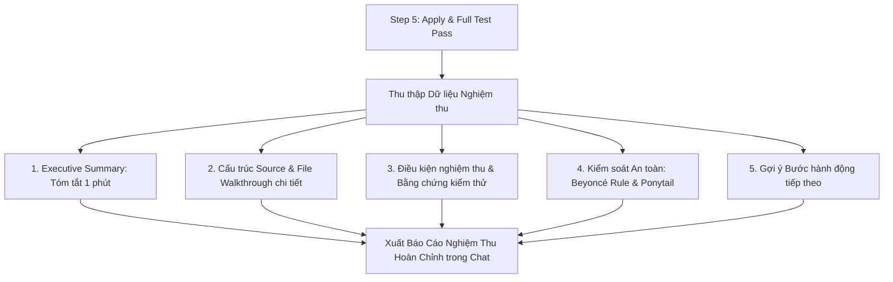

# Concept: Chuẩn hóa Báo cáo Nghiệm thu Hoàn thành của `only-one-apply`

## 1. Problem & Goal (Vấn đề & Mục tiêu)

### Problem (Current Bottlenecks & Deficiencies)
- **Context & Trigger**: Khi kết thúc thực thi lệnh `/only-one-apply`, hệ thống in báo cáo kết quả hoàn thành tác vụ trực tiếp trong phiên chat.
- **Symptom & Defect**:
  - Báo cáo kết thúc sơ sài, thiếu cấu trúc thống nhất.
  - Ngôn ngữ thuyết minh pha trộn tiếng Anh, thiếu tự nhiên với người dùng nói tiếng Việt.
  - Không liệt kê rõ cấu trúc file source đã thay đổi, không thấy được mối liên hệ giữa các file.
  - Không mô tả chi tiết từng file đã làm gì (chỉ thông báo chung chung là đã sửa).
  - Thiếu bằng chứng kiểm thử cụ thể và đối chiếu tiêu chuẩn hoàn thành tác vụ.
- **Root Cause**:
  - `only-one-apply/SKILL.md` (Step 5) chưa định nghĩa schema/template bắt buộc cho phần In-Chat Walkthrough Presentation.
  - Không có quy định về ngôn ngữ hiển thị và các mục báo cáo bắt buộc (Executive Summary, Tree, File Walkthrough, Verification Evidence, Safety Check).
- **Impact / Blast Radius**:
  - PM / Tech Lead khó nghiệm thu nhanh chất lượng mã nguồn sau khi apply.
  - Người dùng không có góc nhìn tổng quan về các thay đổi kiến trúc và rủi ro hồi quy.

### Goal (Target Technical Outcomes)
- **Core Goal**: Thiết lập cấu trúc báo cáo nghiệm thu hoàn tất chuẩn mực (Standard Completion Report Schema) cho `only-one-apply` bằng 100% tiếng Việt, chi tiết theo từng file và gắn liền bằng chứng kiểm thử thực tế.
- **Acceptance Criteria**:
  - Thuyết minh 100% bằng tiếng Việt chuẩn mực, giữ nguyên code symbols, file path và commands.
  - Có phần **Executive Summary** tóm tắt 1 phút mục tiêu và kết quả chính.
  - Có sơ đồ cây thư mục trực quan (`[NEW]`, `[MODIFY]`, `[DELETE]`).
  - Có mục phân tích chi tiết từng file thay đổi: Mục đích, Symbols/Hàm chính, Tóm tắt cơ chế sửa đổi, Fast Test Command kèm kết quả.
  - Có bằng chứng kiểm thử định lượng: Kết quả Full Test Suite (`npm test`), Linter (`format:check`), cập nhật trạng thái frontmatter (`done`/`fixed`).
  - Có bảng kiểm tra an toàn (**Beyoncé Rule** cho test, **Ponytail Checklist** cho tính tái sử dụng và kiểm soát side-effects).
  - Có đề xuất các bước hành động tiếp theo trong chu trình SDLC (`/only-one-review`, `/only-one-pr-git`, `/only-one-clean`).

---

## 2. Scope Boundaries (Phạm vi giải pháp)

### In-Scope
- Cập nhật quy chuẩn hướng dẫn báo cáo trong `assets/skills/only-one-apply/SKILL.md` (Step 5 — Final Comprehensive Verification & In-Chat Reporting).
- Đồng bộ hóa sang cấu hình global skill tương ứng tại `C:\Users\ADMIN\.gemini\config\skills\only-one-apply\SKILL.md`.
- Định nghĩa rõ mẫu Markdown Report Template chuẩn (Executive Summary, Source Structure Tree, File Walkthrough, Verification Proof, Safety Checks, Next Steps).
- Bổ sung quy định bắt buộc thuyết minh bằng tiếng Việt với thuật ngữ kỹ thuật tiêu chuẩn.

### Explicit Out-of-Scope
- Không sinh file `walkthrough.md` riêng biệt trên đĩa (bảo toàn nghiêm ngặt invariant *Zero walkthrough.md File Creation* của `only-one-apply`).
- Không can thiệp vào thuật toán Wave Execution hoặc Sub-agent DAG partitioning của `only-one-apply`.
- Không thay đổi cấu trúc lưu trữ của `plan.md`, `debug.md`, hay `concept.md`.

---

## 3. Proposed Solution & Core Mechanism (Giải pháp đề xuất & Cơ chế cốt lõi)

### Core Mechanism
Trong Step 5 của `only-one-apply`, sau khi toàn bộ file changes được apply thành công và kiểm thử vượt qua (`npm test && npm run lint`), Agent bắt buộc phải định dạng phản hồi chat cuối cùng theo **Khung Báo Cáo Nghiệm Thu 5 Phần**:

### Chi tiết 5 thành phần báo cáo chuẩn
1. **Phần 1 — Tóm tắt nhanh (Executive Summary)**:
   - Mục tiêu tác vụ, giải pháp kiến trúc cốt lõi, và kết quả hoàn thành (số file, % pass).
2. **Phần 2 — Cấu trúc Source & Chi tiết từng file**:
   - Cây thư mục biểu diễn bằng Markdown codeblock với nhãn hành động `[NEW]`, `[MODIFY]`, `[DELETE]`.
   - Danh sách tuần tự từng file: Mục đích thay đổi, symbols/components tác động, nội dung chi tiết đã đổi, lệnh Fast Test và kết quả.
3. **Phần 3 — Điều kiện nghiệm thu & Bằng chứng thực tế**:
   - Tích chọn `[x]` các tiêu chí nghiệm thu ban đầu trong plan/debug.
   - Bằng chứng test: Số lượng test passed, kiểm tra linter sạch, xác nhận cập nhật frontmatter `status: done` hoặc `fixed`.
4. **Phần 4 — Kiểm soát An toàn & Rủi ro**:
   - Khẳng định tuân thủ Beyoncé Rule (có test chứng minh sự thay đổi) và Ponytail Reuse.
   - Đánh giá khả năng ảnh hưởng ngoài ý muốn (side-effects).
5. **Phần 5 — Bước hành động tiếp theo**:
   - Gợi ý lệnh thực thi tiếp theo phù hợp với trạng thái (`/only-one-review`, `/only-one-pr-git`, `/only-one-clean`).

---

## 4. Critical Risks & Edge Cases (Rủi ro & Trường hợp biên)

- **Nguy cơ báo cáo quá dài gây trôi màn hình chat**:
  - *Giải pháp*: Giữ cấu trúc phân cấp rõ ràng với tiêu đề chuẩn, sử dụng bullet point ngắn gọn tuân thủ ASD-STE100, tránh viết văn xuôi dài dòng.
- **Tác vụ lớn với nhiều hơn 10 file thay đổi**:
  - *Giải pháp*: Trong cây thư mục liệt kê đầy đủ, còn trong phần chi tiết từng file, gom nhóm các file cùng module hoặc sử dụng bảng ma trận tóm tắt để giữ tính súc tích.
- **Trường hợp chạy apply thất bại một phần**:
  - *Giải pháp*: Báo cáo chuyển sang chế độ "Báo cáo Tạm dừng / Thất bại", hiển thị rõ file bị lỗi, test failure output và kích hoạt quy trình chẩn đoán `diagnosing-bugs`.
