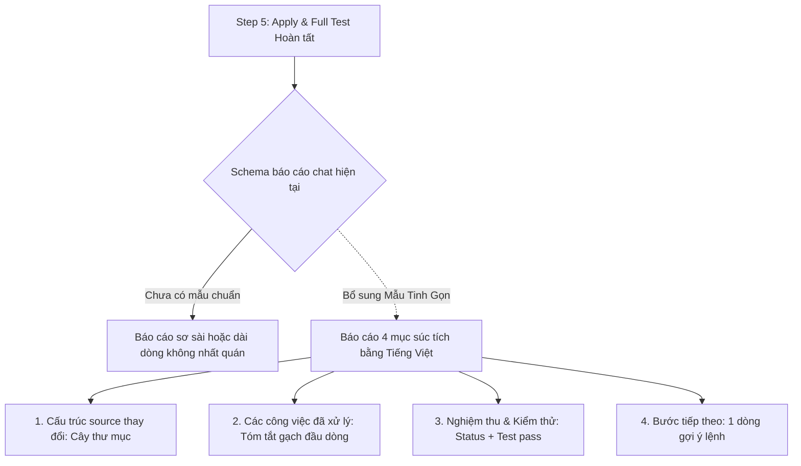

# Debug: Chuẩn hóa và Tinh gọn Báo cáo Hoàn thành của `only-one-apply`

## Section 1. Reproduction & Root Cause (Diagnosis)

### Symptom
- **Hiện tượng**: Khi `only-one-apply` thực thi xong một task, báo cáo cuối cùng hiển thị trong chat quá sơ sài hoặc không có định dạng thống nhất.
- Khi người dùng muốn xem lại những gì đã thực hiện:
  - Thiếu sơ đồ cấu trúc source file đã thay đổi.
  - Không có danh sách tóm tắt nhanh các công việc đã làm trong cả quá trình.
  - Ngôn ngữ thuyết minh không nhất quán, pha trộn tiếng Anh.
  - Nếu viết quá chi tiết theo từng file thì lại gây dài dòng, mất thời gian quét mắt.

### Reproduction
- **Trigger**: Chạy `/only-one-apply` trên bất kỳ task nào và quan sát phần báo cáo ở bước cuối (Step 5).
  - Quan sát: Báo cáo chỉ có 1-2 dòng tóm tắt chung chung hoặc mô tả rườm rà, không theo mẫu tinh gọn.
- **Red Test**:
  - `test/skills/applyReportTemplate.test.ts`: Kiểm tra file `assets/skills/only-one-apply/SKILL.md` có chứa mẫu báo cáo tinh gọn 4 mục bằng tiếng Việt và vượt qua linter `lintSkill`.
- **Command**: `npm test test/skills/applyReportTemplate.test.ts`.

### Evidence
- **Observed Facts**:
  Trong `assets/skills/only-one-apply/SKILL.md` (Step 5):
  Chỉ có 2 dòng quy định chung chung:
  ```markdown
  3. **In-Chat Walkthrough Presentation (Zero walkthrough.md File Creation)**:
     - Output a clean, structured walkthrough summary directly in the chat response.
     - ❌ **Strict No-Extra-File Invariant**: Do NOT create a separate walkthrough.md file on disk.
  ```
  Không có schema, không có yêu cầu tiếng Việt, không có cấu trúc bắt buộc.
- **Fault Location**: `assets/skills/only-one-apply/SKILL.md`.

### Root Cause
- **Nguyên nhân cốt lõi**: `only-one-apply/SKILL.md` chưa định nghĩa mẫu schema chuẩn mực cho phần báo cáo chat, dẫn đến việc mỗi agent khi chạy xong tự xuất báo cáo theo cách tùy tiện, gây khó khăn cho việc nghiệm thu nhanh.

### Defect Call Trace / State Divergence Flow



### Fix Constraints
- Thuyết minh 100% bằng tiếng Việt súc tích, dễ đọc lướt trong 10-15 giây.
- Hiển thị cây thư mục cấu trúc source (`[NEW]`, `[MODIFY]`, `[DELETE]`).
- Tóm tắt tổng quan các công việc đã xử lý qua vài gạch đầu dòng ngắn gọn (không chia nhỏ mô tả chi tiết lặp lại theo từng file).
- Xác nhận điều kiện hoàn thành: Trạng thái task và kết quả test.
- Bảo toàn nghiêm ngặt invariant: Tuyệt đối không sinh file `walkthrough.md` trên đĩa.

---

## Section 2. File Changes

### Directory Structure Changes

```text
assets/skills/only-one-apply/
└── [MODIFY] SKILL.md                          # Cập nhật Step 5 với Mẫu Báo Cáo Tinh Gọn bằng Tiếng Việt

test/skills/
└── [NEW]    applyReportTemplate.test.ts       # Kiểm thử schema báo cáo tinh gọn và độ dài câu ASD-STE100
```

---

### 1. `[MODIFY]` `assets/skills/only-one-apply/SKILL.md`

- **Status**: `[x]`
- **Context**: Báo cáo kết thúc của `only-one-apply` cần tinh gọn: thể hiện cây cấu trúc source, tóm tắt tổng quan các công việc đã xử lý trong cả quá trình (không mô tả chi tiết từng file riêng lẻ), và ghi nhận điều kiện nghiệm thu.
- **Target Symbols / AST Seams**: `Step 5 — Final Comprehensive Verification & In-Chat Reporting`.
- **Invariants**:
  - Bảo toàn nghiêm ngặt invariant không tạo file `walkthrough.md` trên đĩa.
  - Thuyết minh 100% bằng tiếng Việt ngắn gọn, dễ quét mắt nhanh trong 10-15 giây.
  - Không phân rã mô tả chi tiết lặp lại theo từng file riêng lẻ.
- **Depends On**: None.
- **Fast Test Command**: `npm test test/skills/applyReportTemplate.test.ts`.

> **Action**: Cập nhật Step 5 thành mẫu báo cáo trực quan gồm 4 mục súc tích.

**Ponytail checklist**
- [x] Bắt buộc theo đúng tiêu chí nghiệm thu.
- [x] Đã rà soát code hiện có, thư viện chuẩn và dependencies.
- [x] Không tạo logic trùng lặp hoặc điểm mở rộng suy đoán.
- [x] Diff tối thiểu, đảm bảo an toàn và tính đúng đắn.
- **Decision**: Sử dụng cây thư mục source và tóm tắt ngắn gọn các công việc đã hoàn thành qua gạch đầu dòng.
- **Rejected alternative**: Không tạo mục phân tích chi tiết cho từng file.

```diff
@@ -191,4 +191,33 @@
 3. **In-Chat Walkthrough Presentation (Zero walkthrough.md File Creation)**:
-   - Output a clean, structured walkthrough summary directly in the chat response.
-   - ❌ **Strict No-Extra-File Invariant**: Do NOT create a separate `walkthrough.md` file on disk.
+   - Output a concise, high-signal walkthrough report directly in chat.
+   - 🛑 **Strict Vietnamese Language Requirement**: Explanatory text MUST be in concise Vietnamese. Keep symbols, paths, and commands in English.
+   - 🛑 **Strict No-Extra-File Invariant**: Never create a separate `walkthrough.md` file on disk.
+   - Report MUST strictly follow this concise schema:
+
+```markdown
+# 🏁 Hoàn thành tác vụ: `<slug>`
+
+### 1. Cấu trúc source thay đổi
+\`\`\`text
+src/
+├── [NEW]    path/to/newFile.ts
+└── [MODIFY] path/to/modFile.ts
+\`\`\`
+
+### 2. Các công việc đã xử lý
+- <Tóm tắt công việc 1 đã thực hiện trong quá trình>.
+- <Tóm tắt công việc 2 đã thực hiện trong quá trình>.
+- <Tóm tắt công việc 3 đã thực hiện trong quá trình>.
+
+### 3. Nghiệm thu & Kiểm thử
+- **Trạng thái**: Hoàn tất (`status: done` / `fixed`).
+- **Kiểm thử**: `<Lệnh test>` -> `PASS (X test passed)`.
+
+### 4. Bước tiếp theo
+- `/only-one-review` | `/only-one-pr-git` | `/only-one-clean`
+```
```

---

### 2. `[NEW]` `test/skills/applyReportTemplate.test.ts`

- **Status**: `[x]`
- **Context**: Tạo test kiểm tra sự hiện diện của mẫu báo cáo tinh gọn và kiểm tra tiêu chuẩn ASD-STE100 qua `lintSkill`.
- **Target Symbols / AST Seams**: `applyReportTemplateInvariants`.
- **Invariants**: File `SKILL.md` phải có mẫu báo cáo 4 mục súc tích và vượt qua linter độ dài câu.
- **Depends On**: `assets/skills/only-one-apply/SKILL.md`.
- **Fast Test Command**: `npm test test/skills/applyReportTemplate.test.ts`.

> **Action**: Viết unit test xác thực mẫu báo cáo tinh gọn trong `SKILL.md`.

**Ponytail checklist**
- [x] Bắt buộc theo đúng tiêu chí nghiệm thu.
- [x] Đã rà soát code hiện có, thư viện chuẩn và dependencies.
- [x] Không tạo logic trùng lặp hoặc điểm mở rộng suy đoán.
- [x] Diff tối thiểu, đảm bảo an toàn và tính đúng đắn.
- **Decision**: Kiểm tra 4 mục cốt lõi của schema tinh gọn.
- **Rejected alternative**: Không kiểm tra các trường con chi tiết từng file.

```diff
@@ -0,0 +1,34 @@
+import fs from 'node:fs';
+import path from 'node:path';
+import { describe, expect, it } from 'vitest';
+import { lintSkill } from '../../assets/skills/only-one-evolve/scripts/lint-skill.js';
+
+describe('only-one-apply Concise Report Template Invariants', () => {
+    const skillPath = path.resolve(process.cwd(), 'assets/skills/only-one-apply/SKILL.md');
+
+    it('tồn tại file assets/skills/only-one-apply/SKILL.md', () => {
+        expect(fs.existsSync(skillPath)).toBe(true);
+    });
+
+    it('chứa mẫu báo cáo tinh gọn bằng tiếng Việt', () => {
+        const content = fs.readFileSync(skillPath, 'utf8');
+
+        // 1. Cấu trúc source thay đổi
+        expect(content).toContain('1. Cấu trúc source thay đổi');
+
+        // 2. Các công việc đã xử lý
+        expect(content).toContain('2. Các công việc đã xử lý');
+
+        // 3. Nghiệm thu & Kiểm thử
+        expect(content).toContain('3. Nghiệm thu & Kiểm thử');
+
+        // 4. Bước tiếp theo
+        expect(content).toContain('4. Bước tiếp theo');
+    });
+
+    it('đáp ứng tiêu chuẩn độ dài câu ASD-STE100 qua lintSkill', () => {
+        const content = fs.readFileSync(skillPath, 'utf8');
+        const result = lintSkill(content);
+        expect(result.valid).toBe(true);
+    });
+});
```

---

## Section 3. Verification

### Red Feedback Loop
- [x] Chạy `npm test test/skills/applyReportTemplate.test.ts` để kiểm tra sự tồn tại và tính hợp lệ của mẫu báo cáo.
- [x] Kiểm tra tiêu chuẩn văn phong kỹ thuật ASD-STE100 bằng `lintSkill`.

### Regression
- [x] Chạy toàn bộ test suites: `npm test`.
- [x] Kiểm tra định dạng: `npm run format:check`.

### Evidence
- `npm test test/skills/applyReportTemplate.test.ts` — `PASS (3 tests passed)`.
- `npm run format:check` — `Clean`.
- `npm test` — `PASS (71 passed, 287 passed, 0 failed)`.
- `npm run build` — `PASS`.
- **Lessons Learned**: Thiết kế báo cáo cho developer cần ưu tiên tốc độ quét mắt (scannability), trực quan hóa cấu trúc và tránh boilerplate rườm rà.
