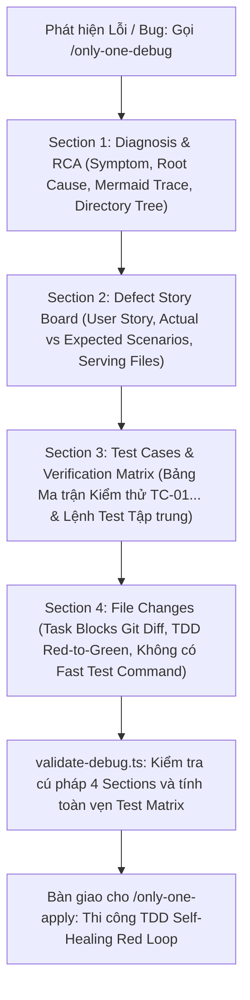

# Concept: Chuẩn hoá Luồng Only-One Debug Theo Quy Chuẩn Kế Hoạch Mới

## 1. Problem & Goal

### Problem (Điểm nghẽn & Thiếu sót hiện tại)
- **Context & Trigger**: Khi phát hiện lỗi hoặc hồi quy, người dùng gọi lệnh `/only-one-debug` để phân tích nguyên nhân gốc rễ (RCA) và tạo tệp thiết kế bản vá `debug.md`. Sau đó, `/only-one-apply` tiếp nhận `debug.md` để thi công mã nguồn.
- **Symptom & Defect**: Cấu trúc tài liệu `debug.md` hiện tại bị lệch pha hoàn toàn so với chuẩn mới của `plan.md`. Cụ thể: vẫn dùng cấu trúc 3 phần cũ, bắt buộc dòng `- **Fast Test Command**: ...` ở từng task block, thiếu ma trận kiểm thử chi tiết dạng bảng (`| Test ID |`), thiếu kịch bản hành vi lỗi (`Defect Story Board`), và script `validate-debug.ts` đang kiểm tra lệch với `SKILL.md`.
- **Root Cause**: Kỹ năng `only-one-debug` chưa được nâng cấp đồng bộ theo các cải tiến kiến trúc của `only-one-plan` (đưa kiểm thử lên Section 3, chuẩn hoá 4 mục số nguyên, gỡ bỏ `Fast Test Command` cục bộ).
- **Impact / Blast Radius**: Khi `/only-one-apply` thực thi `debug.md`, nó không thể đối soát theo ma trận kiểm thử tập trung, gây phân mảnh trải nghiệm người dùng và dễ phát sinh lỗi cú pháp khi chạy `validate-debug.ts`.

### Goal (Kết quả kỹ thuật mục tiêu)
- **Core Goal**: Đồng bộ hoá toàn diện quy cách đặc tả tài liệu `debug.md` và kỹ năng `only-one-debug` theo đúng chuẩn kiến trúc của `only-one-plan` mới.
- **Acceptance Criteria**:
  - **`AC-1` (Cấu trúc 4 Mục Số nguyên Thống nhất)**: `debug.md` chuyển đổi sang cấu trúc chuẩn:
    - `Section 1. Diagnosis & Directory Structure Changes`: Bằng chứng RCA, Mermaid Sequence Trace, và cây thư mục tệp thay đổi.
    - `Section 2. Defect User Story & Reproduction Scenarios`: Kịch bản người dùng gặp lỗi (Actual) vs Kịch bản kỳ vọng sau sửa (Expected), có gắn nhãn `(Test trường hợp: ...)` và tệp phục vụ (`Serving Files`).
    - `Section 3. Test Cases & Verification Matrix`: Bảng Ma trận Kiểm thử Lỗi (`TC-01...`) và Lệnh kiểm thử tự động tập trung.
    - `Section 4. File Changes`: Khối tác vụ Git diffs theo TDD (Test tái hiện đỏ trước $\rightarrow$ Code sửa xanh sau).
  - **`AC-2` (Loại bỏ Triệt để `Fast Test Command`)**: Xoá bỏ hoàn toàn dòng `- **Fast Test Command**: ...` khỏi toàn bộ các task block trong `debug.md` và hướng dẫn của `SKILL.md`. Toàn bộ lệnh kiểm thử được dồn về Section 3.
  - **`AC-3` (Ma trận Kiểm thử Lỗi Chi tiết)**: Bắt buộc Section 3 phải có Bảng Ma trận Kiểm thử với các cột: `Test ID`, `Defect / Invariant Ref`, `Kịch bản Kiểm thử`, `Điều kiện đầu vào`, `Kết quả kỳ vọng (Assertions)`, `Loại test`, `Status [ ]`.
  - **`AC-4` (Nâng cấp Script `validate-debug.ts`)**: Cập nhật kịch bản kiểm tra cú pháp để xác thực linh hoạt cấu trúc 4 Sections mới, bỏ kiểm tra `Fast Test Command`, và kiểm tra sự hiện diện của Bảng Ma trận Kiểm thử.

---

## 2. Scope Boundaries

- **In-Scope**:
  - Cập nhật tài liệu hướng dẫn kỹ năng [`assets/agents/skills/only-one-debug/SKILL.md`](file:///d:/Sources/PERSONAL/only-one-cli/assets/agents/skills/only-one-debug/SKILL.md).
  - Nâng cấp kịch bản kiểm tra chất lượng [`assets/agents/skills/only-one-debug/scripts/validate-debug.ts`](file:///d:/Sources/PERSONAL/only-one-cli/assets/agents/skills/only-one-debug/scripts/validate-debug.ts).
  - Đồng bộ quy tắc thực thi TDD trong `debug.md` để tương thích hoàn toàn với vòng lặp Self-Healing Loop của `/only-one-apply`.
  - Bổ sung hoặc cập nhật bộ kiểm thử đơn vị cho `validate-debug.ts`.
- **Explicit Out-of-Scope**:
  - Không thay đổi các kỹ năng phân tích lỗi chuyên sâu hỗ trợ bên ngoài như `diagnosing-bugs`.
  - Không sửa đổi hoặc can thiệp vào các tài liệu `debug.md` đã hoàn thành và lưu trữ trong quá khứ.

---

## 3. Proposed Solution & Core Mechanism

### Đánh giá Các Phương án Kiến trúc (Architectural Options)

| Tiêu chí So sánh | Phương án 1: Đồng bộ Cấu trúc 4 Mục Thống nhất (Khuyến nghị) | Phương án 2: Giữ Cấu trúc 3 Mục và Vá Cục bộ |
| :--- | :--- | :--- |
| **Cơ chế** | Chuyển `debug.md` sang cấu trúc chuẩn 4 mục: 1. Diagnosis & Structure $\rightarrow$ 2. Defect Story Board $\rightarrow$ 3. Test Cases Matrix $\rightarrow$ 4. File Changes. | Giữ nguyên 3 mục cũ, chèn User Story vào Section 1 và để Ma trận kiểm thử ở Section 3 sau File Changes. |
| **Ưu điểm** | Đồng bộ 100% tư duy và cú pháp giữa `plan.md` và `debug.md`; `/only-one-apply` xử lý chung một mô hình dữ liệu kiểm thử. | Thay đổi ít hơn, giữ nguyên thói quen cấu trúc cũ. |
| **Nhược điểm / Đánh đổi** | Phải cập nhật `validate-debug.ts` để hỗ trợ nhận diện mục linh hoạt. | Gây phân mảnh kiến trúc; người dùng và agent phải nhớ hai chuẩn khác nhau cho `plan` và `debug`. |
| **Độ phức tạp** | Thấp (Low) | Rất thấp (Very Low) |
| **Quyết định** | **Chọn Phương án 1**: Tạo sự nhất quán tuyệt đối trong toàn bộ hệ sinh thái `only-one-*`. | Loại bỏ (Rejected). |

### Core Mechanism (Cơ chế Hoạt động Cốt lõi)

1. **Khâu Chẩn đoán & Cây Thư mục (Section 1)**:
   - Lưu trữ chuỗi bằng chứng RCA: `Symptom`, `Reproduction`, `Evidence`, `Root Cause`, `Fix Constraints`.
   - Giữ nguyên sơ đồ Mermaid Sequence/State Trace biểu diễn điểm gãy vỡ trạng thái.
   - Bổ sung sơ đồ cây thư mục ASCII (`Directory Structure Changes`) để người đọc nắm bắt ngay phạm vi ảnh hưởng.
2. **Khâu Kịch bản Hành vi Lỗi (Section 2 - Defect Story Board)**:
   - Mô tả User Story: *"Là <vai trò>, tôi gặp lỗi <sự cố> khi <hành động>"*.
   - Khắc hoạ rõ nét 2 kịch bản: *Actual Defect Scenario* (Hành vi sai hiện tại) vs *Expected Acceptance Scenario* (Hành vi đúng sau sửa).
   - Chỉ định `Serving Files` và gắn nhãn `(Test trường hợp: ...)`.
3. **Khâu Ma trận Kiểm thử Tập trung (Section 3 - Test Matrix)**:
   - Đưa ma trận kiểm thử lên trước khối mã nguồn để áp dụng triết lý *Test-First Thinking*.
   - Bảng ma trận chi tiết định danh rõ `Test ID` (`TC-01`, `TC-02`...), liên kết với nguyên nhân gốc rễ (`Root Cause Ref`), khẳng định kết quả kỳ vọng (`Assertions`).
   - Lệnh kiểm thử tự động tập trung: Chạy test tái hiện đỏ và test hồi quy toàn dự án.
4. **Khâu Khối Tác vụ Bản vá (Section 4 - File Changes)**:
   - Sắp xếp task test tái hiện đỏ trước, task sửa code xanh sau.
   - Loại bỏ hoàn toàn dòng `- **Fast Test Command**: ...`. Khóa chặt metadata gồm: `Status`, `Task Type`, `Context`, `Target Symbols / AST Seams`, `Invariants`, `Depends On`.

### Conceptual Flow (Sơ đồ Luồng Hoạt động Chuẩn hoá của Only-One Debug)



### Document Structure Wireframe (Khung Cấu trúc Tài liệu `debug.md`)

```text
+-----------------------------------------------------------------------------------+
| debug.md (Chuẩn hoá theo Only-One Architecture)                                    |
+-----------------------------------------------------------------------------------+
| ## Section 1. Diagnosis & Directory Structure Changes                             |
|    - Symptom, Reproduction, Evidence, Root Cause, Fix Constraints                |
|    - Mermaid Defect Call Trace Diagram                                            |
|    - Directory Structure Changes Tree (ASCII)                                     |
+-----------------------------------------------------------------------------------+
| ## Section 2. Defect User Story & Reproduction Scenarios                          |
|    - Story 1: Defect Name                                                         |
|      - User Story: Là <role>, tôi gặp lỗi <lỗi> khi <hành động>.                  |
|      - Scenario 1 (Actual Defect): Hành vi sai hiện tại (Test: TC-01)             |
|        - Serving Files: [TEST] reproduction.test.ts, [MODIFY] target.service.ts   |
|      - Scenario 2 (Expected Fix): Hành vi đúng sau sửa (Test: TC-02)              |
+-----------------------------------------------------------------------------------+
| ## Section 3. Test Cases & Verification Matrix                                    |
|    - 3.1. Defect & Invariant Traceability Matrix                                  |
|    - 3.2. Test Case Specification Matrix (| Test ID | Root Cause Ref | Status |)  |
|    - Automated Test Execution Commands (Lệnh test tập trung)                      |
+-----------------------------------------------------------------------------------+
| ## Section 4. File Changes                                                        |
|    - ### 1. [MODIFY] test/reproduction.test.ts (TDD Red Test - Không Fast Test)    |
|    - ### 2. [MODIFY] src/target.service.ts (Green Fix Code - Không Fast Test)      |
+-----------------------------------------------------------------------------------+
```

---

## 4. Critical Risks & Edge Cases (Phân tích Rủi ro & Cơ chế Phòng vệ)

- **`Risk-1` (Xung đột với các tệp `debug.md` cũ khi chạy `/only-one-apply`)**
  - *Mặt tiêu cực / Nguy cơ*: Nếu `/only-one-apply` hoặc các script kiểm tra bắt buộc cứng `Section 2` cho File Changes, các tệp `debug.md` mới có `Section 4. File Changes` sẽ bị báo lỗi không tìm thấy.
  - *Cơ chế phòng vệ*: Trong `validate-debug.ts` và `plan-status.ts`, sử dụng biểu thức chính quy linh hoạt `## Section (?:2|3|4)\.\s*File Changes` để tương thích ngược 100% với cả cấu trúc 3 mục cũ và cấu trúc 4 mục mới.

- **`Risk-2` (Bỏ sót lệnh kiểm thử khi loại bỏ `Fast Test Command`)**
  - *Mặt tiêu cực / Nguy cơ*: Kỹ sư hoặc Agent thực thi có thể quên lệnh chạy kiểm thử cho từng file nếu không nhìn thấy `Fast Test Command` ngay trong task block.
  - *Cơ chế phòng vệ*: Quy định bắt buộc tại Section 3 phải có tiểu mục `### Automated Test Execution Commands` nêu rõ ràng từng câu lệnh kiểm thử ứng với từng `Test ID` và file tương ứng. Agent `/only-one-apply` sẽ tra cứu tập trung tại đây.

- **`Risk-3` (Lệch Cú pháp Tiêu đề Section giữa `SKILL.md` và `validate-debug.ts`)**
  - *Mặt tiêu cực / Nguy cơ*: Hiện tại `validate-debug.ts` đang bắt cứng `## Section 1. Reproduction & Root Cause` trong khi `SKILL.md` viết `## Section 1. Diagnosis`. Điều này gây lỗi giả (false positive error).
  - *Cơ chế phòng vệ*: Chuẩn hoá regex trong `validate-debug.ts` chấp nhận `## Section 1\.\s*(?:Diagnosis|Reproduction & Root Cause)` kèm theo kiểm tra cây thư mục và sơ đồ Mermaid trace.
