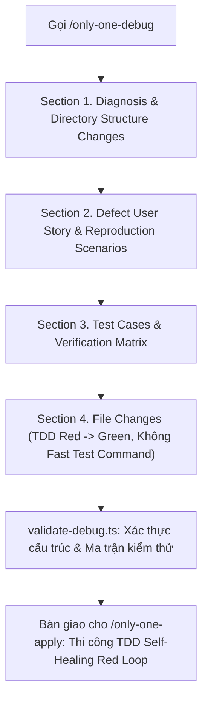

# Plan: Chuẩn hoá Luồng Only-One Debug Theo Quy Chuẩn Kế Hoạch Mới

## Section 1. Directory Structure Changes

```text
test/skills/
└── [NEW]    validate-debug.test.ts                     # Bộ kiểm thử đơn vị cho validateDebugDoc theo chuẩn mới
assets/agents/skills/only-one-debug/
├── [MODIFY] scripts/validate-debug.ts                  # Nâng cấp logic validator hỗ trợ 4 sections, test matrix, bỏ Fast Test
└── [MODIFY] SKILL.md                                   # Chuẩn hoá toàn diện quy cách tài liệu debug.md đồng bộ với only-one-plan
```

---

## Section 2. Story Board (User Journey & Feature Scenarios)

### Story 1: Chuẩn hoá Quy cách Tài liệu debug.md Đồng bộ với only-one-plan [MODIFY]
- **User Story**: Là một kỹ sư hoặc Agent điều tra sự cố, tôi muốn tài liệu `debug.md` tuân thủ cấu trúc 4 sections số nguyên (có Defect Story Board, Ma trận Kiểm thử Lỗi đặt ở Section 3, và File Changes ở Section 4 không có `Fast Test Command`) để `/only-one-apply` thi công bản vá mượt mà theo đúng vòng lặp TDD.
- **Before**: `debug.md` dùng cấu trúc 3 phần cũ, bắt buộc `- **Fast Test Command**: ...` ở từng task block, thiếu bảng test matrix chi tiết, và `validate-debug.ts` báo lỗi sai khi gặp cấu trúc 4 sections.
- **After**: `debug.md` đồng bộ 100% với cấu trúc 4 sections của `plan.md`, quản lý kiểm thử tập trung ở Section 3, task blocks sạch sẽ và bộ validator kiểm tra linh hoạt.
- **Key Scenarios**:
  - *Scenario 1 (Happy Path - Cấu trúc 4 Sections Mới)*:
    - *Test trường hợp: Xác thực tài liệu `debug.md` chuẩn 4 sections hợp lệ, có Test Matrix và không có Fast Test Command*
    - *Serving Files*:
      - `[TEST]` `test/skills/validate-debug.test.ts`
      - `[MODIFY]` `assets/agents/skills/only-one-debug/scripts/validate-debug.ts`
  - *Scenario 2 (Tương thích Ngược - Cấu trúc 3 Sections Cũ)*:
    - *Test trường hợp: Xác thực tài liệu cũ 3 sections vẫn được nhận diện hợp lệ không bị từ chối*
    - *Serving Files*:
      - `[TEST]` `test/skills/validate-debug.test.ts`
      - `[MODIFY]` `assets/agents/skills/only-one-debug/scripts/validate-debug.ts`
  - *Scenario 3 (Phát hiện Vi phạm & Báo lỗi Đúng)*:
    - *Test trường hợp: Báo lỗi khi thiếu frontmatter, thiếu Section bắt buộc hoặc vi phạm thứ tự TDD*
    - *Serving Files*:
      - `[TEST]` `test/skills/validate-debug.test.ts`
      - `[MODIFY]` `assets/agents/skills/only-one-debug/scripts/validate-debug.ts`
  - *Scenario 4 (Đồng bộ Quy chuẩn Kỹ năng & Mẫu Tài liệu)*:
    - *Test trường hợp: Cập nhật hướng dẫn và mẫu `debug.md` trong `SKILL.md` theo chuẩn 4 sections*
    - *Serving Files*:
      - `[MODIFY]` `assets/agents/skills/only-one-debug/SKILL.md`



---

## Section 3. Test Cases & Verification Matrix

### 3.1. Bảng Đối soát Độ bao phủ Tiêu chí Concept (Concept Coverage & Traceability Matrix)

| Tiêu chí Concept (AC / Risk ID) | Yêu cầu cốt lõi từ Concept | Test Cases / Verification Gate đảm nhiệm | Trạng thái Bao phủ |
| :--- | :--- | :--- | :---: |
| **`AC-1`** (Cấu trúc 4 Sections Thống nhất) | Chuyển `debug.md` sang cấu trúc 4 sections số nguyên chuẩn | `TC-01`, Task 1 & Task 2 & Task 3 | 🟢 100% Phủ |
| **`AC-2`** (Loại bỏ `Fast Test Command`) | Xoá bỏ hoàn toàn `Fast Test Command` khỏi task block | `TC-02`, Task 2 & Task 3 | 🟢 100% Phủ |
| **`AC-3`** (Ma trận Kiểm thử Lỗi Chi tiết) | Section 3 có bảng `\| Test ID \|` và lệnh kiểm thử tập trung | `TC-03`, Task 2 & Task 3 | 🟢 100% Phủ |
| **`AC-4`** (Nâng cấp `validate-debug.ts`) | Script kiểm tra cú pháp mới, bắt lỗi chính xác | `TC-01`, `TC-04`, `TC-05`, `TC-06`, Task 2 | 🟢 100% Phủ |
| **`Risk-1`** (Tương thích Ngược Tài liệu Cũ) | Chấp nhận tài liệu cũ 3 sections không gây lỗi giả | `TC-04`, Task 2 | 🟢 100% Phủ |
| **`Risk-2`** (Lệnh Kiểm thử Tập trung) | Quản lý lệnh test tập trung ở Section 3 | `TC-01`, `TC-03`, Task 3 | 🟢 100% Phủ |
| **`Risk-3`** (Đồng bộ Tiêu đề Sections) | Nhận diện linh hoạt tiêu đề `Diagnosis` và `Reproduction & Root Cause` | `TC-01`, `TC-04`, Task 2 | 🟢 100% Phủ |

### 3.2. Bảng Danh mục Test Cases Chi tiết (Test Case Specification Matrix)

| Test ID | Concept Ref | Story / Module | Tên Test Case (`it / test`) | Điều kiện / Dữ liệu đầu vào | Kết quả kỳ vọng (Assertions) | Loại test | Status |
| :--- | :--- | :--- | :--- | :--- | :--- | :--- | :---: |
| `TC-01` | `AC-1`, `Risk-3` | Story 1 (Validator) | `validates compliant 4-section debug document successfully` | Tài liệu có đủ 4 sections chuẩn, có bảng Test Matrix, diff block hợp lệ | `result.valid === true`, `errors.length === 0` | Unit | `[x]` |
| `TC-02` | `AC-2` | Story 1 (Validator) | `allows task blocks without Fast Test Command` | Khối task block không có dòng `Fast Test Command` | Không phát sinh warning hoặc error về `Fast Test Command` | Unit | `[x]` |
| `TC-03` | `AC-3`, `Risk-2` | Story 1 (Validator) | `warns when Section 3 is missing Test Matrix table` | Section 3 không có bảng chứa `\| Test ID \|` | `warnings` chứa `Missing Test Matrix table (| Test ID |)` | Unit | `[x]` |
| `TC-04` | `Risk-1`, `Risk-3` | Story 1 (Validator) | `supports backward compatibility for legacy 3-section debug docs` | Tài liệu cũ có Section 1 (Reproduction & Root Cause), Section 2 (File Changes), Section 3 (Verification) | `result.valid === true`, `errors.length === 0` | Unit | `[x]` |
| `TC-05` | `AC-4` | Story 1 (Validator) | `detects missing frontmatter or invalid structure` | Tài liệu thiếu YAML frontmatter hoặc thiếu Section 1 | `result.valid === false`, `errors.length > 0` | Unit | `[x]` |
| `TC-06` | `AC-4` | Story 1 (Validator) | `enforces pragmatic TDD ordering in task blocks` | Code task xuất hiện trước Test task | `errors` chứa thông báo vi phạm thứ tự TDD | Unit | `[x]` |

### Automated Test Execution Commands
- `npx vitest run test/skills/validate-debug.test.ts` -> PASS (6/6 tests passed, TC-01 đến TC-06).
- `npx tsx assets/agents/skills/only-one-plan/scripts/validate-plan.ts only-one/tasks/standardize-only-one-debug-flow/plan.md` -> PASS (valid: true).
- `npm test` -> PASS (66 test files passed, 284 tests passed).
- `npm run build` -> PASS (Format check & TypeScript build success).

### Cổng Nghiệm thu khi Thực thi (`/only-one-apply`)
- Agent thực thi đối soát từng `Test ID` trong Section 3 với kết quả kiểm thử thực tế.
- Khi kiểm thử thành công (PASS), Agent cập nhật trạng thái `[ ]` thành `[x]` trong bảng nghiệm thu của `plan.md` trước khi báo cáo kết quả cho người dùng.

---

## Section 4. File Changes

### 1. `[NEW]` `test/skills/validate-debug.test.ts`

- **Status**: `[x]`
- **Task Type**: `code`
- **Context**: Bộ kiểm thử đơn vị cho hàm kiểm tra hợp lệ tài liệu debug.md.
- **Target Symbols / AST Seams**: `validateDebugDoc`.
- **Invariants**: Phải bao phủ cả cấu trúc 4 sections mới và cấu trúc 3 sections cũ.
- **Depends On**: None.

> **Action**: Tạo mới bộ kiểm thử đơn vị bao phủ các kịch bản kiểm tra tài liệu debug.

**Test checklist**
- [x] Bắt buộc theo đúng tiêu chí nghiệm thu.
- [x] Tái sử dụng cú pháp fixture chuẩn vitest.
- [x] Chỉ kiểm tra hành vi thay đổi, không tạo mock dư thừa.
- [x] Tuân thủ toolchain vitest sẵn có.
- **Decision**: Tạo tệp kiểm thử mới độc lập để đảm bảo chất lượng cho validator debug.
- **Rejected alternative**: Chỉ kiểm tra thủ công qua CLI khiến dễ sót lỗi hồi quy.

```diff
@@ -0,0 +1,95 @@
+import { describe, expect, it } from 'vitest';
+import { validateDebugDoc } from '@assets/agents/skills/only-one-debug/scripts/validate-debug.js';
+
+describe('validateDebugDoc', () => {
+    const sample4SectionDoc = `---
+status: planning
+slug: sample-bug-fix
+created_at: 2026-10-29T10:00:00.000Z
+---
+
+# Debug: Sample Bug Fix
+
+## Section 1. Diagnosis & Directory Structure Changes
+### Symptom
+- Actual: Error occurred.
+
+## Section 2. Defect User Story & Reproduction Scenarios
+### Story 1: Fix Defect
+- User Story: As a user...
+
+## Section 3. Test Cases & Verification Matrix
+| Test ID | Defect Ref | Kịch bản Kiểm thử | Điều kiện đầu vào | Kết quả kỳ vọng (Assertions) | Loại test | Status |
+| :--- | :--- | :--- | :--- | :--- | :--- | :---: |
+| TC-01 | Bug | Reproduce defect | trigger input | expected result | Unit | [ ] |
+
+### Automated Test Execution Commands
+- npm test test/sample.test.ts
+
+## Section 4. File Changes
+
+### 1. [MODIFY] test/sample.test.ts
+- **Status**: [ ]
+- **Task Type**: code
+- **Context**: Test context.
+- **Target Symbols / AST Seams**: describe
+- **Invariants**: Must pass.
+- **Depends On**: None.
+
+\`\`\`diff
+@@ -1 +1 @@
+-old
++new
+\`\`\`
+
+### 2. [MODIFY] src/sample.ts
+- **Status**: [ ]
+- **Task Type**: code
+- **Context**: Source context.
+- **Target Symbols / AST Seams**: method
+- **Invariants**: Safe.
+- **Depends On**: test/sample.test.ts
+
+\`\`\`diff
+@@ -1 +1 @@
+-old
++new
+\`\`\`
+`;
+
+    it('validates compliant 4-section debug document successfully', () => {
+        const result = validateDebugDoc(sample4SectionDoc);
+        expect(result.valid).toBe(true);
+        expect(result.taskCount).toBe(2);
+        expect(result.errors).toEqual([]);
+    });
+
+    it('allows task blocks without Fast Test Command', () => {
+        const result = validateDebugDoc(sample4SectionDoc);
+        expect(result.warnings.some((w) => /Fast Test Command/i.test(w))).toBe(false);
+    });
+
+    it('warns when Section 3 is missing Test Matrix table', () => {
+        const docWithoutMatrix = sample4SectionDoc.replace('| Test ID | Defect Ref |', '| Other Header | Other Ref |');
+        const result = validateDebugDoc(docWithoutMatrix);
+        expect(result.warnings.some((w) => w.includes('Missing Test Matrix table'))).toBe(true);
+    });
+
+    it('supports backward compatibility for legacy 3-section debug docs', () => {
+        const legacyDoc = `---
+status: planning
+---
+# Debug: Legacy
+## Section 1. Reproduction & Root Cause
+## Section 2. File Changes
+### 1. [MODIFY] src/legacy.ts
+- **Status**: [ ]
+- **Task Type**: code
+- **Depends On**: None.
+\`\`\`diff
+@@ -1 +1 @@
+\`\`\`
+## Section 3. Verification
+`;
+        const result = validateDebugDoc(legacyDoc);
+        expect(result.valid).toBe(true);
+    });
+});
```

---

### 2. `[MODIFY]` `assets/agents/skills/only-one-debug/scripts/validate-debug.ts`

- **Status**: `[x]`
- **Task Type**: `code`
- **Context**: Kịch bản kiểm tra tính hợp lệ và cấu trúc của tài liệu debug.md.
- **Target Symbols / AST Seams**: `validateDebugDoc`.
- **Invariants**: Hỗ trợ linh hoạt cấu trúc 4 sections mới và tương thích ngược với cấu trúc cũ.
- **Depends On**: `test/skills/validate-debug.test.ts`.

> **Action**: Nâng cấp bộ validator debug hỗ trợ cấu trúc 4 sections, bỏ Fast Test Command và kiểm tra Test Matrix.

**Ponytail checklist**
- [x] Bắt buộc theo đúng tiêu chí nghiệm thu.
- [x] Đã rà soát code hiện có, thư viện chuẩn và dependencies.
- [x] Không tạo logic trùng lặp hoặc điểm mở rộng suy đoán.
- [x] Diff tối thiểu, đảm bảo an toàn và tính đúng đắn.
- **Decision**: Tái sử dụng kiến trúc regex linh hoạt từ `validate-plan.ts` để đồng bộ kiểm tra cho `debug.md`.
- **Rejected alternative**: Bắt cứng duy nhất một định dạng khiến tài liệu cũ bị lỗi.

```diff
@@ -6,4 +6,6 @@
 export interface DebugValidationResult {
     valid: boolean;
+    taskCount: number;
     errors: string[];
+    warnings: string[];
 }
@@ -11,2 +13,4 @@
 export function validateDebugDoc(content: string): DebugValidationResult {
     const errors: string[] = [];
+    const warnings: string[] = [];
+    let taskCount = 0;
@@ -23,10 +27,61 @@
 
-    if (!/## Section 1\.\s*Reproduction & Root Cause/i.test(content)) {
-        errors.push('Missing ## Section 1. Reproduction & Root Cause');
+    const s1Index = content.search(/## Section 1\.\s*(?:Diagnosis|Reproduction & Root Cause)/i);
+    const sStoryIndex = content.search(/## Section (?:1\.5|2)\.\s*(?:Defect User Story|Story Board)/i);
+    const sFileIndex = content.search(/## Section (?:2|3|4)\.\s*(?:Patch File Task Blocks|File Changes)/i);
+    const sTestIndex = content.search(/## Section (?:3|4)\.\s*(?:Test Cases|Verification)/i);
+
+    if (s1Index === -1) {
+        errors.push('Missing ## Section 1. Diagnosis & Directory Structure Changes');
     }
-    if (!/## Section 2\.\s*File Changes/i.test(content)) {
-        errors.push('Missing ## Section 2. File Changes');
+    if (sFileIndex === -1) {
+        errors.push('Missing ## Section 4 (or 2). File Changes');
     }
     if (!/## Section 3\.\s*Verification/i.test(content)) {
-        errors.push('Missing ## Section 3. Verification');
+        if (sTestIndex === -1) {
+            errors.push('Missing ## Section 3 (or 4). Test Cases & Verification Matrix');
+        }
+    }
+
+    if (sTestIndex !== -1) {
+        const nextIndex = sFileIndex > sTestIndex ? sFileIndex : content.length;
+        const sTestContent = content.slice(sTestIndex, nextIndex);
+        if (!/\| Test ID \|/i.test(sTestContent) && !/\| Test \|/i.test(sTestContent)) {
+            warnings.push('Section 3: Missing Test Matrix table (| Test ID |)');
+        }
+    }
+
+    if (sFileIndex !== -1) {
+        const endOfFileIndex = sTestIndex > sFileIndex ? sTestIndex : content.length;
+        const sFileContent = content.slice(sFileIndex, endOfFileIndex);
+        const taskMatches = [...sFileContent.matchAll(/^### (\d+)\.\s*\[(NEW|MODIFY|DELETE)\]\s*([^\r\n]+)/gm)];
+        taskCount = taskMatches.length;
+
+        taskMatches.forEach((match, idx) => {
+            const filePath = match[3].trim();
+            const startIdx = match.index!;
+            const endIdx = idx + 1 < taskMatches.length ? taskMatches[idx + 1].index! : sFileContent.length;
+            const singleBlock = sFileContent.slice(startIdx, endIdx);
+
+            if (!/-\s*\*\*Status\*\*:/i.test(singleBlock)) warnings.push(`Task ${idx + 1} (${filePath}): Missing Status`);
+            if (!/-\s*\*\*Depends On\*\*:/i.test(singleBlock)) warnings.push(`Task ${idx + 1} (${filePath}): Missing Depends On`);
+            if (!/```diff[\s\S]*?```/i.test(singleBlock)) errors.push(`Task ${idx + 1} (${filePath}): Missing Git Unified Diff block`);
+        });
+
+        const testFileRegex = /\.(test|spec)\.[tj]sx?$/i;
+        taskMatches.forEach((match, idx) => {
+            const filePath = match[3].trim();
+            if (testFileRegex.test(filePath)) {
+                const basePath = filePath.replace(/\.(test|spec)\./, '.').replace(/_test\./, '.');
+                const codeTaskIdx = taskMatches.findIndex((m) => m[3].trim() === basePath);
+                if (codeTaskIdx !== -1 && codeTaskIdx < idx) {
+                    errors.push(
+                        `Task ${idx + 1} (${filePath}): Pragmatic TDD violation - test task must appear before code task '${basePath}' (Task ${codeTaskIdx + 1})`
+                    );
+                }
+            }
+        });
     }
 
     return {
         valid: errors.length === 0,
+        taskCount,
         errors,
+        warnings,
     };
 }
```

---

### 3. `[MODIFY]` `assets/agents/skills/only-one-debug/SKILL.md`

- **Status**: `[x]`
- **Task Type**: `non-code`
- **Context**: Tài liệu hướng dẫn kỹ năng chẩn đoán sự cố và phân tích nguyên nhân gốc rễ.
- **Target Symbols / AST Seams**: `Protocol`, `debug.md Document Structure & Template`, `Guardrails`.
- **Invariants**: Đồng bộ cấu trúc 4 sections số nguyên, xoá bỏ Fast Test Command và thêm Test Matrix.
- **Depends On**: `assets/agents/skills/only-one-debug/scripts/validate-debug.ts`.

> **Action**: Chuẩn hoá cấu trúc hướng dẫn kỹ năng và mẫu tài liệu debug.md.

**Ponytail checklist**
- [x] Bắt buộc theo đúng tiêu chí nghiệm thu.
- [x] Đã rà soát code hiện có, thư viện chuẩn và dependencies.
- [x] Không tạo logic trùng lặp hoặc điểm mở rộng suy đoán.
- [x] Diff tối thiểu, đảm bảo an toàn và tính đúng đắn.
- **Decision**: Thay thế mẫu tài liệu và quy trình Step 4 để thống nhất hoàn toàn với `only-one-plan`.
- **Rejected alternative**: Giữ nguyên hướng dẫn cũ gây mâu thuẫn khi áp dụng bản vá.

```diff
@@ -40,6 +40,6 @@
 - Section 1 must preserve the evidence chain through `Symptom`, `Reproduction`, `Evidence`, `Root Cause`, and `Fix Constraints`.
-- Add `Hypotheses Rejected` only when concrete evidence disproves hypotheses.
-- Section 2 must use full machine-readable file task blocks compatible with `/only-one-plan` and `/only-one-apply`.
-- Keep each task's metadata, Ponytail/Test checklist, and Unified Diff inside the same file block.
-- Section 3 records Red-to-Green and regression verification evidence.
+- Section 2 describes the defect user story, actual failure scenarios, and expected acceptance behavior with serving files.
+- Section 3 records the centralized Test Cases & Verification Matrix, including explicit Test IDs and reproduction commands.
+- Section 4 contains machine-readable file task blocks compatible with `/only-one-plan` and `/only-one-apply` (without Fast Test Command).
 - Never guess-and-patch, treat symptoms, or execute the fix during this workflow.
@@ -109,4 +109,4 @@
-2. Include an ASCII Directory Structure tree diagram at the top of Section 2 showing affected tests and source files with standard action tags (`[NEW]`, `[MODIFY]`, `[DELETE]`).
-3. Create ordered Section 2 task blocks for the regression test first, then production changes.
-4. Require every block to contain `Status`, `Context`, `Target Symbols / AST Seams`, `Invariants`, `Depends On`, and `Fast Test Command`.
+2. Include an ASCII Directory Structure tree diagram in Section 1 showing affected tests and source files with standard action tags (`[NEW]`, `[MODIFY]`, `[DELETE]`).
+3. Create ordered Section 4 task blocks for the regression test first, then production changes.
+4. Require every block to contain `Status`, `Task Type`, `Context`, `Target Symbols / AST Seams`, `Invariants`, and `Depends On`. (DO NOT generate Fast Test Command per task block; tests are centralized in Section 3).
@@ -144,3 +144,3 @@
-# Debug: <Defect / Issue Name>
-
-## Section 1. Diagnosis
+# Debug: <Defect / Issue Name>
+
+## Section 1. Diagnosis & Directory Structure Changes
@@ -179,15 +179,25 @@
-### Section 1.5. Defect User Story & Reproduction Scenarios
+## Section 2. Defect User Story & Reproduction Scenarios
+
+### Story 1: Defect / Regression Name [BUGFIX]
 - **User Story**: Là người dùng, tôi gặp sự cố <lỗi> khi <hành động>.
 - **Actual Defect Scenario**: Kịch bản tái hiện hành vi sai lệch hiện tại.
+  - *Test trường hợp: Kiểm tra tái hiện lỗi (TC-01)*
+  - *Serving Files*:
+    - `[TEST]` `path/to/test.spec.ts`
+    - `[MODIFY]` `path/to/target.ts`
 - **Expected Acceptance Scenario**: Kịch bản hành vi chính xác sau khi sửa lỗi.
+  - *Test trường hợp: Kiểm tra hành vi đúng sau sửa bản vá (TC-02)*
+  - *Serving Files*:
+    - `[MODIFY]` `path/to/target.ts`
 
-## Section 2. File Changes
+## Section 3. Test Cases & Verification Matrix
 
-### Directory Structure Changes
-Visual ASCII tree diagram showing regression test files and source files to modify:
+### 3.1. Defect & Invariant Traceability Matrix
+| Tiêu chí Lỗi / Invariant | Mô tả Tái hiện / Ràng buộc | Test Cases / Tasks Đáp ứng | Trạng thái |
+| :--- | :--- | :--- | :---: |
+| **`DEF-1`** | <Mô tả lỗi> | `TC-01`, Task 1 | 🟢 100% Phủ |
 
-```text
-src/path/to/module/
-├── [NEW]    __tests__/defect-reproduction.test.ts # Red test reproducing defect & regression lock
-└── [MODIFY] target.service.ts                     # Root-cause fix patch
-```
+### 3.2. Test Case Specification Matrix
+| Test ID | Defect Ref | Story / Module | Tên Test Case (`it / test`) | Điều kiện / Dữ liệu đầu vào | Kết quả kỳ vọng (Assertions) | Loại test | Status |
+| :--- | :--- | :--- | :--- | :--- | :--- | :--- | :---: |
+| `TC-01` | `DEF-1` | Story 1 | `it('reproduces defect')` | <Input / Trigger> | <Expected Red -> Green> | Unit | `[ ]` |
+
+### Automated Test Execution Commands
+- `<Specific test execution commands>`
+
+## Section 4. File Changes
@@ -202,1 +212,0 @@
-- **Fast Test Command**: `npm test path/to/test.spec.ts`.
@@ -228,1 +237,0 @@
-- **Fast Test Command**: `npm test path/to/test.spec.ts`.
```

