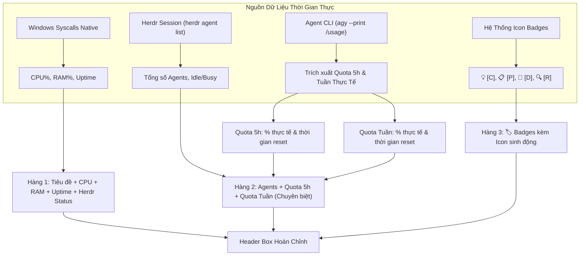

# Concept: Tinh Gọn Header, Thống Kê Hệ Thống (CPU/RAM/Uptime), Trạng Thái Agent, Quota Chuyên Biệt & Icon Badges

## 1. Problem & Goal (Vấn đề & Mục tiêu)

### Problem (Điểm nghẽn & Thiếu sót hiện tại)
- **Context & Trigger**: Người dùng theo dõi TUI Board và điều phối các AI Agent qua các pha công việc.
- **Symptom & Defect**:
  1. Header Box chiếm dụng không gian hiển thị bằng các chuỗi thông tin dư thừa: đường dẫn Workspace dài dòng (`Workspace: D:\Sources\PERSONAL\only-one-cli`) và tổng số task (`Total: 7 Tasks` - vốn đã hiển thị ở từng cột).
  2. Thiếu thông tin giám sát tải của hệ thống máy chủ/máy trạm (CPU, RAM, Uptime).
  3. Thiếu chỉ số hiển thị mức độ bận rộn và số lượng agent của Herdr đang hoạt động ngầm.
  4. Người dùng không theo dõi được Quota còn lại theo cửa sổ trượt 5 giờ và theo tuần của các Agent.
  5. Các ký hiệu Badges (`[C]`, `[P]`, `[D]`, `[R]`) chỉ có chữ cái viết tắt, thiếu icon đồ họa sinh động đi kèm ở cả thanh Legend và thẻ Task Card.
- **Root Cause**:
  1. Header thiết kế tĩnh từ phiên bản đầu, in trực tiếp chuỗi `m.workspaceDir` và `len(m.tasks)`.
  2. Chưa tích hợp bộ thu thập chỉ số phần cứng (CPU, Memory, Host Uptime) trong Go runtime native.
  3. Mô hình chưa truy vấn danh sách `herdr agent list` để phân loại trạng thái agent (`idle`, `busy`).
  4. Chưa tích hợp cơ chế trích xuất Quota 5 giờ và Quota tuần thực tế trực tiếp từ Agent CLI (`agy --output-format json --print "/usage"`).
  5. Định dạng hiển thị Badges chưa gán biểu tượng trực quan tương ứng cho từng loại tài liệu.
- **Impact / Blast Radius**: Header cồng kềnh làm thu hẹp không gian bảng Kanban, người dùng không nắm được tài nguyên máy tính, không biết được hạn mức còn lại thực tế của Agent AI để điều phối, và các badge tài liệu đơn điệu thiếu tính nhận diện nhanh.

### Goal (Kết quả kỹ thuật mục tiêu)
- **Core Goal**: Tinh giản Header Box, loại bỏ đường dẫn workspace và số task thừa, tách riêng hàng Quota 5 giờ và Quota tuần trích xuất trực tiếp từ Agent CLI, bổ sung thông số phần cứng, và tích hợp icon biểu tượng sinh động cho toàn bộ hệ thống Badges.
- **Acceptance Criteria**:
  - Loại bỏ hoàn toàn hiển thị đường dẫn `Workspace` và chỉ số `Total Tasks` khỏi Header.
  - Phân tách Header thành 3 hàng thông tin trực quan, ngăn nắp:
    - **Hàng 1 (Hệ thống)**: Tên ứng dụng + Trạng thái Herdr + `⚡ CPU: XX%` + `💾 RAM: XX%` + `⏱ Uptime: Xh Ym`.
    - **Hàng 2 (Agent & Quota thực tế từ Agent)**:
      - Trạng thái Herdr Agent: `🤖 Agents: N (X idle, Y busy)`.
      - Quota 5 giờ: `⏱ Quota (5h): XX% (~Xh Ym)` (lấy từ bucket 5h của Agent CLI).
      - Quota Tuần: `📅 Quota (Tuần): XX% (~X ngày)` (lấy từ bucket weekly của Agent CLI).
    - **Hàng 3 (Tài liệu có Icon)**:
      - Tiền tố nhãn: `🏷️ Badges:`
      - `💡 [C] Concept` (Ý tưởng / Đề xuất kỹ thuật).
      - `📋 [P] Plan` (Kế hoạch triển khai & Unified Diffs).
      - `🐛 [D] Debug` (Truy vết lỗi & Root Cause Analysis).
      - `🔍 [R] Review` (Đánh giá mã nguồn & Kiểm thử).
  - Tích hợp các biểu tượng icon này đồng bộ cả trên **Header Legend** và trên từng **Task Card** trong các cột Kanban.

## 2. Scope Boundaries (Ranh giới phạm vi)
- **In-Scope**:
  - Tái cấu trúc layout hiển thị của Header Box trong `internal/board/model.go`.
  - Tích hợp thu thập chỉ số CPU, RAM, Uptime qua Windows API native (`golang.org/x/sys/windows`).
  - Nạp và thống kê trạng thái Agent từ Herdr qua lệnh `herdr agent list`.
  - Trích xuất Quota 5h và tuần thực tế từ Agent CLI (`agy --output-format json --print "/usage"`) kèm bộ nhớ đệm cache ~30s trong RAM.
  - Bổ sung icon biểu tượng (`💡`, `📋`, `🐛`, `🔍`) cho các Badges tài liệu trên Header và Task Card.
  - Cập nhật số liệu định kỳ trong vòng lặp Realtime.
- **Explicit Out-of-Scope**:
  - Không thay đổi bảng Kanban và thanh chân trang Footer.
  - Không gọi trực tiếp các API thanh toán bên ngoài ngoài lệnh chính thức của Agent CLI.
  - Không lưu trữ lịch sử chuỗi thời gian (time-series) dài hạn của CPU/RAM.

## 3. Proposed Solution & Core Mechanism (Giải pháp đề xuất & Cơ chế cốt lõi)

### Core Mechanism
- **System Metrics Collector**:
  - Thu thập trực tiếp qua Win32 API native: `GlobalMemoryStatusEx` (RAM%), `GetTickCount64` (Uptime), `GetSystemTimes` (CPU%).
  - Định dạng hiển thị ngắn gọn với các biểu tượng trực quan (`⚡ CPU: 14%  💾 RAM: 48%  ⏱ Uptime: 2h15m`).
- **Real Agent Quota Extraction (`agy --output-format json --print "/usage"`)**:
  - Gọi Agent CLI để lấy cấu trúc dữ liệu JSON chính xác từ model provider:
    - `buckets[window="5h"].remaining_fraction`: tỷ lệ % quota còn lại trong 5 giờ.
    - `buckets[window="5h"].reset_time`: thời điểm reset ISO-8601, tính ra thời gian đếm ngược (ví dụ `~2h15m`).
    - `buckets[window="weekly"].remaining_fraction`: tỷ lệ % quota còn lại trong tuần.
    - `buckets[window="weekly"].reset_time`: thời điểm reset ISO-8601, tính ra số ngày đếm ngược (ví dụ `~5 ngày 22h`).
  - **In-Memory Cache (TTL ~30s)**: Truy vấn bất đồng bộ hoặc lưu đệm trong 30 giây để đảm bảo TUI phản hồi tức thì mà không bị gián đoạn hay đơ giao diện.
- **Badges Icon System**:
  - Định nghĩa bộ icon chuẩn cho tài liệu:
    - Concept: `💡 [C]` (Màu Cyan `#00FFFF`).
    - Plan: `📋 [P]` (Màu Vàng `#FFCC00`).
    - Debug: `🐛 [D]` (Màu Đỏ `#FF5555`).
    - Review: `🔍 [R]` (Màu Xanh lá `#55FF55`).
  - Hiển thị đồng nhất trên cả Header Box và Task Card.
- **Structured 3-Row Header Layout**:
  - **Hàng 1**: Tiêu đề ứng dụng + Trạng thái kết nối Herdr + Chỉ số phần cứng (`CPU`, `RAM`, `Uptime`).
  - **Hàng 2 (Hàng Quota Riêng Biệt)**: Trạng thái Agent sử dụng + Tỷ lệ % Quota 5 giờ (kèm thời gian reset) + Tỷ lệ % Quota tuần (kèm thời gian reset).
  - **Hàng 3**: Hàng chú thích Badges Legend có icon (`💡 [C] Concept  📋 [P] Plan  🐛 [D] Debug  🔍 [R] Review`).

### Conceptual Flow / Domain Model



### UI Wireframe

#### Header Box Mới với Hàng Quota Riêng Biệt & Icon Badges
```text
┌─ 🚀 ONLY-ONE ⚡ WORKFLOW BOARD ── [HERDR: CONNECTED] ───────────────────────────────┐
│ ⚡ CPU: 14%      💾 RAM: 48%      ⏱ Uptime: 3h20m                                    │
│ 🤖 Agents: 4 (0 busy) │ ⏱ Quota (5h): 85% (~2h15m) │ 📅 Quota (Tuần): 92% (~4 ngày) │
│ 🏷️ Badges: 💡 [C] Concept   📋 [P] Plan   🐛 [D] Debug   🔍 [R] Review               │
└──────────────────────────────────────────────────────────────────────────────────────┘
```

#### Task Card với Icon Badges
```text
┌─ #01 20261021-092000-debug-launch... ─┐
│ Cửa sổ Desktop App không tự động...   │
│ 🐛 [D]   2026-10-21                   │
└───────────────────────────────────────┘
```

## 4. Critical Risks & Edge Cases (Rủi ro & Xử lý ngoại lệ)
- **Độ rộng terminal hẹp (dưới 100 cột)**: Khi chiều rộng bị co hẹp, Header tự động rút gọn nhãn hiển thị (`Up: 3h`, `Q-5h: 85%`, `Q-Tuần: 92%`) để đảm bảo không bị rớt dòng làm hỏng khung viền.
- **Icon hiển thị trên các terminal cũ**: Sử dụng các Unicode emoji phổ thông (`💡`, `📋`, `🐛`, `🔍`) được hỗ trợ mặc định trên Windows Terminal, PowerShell 7, macOS Terminal và Linux.
- **File usage.json bị phình to**: Tự động dọn dẹp các bản ghi timestamp cũ hơn 7 ngày mỗi lần nạp hoặc lưu.
