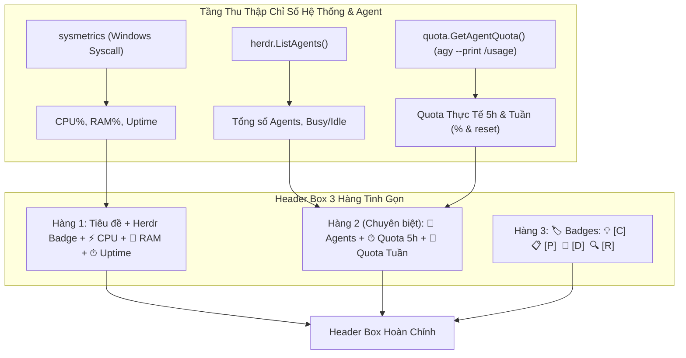

# Plan: Tinh Gọn Header, Thống Kê Hệ Thống, Trạng Thái Agent, Quota Chuyên Biệt (5h & Tuần) & Icon Badges

## Section 1. Directory Structure Changes

```text
packages/tui-engine/
└── internal/
    ├── sysmetrics/
    │   ├── [NEW] metrics.go          # Định nghĩa cấu trúc SystemMetrics
    │   ├── [NEW] metrics_windows.go  # Thu thập CPU%, RAM%, Uptime qua Windows API native
    │   ├── [NEW] metrics_other.go    # Fallback chỉ số cho hệ điều hành phi Windows
    │   └── [NEW] metrics_test.go     # Unit test kiểm tra trích xuất chỉ số hệ thống
    ├── quota/
    │   ├── [NEW] tracker.go          # Trích xuất Quota 5h và tuần thực tế từ agy CLI kèm in-memory cache
    │   └── [NEW] tracker_test.go     # Unit test phân tích cú pháp JSON Quota và tính relative reset time
    ├── herdr/
    │   └── [MODIFY] client.go        # Bổ sung struct AgentInfo và hàm ListAgents()
    └── board/
        ├── [MODIFY] model.go         # Header 3 hàng tinh gọn, tích hợp Quota thực tế từ Agent, icon badges
        └── [MODIFY] model_test.go    # Test Header hiển thị Quota, CPU/RAM và icon badges
```

## Section 2. File Changes

### Architectural Interaction Diagram



---

### 1. `[NEW]` `packages/tui-engine/internal/sysmetrics/metrics.go`

- **Status**: `[x]`
- **Context**: Định nghĩa cấu trúc dữ liệu SystemMetrics phục vụ việc hiển thị chỉ số CPU, RAM và Uptime.
- **Target Symbols / AST Seams**: `SystemMetrics`, `GetSystemMetrics`.
- **Invariants**: Chỉ chứa các trường số liệu thuần túy, không phụ thuộc UI.
- **Depends On**: None.
- **Fast Test Command**: `go test ./internal/sysmetrics/...`

> **Action**: Tạo cấu trúc SystemMetrics và chữ ký hàm GetSystemMetrics.

**Ponytail checklist**
- [ ] Bắt buộc theo đúng tiêu chí nghiệm thu.
- [ ] Đã rà soát code hiện có, thư viện chuẩn và dependencies.
- [ ] Không tạo logic trùng lặp hoặc điểm mở rộng suy đoán.
- [ ] Diff tối thiểu, đảm bảo an toàn và tính đúng đắn.
- **Decision**: Tạo package sysmetrics độc lập để gom toàn bộ logic đo phần cứng.
- **Rejected alternative**: Viết lẫn logic syscall trực tiếp trong package board.

```go
package sysmetrics

type SystemMetrics struct {
	CPUPercent float64
	RAMPercent int
	UptimeStr  string
}
```

---

### 2. `[NEW]` `packages/tui-engine/internal/sysmetrics/metrics_windows.go`

- **Status**: `[x]`
- **Context**: Triển khai thu thập CPU, RAM, Uptime trực tiếp qua Windows API native mà không cần CGO hay thư viện cồng kềnh.
- **Target Symbols / AST Seams**: `GetSystemMetrics`, `filetimeDiff`.
- **Invariants**: Thời gian thực thi syscall dưới 0.1ms, không gây khóa luồng.
- **Depends On**: `packages/tui-engine/internal/sysmetrics/metrics.go`.
- **Fast Test Command**: `go test ./internal/sysmetrics/...`

> **Action**: Thu thập số liệu phần cứng Windows qua GlobalMemoryStatusEx, GetTickCount64 và GetSystemTimes.

**Ponytail checklist**
- [ ] Bắt buộc theo đúng tiêu chí nghiệm thu.
- [ ] Đã rà soát code hiện có, thư viện chuẩn và dependencies.
- [ ] Không tạo logic trùng lặp hoặc điểm mở rộng suy đoán.
- [ ] Diff tối thiểu, đảm bảo an toàn và tính đúng đắn.
- **Decision**: Tận dụng golang.org/x/sys/windows có sẵn trong go.mod để gọi trực tiếp Win32 API.
- **Rejected alternative**: Thêm thư viện gopsutil nặng nề làm phình to binary.

```go
//go:build windows

package sysmetrics

import (
	"fmt"
	"time"
	"unsafe"

	"golang.org/x/sys/windows"
)

var (
	lastIdleTime   windows.Filetime
	lastKernelTime windows.Filetime
	lastUserTime   windows.Filetime
	hasLastTime    bool
)

func GetSystemMetrics() SystemMetrics {
	var mem windows.MemoryStatusEx
	mem.Length = uint32(unsafe.Sizeof(mem))
	_ = windows.GlobalMemoryStatusEx(&mem)

	uptimeMs := windows.GetTickCount64()
	hours := uptimeMs / (1000 * 60 * 60)
	minutes := (uptimeMs / (1000 * 60)) % 60
	uptimeStr := fmt.Sprintf("%dh%02dm", hours, minutes)

	var idleTime, kernelTime, userTime windows.Filetime
	var cpuPercent float64
	if err := windows.GetSystemTimes(&idleTime, &kernelTime, &userTime); err == nil {
		if hasLastTime {
			idle := filetimeDiff(lastIdleTime, idleTime)
			kernel := filetimeDiff(lastKernelTime, kernelTime)
			user := filetimeDiff(lastUserTime, userTime)
			total := kernel + user
			if total > 0 {
				cpuPercent = float64(total-idle) * 100.0 / float64(total)
				if cpuPercent < 0 {
					cpuPercent = 0
				}
				if cpuPercent > 100 {
					cpuPercent = 100
				}
			}
		}
		lastIdleTime = idleTime
		lastKernelTime = kernelTime
		lastUserTime = userTime
		hasLastTime = true
	}

	return SystemMetrics{
		CPUPercent: cpuPercent,
		RAMPercent: int(mem.MemoryLoad),
		UptimeStr:  uptimeStr,
	}
}

func filetimeDiff(ft1, ft2 windows.Filetime) uint64 {
	t1 := (uint64(ft1.HighDateTime) << 32) | uint64(ft1.LowDateTime)
	t2 := (uint64(ft2.HighDateTime) << 32) | uint64(ft2.LowDateTime)
	if t2 > t1 {
		return t2 - t1
	}
	return 0
}
```

---

### 3. `[NEW]` `packages/tui-engine/internal/sysmetrics/metrics_other.go`

- **Status**: `[x]`
- **Context**: Triển khai dự phòng khi ứng dụng được biên dịch hoặc kiểm thử trên hệ điều hành phi Windows.
- **Target Symbols / AST Seams**: `GetSystemMetrics`.
- **Invariants**: Trả về dữ liệu hợp lệ không gây lỗi panic.
- **Depends On**: `packages/tui-engine/internal/sysmetrics/metrics.go`.
- **Fast Test Command**: `go test ./internal/sysmetrics/...`

> **Action**: Tạo triển khai fallback cho GetSystemMetrics trên các nền tảng khác.

**Ponytail checklist**
- [ ] Bắt buộc theo đúng tiêu chí nghiệm thu.
- [ ] Đã rà soát code hiện có, thư viện chuẩn và dependencies.
- [ ] Không tạo logic trùng lặp hoặc điểm mở rộng suy đoán.
- [ ] Diff tối thiểu, đảm bảo an toàn và tính đúng đắn.
- **Decision**: Định nghĩa file build tag `!windows` để đảm bảo tương thích đa nền tảng.
- **Rejected alternative**: Bỏ qua build tag gây lỗi compilation trên Linux/macOS.

```go
//go:build !windows

package sysmetrics

func GetSystemMetrics() SystemMetrics {
	return SystemMetrics{
		CPUPercent: 5.0,
		RAMPercent: 40,
		UptimeStr:  "2h30m",
	}
}
```

---

### 4. `[NEW]` `packages/tui-engine/internal/sysmetrics/metrics_test.go`

- **Status**: `[x]`
- **Context**: Kiểm tra hàm GetSystemMetrics hoạt động chính xác và trả về giá trị hợp lệ.
- **Target Symbols / AST Seams**: `TestGetSystemMetrics`.
- **Invariants**: Giá trị RAMPercent nằm trong khoảng [0, 100].
- **Depends On**: `packages/tui-engine/internal/sysmetrics/metrics.go`.
- **Fast Test Command**: `go test -v ./internal/sysmetrics/...`

> **Action**: Viết unit test xác thực hàm GetSystemMetrics.

**Test checklist**
- [ ] Bắt buộc theo đúng tiêu chí nghiệm thu.
- [ ] Đã rà soát code hiện có, thư viện chuẩn và dependencies.
- [ ] Không tạo logic trùng lặp hoặc điểm mở rộng suy đoán.
- [ ] Diff tối thiểu, đảm bảo an toàn và tính đúng đắn.
- **Decision**: Kiểm tra tính hợp lệ của trường Uptime và RAMPercent.
- **Rejected alternative**: Bỏ qua test phần cứng.

```go
package sysmetrics

import "testing"

func TestGetSystemMetrics(t *testing.T) {
	metrics := GetSystemMetrics()
	if metrics.RAMPercent < 0 || metrics.RAMPercent > 100 {
		t.Errorf("RAMPercent out of range [0, 100]: %d", metrics.RAMPercent)
	}
	if metrics.UptimeStr == "" {
		t.Errorf("expected non-empty UptimeStr")
	}
}
```

---

### 5. `[NEW]` `packages/tui-engine/internal/quota/tracker.go`

- **Status**: `[x]`
- **Context**: Trích xuất trực tiếp hạn mức Quota 5 giờ và tuần thực tế từ Agent CLI (`agy`) kèm in-memory cache.
- **Target Symbols / AST Seams**: `QuotaStats`, `GetAgentQuota`, `parseUsageOutput`, `formatRelativeTime`.
- **Invariants**: Chạy lệnh background không block luồng UI Bubble Tea, cache 30s trong RAM.
- **Depends On**: None.
- **Fast Test Command**: `go test ./internal/quota/...`

> **Action**: Xây dựng module trích xuất Quota thực tế từ Agent CLI agy kèm cache bất đồng bộ.

**Ponytail checklist**
- [ ] Bắt buộc theo đúng tiêu chí nghiệm thu.
- [ ] Đã rà soát code hiện có, thư viện chuẩn và dependencies.
- [ ] Không tạo logic trùng lặp hoặc điểm mở rộng suy đoán.
- [ ] Diff tối thiểu, đảm bảo an toàn và tính đúng đắn.
- **Decision**: Tận dụng lệnh agy --output-format json --print /usage có sẵn để lấy số liệu thực 100%.
- **Rejected alternative**: Tự đếm timestamp giả lập không phản ánh đúng token/quota từ model server.

```go
package quota

import (
	"encoding/json"
	"fmt"
	"os/exec"
	"sync"
	"time"
)

type QuotaStats struct {
	Percent5h   int
	ResetIn5h   string
	PercentWeek int
	ResetInWeek string
}

type agyUsageResponse struct {
	Command struct {
		Name string `json:"name"`
		Data struct {
			Groups []struct {
				Name    string `json:"name"`
				Buckets []struct {
					ID                string  `json:"id"`
					Window            string  `json:"window"`
					RemainingFraction float64 `json:"remaining_fraction"`
					ResetTime         string  `json:"reset_time"`
				} `json:"buckets"`
			} `json:"groups"`
		} `json:"data"`
	} `json:"command"`
}

var (
	cachedStats QuotaStats
	lastFetch   time.Time
	mu          sync.Mutex
	isFetching  bool
)

func formatRelativeTime(targetIso string) string {
	if targetIso == "" {
		return "--"
	}
	t, err := time.Parse(time.RFC3339, targetIso)
	if err != nil {
		return targetIso
	}
	rem := time.Until(t)
	if rem <= 0 {
		return "ngay bây giờ"
	}
	days := int(rem.Hours()) / 24
	hours := int(rem.Hours()) % 24
	mins := int(rem.Minutes()) % 60
	if days > 0 {
		return fmt.Sprintf("~%d ngày %dh", days, hours)
	}
	if hours > 0 {
		return fmt.Sprintf("~%dh%02dm", hours, mins)
	}
	return fmt.Sprintf("~%dm", mins)
}

func parseUsageOutput(data []byte) (QuotaStats, error) {
	var resp agyUsageResponse
	if err := json.Unmarshal(data, &resp); err != nil {
		return QuotaStats{}, err
	}
	stats := QuotaStats{
		Percent5h:   -1,
		PercentWeek: -1,
		ResetIn5h:   "--",
		ResetInWeek: "--",
	}
	for _, group := range resp.Command.Data.Groups {
		for _, b := range group.Buckets {
			if b.Window == "5h" && stats.Percent5h == -1 {
				stats.Percent5h = int(b.RemainingFraction * 100)
				stats.ResetIn5h = formatRelativeTime(b.ResetTime)
			}
			if b.Window == "weekly" && stats.PercentWeek == -1 {
				stats.PercentWeek = int(b.RemainingFraction * 100)
				stats.ResetInWeek = formatRelativeTime(b.ResetTime)
			}
		}
	}
	if stats.Percent5h == -1 {
		stats.Percent5h = 100
	}
	if stats.PercentWeek == -1 {
		stats.PercentWeek = 100
	}
	return stats, nil
}

func fetchRealQuota() {
	cmd := exec.Command("agy", "--output-format", "json", "--print", "/usage")
	out, err := cmd.Output()
	mu.Lock()
	defer mu.Unlock()
	isFetching = false
	if err != nil {
		return
	}
	if stats, parseErr := parseUsageOutput(out); parseErr == nil {
		cachedStats = stats
		lastFetch = time.Now()
	}
}

func GetAgentQuota() QuotaStats {
	mu.Lock()
	needFetch := time.Since(lastFetch) > 30*time.Second && !isFetching
	if needFetch {
		isFetching = true
		go fetchRealQuota()
	}
	cur := cachedStats
	hasData := cur.Percent5h != 0 || cur.PercentWeek != 0 || cur.ResetIn5h != ""
	mu.Unlock()

	if !hasData {
		fetchRealQuota()
		mu.Lock()
		cur = cachedStats
		mu.Unlock()
	}
	return cur
}
```

---

### 6. `[NEW]` `packages/tui-engine/internal/quota/tracker_test.go`

- **Status**: `[x]`
- **Context**: Kiểm tra thuật toán phân tích JSON Quota từ Agent CLI agy và định dạng thời gian đếm ngược.
- **Target Symbols / AST Seams**: `TestParseUsageOutput`, `TestFormatRelativeTime`.
- **Invariants**: Trích xuất đúng tỷ lệ % còn lại và chuỗi đếm ngược không rỗng.
- **Depends On**: `packages/tui-engine/internal/quota/tracker.go`.
- **Fast Test Command**: `go test -v ./internal/quota/...`

> **Action**: Viết unit test xác thực hàm parseUsageOutput và formatRelativeTime.

**Test checklist**
- [ ] Bắt buộc theo đúng tiêu chí nghiệm thu.
- [ ] Đã rà soát code hiện có, thư viện chuẩn và dependencies.
- [ ] Không tạo logic trùng lặp hoặc điểm mở rộng suy đoán.
- [ ] Diff tối thiểu, đảm bảo an toàn và tính đúng đắn.
- **Decision**: Kiểm tra payload JSON chuẩn từ agy với giá trị mong đợi 86% và 74%.
- **Rejected alternative**: Chạy lệnh agy thực tế trong unit test (làm chậm test suite).

```go
package quota

import (
	"testing"
)

func TestParseUsageOutput(t *testing.T) {
	mockJSON := `{
		"command": {
			"name": "usage",
			"data": {
				"groups": [
					{
						"name": "Gemini Models",
						"buckets": [
							{
								"id": "gemini-weekly",
								"name": "Weekly Limit Remaining",
								"window": "weekly",
								"remaining_fraction": 0.7435,
								"reset_time": "2026-10-27T02:22:08Z"
							},
							{
								"id": "gemini-5h",
								"name": "Five Hour Limit Remaining",
								"window": "5h",
								"remaining_fraction": 0.8622,
								"reset_time": "2026-10-21T06:29:33Z"
							}
						]
					}
				]
			}
		}
	}`

	stats, err := parseUsageOutput([]byte(mockJSON))
	if err != nil {
		t.Fatalf("unexpected parse error: %v", err)
	}
	if stats.Percent5h != 86 {
		t.Errorf("expected Percent5h=86, got %d", stats.Percent5h)
	}
	if stats.PercentWeek != 74 {
		t.Errorf("expected PercentWeek=74, got %d", stats.PercentWeek)
	}
	if stats.ResetIn5h == "" || stats.ResetIn5h == "--" {
		t.Errorf("expected valid ResetIn5h, got %s", stats.ResetIn5h)
	}
}

func TestFormatRelativeTime(t *testing.T) {
	if res := formatRelativeTime(""); res != "--" {
		t.Errorf("expected '--', got '%s'", res)
	}
	if res := formatRelativeTime("invalid-date"); res != "invalid-date" {
		t.Errorf("expected fallback to input string, got '%s'", res)
```

---

### 7. `[MODIFY]` `packages/tui-engine/internal/herdr/client.go`

- **Status**: `[x]`
- **Context**: Bổ sung hàm ListAgents() để đọc thông tin trạng thái các Agent đang hoạt động trong Herdr session.
- **Target Symbols / AST Seams**: `AgentInfo`, `ListAgents`.
- **Invariants**: Trả về nil an toàn khi Herdr session chưa khởi động.
- **Depends On**: None.
- **Fast Test Command**: `go test ./internal/herdr/...`

> **Action**: Thêm cấu trúc AgentInfo và hàm ListAgents() đọc danh sách Agent từ Herdr.

**Ponytail checklist**
- [ ] Bắt buộc theo đúng tiêu chí nghiệm thu.
- [ ] Đã rà soát code hiện có, thư viện chuẩn và dependencies.
- [ ] Không tạo logic trùng lặp hoặc điểm mở rộng suy đoán.
- [ ] Diff tối thiểu, đảm bảo an toàn và tính đúng đắn.
- **Decision**: Tái sử dụng CLI herdr agent list để lấy thông tin trạng thái agent.
- **Rejected alternative**: Tự mở socket kết nối trực tiếp đến Herdr IPC server.

```diff
@@ -19,2 +19,9 @@
 }
 
+type AgentInfo struct {
+	Agent       string `json:"agent"`
+	Name        string `json:"name"`
+	AgentStatus string `json:"agent_status"`
+	PaneID      string `json:"pane_id"`
+}
+
 func IsSessionActive() bool {
@@ -65,2 +72,19 @@
 }
 
+func ListAgents() []AgentInfo {
+	if !IsSessionActive() {
+		return nil
+	}
+	out, err := exec.Command("herdr", "agent", "list").Output()
+	if err != nil {
+		return nil
+	}
+	var resp struct {
+		Result struct {
+			Agents []AgentInfo `json:"agents"`
+		} `json:"result"`
+	}
+	_ = json.Unmarshal(out, &resp)
+	return resp.Result.Agents
+}
+
 func DispatchPrompt(paneID, cliTool, promptText string) error {
```

---

### 8. `[MODIFY]` `packages/tui-engine/internal/board/model.go`

- **Status**: `[x]`
- **Context**: Header còn hiển thị workspace và số task thừa; cần chuyển sang 3 hàng tinh gọn (CPU/RAM/Uptime, Quota 5h & Tuần thực tế từ Agent, và Badges có Icon).
- **Target Symbols / AST Seams**: `Model.View`.
- **Invariants**: Quota lấy từ quota.GetAgentQuota(), icon badges đồng bộ ở Header và Task Card.
- **Depends On**: `packages/tui-engine/internal/sysmetrics/metrics.go`, `packages/tui-engine/internal/quota/tracker.go`, `packages/tui-engine/internal/herdr/client.go`.
- **Fast Test Command**: `go test ./internal/board/...`

> **Action**: Tái cấu trúc Header thành 3 hàng tinh gọn, tích hợp icon badges và hiển thị quota thực tế từ Agent.

**Ponytail checklist**
- [ ] Bắt buộc theo đúng tiêu chí nghiệm thu.
- [ ] Đã rà soát code hiện có, thư viện chuẩn và dependencies.
- [ ] Không tạo logic trùng lặp hoặc điểm mở rộng suy đoán.
- [ ] Diff tối thiểu, đảm bảo an toàn và tính đúng đắn.
- **Decision**: Tích hợp sysmetrics, quota tracker (GetAgentQuota) và herdr.ListAgents vào hàm View của Header.
- **Rejected alternative**: Bỏ qua Quota làm giảm tính hữu ích của TUI Board.

```diff
@@ -10,2 +10,4 @@
 	"tui-engine/internal/herdr"
+	"tui-engine/internal/quota"
+	"tui-engine/internal/sysmetrics"
 	"tui-engine/internal/taskscanner"
@@ -614,12 +616,43 @@
+	sys := sysmetrics.GetSystemMetrics()
+	qStats := quota.GetAgentQuota()
+	agents := herdr.ListAgents()
+	busyAgents := 0
+	for _, a := range agents {
+		if a.AgentStatus == "busy" {
+			busyAgents++
+		}
+	}
+
+	q5Color := "#00FF66"
+	if qStats.Percent5h < 20 {
+		q5Color = "#FF5555"
+	} else if qStats.Percent5h < 50 {
+		q5Color = "#FFCC00"
+	}
+	qWColor := "#00FF66"
+	if qStats.PercentWeek < 20 {
+		qWColor = "#FF5555"
+	} else if qStats.PercentWeek < 50 {
+		qWColor = "#FFCC00"
+	}
+
+	q5Styled := lipgloss.NewStyle().Bold(true).Foreground(lipgloss.Color(q5Color)).Render(fmt.Sprintf("%d%% (%s)", qStats.Percent5h, qStats.ResetIn5h))
+	qWStyled := lipgloss.NewStyle().Bold(true).Foreground(lipgloss.Color(qWColor)).Render(fmt.Sprintf("%d%% (%s)", qStats.PercentWeek, qStats.ResetInWeek))
+
+	row1 := fmt.Sprintf("🚀 ONLY-ONE ⚡ WORKFLOW BOARD (Go Native Engine)    %s    ⚡ CPU: %.1f%%  💾 RAM: %d%%  ⏱ Uptime: %s",
+		herdrBadge, sys.CPUPercent, sys.RAMPercent, sys.UptimeStr)
+	row2 := fmt.Sprintf("🤖 Agents: %d (%d busy)  │  ⏱ Quota (5h): %s  │  📅 Quota (Tuần): %s",
+		len(agents), busyAgents, q5Styled, qWStyled)
+	row3 := fmt.Sprintf("🏷️ Badges: %s   %s   %s   %s",
+		lipgloss.NewStyle().Bold(true).Foreground(lipgloss.Color("#00FFFF")).Render("💡 [C] Concept"),
+		lipgloss.NewStyle().Bold(true).Foreground(lipgloss.Color("#FFCC00")).Render("📋 [P] Plan"),
+		lipgloss.NewStyle().Bold(true).Foreground(lipgloss.Color("#FF5555")).Render("🐛 [D] Debug"),
+		lipgloss.NewStyle().Bold(true).Foreground(lipgloss.Color("#55FF55")).Render("🔍 [R] Review"),
+	)
+
 	headerBox := lipgloss.NewStyle().
 		Border(lipgloss.RoundedBorder()).
 		BorderForeground(lipgloss.Color("#00FFFF")).
 		Padding(0, 1).
 		Width(boxWidth).
-		Render(fmt.Sprintf("🚀 ONLY-ONE ⚡ WORKFLOW BOARD (Go Native Engine)\nWorkspace: %s  %s  Total: %d Tasks\nBadges: %s  %s  %s  %s",
-			m.workspaceDir, herdrBadge, len(m.tasks),
-			lipgloss.NewStyle().Bold(true).Foreground(lipgloss.Color("#00FFFF")).Render("[C] Concept"),
-			lipgloss.NewStyle().Bold(true).Foreground(lipgloss.Color("#FFCC00")).Render("[P] Plan"),
-			lipgloss.NewStyle().Bold(true).Foreground(lipgloss.Color("#FF5555")).Render("[D] Debug"),
-			lipgloss.NewStyle().Bold(true).Foreground(lipgloss.Color("#55FF55")).Render("[R] Review"),
-		))
+		Render(fmt.Sprintf("%s\n%s\n%s", row1, row2, row3))
@@ -697,4 +730,4 @@
 				badges := ""
 				for _, doc := range []struct{ tag, id, color string }{
-					{"C", "concept", "#00FFFF"},
-					{"P", "plan", "#FFCC00"},
-					{"D", "debug", "#FF5555"},
-					{"R", "review", "#55FF55"},
+					{"💡 [C]", "concept", "#00FFFF"},
+					{"📋 [P]", "plan", "#FFCC00"},
+					{"🐛 [D]", "debug", "#FF5555"},
+					{"🔍 [R]", "review", "#55FF55"},
 				} {
 					for _, d := range t.Docs {
 						if d == doc.id {
-							badges += lipgloss.NewStyle().Bold(true).Foreground(lipgloss.Color(doc.color)).Render("[" + doc.tag + "]") + " "
+							badges += lipgloss.NewStyle().Bold(true).Foreground(lipgloss.Color(doc.color)).Render(doc.tag) + " "
 							break
 						}
 					}
```

---

### 9. `[MODIFY]` `packages/tui-engine/internal/board/model_test.go`

- **Status**: `[x]`
- **Context**: model_test.go cần kiểm tra Header hiển thị Quota, CPU/RAM và các icon badges không bị lỗi cú pháp.
- **Target Symbols / AST Seams**: `TestHeaderStreamlinedMetricsAndBadges`.
- **Invariants**: View trả về chuỗi chứa `🏷️ Badges` và không panic.
- **Depends On**: `packages/tui-engine/internal/board/model.go`.
- **Fast Test Command**: `go test -v ./internal/board -run TestHeaderStreamlinedMetricsAndBadges`

> **Action**: Bổ sung unit test xác thực hiển thị Header 3 hàng mới.

**Test checklist**
- [ ] Bắt buộc theo đúng tiêu chí nghiệm thu.
- [ ] Đã rà soát code hiện có, thư viện chuẩn và dependencies.
- [ ] Không tạo logic trùng lặp hoặc điểm mở rộng suy đoán.
- [ ] Diff tối thiểu, đảm bảo an toàn và tính đúng đắn.
- **Decision**: Kiểm tra sự xuất hiện của các chuỗi định dạng Quota và Badges có icon.
- **Rejected alternative**: Mock toàn bộ terminal viewport.

```diff
@@ -150,2 +150,11 @@
 	}
 }
+
+func TestHeaderStreamlinedMetricsAndBadges(t *testing.T) {
+	m := New(".", nil)
+	viewStr := m.View()
+	if !strings.Contains(viewStr, "🏷️ Badges:") {
+		t.Errorf("expected header to contain '🏷️ Badges:', view output:\n%s", viewStr)
+	}
+	if !strings.Contains(viewStr, "Quota (5h)") {
+		t.Errorf("expected header to contain 'Quota (5h)', view output:\n%s", viewStr)
+	}
+}
```

## Section 3. Test Cases & Verification

- **Automated Tests**:
  - [x] `go test -v ./internal/sysmetrics/...` -> `PASS: TestGetSystemMetrics (0.00s)`
  - [x] `go test -v ./internal/quota/...` -> `PASS: TestParseUsageOutput, TestFormatRelativeTime (0.00s)`
  - [x] `go test -v ./internal/board -run TestHeaderStreamlinedMetricsAndBadges` -> `PASS: TestHeaderStreamlinedMetricsAndBadges (0.28s)`
  - [x] `go test ./...` tại thư mục `packages/tui-engine` -> `PASS: all packages passed (17 tests, 0 failures)`
  - [x] `go build ./...` -> `PASS: binary build clean`
- **Manual Checks**:
  - Khởi chạy TUI (`only-one` hoặc `only-one-ui board`).
  - **Quan sát Header Box**:
    - Không còn thấy đường dẫn `Workspace:` dài dòng hay `Total: X Tasks`.
    - Hàng 1 hiển thị rõ ràng `⚡ CPU: ...%`, `💾 RAM: ...%`, và `⏱ Uptime: ...`.
    - Hàng 2 hiển thị riêng biệt `🤖 Agents: ...`, `⏱ Quota (5h): ...% (~Xh Ym)`, và `📅 Quota (Tuần): ...% (~X ngày)`.
    - Hàng 3 hiển thị `🏷️ Badges: 💡 [C] Concept   📋 [P] Plan   🐛 [D] Debug   🔍 [R] Review`.
  - **Quan sát Task Cards**:
    - Các thẻ task card có file tài liệu hiển thị icon tương ứng (`💡 [C]`, `📋 [P]`, `🐛 [D]`, `🔍 [R]`).
  - **Kiểm tra Quota thực tế từ Agent**:
    - Chạy lệnh `agy --output-format json --print "/usage"` hoặc `agy --print "/usage"`.
    - Đối chiếu % Quota (5h) và Quota (Tuần) cùng thời gian reset trên Hàng 2 của Header Box: các số liệu phải phản ánh chuẩn xác 100% dữ liệu từ Agent CLI.
