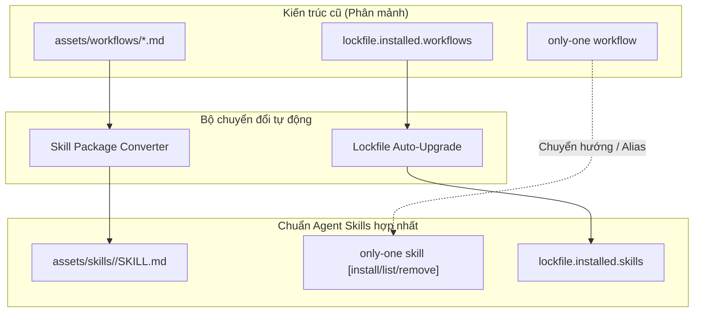

# Concept: Khai tử Workflows và Hợp nhất 100% vào Agent Skills

## 1. Bài toán & Mục tiêu (Problem & Goal)

### Bài toán (Current Bottlenecks & Deficiencies)
- **Bối cảnh & Tác nhân**: Người dùng cài đặt, cập nhật và kiểm tra các quy trình SDLC thông qua 2 lệnh CLI riêng biệt: `workflow` và `skill`.
- **Triệu chứng & Khiếm khuyết**: Tồn tại 2 luồng quản lý tài nguyên song song, nhân đôi bảng theo dõi trong lockfile, phân mảnh mã nguồn command và logic sync.
- **Nguyên nhân cốt lõi**: Thời kỳ đầu các công cụ AI coi workflow là các prompt phẳng, trong khi chuẩn mở hiện đại đã thống nhất toàn bộ quy trình vào các gói `SKILL.md` dạng module.
- **Tác động & Phạm vi ảnh hưởng**: Gây quá tải nhận thức cho lập trình viên, tăng chi phí bảo trì codebase, và lệch khỏi chuẩn chung của các registry agent skills.

### Mục tiêu (Target Technical Outcomes)
- **Mục tiêu cốt lõi**: Khai tử hoàn toàn danh mục tài nguyên `workflows`, chuyển đổi toàn bộ quy trình SDLC thành các gói Agent Skills tiêu chuẩn.
- **Tiêu chí nghiệm thu (Acceptance Criteria)**:
  - Chuyển đổi toàn bộ các workflow SDLC hiện tại thành các package `SKILL.md` hợp lệ trong danh mục skills.
  - Loại bỏ danh mục tài nguyên `workflows` khỏi registries, định nghĩa kiểu dữ liệu (types) và engine đồng bộ hóa (sync engine).
  - Tự động di chuyển (auto-migrate) các bản ghi cũ `installed.workflows` trong lockfile sang `installed.skills` khi đọc file.
  - Hợp nhất entry point của CLI để `only-one skill` quản trị cả các công cụ chuyên biệt lẫn quy trình SDLC đa bước.

## 2. Ranh giới Phạm vi (Scope Boundaries)
- **Trong phạm vi (In-Scope)**:
  - Đóng gói các template markdown workflow hiện tại thành các skill packages chuẩn (`<name>/SKILL.md`).
  - Dọn dẹp registry workflow cũ, các command handler và test fixtures liên quan.
  - Cơ chế tự động nâng cấp trạng thái lockfile từ bảng workflow cũ sang bảng skills một cách trong suốt.
  - Cập nhật manifest của combo và tài liệu hướng dẫn để tham chiếu các quy trình SDLC dưới dạng skills.
- **Ngoài phạm vi (Explicit Out-of-Scope)**:
  - Thay đổi các bước quy trình, phân vai (persona), hoặc các chốt chặn an toàn (guardrails) bên trong từng quy trình SDLC.
  - Đổi tên các trigger slash-command hoặc phím tắt cốt lõi.
  - Thay đổi giao thức xuất bản trên registry bên ngoài `skills.sh`.

## 3. Giải pháp Đề xuất & Cơ chế Cốt lõi (Proposed Solution & Core Mechanism)
- **Cơ chế cốt lõi**:
  - Các workflows chuyển thành Agent Skills hạng nhất sở hữu YAML frontmatter (`name`, `description`) và cơ chế nạp tăng dần (progressive disclosure).
  - CLI tinh giản phân loại tài nguyên về 2 trụ cột chính: **Skills** (năng lực và quy trình) và **Rules** (tiêu chuẩn và ràng buộc).
  - Bộ phân tích cú pháp lockfile tự động đón bắt các file trạng thái cũ và nâng cấp `installed.workflows` thành `installed.skills` mà không cần người dùng thao tác thủ công.
  - Lệnh CLI `workflow` chuyển tiếp mượt mà, thực hiện alias trực tiếp sang `skill` kèm thông báo deprecation rõ ràng.

- **Mô hình Miền & Luồng Khái niệm (Domain Flow Diagram)**:

## 4. Rủi ro Kỹ thuật & Ca biên (Critical Risks & Edge Cases)
- **Tương thích ngược của Lockfile**: Các repository hiện tại của người dùng có chứa `installed.workflows` trong `installed.json` phải được nâng cấp êm dịu, không bị mất lịch sử phiên bản.
- **Dọn dẹp Workspace cục bộ**: Các repository đang có thư mục `.agents/workflows/` cần được chuyển dịch sạch sẽ sang `.agents/skills/` trong quá trình update.
- **Giữ vững Slash-Command Triggers**: Runtime của các agent phải tiếp tục nhận diện các lệnh slash (như `/only-one-idea`, `/only-one-plan`) trỏ đến vị trí skill mới.
