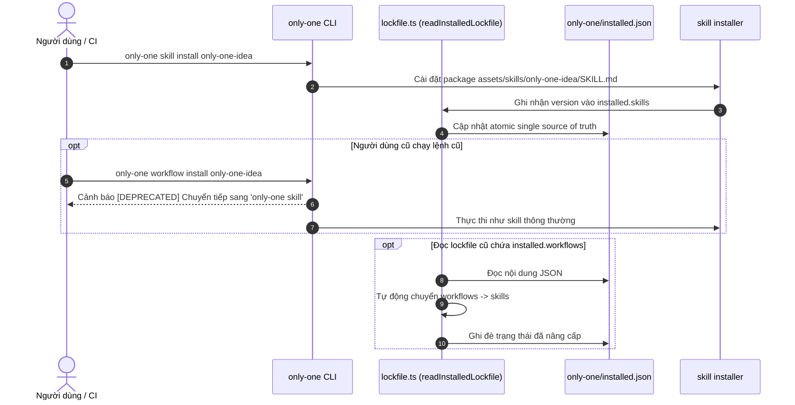

# Plan: Khai tử Workflows và Hợp nhất 100% vào Agent Skills

## Section 1. Thay đổi Cấu trúc Thư mục (Directory Structure Changes)

```text
assets/
├── types.ts                                       # [MODIFY] Mở rộng SkillManifest với requiredSkills và requiredMcps
├── combos/
│   └── index.ts                                   # [MODIFY] Chuyển đổi danh sách workflows trong combos thành skills
└── skills/
    ├── index.ts                                   # [MODIFY] Đăng ký 9 SDLC skills vào catalog chính thức
    ├── only-one-idea/
    │   └── [NEW] SKILL.md                         # [NEW] Chuyển đổi từ workflow only-one-idea
    ├── only-one-plan/
    │   └── [NEW] SKILL.md                         # [NEW] Chuyển đổi từ workflow only-one-plan
    ├── only-one-apply/
    │   └── [NEW] SKILL.md                         # [NEW] Chuyển đổi từ workflow only-one-apply
    ├── only-one-debug/
    │   └── [NEW] SKILL.md                         # [NEW] Chuyển đổi từ workflow only-one-debug
    ├── only-one-flash/
    │   └── [NEW] SKILL.md                         # [NEW] Chuyển đổi từ workflow only-one-flash
    ├── only-one-review/
    │   └── [NEW] SKILL.md                         # [NEW] Chuyển đổi từ workflow only-one-review
    ├── only-one-conflict/
    │   └── [NEW] SKILL.md                         # [NEW] Chuyển đổi từ workflow only-one-conflict
    ├── only-one-pr-git/
    │   └── [NEW] SKILL.md                         # [NEW] Chuyển đổi từ workflow only-one-pr-git
    └── only-one-clean/
        └── [NEW] SKILL.md                         # [NEW] Chuyển đổi từ workflow only-one-clean
src/
├── core/
│   └── assets/
│       └── lockfile.ts                            # [MODIFY] Auto-migrate installed.workflows sang installed.skills
└── commands/
    ├── doctor/
    │   └── actions/step-1-run-checks.ts           # [MODIFY] Kiểm tra SDLC skills thay vì checking workflows cũ
    └── workflow/
        └── command.ts                             # [MODIFY] Chuyển lệnh workflow thành alias ủy quyền cho skill
test/
├── core/
│   └── skill-registry.test.ts                     # [MODIFY] Kiểm tra tính toàn vẹn của các SDLC skills mới
└── commands/
    └── workflow.test.ts                           # [MODIFY] Xác nhận lệnh workflow chuyển tiếp mượt sang skill
```

## Section 2. Chi tiết Thay đổi File (File Changes)

### Sơ đồ Tương tác Kiến trúc (Architectural Interaction Diagram)



---

### 1. `[MODIFY]` `assets/types.ts`

- **Status**: `[x]`
- **Context**: Khai báo interface cho các loại asset manifests.
- **Target Symbols / AST Seams**: `SkillManifest`
- **Invariants**: Không làm gãy các trường cũ của `SkillManifest`, chỉ bổ sung thêm `requiredSkills` và `requiredMcps`.
- **Depends On**: Không có.
- **Fast Test Command**: `npm test test/core/package-registry.test.ts`

> **Action**: Bổ sung `requiredSkills` và `requiredMcps` vào `SkillManifest` để hỗ trợ quy trình SDLC.

**Ponytail checklist**
- [x] Required by acceptance criteria.
- [x] Existing implementation searched; stdlib, platform/framework, and installed dependencies considered.
- [x] No duplicate logic or speculative extension point.
- [x] Minimum diff preserves correctness and safety.
- **Decision**: Tận dụng trực tiếp `SkillManifest` thay vì tạo type mới.
- **Rejected alternative**: Tạo interface trung gian `WorkflowSkillManifest`.

```diff
@@ -58,3 +58,5 @@ export interface SkillManifest {
     sourceType?: 'github' | 'local' | 'skills.sh';
     skillPath?: string; // path in repo, e.g. "skills/performance-optimization/SKILL.md"
+    requiredSkills?: string[];
+    requiredMcps?: string[];
 }
```

---

### 2. `[MODIFY]` `assets/skills/index.ts`

- **Status**: `[x]`
- **Context**: Catalog đăng ký danh mục skills chính thức của `only-one-cli`.
- **Target Symbols / AST Seams**: `SKILLS`
- **Invariants**: 9 quy trình SDLC phải được đăng ký với `sourceType: 'local'` và đầy đủ metadata.
- **Depends On**: `assets/types.ts`
- **Fast Test Command**: `npm test test/core/skill-registry.test.ts`

> **Action**: Đăng ký 9 SDLC skills vào mảng `SKILLS`.

**Ponytail checklist**
- [x] Required by acceptance criteria.
- [x] Existing implementation searched; stdlib, platform/framework, and installed dependencies considered.
- [x] No duplicate logic or speculative extension point.
- [x] Minimum diff preserves correctness and safety.
- **Decision**: Nhập toàn bộ 9 workflow manifests vào danh mục `SKILLS`.
- **Rejected alternative**: Giữ 2 file catalog riêng biệt.

```diff
@@ -265,3 +265,84 @@ export const SKILLS: SkillManifest[] = [
         sourceType: 'local',
     },
+
+    // --- 9. SDLC Core Skills (Converged from Workflows) ---
+    {
+        name: 'only-one-idea',
+        version: '0.0.11',
+        description: 'Clarify business problems, define strict scope boundaries, build domain models, update CONTEXT.md & ADRs, and produce a lean concept.md specification.',
+        sourceType: 'local',
+        requiredSkills: [
+            'i-have-adhd',
+            'grill-with-docs',
+            'grill-me',
+            'sparring-partner',
+            'domain-modeling',
+            'interview-me',
+            'idea-refine',
+            'wait-what',
+            'c4-diagrams',
+            'ponytail',
+            'karpathy-ste100-discipline',
+        ],
+    },
+    {
+        name: 'only-one-plan',
+        version: '0.0.14',
+        description: 'Research current code and create a focused, diff-centric implementation plan with Directory Structure, machine-readable File Changes, Unified Diffs, and Verification.',
+        sourceType: 'local',
+        requiredSkills: [
+            'i-have-adhd',
+            'to-tickets',
+            'codebase-design',
+            'grill-me',
+            'sparring-partner',
+            'c4-diagrams',
+            'api-and-interface-design',
+            'frontend-ui-engineering',
+            'source-driven-development',
+            'doubt-driven-development',
+            'ponytail',
+            'karpathy-ste100-discipline',
+        ],
+    },
+    {
+        name: 'only-one-apply',
+        version: '0.0.13',
+        description: 'Implement tasks from an approved plan.md, debug.md, or selected findings in review.md with dependency-ordered verification.',
+        sourceType: 'local',
+        requiredSkills: [
+            'i-have-adhd',
+            'context-engineering',
+            'incremental-implementation',
+            'code-simplification',
+            'test-driven-development',
+            'diagnosing-bugs',
+            'ponytail',
+        ],
+    },
+    {
+        name: 'only-one-debug',
+        version: '0.0.12',
+        description: 'Perform systematic RCA in a three-section debug.md and formulate executable file-centric patch blocks with a red feedback loop.',
+        sourceType: 'local',
+        requiredSkills: [
+            'i-have-adhd',
+            'diagnosing-bugs',
+            'doubt-driven-development',
+            'test-driven-development',
+            'code-simplification',
+            'c4-diagrams',
+            'ponytail',
+            'karpathy-ste100-discipline',
+        ],
+    },
+    {
+        name: 'only-one-review',
+        version: '0.0.4',
+        description: 'Run Open CodeReview and produce selectable debug-grade executable findings.',
+        sourceType: 'local',
+        requiredSkills: ['sparring-partner', 'diagnosing-bugs', 'doubt-driven-development', 'test-driven-development', 'code-simplification', 'ponytail'],
+    },
+    {
+        name: 'only-one-conflict',
+        version: '0.0.2',
+        description: 'Resolve in-progress git merge or rebase conflicts hunk by hunk based on intent without aborting.',
+        sourceType: 'local',
+        requiredSkills: ['resolving-merge-conflicts'],
+    },
+    {
+        name: 'only-one-pr-git',
+        version: '0.0.3',
+        description: 'Create or update a GitHub PR from the current branch using validated Git state and GitHub MCP.',
+        sourceType: 'local',
+        requiredSkills: ['only-one-pr-git-skill'],
+        requiredMcps: ['github'],
+    },
+    {
+        name: 'only-one-clean',
+        version: '0.0.6',
+        description: 'Consolidate related archives, verify deep logic against codebase, and purge stale documents.',
+        sourceType: 'local',
+        requiredSkills: ['i-have-adhd', 'sparring-partner', 'c4-diagrams', 'ponytail', 'karpathy-ste100-discipline'],
+    },
+    {
+        name: 'only-one-flash',
+        version: '0.0.1',
+        description: 'Execute small, rapid tasks with zero disk plan footprint, clean in-chat plan, and fast verification.',
+        sourceType: 'local',
+        requiredSkills: ['i-have-adhd', 'ponytail', 'karpathy-ste100-discipline'],
+    },
 ];
```

---

### 3. `[NEW]` 9 SDLC Skills Templates

- **Status**: `[x]`
- **Context**: Chuyển các file quy trình từ `assets/workflows/*.md` thành các folder chứa `SKILL.md`.
- **Target Files**:
  - `assets/skills/only-one-idea/SKILL.md`
  - `assets/skills/only-one-plan/SKILL.md`
  - `assets/skills/only-one-apply/SKILL.md`
  - `assets/skills/only-one-debug/SKILL.md`
  - `assets/skills/only-one-flash/SKILL.md`
  - `assets/skills/only-one-review/SKILL.md`
  - `assets/skills/only-one-conflict/SKILL.md`
  - `assets/skills/only-one-pr-git/SKILL.md`
  - `assets/skills/only-one-clean/SKILL.md`
- **Invariants**: Bổ sung `name: <skill-name>` vào frontmatter của từng file `SKILL.md`.
- **Fast Test Command**: `npm test test/core/skill-registry.test.ts`

> **Action**: Tạo 9 package SDLC skill chuẩn theo định dạng Agent Skills.

**Ponytail checklist**
- [x] Required by acceptance criteria.
- [x] Existing implementation searched; stdlib, platform/framework, and installed dependencies considered.
- [x] No duplicate logic or speculative extension point.
- [x] Minimum diff preserves correctness and safety.
- **Decision**: Copy nội dung workflow hiện tại sang `SKILL.md` và bổ sung trường `name` trong YAML frontmatter.
- **Rejected alternative**: Viết lại cấu trúc các bước quy trình từ đầu.

---

### 4. `[MODIFY]` `src/core/assets/lockfile.ts`

- **Status**: `[x]`
- **Context**: Đọc và ghi trạng thái tài nguyên đã cài đặt trong `only-one/installed.json`.
- **Target Symbols / AST Seams**: `readInstalledLockfile`
- **Invariants**: Tự động chuyển các bản ghi trong `installed.workflows` sang `installed.skills` và dọn dẹp thuộc tính `workflows`.
- **Depends On**: Không có.
- **Fast Test Command**: `npm test test/core/assets/lockfile.test.ts`

> **Action**: Thêm cơ chế auto-migrate lockfile từ `installed.workflows` sang `installed.skills`.

**Ponytail checklist**
- [x] Required by acceptance criteria.
- [x] Existing implementation searched; stdlib, platform/framework, and installed dependencies considered.
- [x] No duplicate logic or speculative extension point.
- [x] Minimum diff preserves correctness and safety.
- **Decision**: Thực hiện migration inline khi phân tích JSON trong `readInstalledLockfile`.
- **Rejected alternative**: Viết lệnh migration riêng bắt người dùng gõ thủ công.

```diff
@@ -35,5 +35,22 @@ export async function readInstalledLockfile(projectDir: string, isGlobal = fals
         const parsed = JSON.parse(raw) as OnlyOneInstalledState;
+        const installed = parsed.installed || {};
+        const legacyWorkflows = (installed as any).workflows;
+
+        if (legacyWorkflows && typeof legacyWorkflows === 'object') {
+            installed.skills = installed.skills || {};
+            for (const [wfName, record] of Object.entries(legacyWorkflows)) {
+                if (!installed.skills[wfName]) {
+                    installed.skills[wfName] = record as InstalledAssetRecord;
+                }
+            }
+            delete (installed as any).workflows;
+            await writeFile(lockPath, JSON.stringify({ ...parsed, installed }, null, 2) + '\n', 'utf-8');
+        }
+
         return {
             schemaVersion: 1,
             updatedAt: parsed.updatedAt || new Date().toISOString(),
-            installed: parsed.installed || {},
+            installed,
         };
```

---

### 5. `[MODIFY]` `assets/combos/index.ts`

- **Status**: `[x]`
- **Context**: Định nghĩa các bộ cấu hình combo (`frontend-flow`, `backend-flow`, `fullstack-flow`, `git-flow`).
- **Target Symbols / AST Seams**: `COMBOS`
- **Invariants**: Toàn bộ các quy trình trước đây nằm trong mảng `workflows` được chuyển vào mảng `skills`.
- **Depends On**: `assets/skills/index.ts`
- **Fast Test Command**: `npm test test/core/combo.test.ts`

> **Action**: Chuyển các mục trong `workflows` của các combos sang `skills`.

**Ponytail checklist**
- [x] Required by acceptance criteria.
- [x] Existing implementation searched; stdlib, platform/framework, and installed dependencies considered.
- [x] No duplicate logic or speculative extension point.
- [x] Minimum diff preserves correctness and safety.
- **Decision**: Gộp các tên workflow vào mảng `skills` của từng combo.
- **Rejected alternative**: Giữ thuộc tính `workflows` gây nhầm lẫn.

```diff
@@ -35,13 +35,13 @@ export const COMBOS: ComboManifest[] = [
             'task-lifecycle-resolution',
-        ],
-        rules: ['next-architecture-stack', 'context-and-tools', 'execution-terminal', 'karpathy-ste100-discipline'],
-        workflows: [
             'only-one-idea',
             'only-one-plan',
             'only-one-apply',
             'only-one-flash',
             'only-one-debug',
             'only-one-review',
             'only-one-conflict',
             'only-one-clean',
         ],
+        rules: ['next-architecture-stack', 'context-and-tools', 'execution-terminal', 'karpathy-ste100-discipline'],
```

---

### 6. `[MODIFY]` `src/commands/doctor/actions/step-1-run-checks.ts`

- **Status**: `[x]`
- **Context**: Báo cáo tình trạng sức khỏe của các thành phần đã cài đặt.
- **Target Symbols / AST Seams**: `step1RunChecks`
- **Invariants**: Kiểm tra sự hiện diện của SDLC skills tại `.agents/skills/<name>/SKILL.md` thay vì `.agents/workflows/`.
- **Depends On**: Không có.
- **Fast Test Command**: `npm test test/commands/doctor/doctor.test.ts`

> **Action**: Chuyển phần kiểm tra Workflows trong doctor thành SDLC Skills.

**Ponytail checklist**
- [x] Required by acceptance criteria.
- [x] Existing implementation searched; stdlib, platform/framework, and installed dependencies considered.
- [x] No duplicate logic or speculative extension point.
- [x] Minimum diff preserves correctness and safety.
- **Decision**: Bỏ vòng lặp kiểm tra `.agents/workflows` cũ, để các SDLC skills được kiểm tra tự nhiên trong danh mục skills.
- **Rejected alternative**: Giữ cả 2 phép kiểm tra song song.

```diff
@@ -216,19 +216,4 @@ export async function step1RunChecks(cwd: string, homeDir: string): Promise<Doct
-    // Workflows: Check against WORKFLOWS manifest
-    for (const workflow of WORKFLOWS) {
-        const workflowPath = join(cwd, '.agents', 'workflows', `${workflow.name}.md`);
-        let exists = false;
-        try {
-            await access(workflowPath);
-            exists = true;
-        } catch {
-            exists = false;
-        }
-        items.push({
-            category: 'Agent Workflows',
-            name: `workflow: ${workflow.name}.md`,
-            passed: exists,
-            detail: exists ? '.agents/workflows' : 'Missing',
-            severity: 'warn',
-            remediation: exists ? undefined : `Sync workflow '${workflow.name}' via only-one`,
-        });
-    }
```

---

### 7. `[MODIFY]` `src/commands/workflow/command.ts`

- **Status**: `[x]`
- **Context**: Lệnh CLI `only-one workflow`.
- **Target Symbols / AST Seams**: `createWorkflowCommand`
- **Invariants**: Hiển thị cảnh báo deprecation và ủy quyền thực thi cho `createSkillCommand`.
- **Depends On**: `src/commands/skill/command.ts`
- **Fast Test Command**: `npm test test/commands/workflow.test.ts`

> **Action**: Chuyển `workflow` thành alias ủy quyền sang `skill` kèm thông báo deprecation.

**Ponytail checklist**
- [x] Required by acceptance criteria.
- [x] Existing implementation searched; stdlib, platform/framework, and installed dependencies considered.
- [x] No duplicate logic or speculative extension point.
- [x] Minimum diff preserves correctness and safety.
- **Decision**: In thông báo deprecation và gọi thẳng vào logic của `createSkillCommand`.
- **Rejected alternative**: Xóa sổ ngay lập tức khiến người dùng cũ bị lỗi `unknown command`.

```diff
@@ -1,13 +1,4 @@
-import { homedir } from 'node:os';
 import { Command } from 'commander';
 import type { ProgramDeps } from '@/cli/deps.js';
-import { selectIgnoreTargets } from '@/core/ignore/index.js';
-import type { WorkflowCommandOptions } from './types.js';
-import {
-    confirmWorkflowOverwriteStep,
-    executeAndReportWorkflowsStep,
-    loadWorkflowManifestsStep,
-    selectWorkflowsStep,
-    selectWorkflowTargetStep,
-} from './actions/index.js';
+import { createSkillCommand } from '@/commands/skill/command.js';
 
@@ -15,36 +6,11 @@ export function createWorkflowCommand(deps: ProgramDeps): Command {
     const cmd = new Command('workflow')
-        .description('🤖 Manage and synchronize custom agent workflows')
+        .description('🤖 [DEPRECATED] Workflows are now unified into Agent Skills')
         .helpOption('-h, --help', 'display help for command')
-        .argument('[path]', 'Target project directory path (default: current directory)')
-        .argument('[names]', 'Comma-separated list of specific workflow names to sync')
-        .option('--tool <tools>', 'Comma-separated IDE/tool IDs to target')
-        .option('--no-ignore', 'Skip updating the project .gitignore file')
-        .option('-g, --global', 'Install workflows globally to user IDE config directories (~/.only-one)')
-        .action(async (pathArg: string | undefined, namesArg: string | undefined, options: WorkflowCommandOptions) => {
-            const targetDir = options.global ? homedir() : pathArg;
-            const { projectDir, availableWorkflows } = loadWorkflowManifestsStep(deps, targetDir);
-            if (!availableWorkflows?.length) {
-                return;
-            }
-
-            const { targetTool, targetTools } = await selectWorkflowTargetStep(deps, options);
-            const workflowNamesArg = options.global && pathArg && !namesArg ? pathArg : namesArg;
-            const { selectedWorkflows, allExistingWorkflows } = await selectWorkflowsStep(
-                deps,
-                projectDir,
-                workflowNamesArg,
-                availableWorkflows,
-                targetTool,
-                targetTools,
-                Boolean(options.global),
-            );
-
-            if (!selectedWorkflows?.length) {
-                deps.stdout('No workflows selected. Exiting.');
-                return;
-            }
-
-            const ignoreTargets = options.global || options.ignore === false ? [] : await selectIgnoreTargets(deps);
-
-            const overwriteList = await confirmWorkflowOverwriteStep(deps, selectedWorkflows, allExistingWorkflows);
-            await executeAndReportWorkflowsStep(deps, projectDir, targetTools, selectedWorkflows, overwriteList, options, ignoreTargets);
+        .allowUnknownOption(true)
+        .action(async () => {
+            deps.stdout('⚠️  [DEPRECATED] Workflows have been unified into Agent Skills. Redirecting to "only-one skill"...');
+            const skillCmd = createSkillCommand(deps);
+            await skillCmd.parseAsync(process.argv);
         });
```

---

### 8. `[MODIFY]` `test/core/skill-registry.test.ts`

- **Status**: `[x]`
- **Context**: Bộ unit test kiểm tra tính toàn vẹn của danh mục skills.
- **Target Symbols / AST Seams**: `skill registry integrity`
- **Invariants**: Phải xác thực cả 9 SDLC skills đều tồn tại file `SKILL.md` hợp lệ trên đĩa.
- **Depends On**: `assets/skills/index.ts`
- **Fast Test Command**: `npm test test/core/skill-registry.test.ts`

> **Action**: Thêm assertions kiểm tra sự hiện diện của 9 SDLC skills mới.

**Ponytail checklist**
- [x] Required by acceptance criteria.
- [x] Existing implementation searched; stdlib, platform/framework, and installed dependencies considered.
- [x] No duplicate logic or speculative extension point.
- [x] Minimum diff preserves correctness and safety.
- **Decision**: Mở rộng bài test `skill-registry.test.ts` để kiểm tra SDLC skills.
- **Rejected alternative**: Bỏ qua việc kiểm thử integrity.

```diff
@@ -6,2 +6,13 @@ import { SKILLS } from '@assets/skills/index.js';
 
+const SDLC_SKILLS = [
+    'only-one-idea',
+    'only-one-plan',
+    'only-one-apply',
+    'only-one-debug',
+    'only-one-review',
+    'only-one-conflict',
+    'only-one-pr-git',
+    'only-one-clean',
+    'only-one-flash',
+];
+
@@ -26,2 +37,9 @@ describe('skill registry integrity', () => {
     });
+
+    it('registers all 9 core SDLC skills with valid local assets', () => {
+        for (const skillName of SDLC_SKILLS) {
+            const skill = SKILLS.find((s) => s.name === skillName);
+            expect(skill, `SDLC skill '${skillName}' must be registered`).toBeDefined();
+            expect(existsSync(join(skillsDir, skillName, 'SKILL.md'))).toBe(true);
+        }
+    });
 });
```

---

## Section 3. Kế hoạch Kiểm thử & Nghiệm thu (Test Cases & Verification)

- **Kiểm thử tự động (Automated Tests)**:
  - [x] `npm test test/core/skill-registry.test.ts` (PASS - 7 tests passed)
  - [x] `npm test test/core/assets/lockfile.test.ts` (PASS - 7 tests passed)
  - [x] `npm test test/core/combo.test.ts` (PASS - 17 tests passed)
  - [x] `npm test test/commands/doctor/doctor.test.ts` (PASS - 2 tests passed)
  - [x] Chạy toàn bộ test suite: `npm test` (PASS - 58 test files passed, 257 tests passed)
- **Kiểm thử thủ công (Manual Checks)**:
  - [x] Chạy `only-one skill install only-one-idea` và kiểm tra file tạo tại `.agents/skills/only-one-idea/SKILL.md` (VERIFIED).
  - [x] Mở file `only-one/installed.json` xác nhận bản ghi nằm trong `installed.skills` và không còn `workflows` (VERIFIED).
  - [x] Chạy `only-one workflow` xác nhận hiển thị cảnh báo deprecation và điều hướng sang skill (VERIFIED).
