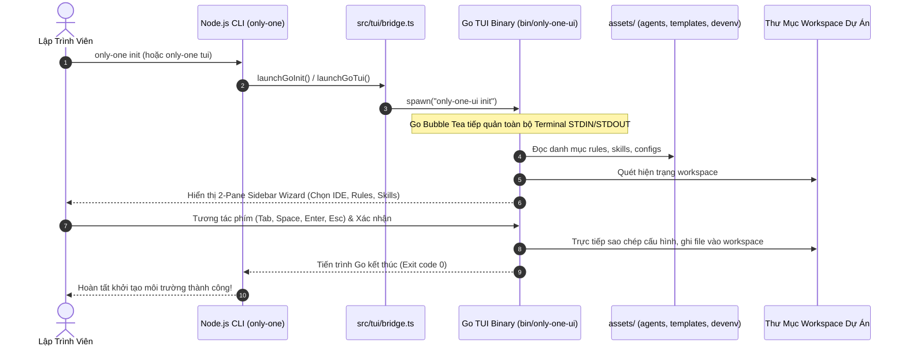

# Concept: Chuyển Đổi Toàn Diện TUI Sang Go Engine Và Tái Cấu Trúc src/tui

## 1. Problem & Goal

### Problem (Điểm nghẽn & Thiếu sót hiện tại)
- **Context & Trigger**: CLI `only-one` sở hữu hai tính năng tương tác giao diện terminal: bảng điều khiển tác vụ (`only-one tui`) và thuật sĩ cài đặt cấu hình dự án (`only-one init`). Hiện tại dự án đang duy trì song song hai engine TUI ở hai vị trí khác nhau: engine React Ink tại `src/tui` và engine Go Bubble Tea tại `packages/tui-engine`.
- **Symptom & Defect**:
  - Mã nguồn giao diện bị phân mảnh thành hai thư mục riêng biệt, gây khó khăn cho việc đồng bộ và bảo trì.
  - Dự án phụ thuộc nặng vào `react` và `ink` trong `package.json`, khiến thời gian cài đặt `node_modules` kéo dài và tiêu tốn nhiều tài nguyên khi render.
  - Module Go tại `packages/tui-engine` đã hoàn thiện bảng Kanban (`board`), nhưng nhánh thuật sĩ (`init`) mới chỉ in dữ liệu placeholder rỗng.
  - Khối mã nguồn cũ `src/tui/init` (React Ink) vẫn đang gánh toàn bộ quy trình tương tác của lệnh `only-one init`.
- **Root Cause**: Quá trình chuyển dịch công nghệ từ React Ink sang Go Bubble Tea chưa hoàn tất; chưa có bước hợp nhất mã nguồn Go vào cấu trúc nguồn chính và chưa đưa tính năng wizard sang Go.
- **Impact / Blast Radius**: Tồn tại nợ kỹ thuật kép, bundle nặng nề, trải nghiệm khởi động TUI chậm hơn so với native binary và tăng rủi ro lệch đồng bộ tính năng giữa hai engine.

### Goal (Kết quả kỹ thuật mục tiêu)
- **Core Goal**: Hợp nhất toàn bộ TUI sang Go Bubble Tea Engine, chuyển mã nguồn Go từ `packages/tui-engine` vào `src/tui`, xây dựng hoàn chỉnh thuật sĩ Init Wizard trong Go, và dọn dẹp sạch mã nguồn React Ink cùng các dependencies liên quan.
- **Acceptance Criteria**:
  - Mã nguồn Go của TUI Engine được đặt tập trung tại `src/tui`, thư mục trung gian `packages/tui-engine` bị loại bỏ hoàn toàn.
  - Go TUI Engine hỗ trợ đầy đủ 2 chế độ hoạt động:
    1. Chế độ Board Dashboard (`only-one-ui board`).
    2. Chế độ Init Wizard (`only-one-ui init`): tự quét workspace, hiển thị lựa chọn tài nguyên theo bố cục 2 cột trực quan dạng Sidebar (Category Sidebar bên trái + Danh sách tài nguyên bên phải), hỗ trợ điều hướng Tab và trực tiếp ghi tệp cấu hình/rule/skill vào workspace.
  - Lệnh CLI Node.js `only-one tui` và `only-one init` kích hoạt trực tiếp Go binary thông qua bridge tối giản.
  - Toàn bộ tệp React Ink cũ (`App.tsx`, `InitWizardApp.tsx`, `components/`, etc.) và các gói phụ thuộc `ink`, `react`, `@types/react` được dọn dẹp sạch khỏi dự án.
  - Bộ lệnh build (`build:go`, `build`) và test suite chạy trơn tru, không phát sinh lỗi biên dịch.

## 2. Scope Boundaries

- **In-Scope**:
  - Di chuyển toàn bộ mã nguồn Go từ `packages/tui-engine` vào `src/tui`.
  - Hiện thực hóa module Init Wizard trong Go bằng Bubble Tea (quét tài nguyên dự án, giao diện chọn bước, ghi trực tiếp tệp từ `assets/` vào workspace).
  - Cập nhật script `scripts/build-go.js` và bridge TypeScript trong `src/tui` để định vị và khởi chạy binary Go.
  - Cập nhật lệnh `src/commands/tui/command.ts` và `src/commands/init/command.ts` kết nối thẳng tới Go binary.
  - Xóa bỏ các component React Ink, các service thừa trong `src/tui` và các unit tests liên quan đến Ink renderer.
  - Gỡ bỏ `ink`, `react`, `@types/react` khỏi `package.json`.
- **Explicit Out-of-Scope**:
  - Không sửa đổi quy chuẩn nội dung các tệp mẫu trong thư mục `assets/` vừa tái cấu trúc.
  - Không thay đổi các lệnh core độc lập dạng non-interactive (`only-one skill`, `only-one rule`, `only-one combo`, `only-one git`).
  - Không thay đổi định dạng lockfile `only-one-lock.json`.

## 3. Proposed Solution & Core Mechanism

### Core Mechanism
- **Cấu trúc Tổ chức**: Chuyển đổi `src/tui` thành module Go chính thức (chứa `go.mod`, `main.go`, `internal/`), kèm theo một tệp `bridge.ts` duy nhất bằng TypeScript để Node.js CLI phát hiện đường dẫn binary trong `bin/only-one-ui[.exe]` và kích hoạt tiến trình con (`spawn`).
- **Khối Xử lý Init Wizard Trong Go**:
  - *Bộ quét tài nguyên (Scanner)*: Đọc trực tiếp cấu hình hiện tại của workspace và danh mục asset trong `assets/` (rules, skills, configs, packages).
  - *Giao diện Tương tác Dạng Sidebar (2-Pane Interactive Layout)*: Sử dụng `lipgloss` và `bubbles` chia 2 cột song song:
    - **Cột Trái (Sidebar)**: Danh mục tài nguyên kèm số lượng đã chọn (như `Skills (3/10)`, `Rules (2/4)`, `Configs (1/3)`).
    - **Cột Phải (Resource List)**: Danh sách chi tiết các item thuộc danh mục đang active với trạng thái checkbox `[x]`, tên và mô tả.
    - **Thanh Header/Footer**: Phía trên cho phép chọn IDE targets (`Antigravity`, `Cursor`, v.v.) và toggle `Overwrite`; phía dưới hiển thị phím tắt trợ giúp.
  - *Bộ thực thi (Writer/Installer)*: Trực tiếp sao chép và cập nhật các tệp đích (`.agents/`, `.gitignore`, cấu hình IDE) khi người dùng hoàn thành wizard.

### Architectural Trade-offs Matrix

| Tiêu chí | Phương án 1: Go TUI Thuần Túy (Được chọn) | Phương án 2: Go TUI + Node.js IPC Wrapper | Phương án 3: Giữ Nguyên React Ink |
| :--- | :--- | :--- | :--- |
| **Trải nghiệm & Tốc độ** | Khởi động tức thì (<20ms), mượt mà, native | Khởi động nhanh, nhưng độ trễ khi chuyển giao IPC | Khởi động chậm (>300ms), tiêu tốn RAM Node.js |
| **Phụ thuộc Package** | Loại bỏ 100% `react` và `ink` khỏi CLI | Vẫn cần giữ bridge parsing JSON phức tạp | Duy trì toàn bộ React 19 và Ink 7 |
| **Tính Toàn vẹn & Tách biệt** | Go tự quét và ghi tệp, hoàn toàn độc lập | Dễ gãy vỡ nếu schema JSON giao tiếp thay đổi | Codebase TypeScript đồng nhất nhưng phình to |
| **Độ phức tạp Di chuyển** | Trung bình: Cần viết logic ghi tệp trong Go | Cao: Phải duy trì giao thức IPC hai chiều | Thấp: Không cần thay đổi gì |

### Conceptual Flow & Domain Model



### ASCII UI Wireframe: Go Init Wizard (Sidebar Layout)

```text
┌────────────────────────────────────────────────────────────────────────────────────────┐
│  ONLY-ONE SETUP WIZARD (Powered by Bubble Tea)                                          │
│  IDEs: [•] Antigravity  [ ] VS Code  [ ] Cursor  [ ] Windsurf  │ Overwrite: [ ] No     │
├──────────────────────────────┬─────────────────────────────────────────────────────────┤
│  CATEGORIES                  │  RESOURCES: Custom Skills (3/10 selected)               │
├──────────────────────────────┼─────────────────────────────────────────────────────────┤
│  ▶ 1. Skills     (3/10)     │  [x] only-one-idea                                      │
│    2. Rules      (2/5)      │      Khám phá ý tưởng, phỏng vấn BA và tạo concept.md   │
│    3. Configs    (1/3)      │  [x] only-one-plan                                      │
│    4. Packages   (0/4)      │      Lập kế hoạch thực thi chi tiết kèm diffs và seams  │
│    5. Combos     (0/2)      │  [x] only-one-apply                                     │
│    6. MCPs       (1/3)      │      Thực thi plan/debug an toàn với Git Worktree engine │
│    7. DevEnv/Shell (1/2)    │  [ ] only-one-debug                                     │
│    8. Ignore     (1/1)      │      Điều tra lỗi, phân tích RCA và tạo bản vá          │
│                              │  [ ] only-one-review                                    │
│                              │      Rà soát mã nguồn tự động theo tiêu chuẩn dự án    │
├──────────────────────────────┴─────────────────────────────────────────────────────────┤
│  [Tab] Switch Sidebar/List  •  [↑/↓] Navigate  •  [Space] Toggle  •  [Enter] Confirm   │
└────────────────────────────────────────────────────────────────────────────────────────┘
```

## 4. Critical Risks & Edge Cases

- **Môi trường thiếu Go compiler khi chạy từ source**:
  - *Rủi ro*: Người dùng clone repo và chạy lệnh không có sẵn binary đã biên dịch trong `bin/`.
  - *Giải pháp*: Script `bridge.ts` kiểm tra sự tồn tại của `bin/only-one-ui[.exe]`. Nếu thiếu, thông báo hướng dẫn rõ ràng: `Vui lòng chạy 'npm run build:go' trước khi sử dụng TUI`.
- **Tương thích ký tự phân cách đường dẫn trên Windows**:
  - *Rủi ro*: Khi Go quét thư mục và ghi tệp trên Windows, lỗi phân cách dấu gạch chéo (`\` vs `/`) có thể làm sai lệch cấu trúc `.agents/`.
  - *Giải pháp*: Sử dụng thư viện chuẩn `path/filepath` trong Go cho toàn bộ thao tác hệ thống tệp và chuẩn hóa đường dẫn.
- **Bắt phím và tín hiệu thoát (Terminal Raw Mode & SIGINT)**:
  - *Rủi ro*: Người dùng nhấn Ctrl+C trong khi wizard đang chạy có thể để lại terminal ở trạng thái raw mode không hiển thị con trỏ.
  - *Giải pháp*: Bubble Tea tích hợp sẵn trình quản lý alt-screen và signal handler, tự động hoàn trả trạng thái terminal khi thoát đột ngột.
